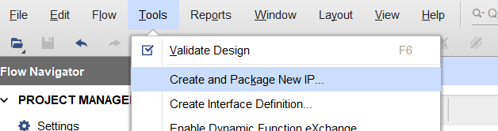
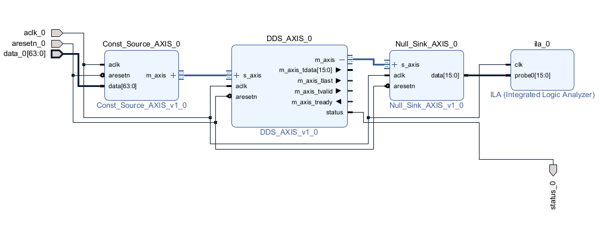
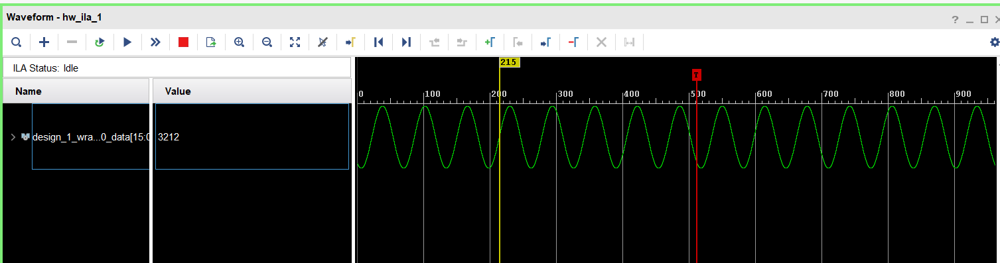
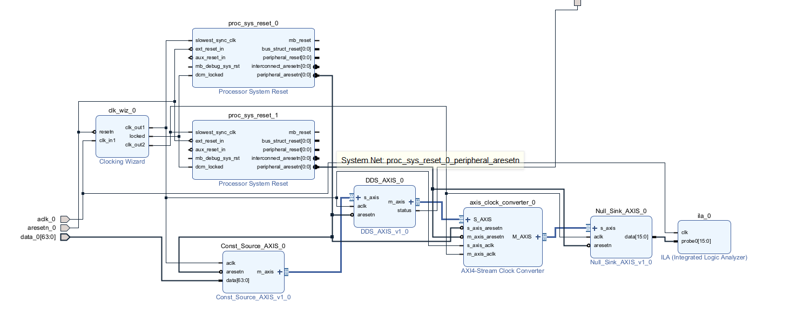
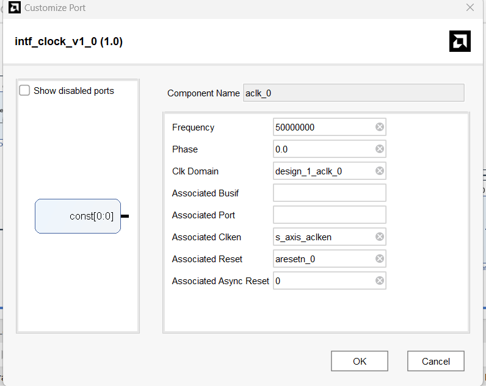
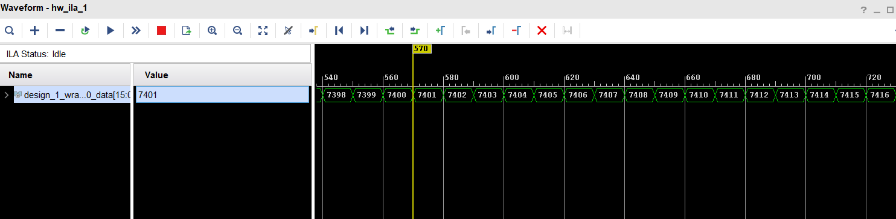
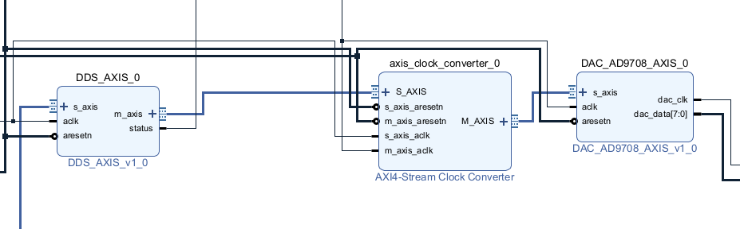
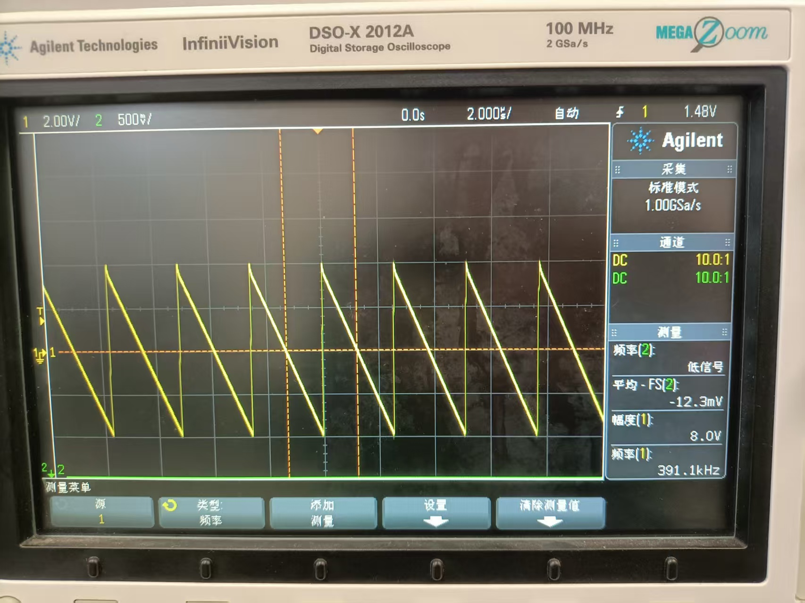
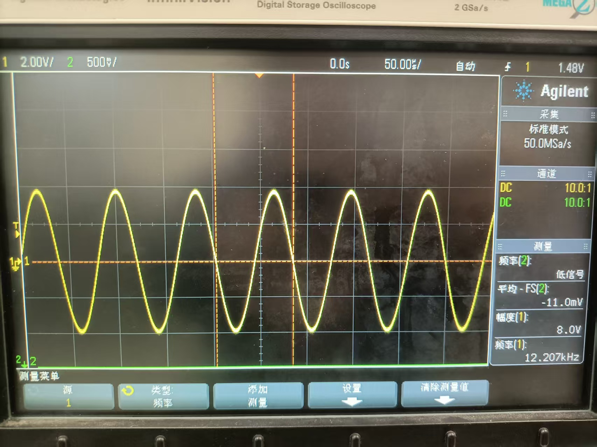
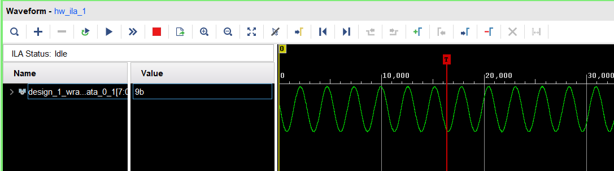

这段时间是在熟悉AXI-Stream，手搓一些IP核，然后把这些数据流连接起来
# 实验1：同时钟域数据流传输

## AXI-Stream
三大AXI协议里最简单的一个，只能一对一，单向

主要的信号：
* 主机：```tvalid```
* 从机：```tready```
* 主机：```tdata```
* 主机：```tlast```

其中前两个是握手信号，握手标准是：
* 主机准备好数据，发送```tvalid```；从机准备好接收数据，发送```tready```；
* 主机看到同时```tvalid & tready```，开始发送数据
* 从机看到同时```tvalid & tready```，开始接收数据

所谓背压（backpressure），就是后面不ready，前面不许发送信号，能够根据后级的带宽调控信号速率，从而不丢失数据。对于一直连续产生数据，不care是否丢失，比如ADC，就不需要考虑背压。就直接消费者速率快于生产者就行。如果消费者速率是波动的，但是还是平均快于生产者的，那么适当深度的fifo缓冲一下能解决这个问题。

```tdata```不言而喻是数据
```tlast```用于标记数据包的末尾。对于连续数据流，没有末尾，我的处理是直接master置0。但是如果下游有AXI DMA，也就是AXI Stream转AXI，就可能会出现阻塞问题，主要是DMA内部缓存容易满导致的一些死锁问题

剩下还有一些optional的信号不用管

## DDS
### 1. 搓内核
首先搓一个DDS核，但是搓的时候慢慢代码越来越复杂，原因是为了满足AXI-Stream的背压要求，也就是后面tready拉低的时候要立刻停止传输，但是数据输出相对ready信号有两级延迟，不能立即停止。所以开始一波打补丁，使得数据不会丢失。

下面来诠释为什么有两级延迟：
1. 当ready时，相位累加器自增
2. 根据相位累加器去查表，而BRAM查表有一个延时

打补丁的思路，就是在检测到ready拉低的时候，强制不允许相位累加器自增，同时因为ready拉低的时候后级已经不读新数据了，而产生了一个新的数据。所以在ready重新拉高的时候，同时拉高valid，让后级把这个没读完的数据读掉。

``` sv
module DDS_core #(
    parameter int PHASE_BITS = 32,              // 相位累加器位宽
    parameter int TABLE_ADDR_BITS = 13,          // LUT地址位宽 (LUT深度 = 2^TABLE_ADDR_BITS)
    parameter int AMP_BITS = 16,                 // 输出幅度位宽 (有符号固定点)
    parameter string LUT_PATH = "default_lut.mem"
) (
    input logic clk,
    input logic rst_n,
    input logic en,                             // 是否启动相位累加器自增
    input logic [PHASE_BITS-1:0] freq,          // 频率控制字
    input logic [PHASE_BITS-1:0] phase,         // 初始相位

    output logic [AMP_BITS-1:0] signal_out,          // 输出信号
    output logic [PHASE_BITS-1:0] phase_out,         // 输出相位
    output logic data_valid                         //比en慢两拍，因为BRAM慢一拍
);

// 计算查找表深度
localparam LUT_DEPTH = 1 << TABLE_ADDR_BITS;
// BRAM查找表 - 正确声明深度
(* rom_style = "block" *) logic signed [AMP_BITS-1:0] lookup_table [0:LUT_DEPTH-1];

// 查找表初始化 - 使用循环生成正弦波
initial begin
    // // 使用循环初始化整个查找表
    // for (int i = 0; i < LUT_DEPTH; i++) begin
    //     real phase_angle;
    //     real sin_value;
    //     int quantized_value;
        
    //     // 计算相位角度 (0 到 2π)
    //     phase_angle = 2.0 * 3.141592653589793 * real'(i) / real'(LUT_DEPTH);
        
    //     // 计算正弦值 (-1 到 +1)
    //     sin_value = $sin(phase_angle);
        
    //     // 量化为有符号定点数
    //     // 范围: -(2^(AMP_BITS-1)) 到 +(2^(AMP_BITS-1)-1)
    //     quantized_value = $rtoi(sin_value * (2.0**(AMP_BITS-1) - 1.0));
        
    //     lookup_table[i] = AMP_BITS'(quantized_value);
    // end
    
    // 或者使用文件初始化 (取消注释)
    $readmemh(LUT_PATH, lookup_table);
end

logic [PHASE_BITS-1:0] phase_acc; // 相位累加器
logic [PHASE_BITS-1:0] phase_out0; // 相位偏移
logic en1, en2;

// 相位累加 流水线第1级
always_ff @(posedge clk) begin
    if(!rst_n) begin
        phase_acc <= 0; 
        en1 <= 0;
    end else begin 
        if(en) begin
            phase_acc <= phase_acc + freq;
            en1 <= 1;
        end else begin
            en1 <= 0;
        end
    end
end

// 相位偏移 流水线第2级（但是实际上算第1级，因为并没有比phase_acc慢一拍，因为刚开始的0也是一个有效的数据）
always_ff @(posedge clk) begin
    if(!rst_n) begin
        phase_out0 <= 0; 
        en2 <= 0;
    end else begin
        if(en) begin
            phase_out0 <= phase_acc + phase;
            en2 <= en1;
        end else begin
            en2 <= 0;
        end
    end
        
end

// 与BRAM的延时对齐的相位 流水线第3级（但是实际上算第2级，相对en）
always_ff @(posedge clk) begin
    if(!rst_n) begin
        phase_out <= 0; 
    end else begin
        if(en) begin
            phase_out <= phase_out0;
        end
    end

end


// 查找表地址生成 （实际上算第1级）
logic [TABLE_ADDR_BITS-1:0] table_addr;
assign table_addr = phase_out0[PHASE_BITS-1:PHASE_BITS-TABLE_ADDR_BITS];

// 查找表输出 （其实是位于第2级）
always_ff @(posedge clk) begin
    if(!rst_n) begin
        signal_out <= '0;
    end else begin
        if(en) begin
            signal_out <= lookup_table[table_addr]; //BRAM输出慢一拍
        end
    end

end

//有效数据的逻辑
logic status_init;
always_ff @(posedge clk) begin
    if(!rst_n) begin
        status_init <= '0;
    end else begin
        if(en2) begin
            status_init <= 1;
        end
    end
        
end

always_comb begin
    if(!status_init) begin
        data_valid = en2; //bram导致慢两级
    end else begin
        data_valid = en; //中断有一个未读
    end
end

endmodule
        
```
### 2. 接上AXI-Stream接口
这里配置输入和数据输出都使用AXI-Stream接口，配置输入不选AXI-Lite的原因是，可以实现高速连续调制（频率和相位）

基本上就是在搓AXS-Stream控制器，确保背压正常

``` sv
module DDS_AXIS #(
    parameter int PHASE_BITS = 32,
    parameter int TABLE_ADDR_BITS = 13,
    parameter int AMP_BITS = 16,
    parameter string LUT_PATH = "default_lut.mem"
) (
    // 时钟和复位
    input logic aclk,
    input logic aresetn,
    
    // AXI Stream 从接口 (配置输入)
    input logic s_axis_tvalid,
    output logic s_axis_tready,
    input logic [PHASE_BITS*2-1:0] s_axis_tdata,  // [63:32] = freq, [31:0] = phase
    input logic s_axis_tlast,
    
    // AXI Stream 主接口 (数据输出)
    output logic m_axis_tvalid,
    input logic m_axis_tready,
    output logic [AMP_BITS-1:0] m_axis_tdata,
    output logic m_axis_tlast,
    
    output logic status //是否使能DDS内核
);

// 内部信号
logic [PHASE_BITS-1:0] freq_reg;
logic [PHASE_BITS-1:0] phase_reg;
logic config_valid;

//配置输入
assign s_axis_tready = aresetn; //当复位完一直可以接收配置数据
always_ff @(posedge aclk) begin
    if(!aresetn) begin
        freq_reg <= 0;
        phase_reg <= 0;
        config_valid <= 0;
    end else if(s_axis_tvalid && s_axis_tready)  begin
        freq_reg <= s_axis_tdata[PHASE_BITS*2-1:PHASE_BITS];
        phase_reg <= s_axis_tdata[PHASE_BITS-1:0];
        config_valid <= 1;
    end
end

// 输出数据流控制
logic en_reg;
logic [AMP_BITS-1:0] signal_out_int;
logic [PHASE_BITS-1:0] phase_out_int;
logic data_valid_int;
assign m_axis_tdata = signal_out_int;
assign en_reg = config_valid && m_axis_tready;
assign m_axis_tvalid = data_valid_int;
assign m_axis_tlast = 0;
assign status = en_reg;


// DDS核实例化
DDS_core #(
    .PHASE_BITS(PHASE_BITS),
    .TABLE_ADDR_BITS(TABLE_ADDR_BITS),
    .AMP_BITS(AMP_BITS),
    .LUT_PATH(LUT_PATH)
) dds_core_inst (
    .clk(aclk),
    .rst_n(aresetn),
    .en(en_reg),
    .freq(freq_reg),
    .phase(phase_reg),
    .signal_out(signal_out_int),
    .phase_out(phase_out_int),
    .data_valid(data_valid_int)
);


endmodule
```
### 3. 封装成ip核



### 4. 搓一些消费者核和控制核
搓了一个```null_sink```，一个```const_source```，用于拉数据让数据流正常流动，和配置DDS核的参数

### 5. Block Design
打开```block design```连连看（总线数量太多在top里写太累了），然后再封装一下剩余的引脚（右键引脚然后点`make external`），然后右键design点创建```hdl_wrapper```去top里连


连连看结束之后要记得右键然后`validate design`，能有效查错

### 6. 测试
用ILA看了看最终的数据，非常正常


下一步做什么？做消费者速度比生产者慢，比如用UART输出，看是否数据仍连续，就是背压是否正常。

如果生产者比消费者慢会发生什么？消费者就只能按照生产者的速率取数据

---

# 实验2：跨时钟域的数据传输
主要想看看我背压写对了没。期待就是慢消费者限制数据流速率，同时数据流不丢失数据

### 1. 加入跨时钟域
* 用`MMCM`创建一个100M时钟和一个10M时钟，前者为生产者时钟，后者为消费者时钟
* 用`processor system reset`产生跨时钟域同步复位信号，其中有两个时钟域，所以开两个核
* 用`AXI clock converter`核来转换时钟域传输数据（我猜等效异步FIFO，只是深度给你算好了）


### 2. 设置一下引脚时钟
我之前是把时钟约束写在约束文件里的，但是implement的时候报重复定义时序约束的critical warning。然后我去掉了我的时序约束，然后去设置了下引脚的时钟频率。

双击block design里的时钟输入引脚：


修改频率为时钟输入频率

然后重新implement不会报错

### 3. 测试
比如我拿一个锯齿波来测试。100M ILA时钟，100M生产者时钟，10M消费者时钟。最终效果每10格传一个数据，背压正常


之后打算把中速率ADC,DAC的驱动写一下，也接上AXIS接口。然后是把三大低速通信搓出来（UART/I2C/SPI），首先要学AXI lite/AXI。最后进阶一下DDR/网口

(btw人生第一次在图书馆还书期限把书看完了，借了本fpga入门书，因为有之前的基础，所以刷的很快。除了三大低速通信还没搓)

---

## AD-DA实验
### 1. DAC驱动
用之前DDS核驱动DAC







### 2. ADC驱动
DAC回环接ADC


