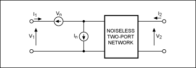
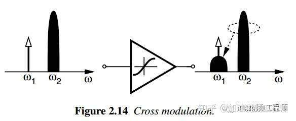
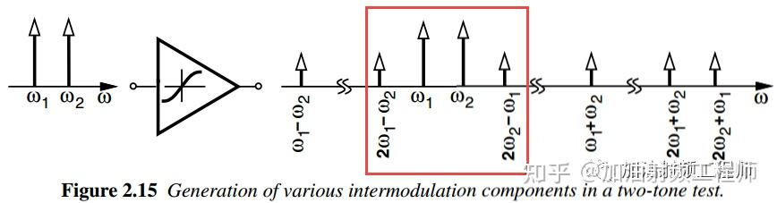
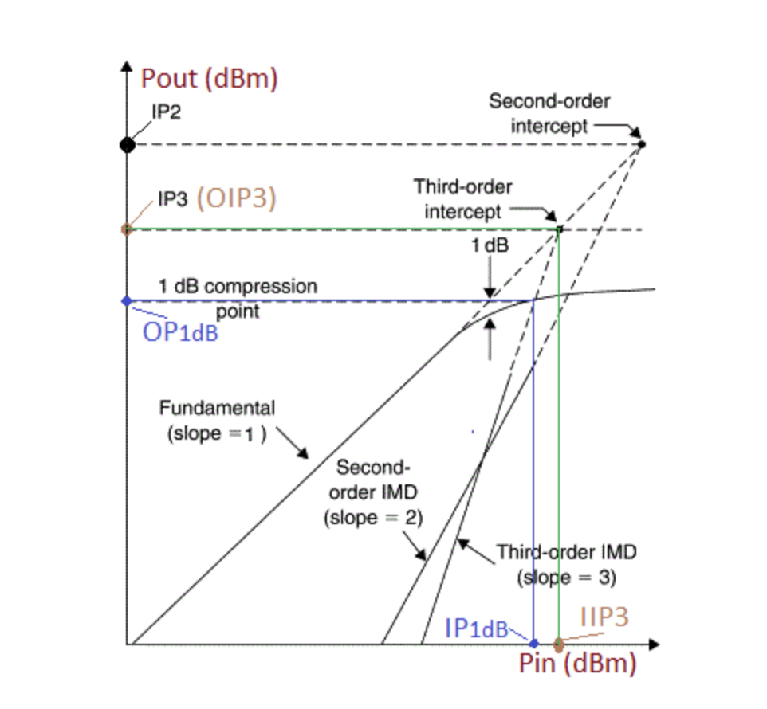

今天是器件级联信噪比计算：

热电阻噪声的最大可用功率是 $\dfrac{V^2}{4R}=kTB$

首先二端口器件模型用那个加入输入电压噪声和输入电流噪声的模型，

而且假设源阻抗是固定的（就是说器件的噪声在特定的阻抗测量，给出了数据手册的噪声系数。如果在多个阻抗测量，数据手册就会给出噪声圆），那么这样这个器件贡献的噪声功率 $P_D=\dfrac{V_n^2}{R_g}+I_n^2R_g$ 就是固定的，这里定义噪声温度 $T_D$ 用于表示器件等效输入噪声 ， $P_D=kT_DB$

**噪声系数的定义：**

 $T_D$ 代表器件等效输入噪声温度， $T_s$ 代表信号噪声温度

$$
F=\dfrac{SNR_{in}}{SNR_{out}}
\\=1+\dfrac{T_D}{T_s}
\\NF=10lgF
$$

当计算单器件的噪声系数时，取 $T_s=T_{amb}$ 即环境温度

**推导级联公式**

比如三级放大器，gi是放大倍数，Ti是器件等效输入噪声温度：
 
$$ 
(\dfrac{S}{N})_{out}=\dfrac{g_1g_2g_3S}{k(g_1g_2g_3T_s+g_1g_2g_3T_1+g_2g_3T_2+g_3T_3)B}
\\=\dfrac{1}{1+\dfrac{T_1}{T_s}+\dfrac{T_2}{g_1T_s}+\dfrac{T_3}{g_1g_2T_s}}(\dfrac{S}{N})_{in}
$$

那么 $F=1+(F_1-1)+\dfrac{F_2-1}{g_1}+\dfrac{F_3-1}{g_1g_2}$ 

**Friss formula**：
$$
F=F_1+\dfrac{F_2-1}{g_1}+\dfrac{F_3-1}{g_1g_2}+...
$$

**衰减器件的级联模型**
有耗衰减不会损失信号源内阻的热噪声功率，只会损耗已经被放大的噪声。假设信号衰减倍数是L：
$$
SNR_{in}=\dfrac{S}{kT_{amb}B}
\\SNR_{out}=\dfrac{S/L}{kT_{amb}B}
\\ F=L
$$

参与级联计算的时候，等效为g=1/L，F=L的放大器

---

讲完了器件噪声，下面是器件非线性

## 非线性
假设有用信号 $s(t)=A_scosw_st$ ，干扰信号 $i(t)=A_{i1}cosw_{i1}t+A_{i2}cosw_{i2}t$ ，系统响应 $y(t)=a_1x+a_2x^2+...$ 

如果是一个干扰信号，
$$
y(t)=a_1(1+\dfrac{3a_3}{4a_1}A_s^2+\dfrac{3a_3}{2a_1}A_{i1}^2)s(t)+...
$$

### 增益压缩（1dB压缩点）
当输入信号功率超过 $P_{1dB}$ 的时候，增益开始下降（这个输入信号不仅包含了需要放大的小信号，还包含干扰信号。如果干扰信号足够大，那么小信号的增益几乎没有）

主要的原因是放大器输出范围的限制导致的削峰

### 交调
当一个弱有用信号和一个带有幅度调制的强干扰信号，同时输入至一个非线性系统时，调制从干扰信号转移到有用弱信号上

在上述一个干扰信号的输出中，那个来自干扰信号的幅度的平方会调制到期望信号上，如果期望信号带有幅度调制（比如QAM），那么就会很受干扰

### 互调（IP3）
如果是两个干扰信号，

$$
y(t)=a_1[1+\dfrac{3a_3}{4a_1}A_s^2+\dfrac{3a_3}{2a_1}(A_{i1}^2+A_{i2}^2)]s(t)
\\+a_2A_{i1}A_{i2}[cos(w_{i1}+w_{i2})t+cos(w_{i1}-w_{i2})t]
\\+\dfrac{3}{4}a_3[A_{i1}^2A_{i2}cos(2w_{i1}\pm w_{i2})t+A_{i1}A_{i2}^2cos(w_{i1}\pm 2w_{i2})t]
+...
$$

第二行是二阶互交调产物，第三行是三阶互交调产物。一般来说，二阶会落在带外，但是三阶很容易落在带内（主要是2w1-w2和2w2-w1）（虽然还有很多奇数阶产物都容易落在带内，但是通常比三阶互交调的分量小很多，所以忽略不计）

**IIP3**：相同输入功率下（干扰与期望信号），干扰双音信号产生的互调功率跟期望信号输出功率相同时的输入功率（OIP3则是输出功率）

## 参考资料
* https://www.analog.com/en/resources/technical-articles/ip3-and-intermodulation-guide.html
