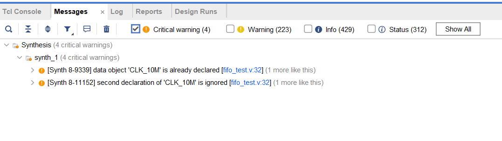
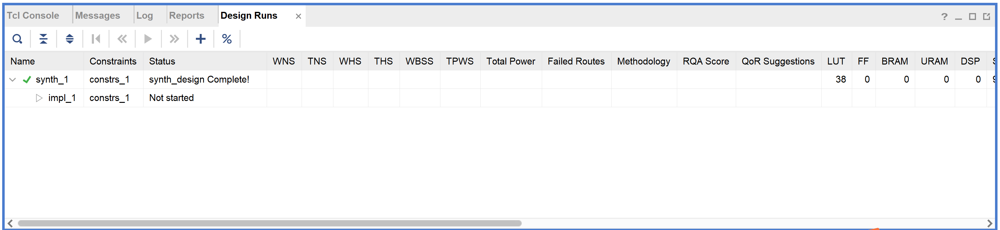
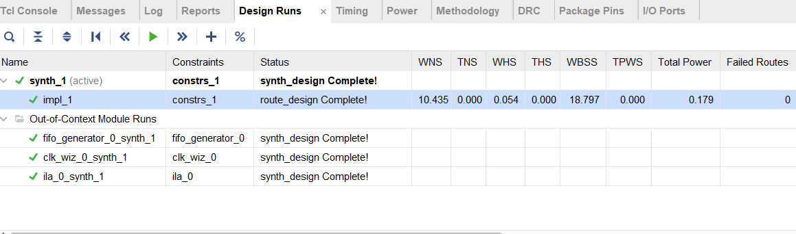

## fpga架构
1. CLB（Configurable Logic Block，可配置逻辑块）

2. Routing Fabric（可编程连线网络）

3. I/O Blocks（输入输出块）

4. Dedicated Hard Blocks（专用硬核）
    * DSP Slice：乘法器 + 加法器 + 累加器（适合 FIR 滤波器、矩阵乘）
    * Block RAM（BRAM）：成块的片上存储
    * PLL / MMCM：时钟倍频、分频、相位调整
    * SERDES：高速串并转换器（支持几 Gbps）
    * PCIe：高速接口硬核
    
5. Clock Network（时钟分配网络）
    * Global clock lines
    * Regional / Local clock networks
    * BUFG、BUFR、BUFH 等时钟缓冲器

## 工程开发流程
* 需求分析
* 设计架构，编写代码
* 功能仿真（前仿）
* 综合（synthesis）：逻辑到门电路（网表）
* 实现（implementation）：门电路到实际布线（包括连接输入输出）和实现
* 编程和调试

    

## 设计流程关心的指标

### 错误与warning



### 消耗的资源
在综合电路时，我们还可以通过左侧的`Open Synthesis Design`选项卡的`Report Utilization`选项中找到该设计使用的资源数量。一个更简单的办法就是直接在下方的Design Run选项卡中找到资源使用量：


在比较简单的组合逻辑设计中，资源使用量少自然是一件很好的事情，但对于组合——时序综合逻辑设计中，评判一个设计的好坏，不能仅仅看资源使用量，还要看电路可接受的最高时钟频率。因此，我们在设计电路时，如果能够使用更多的资源来减少逻辑通路长度，从而提高时钟频率，那么这样的设计也可以是好的设计。

### 时序违例
* 首先设置时钟频率等时序约束

implement后


中间那几个时间没出红色就是时序过

| 缩写       | 全称                      | 含义                        | 正负意义                 |
| -------- | ----------------------- | ------------------------- | -------------------- |
| **WNS**  | Worst Negative Slack    | 最差建立裕量（Worst setup slack） | <0 表示有路径违例（不满足建立时间）  |
| **TNS**  | Total Negative Slack    | 所有违例路径的总和                 | <0 表示有多个路径违例         |
| **WHS**  | Worst Hold Slack        | 最差保持裕量（Worst hold slack）  | <0 表示有保持时间违例         |
| **THS**  | Total Hold Slack        | 所有保持违例路径的总和               | <0 表示有保持时间问题         |
| **WBSS** | Worst Bus Skew Slack    | 总线最差偏斜裕量（Bus Skew）        | <0 表示总线信号到达时间差过大     |
| **TPWS** | Total Pulse Width Slack | 脉宽裕量（Pulse Width Slack）   | <0 表示时钟或信号脉冲宽度不够（太窄） |

## 设计范式
### 状态机

FSM 将逻辑分为三块：

1. **状态寄存器**：存储当前状态
2. **状态转移逻辑**（组合逻辑）
3. **输出逻辑**（组合逻辑）


因为追求写法把组合逻辑和时序逻辑分离，所以状态机一般不建议写一段式，因为状态转移逻辑和输出逻辑是组合逻辑。

``` systemverilog
// 三段式 FSM 示例

// 1️⃣ 状态寄存器
always @(posedge clk or negedge rst_n) begin
    if (!rst_n)
        state <= IDLE;
    else
        state <= next_state;
end

// 2️⃣ 状态转移逻辑
always @(*) begin
    next_state = state;  // 默认保持
    case(state)
        IDLE: if (start) next_state = RUN;
        RUN:  next_state = DONE;
        DONE: next_state = IDLE;
    endcase
end

// 3️⃣ 输出逻辑
always @(*) begin
    case(state)  
        IDLE: out = 0;
        RUN:  out = 0;
        DONE: out = 1;
    endcase
end
```

### 数据流

一连串组合逻辑

### 流水线

把一连串组合逻辑拆分成若干段，插入寄存器缓存，降低单级组合逻辑延时，提高吞吐率


### 计数器

用于控制时序

分为
* cnt复位
* cnt自增/减
* 检测阈值，触发事件，复位

写法：
```systemverilog
always @(posedge clk or posedge rst) begin
    if (rst) begin
        cnt <= 0;
    end else
        if (cnt >= THRE - 1) begin  // 条件逻辑：检查阈值
            cnt <= 0;
            //do something...
            
        end else begin
            cnt <= cnt + 1;
        end
    end
end
```

### 通信与握手协议
| 信号      | 方向         | 含义            |
| ------- | ---------- | ------------- |
| `valid` | 发送端 -> 接收端 | 数据有效，发送端准备好发送 |
| `ready` | 接收端 -> 发送端 | 接收端准备好接收数据    |

**传输条件**：

> **数据只有在 `valid && ready` 为 1 时才被“接收”或“采样”**
