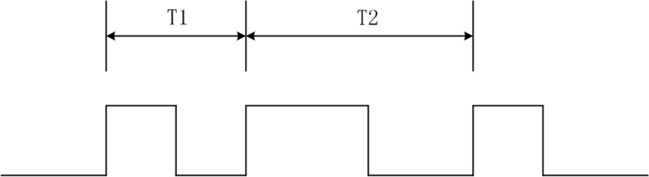
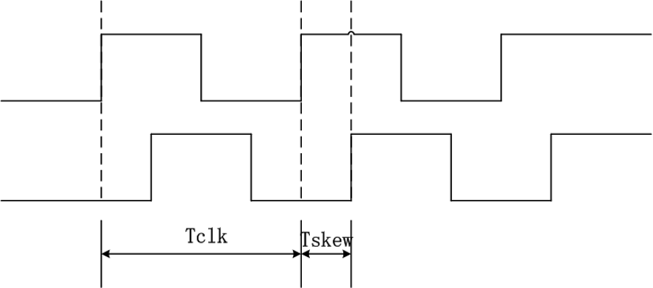
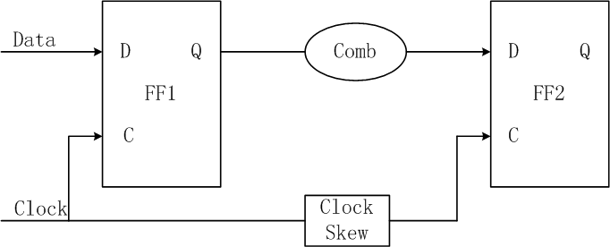
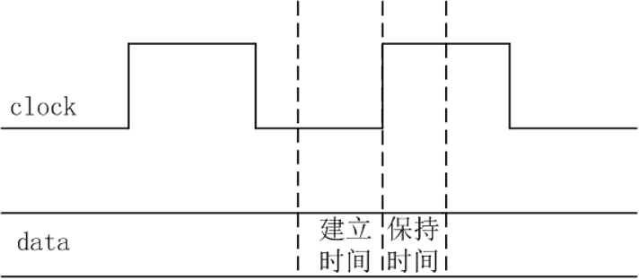
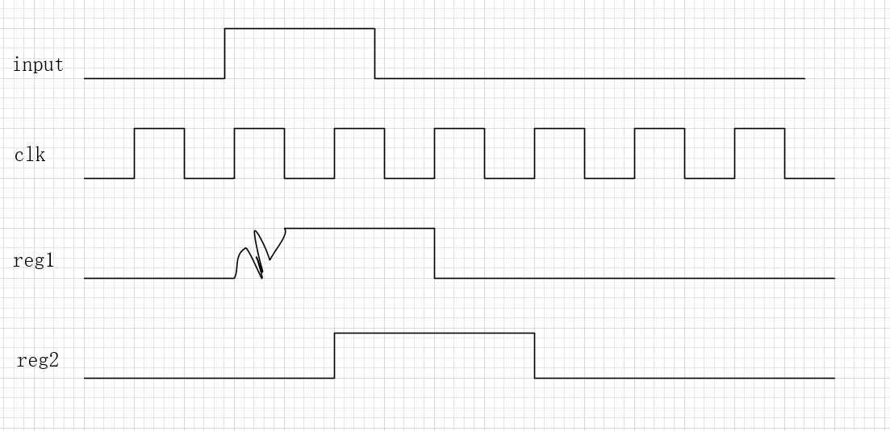

后面开始更新fpga的学习进程了

# fpga时钟，复位，时序约束
## 时钟模型
* 抖动（jitter）：时钟周期的抖动


* 偏斜（skew）：同一时钟到不同寄存器的相位差（由布线产生）



## 复位设计
### 同步复位：时钟边沿才复位
``` v
always @(posedge clk) begin
    if (!rst_n) begin
        counter <= 8'd0;     // 同步复位：只有在时钟沿时才复位
    end else begin
        counter <= counter + 1;
    end
end


```
### 异步复位：只要复位信号有效就复位

``` v
always @(posedge clk or negedge rst_n) begin
    if (!rst_n) begin
        counter <= 8'd0;     // 异步复位立即生效
    end else begin
        counter <= counter + 1;
    end
end
```

异步复位释放时，如果复位信号本身传播延迟不一致，
有些寄存器先退出复位、有些后退出，可能会产生时序问题

### 工程用法
* 顶层异步复位（上电立即复位，不依赖时钟）
* 用PLL Locked信号作为子模块复位，可以多打两拍然后同步复位

``` v
// 顶层信号
input wire ext_reset_n; // 外部异步复位
wire pll_locked;        // PLL锁定信号
wire clk;               // PLL输出时钟

//------------------------------------
// 1️⃣ 组合异步复位条件
//------------------------------------
wire sys_reset_n = ext_reset_n & pll_locked;

//------------------------------------
// 2️⃣ 复位同步器（两拍同步）
//------------------------------------
reg [1:0] reset_sync;
always @(posedge clk or negedge sys_reset_n) begin
    if (!sys_reset_n)
        reset_sync <= 2'b00;
    else
        reset_sync <= {reset_sync[0], 1'b1};
end

//------------------------------------
// 3️⃣ 同步复位输出
//------------------------------------
wire rst = ~reset_sync[1];

```

以及不同的时钟域要有自己的复位同步器，因为时钟周期不同，用同一个`sys_reset_n`

## 时序分析




不满足建立时间或保持时间会进入亚稳态。就是寄存器输出会有一段时间不稳定。

### 建立时间时序要求
数据要在建立时间前到 $Tcq+Tcomb < Tclk+Tskew-Tsu$
即 $Tclk>Tcq+Tcomb+Tsu-Tskew$
其中
* Tcq是FF1时钟边沿到Q的延迟
* Tcomb是组合逻辑延迟
* Tsu是建立时间
* Tskew是时钟偏斜

解决方案
* 调整时钟频率
* 流水线，加入中间级以减少Tcomb。虽然数据延迟增加，但是吞吐率还在
* 优化组合逻辑


### 保持时间时序要求
数据不能太快更新，需要在保持时间后更新 $Tcq+Tcomb>Tskew+Thold$
其中
* Thold是保持时间、

尤其在负偏斜的时候容易发生


解决方案：
* 加入延时

## 异步时钟域
两个时钟域没有任何相位关系，叫**异步时钟域**

### 打拍法（打两拍）

**“打两拍”一般适用于单比特信号从慢时钟域传递快时钟域的场景**。这样采样能被采到



1. 当使用时钟采样一个来自异步时钟域的单比特信号时，如果采样时信号在边沿附近，第一级寄存器可能进入亚稳态。
2. 亚稳态会在一段时间内输出电平不稳定，但最终会收敛到 0 或 1。
3. 第二级寄存器采样第一级寄存器输出时，前一级寄存器已经有足够时间消除亚稳态，因此第二级寄存器输出几乎总是稳定的。
4. 对单比特信号来说，收敛到 0 或 1 无所谓，只要保证第二级寄存器输出稳定，就可以安全用于后续逻辑。对多比特总线或控制信号则不能随便忽略，因为位间不同步会产生逻辑错误。

``` v
    // 两级寄存器
    reg sync_ff1, sync_ff2;

    always @(posedge clk) begin
        sync_ff1 <= async_sig;   // 第一级寄存器：可能进入亚稳态
        sync_ff2 <= sync_ff1;    // 第二级寄存器：输出稳定信号
    end

    assign sync_sig = sync_ff2;
```

对于多比特连续数据，比如1，2，3，...，打拍法不同比特时间不同，用格雷码每次只有一个比特变化就没有关系

### 异步fifo
适合小规模多比特数据（几十位以内）

### 双端口RAM
适合大容量数据（如视频帧、图像缓存）


## fpga约束

### 🧩 一、约束（Constraint）的分类

FPGA 约束大致分为 **三大类**：

| 类型                                            | 作用                                      | 常见文件               |
| ----------------------------------------------- | ----------------------------------------- | ---------------------- |
| **时序约束 (Timing Constraints)**               | 确保信号满足建立/保持时间要求             | `.xdc`、`.sdc`         |
| **引脚约束 (Physical Constraints)**             | 指定信号对应哪一个物理管脚、IO 标准、电压 | `.xdc`、`.qsf`         |
| **逻辑/布线约束 (Placement/Logic Constraints)** | 指定逻辑放在哪个区域、锁定资源            | `.xdc`、`.qsf`、`.tcl` |

---

### 🧠 二、时序约束 (Timing Constraints)

时序约束是最核心的部分，用来保证 FPGA 工作频率和数据传输的可靠性。

#### 1️⃣ 创建主时钟

```tcl
create_clock -name clk_main -period 10 [get_ports clk]
```

表示 `clk` 是一个周期 10ns（100MHz）的主时钟。

---

#### 2️⃣ 输入/输出延时

指定外部信号与 FPGA 时钟的时序关系（建立时间、保持时间）。

```tcl
set_input_delay  -clock clk_main 2.0 [get_ports data_in]
set_output_delay -clock clk_main 3.0 [get_ports data_out]
```

---

#### 3️⃣ 多时钟域关系

* 告诉工具不同的时钟是否同步
* 避免对异步时钟做错误的时序分析

```tcl
set_clock_groups -asynchronous \
    -group [get_clocks clk_a] \
    -group [get_clocks clk_b]
```

---

#### 4️⃣ 虚拟时钟（外设同步用）

用于约束 FPGA 外部设备接口（如 DDR、ADC）。

```tcl
create_clock -name ext_clk -period 5
set_input_delay -clock ext_clk 1.0 [get_ports ext_data]
```

---

#### 5️⃣ False Path / Multicycle Path

告诉工具某条路径**不参与时序分析**或**跨多个周期传输**。

```tcl
set_false_path -from [get_clocks clk_a] -to [get_clocks clk_b]
set_multicycle_path 2 -from [get_pins A_reg/Q] -to [get_pins B_reg/D]
```

---

### ⚙️ 三、引脚约束 (Physical Constraints)

用于指定外部接口对应的物理引脚位置、IO 标准、电压等。

```tcl
set_property PACKAGE_PIN V17 [get_ports clk]
set_property IOSTANDARD LVCMOS33 [get_ports clk]

set_property PACKAGE_PIN E3  [get_ports led[0]]
set_property IOSTANDARD LVCMOS18 [get_ports led[0]]
```

> 不指定的话工具会随机分配，下载到板上就可能烧坏芯片或IO。

---

### 🧩 四、逻辑/布线约束 (Placement Constraints)

用于控制模块、逻辑单元、RAM、DSP 等放置区域或锁定位置。

```tcl
# 指定实例到 FPGA 的特定区域
create_pblock pblock_1
resize_pblock pblock_1 -add {SLICE_X0Y0:SLICE_X49Y49}
add_cells_to_pblock pblock_1 [get_cells -hierarchical -filter {NAME =~ "u_core/*"}]
```

常见用途：

* 锁定关键模块在特定区域（防止布线延迟不确定）
* 防止跨时钟逻辑被放远
* 约束高性能路径（如高速接口、DDR PHY）
