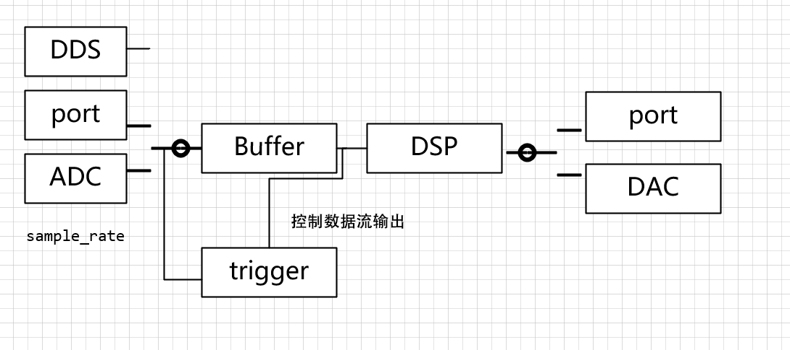

感觉fpga看书看的差不多了，该开始练手了
# FPGA入门项目--信号采集发生装置
## 系统框架


如果做采集处理+控制的整个系统，那么FPGA是MCU的外设，两者通信可以使用
* QSPI
* FSMC（FPGA作为SRAM）

（不使用PS，因为PS存在学习成本，而且嵌入式Linux不会）

## 系统设计

* 数据流模块化，统一接口
* 数据流的速率协调？？
``` css
[source1] -> [FIFO1] \                  /  [FIFO1] --> [sink1]
[source2] -> [FIFO2] --> [multiplexer] --> [FIFO2] --> [sink2]
[source3] -> [FIFO3] /                  \  [FIFO3] --> [sink3]

```
* source接口？
    * valid
    * data
    * clk
* sink接口？
    * ready
    * data
    * clk
* source/sink干脆直接用AXI-stream
* backpressure，流控？
* fifo深度？

## 系统实现
* [ ] DDS
* [ ] BRAM FIFO作为Buffer
* [ ] port通信设计（控制，多通道数据发送接收）
* [ ] UART作为port
* [ ] ADC 里面加入抽采样
* [ ] mux(axi-stream switch)
* [ ] DAC 里面加入升采样
* [ ] DDR作为Buffer（手搓环形缓冲）
* [ ] 网口作为port
* [ ] 思考跟单片机通信
* [ ] trigger
* [ ] DSP
