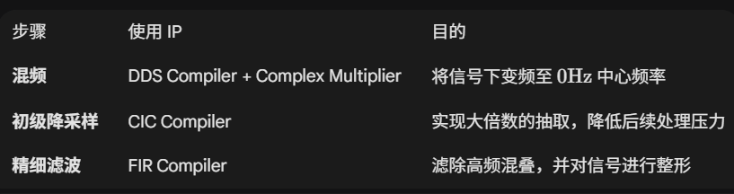
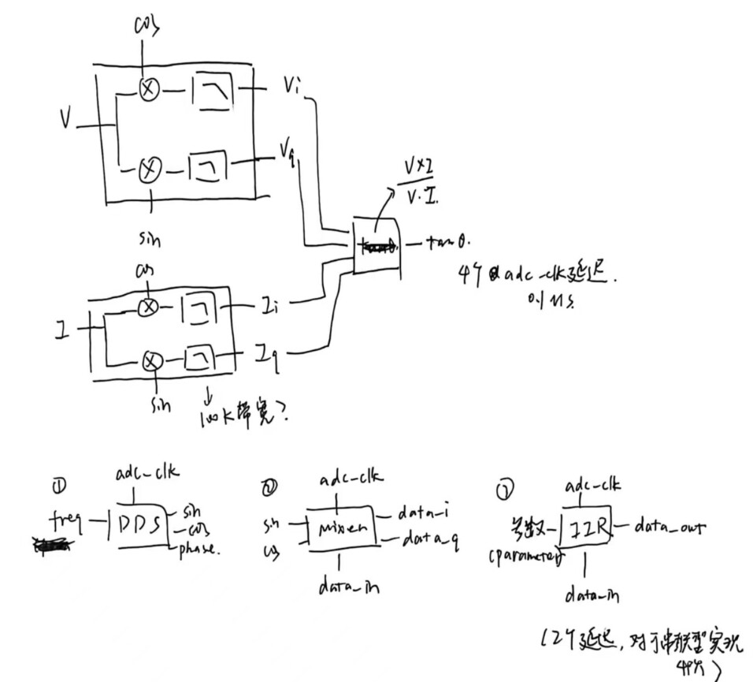
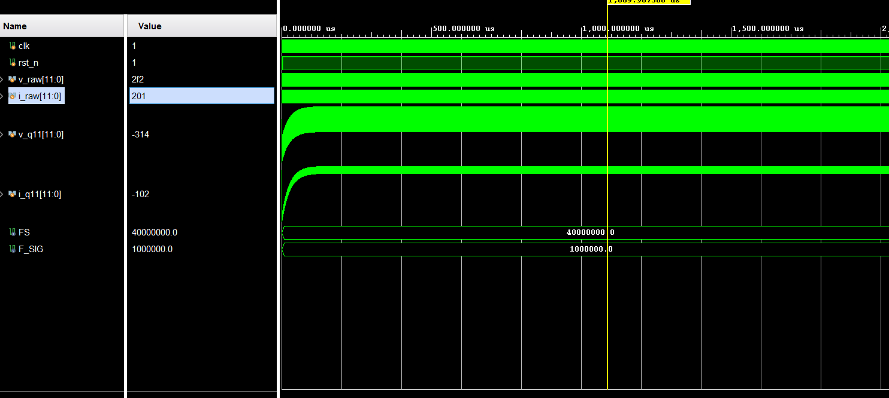
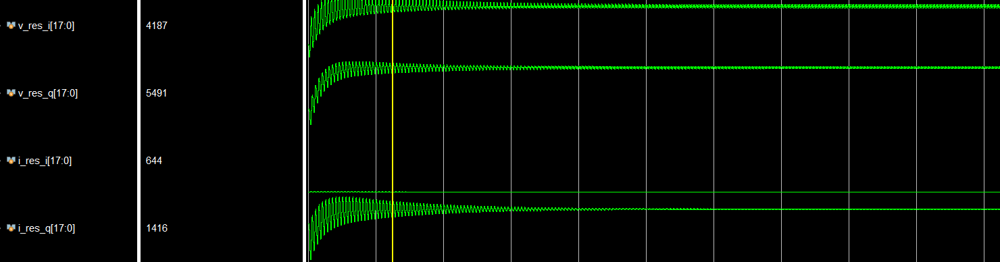
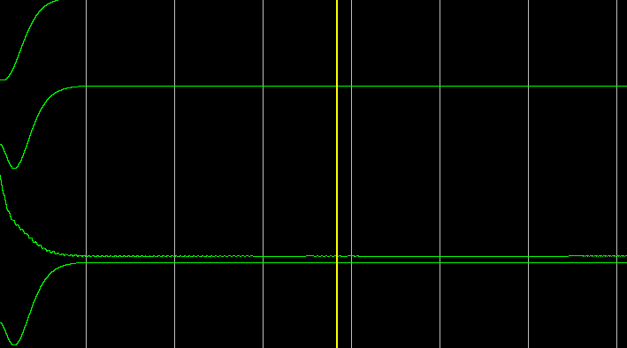
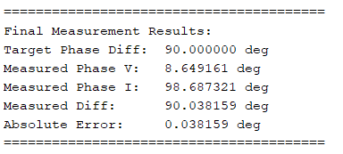
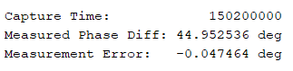
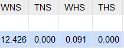
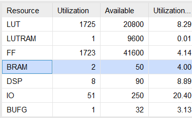

今天又开始做老本行。电赛搞过的鉴相（正交解调法）移植到FPGA上，基本上就是push gemini给我生成代码，因为这个并不复杂，我感觉很多人肯定都写过

入门DSP我感觉数字下变频是典型例子了，一下子cover到了dsp的非常多的内容。我未来整理整理，把数字下变频的计算与实现写出来。虽然ai给的方案是一堆ip核的组合。我感觉未来也可以配置看看。但是我感觉入门就需要手搓一下





* 首先是去除直流，用一个低通得到直流（6khz）。去除直流目前需要120us
* 实现滤波器时出了一点问题（高阶IIR的数值精度问题），先用一阶滤波器浅浅尝试一下，很明显对2MHz衰减不够好：
* 然后我级联了4个一阶滤波器（100khz截止频率）
* 结果：
* 人永远无法de出不会的东西，cordic ip还没琢磨明白但是想先用，于是用不明白 🤣
* 但是怒而让ai手搓cordic然后成功了 🤣
* 最终过cordic后的鉴相结果（仿真12bit adc，50mv的电压：

）
* 跟ai的合作有种指导初级工程师干活的感觉（虽然我也初级 🤣）

---

因为现在全ai工作流，写完模块之后让ai帮我生成一篇使用指南。我现在就是用ai 3天干完两周的活，其他时间放假，或者学点东西。

# Digital Down Converter (DDC) 设计与使用指南 (V1.0)

## 1. 系统架构概览

### 信号处理流程：
1. **去偏置 (DC Remover)**: 将无符号 ADC 码流转为有符号补码，并滤除直流分量。
2. **混频器 (Mixer)**: 利用 DDS 产生的正交参考源（Sin/Cos）将信号解调为 IQ 分量。
3. **低通滤波 (LPF)**: 采用级联一阶 IIR 结构，滤除 2 倍频分量，提取直流 I/Q。
4. **复共轭乘法 (Complex Mult)**: 计算 $Z = I \cdot V^*$，提取两路信号的相对相位向量。
5. **坐标旋转 (CORDIC)**: 采用流水线级联结构，将向量转换为相位角。

---

## 2. 信号链位宽演变 (Bit-Width Propagation)
为了平衡资源消耗与计算精度，系统在各阶段采用了不同的定点数位宽。

| 处理阶段       | 位宽定义           | 量纲 (默认) | 物理意义               |
| :------------- | :----------------- | :---------- | :--------------------- |
| ADC Raw Input  | `[11:0]`           | Unsigned    | 原始采样 (0V ~ 1V)     |
| DC Free Signal | `signed [11:0]`    | $Q1.11$     | 归一化 AC 信号         |
| NCO Reference  | `signed [15:0]`    | $Q1.15$     | 正交参考正弦波         |
| Mixer Full     | `signed [27:0]`    | $Q2.26$     | 乘法全精度结果         |
| Mixer Trunc    | `signed [17:0]`    | $Q2.16$     | 四舍五入后的 I/Q 分量  |
| Complex Product| `signed [36:0]`    | $Q4.33$     | 共轭相乘结果           |
| CORDIC In      | `signed [23:0]`    | -           | 动态截位后的鉴相向量   |
| Phase Out      | `signed [23:0]`    | $2^{22}=180^\circ$ | 最终输出的相位角       |

**关键设计点**：
- **四舍五入 (Rounding)**：在 Mixer 截位时引入 $2^{SHIFT-1}$ 的偏移，避免直接截断带来的直流偏置。
- **Headroom (2-bit Integer)**：Mixer 输出采用 $Q2.16$，预留 1 位溢出余量，防止后续处理中符号位翻转。

---

## 3. 滤波器截止频率计算 (LPF Cutoff)
系统内的 LPF 采用移位实现，其截止频率 $f_c$ 严格受移位系数  $k$ （`K_LPF`）控制。

### 核心公式：
当 $f_c \ll f_s$ 时：
$$
f_c \approx \frac{f_s}{2\pi \cdot 2^k}
$$

### 参数对照表 ($f_s = 40\text{ MHz}$):
- **$k=6$**: $f_c \approx 99.5\text{ kHz}$ (响应快，纹波稍大)
- **$k=8$**: $f_c \approx 24.8\text{ kHz}$ (兼顾速度与平滑)
- **$k=10$**: $f_c \approx 6.2\text{ kHz}$ (极高平滑度，适合极慢速测量)

---

## 4. 快速集成指南

### 4.1 计算频率控制字 (FTW)
在顶层调用前，需根据目标频率 $f_{sig}$ 和采样率 $f_s$ 计算：
$$
FTW = \frac{f_{sig}}{f_s} \times 2^{32}
$$

### 4.2 模块例化示例
```systemverilog
digital_downconverter #(
    .ADC_W(12),    // ADC位宽
    .DATA_W(18),   // 内部处理位宽
    .PHASE_W(24),  // 相位位宽
    .K_LPF(6)      // 滤波器系数
) u_ddc (
    .clk(sys_clk),
    .rst_n(sys_rst_n),
    .freq_word(32'd107374182), // 1MHz @ 40MHz FS
    .v_adc(v_adc_raw),
    .i_adc(i_adc_raw),
    .phase_out(phase_out),
    .phase_valid(phase_valid)
);

```

### 4.3 结果转换
将 CORDIC 输出的整数转换为物理角度：
$$
deg=\dfrac{phase\_out}{2^{22}}*180
$$


---

## 5. 综合与时序验证




