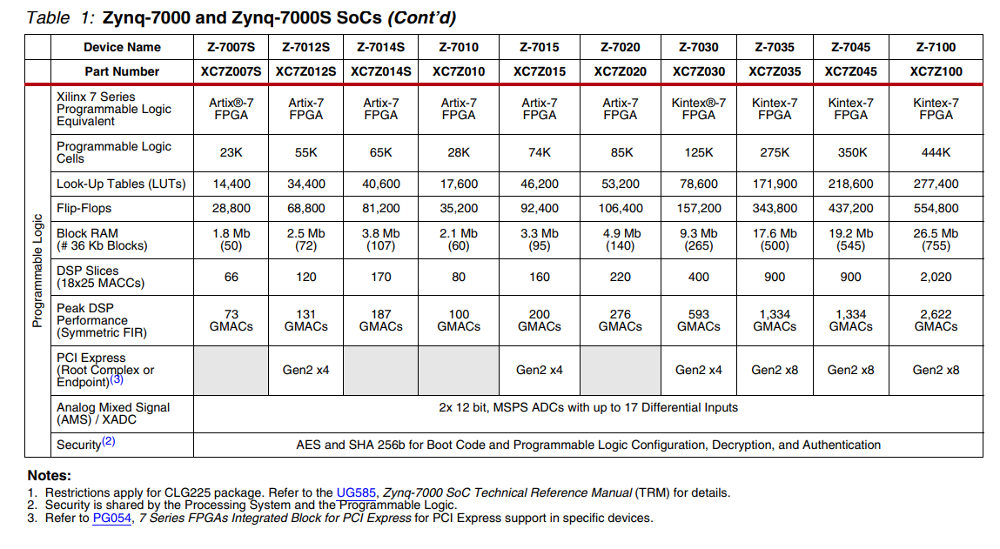

今天问deepseek fpga的选型方法，讲的很好：

选择合适的FPGA芯片是嵌入式系统、通信、图像处理等领域的核心步骤。以下是FPGA选型的系统化方法和关键考虑因素，结合实际案例和行业经验，帮助您高效决策：

---

### **1. 明确需求：核心问题定义**
在选型前，需清晰回答以下问题：
- **应用场景**：工业控制、通信基带、AI推理、图像处理还是高速数据采集？
- **关键指标**：需要多高的时钟频率（如200 MHz vs 500 MHz）？是否需要硬核处理器（如ARM Cortex-A9/A53）？
- **接口需求**：是否需要高速SerDes（如PCIe Gen3/4、JESD204B）？支持的LVDS、HDMI等接口数量？
- **开发周期**：是否为快速原型验证（需现成开发板）？还是量产定制（需长期供货支持）？

---

### **2. 资源评估：FPGA核心参数**
#### **（1）逻辑资源**
- **逻辑单元（LUT/CLB）**：  
  - 简单算法（如PID控制）：1K–10K LUT。  
  - 复杂算法（如H.264编码）：需50K+ LUT。  
  - **案例**：Zynq7020（28K LUT）适合中等视频处理，而Zynq7100（Kintex-7架构）适合雷达信号处理。  

- **存储资源（Block RAM）**：  
  - 缓存需求（如帧缓存）：需评估每帧数据量（如1080p图像≈8MB）。  
  - 分布式RAM vs Block RAM：Block RAM效率更高，但需预先规划。  

- **DSP切片（乘法器）**：  
  - 每通道信号处理（如FIR滤波器）：需计算乘累加（MAC）操作数量。  
  - **经验公式**：DSP数量 ≈ 并行通道数 × 单通道运算复杂度。  

#### **（2）I/O需求**
- **高速接口**：  
  - 需明确协议类型（如PCIe Gen3 ×8需16对差分线）。  
  - 例如：Xilinx UltraScale+系列支持56Gbps PAM4，适合5G基站。  
- **普通I/O数量**：  
  - 传感器接口（如SPI/I2C）：需预留冗余（至少20%余量）。  

---

### **3. 性能与功耗权衡**
#### **（1）时钟频率与时序收敛**
- **高频挑战**：  
  - 500 MHz以上设计需关注布线延迟，选择高等级速度芯片（如Speed Grade -2）。  
  - **工具支持**：Xilinx Vivado的时序分析工具可预估关键路径。  

#### **（2）功耗估算**
- **静态功耗**：FPGA工艺决定（如28nm vs 16nm FinFET）。  
- **动态功耗**：与逻辑翻转率和资源使用率正相关。  
- **工具辅助**：Xilinx Power Estimator（XPE）或Intel Power Thermal Calculator（PTC）可建模。  

---

### **4. 开发工具与生态支持**
#### **（1）开发环境**
- **工具链**：  
  - Xilinx Vivado（支持Zynq/UltraScale+） vs Intel Quartus（Stratix/Arria）。  
  - 开源工具（如Yosys+NextPNR）仅适合小规模FPGA（如Lattice ICE40）。  

#### **（2）IP核可用性**
- 预验证IP（如DDR4控制器、以太网MAC）可缩短开发周期。  
- **案例**：Xilinx的AXI Interconnect IP对Zynq PS-PL集成至关重要。  

---

### **5. 成本与供应链**
#### **（1）芯片成本**
- **低端FPGA**：  
  - Lattice iCE40（≈$10）适合简单逻辑控制。  
  - Xilinx Artix-7（≈$50–$200）适合中等规模设计。  
- **高端FPGA**：  
  - Xilinx Virtex UltraScale+（$1k+）用于数据中心加速。  

#### **（2）长期供货**
- 工业/汽车项目需选择“量产级”芯片（如Xilinx Automotive Grade）。  
- **风险提示**：某些旧型号（如Spartan-6）已进入停产周期。  

---

### **6. 供应商对比与选型策略**
| **供应商**       | **优势领域**                  | **典型型号**                  |  
|------------------|-----------------------------|------------------------------|  
| **Xilinx**       | 高性能计算、异构SoC         | Zynq-7000/UltraScale+ RFSoC  |  
| **Intel (Altera)** | 通信、数据中心            | Stratix 10、Agilex           |  
| **Lattice**      | 低功耗、小封装            | iCE40、ECP5                  |  
| **Microchip**    | 抗辐射、航天级            | RTG4、PolarFire              |  

---

### **7. 快速验证流程**
1. **原型开发板测试**：  
   - 例如：Zynq7020使用Pynq-Z2开发板，快速验证算法。  
2. **性能瓶颈分析**：  
   - 通过逻辑分析仪（如SignalTap）抓取关键信号时序。  
3. **功耗实测**：  
   - 使用电流探头测量动态功耗峰值。  

---

### **总结：FPGA选型决策树**
1. **明确需求优先级**（性能 vs 成本 vs 功耗）。  
2. **计算资源需求**（LUT、BRAM、DSP）。  
3. **评估接口与协议**（是否需要PCIe/JESD204B）。  
4. **选择供应商生态**（Xilinx vs Intel vs Lattice）。  
5. **验证可行性**（开发板测试 + 功耗模型）。  

通过以上步骤，可系统化避免“过度设计”或“资源不足”的风险，确保选型精准匹配项目需求。

---

zynq选型表：（mpu都是a9，差异不大。差距主要是fpga部分，nb点的是k7，不仅逻辑和运算资源多，而且有GTX高速收发器，咨询了下deepseek，这个高速收发器支持10G以太网、JESD204B或PCIe Gen2（如高速数据采集卡）。）

相比之下，我目前的项目撑死算中速，应该用不上这么高端的fpga。k7适合插高速采集FMC子卡

看到人家pluto sdr用的也就是7010，很够了

又看到7100相比7020不仅资源x10，价格也x10了
