因为硬件仿真语言那门课约等于没学，所以lz这周除了完成工科创，补补电子线路以外，就在重学FPGA。

因为昨天学了PLL, BRAM, FIFO，所以今天设计的实验是：
## 需求
假设有一个通信接口（比如网口），每个数据位宽为16b，以50M/16b的速度读写数据。这个通信接口每个数据包的长度为512x16b。

FPGA连了一个ADC作为数据源输入（10Msps，16bit），一个DAC作为数据源输出（10Msps，16bit）

需求就是，ADC以流形式输出到通信接口，通信接口以流形式输出到DAC。

最终测试就是回环实验。ADC的数据以流的形式输出到DAC，延时与缓冲长度成正比。

## 架构
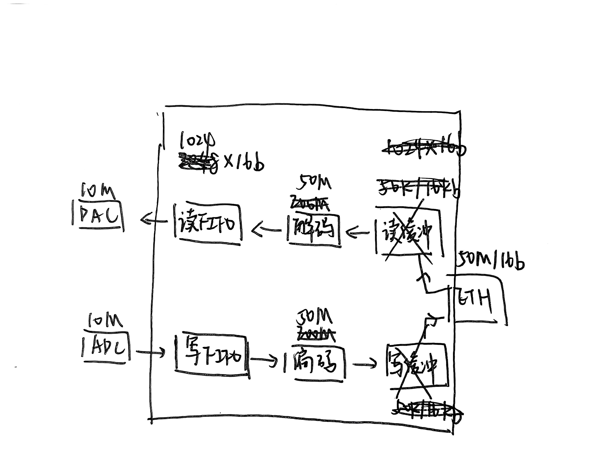

## 实现
### 数据流输入通路
* ADC：模拟输入锯齿波
* 写FIFO：输入输出转换时钟速率
* 编码器：根据通信协议把数据写成数据包发出去

### 数据流输出通路
* 解码器：根据通信协议把收到的数据包中的数据解析出来，并校验错误
* 读FIFO：输入输出转换时钟速率
* DAC：模拟输出

### 模块
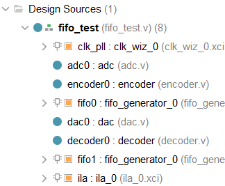

## 结果
可以看到，ADC数据到FIFO再到编码器输出，是一个个数据包高速发送的，数据包大小设定为512x16b，也就是两个波形周期；到了解码器再过FIFO进入DAC，延迟两个波形周期之后正常发送，完成回环实验。
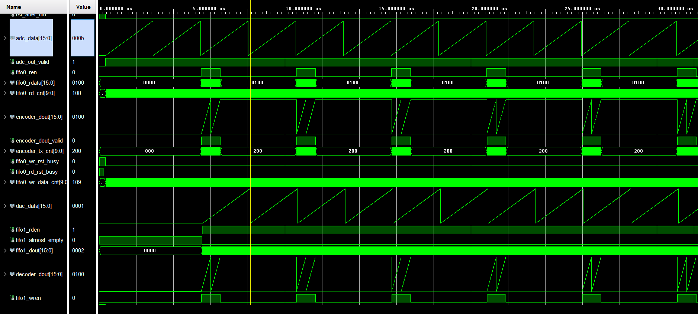

## 一些debug过程
* 复位有先后，首先PLL复位，PLL稳定之后fifo复位，fifo复位完成之后adc与dac与编解码器复位（最开始只使用一个复位信号，导致最开头有部分adc数据没进fifo）
* 最终上板验证使用ila逻辑分析仪

---

今天在手搓UART的时候发现很离奇的bug：

因为接收数据需要检测开始的起始位，也就是一个下降沿。我采用前后数据比较的方式，如图：
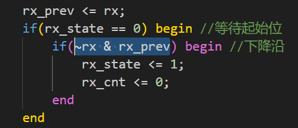

结果是，经常在这个跳变沿，状态不跳转。尽管都满足这些条件了。我很纳闷

这是数据错误率：
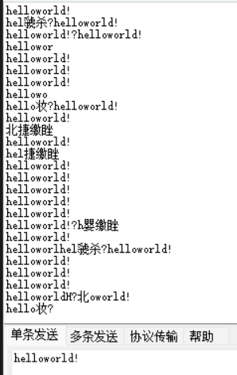

但是当我把这个边沿检测去掉的时候，莫名奇妙就好了：

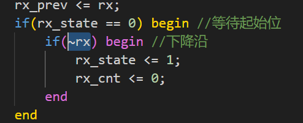

正确率：
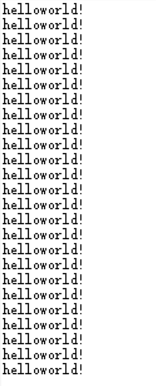

有无大佬指点一下，不胜感激！

破案了，大佬指点下，是跨时钟域的亚稳态问题，意思是时钟不对齐，采样可能采样在信号正在跳转的边沿而不是一个稳定的状态。解决方案是打两拍，就是延时两个时钟周期来比较是否是跳变边沿。

改进后：
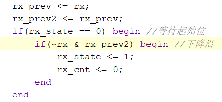

最终结果：
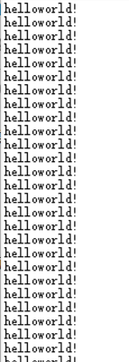

---

今天第一次遇到clock fanout 过多导致的时序问题，我把晶振的时钟给了ila，然后ila观测的引脚实在太多了，然后时序就爆了

我还纳闷，怎么我的ila打不开了，报告说ila的时钟有问题。一看时序约束已经寄寄了

诶今天碰上个山寨核心板，不知道是供电问题还是硬件设计问题还是ddr的玄学问题，反正ddr的稳定性很堪忧。比如上电正常，复位就初始化失败。下电再上电初始化还失败。但是过几分钟凉透之后又上电初始化正常。

因为原来是usb供电，觉得可能是供电能力不行，外接了稳压电源，发现电流到0.4a，确实逼近了usb的极限。外接电源之后稳定性高了不少，比如复位后正常的概率从0%上升到了50%。但是下电再上电还是不行。无奈，我放弃我的山寨核心板，打算下次使用黑金的zynq开发板。

现在只能跑跑仿真了，看起来还是很正常的：
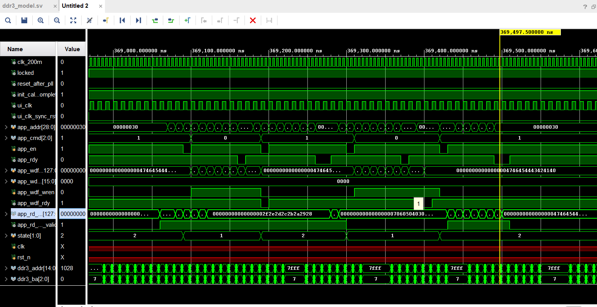

不知道哪位大神，做ddr3_model的仿真的时候在console输出ddr的指令，太人性化了
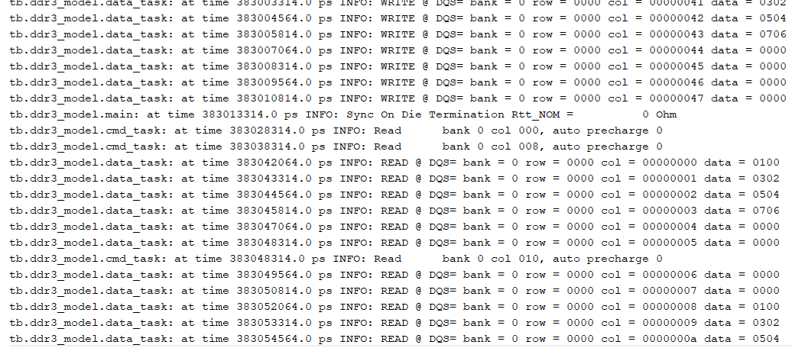

我之所以之前使用这块山寨核心板的原因是，简单，什么外设都直接与pl连。如果是zynq，好多外设连着ps，我还要去研究axi，还要研究ps的开发环境和流程，好麻烦

今天总体还是不错的一天，啃了一天的UG586，读明白MIG ip和的DDR3用户接口和时序之后自己手搓了一下，其实是一遍过的，只是山寨核心板不够给力，害的我debug往自己代码上找，最终感觉初始化也不需要什么时序，才反思硬件。顺便发现了有ddr3_model这个仿真模型可以跑跑仿真，根据别人说的110us开始初始化成功多跑了一段时间的仿真，并且根据别人的debug记录，发现自己仿真没有注意跟实际频率的匹配，遂改了一下仿真时钟的频率，最终果然出结果了。

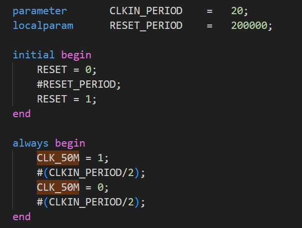
仿真的时钟，设置为50M，之前随便写的写成了#1

ddr的学习告一段落了，下一个是网口。网口之后就是axi，然后是zynq了。
