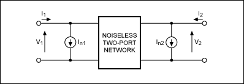
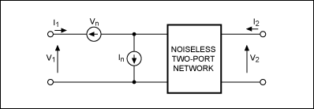
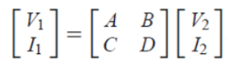
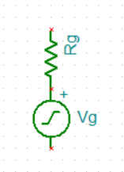
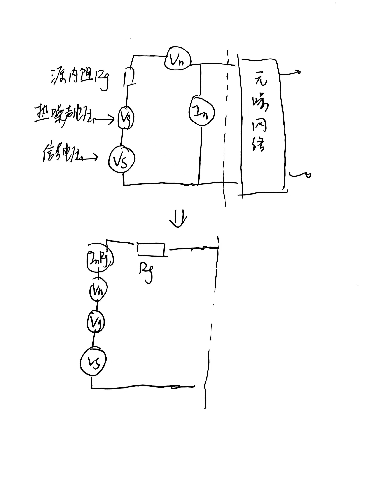

我感觉我需要复健电路理论了，忘的一干二净，只剩下戴维南等效了

今天看噪声双端口等效模型的时候是懵逼的（脑子里：内部的源怎么等效到外部去的...）

图2. 一个噪声双端口网络也可以表示为一个无噪声双端口网络加外部电流噪声源In1和In2

图3. 同样，一个噪声双端口网络还可以表示为一个无噪声双端口网络加输入端上的外部噪声源Vn和In。

有头猪了。
1. 二端口网络用Z矩阵刻画，因为这是线性电路，所以[V]=[I][Z]+内部源的贡献，这个内部源的贡献等效为外部输入输出串联电压源；
2. 当二端口网络用Y矩阵刻画，[I]=[V][Y]+内部源的贡献，这个内部源的贡献等效为外部输入输出并联电流源；
3. 当二端口网络用ABCD矩阵刻画（至少微波里是这么叫的）

内部源会在这个式子后面加上一项内部源的贡献，就等效为输入的串联电压源和并联电流源

下面整理一些经常听说但是不大有头猪的概念（都是本人的理解， 有误请指出）
## 为什么要阻抗匹配
有人说是为了传输最大功率，这个角度是站在，源端的内阻不变，改变负载端阻抗。但很多时候，我们追求的是最大电压，那为什么还要阻抗匹配呢？我直接用一个大电阻接源不就能获得最大电压？

在低频电路里，确实是这样的。但是到了高频，有个很tricky的方法叫做阻抗变换，比如你用一个谐振电路，把负载的大电阻变换成了在源端看去等于源内阻大小（共轭匹配），那么可以获得最大功率。这最大功率加在恒定的负载电阻上，那么就是获得最大电压。这也是为什么在微波电路中很多时候使用功率源模型而不是电压源的原因，因为无耗阻抗变换不改变最大输出功率，但是改变电压。

然后再讲讲传输线的影响，我认为匹配最大的意义，就是传输线的特性阻抗与源和负载匹配，目的就是传输线上驻波比（VSWR）最小，阻抗不管从源端还是负载端看去，随距离几乎不变。

什么是传输线的特性阻抗？微波里给出的是正向和反向的电压和电流关系的那个定义，而我的直观理解其实是，一个正在前进的波，其实是看不到最后的负载阻抗的，它只能看到眼前的传输线的特征阻抗。就像声波遇到不同的材料会反射一样，电磁波遇到不一致的特征阻抗也会反射。

如果传输线特征阻抗与负载不匹配，那么电磁波遇到负载会反射。如果传输线特征阻抗与源端不匹配，那么首先入射入传输线的功率就会小，然后如果在负载端还反射回来了，就会到了源端又反射过去，来回反射形成谐振不仅影响信号波形，还辐射出去影响别的电路（如果再往下思考一层，为什么会辐射，那就是谐振驻波比非常大，电流在波腹点非常大，因为辐射来源于电流振子，所以谐振辐射大）。

阻抗随距离变化其实是个非常大的问题，可能会干烂前级输出电路。比如对讲机如果不接天线功放容易烧，但是理论上不输出功率，那为什么会烧呢？简单的理解就是反射回来功率大。如果更深一层的理解，就是烧是来源于过热，过热来源于I2R大，也就是电流大。电流大是因为，负载不匹配导致的VSWR特别大。最大电流位于波腹点，这个值刚好是源短路的电流（具体计算省略，要列微波的方程）。如果源刚好位于电流波腹点附近，那么电流非常大，所以容易烧。

**有趣的小例子**

昨天头疼于SWD在电机启动总是掉。观察SWD信号线波形，发现有很大的过冲。一个朋友跟我说，SWD是不是要端接，因为他知道SPI信号线要端接。我很纳闷，好像SPI没有很快？然后我对端接的理解是负载端匹配，并联一个电阻。比如CAN线/LVDS这种差分线会并联100欧，以及单端线并联50欧这种。

然后一查，果真有“端接”这回事，只不过是源端的串联22欧，减少源端的反射，可以减少振铃/过冲等信号失真现象。

但是在观察中，我发现不管电机这个巨大干扰源是否接上，SWD的过冲是一样的，只不过电机启动瞬间我强烈怀疑有巨大噪声（只不过示波器没抓到，下次加个高点的触发single一下试试）。甚至在电源分离之后，掉线现象仍然存在。那么我只能怀疑是电磁干扰了。对于这种电磁干扰噪声，最好的办法不是源端与负载端匹配，而是滤波。滤波带来的额外的好处就是抑制过冲。

我也可以给这个过冲的原因一个猜想。我布线的时候SWD的线最后布，所以打了两个过孔（每根线），这些过孔贡献了电感。然后调试器和板子用长长的杜邦线连接，旁边只有一根参考地线，这些线又贡献了电感。

## 功率源模型
不仅信号使用功率源模型，电阻产生的热噪声也是。我们讨论这个是为了为下面噪声/信噪比的分析做铺垫。

**功率源模型(AC)：**

**电阻噪声源模型**
白噪声，即噪声功率谱密度分布平坦。B是噪声带宽
$$
V_g=\sqrt{4kTBR_g}
$$
**功率源串联**
假设V1R1，V2R2的两个互不相关的功率源，串联后，因为电压互不相关，满足电压平方直接相加的关系
$$
R_g=R_1+R_2
\\V_g=\sqrt{V_1^2+V_2^2}
$$
对于噪声源串联，是
$$
V_g=\sqrt{4kTB(R_1+R_2)}=\sqrt{4kTBR_g}
$$

**功率源并联**
$$
R_g=R_1//R_2=\dfrac{R_1R_2}{R_1+R_2}
\\V_g=\dfrac{V_1R_2+V_2R_1}{R_1+R_2}=\dfrac{1}{R_1+R_2}\sqrt{(V_1R_2)^2+(V_2R_1)^2}
$$
对于噪声源并联，代入算算
$$
V_g=\sqrt{4kTBR_g}
$$

## 放大器的噪声优化
在低频电路小信号检测中，我们会关注运放的Vn, In这些指标。以及运放的外接电阻也会贡献噪声。常识是，源的内阻越小越好，噪声越小。但是在微波电路中，比如低噪放（LNA），我们会关注所谓噪声圆，又要求源的阻抗在特定值噪声最小。怪，同样是噪声，为什么在低频电路和高频电路中的分析不同？

**低频运放电路**
运放电路的噪声由等效输入电压噪声，等效输入电流噪声，和源阻抗的热噪声组成。等效二端口模型如下：

我们来算一下信噪比。
$$
V_{ntot}=\sqrt{4kTBR_g+V_n^2+I_n^2R_g^2}
\\SNR=\dfrac{V_s^2}{V_{ntot}^2}=\dfrac{V_s^2}{4kTBR_g+V_n^2+I_n^2R_g^2}
$$

为了让SNR最大，也就是噪声电压最小，所以让Rg最小即可

**微波放大电路**
那微波放大电路有什么不同吗？有，就是那个阻抗变换神器。阻抗变换之所以不应用在低频电路，是因为是谐振电路带宽非常有限。

阻抗变换电路在微波电路还有一个巨大的好处，就是可以输入端看去阻抗为50欧与传输线匹配，避免反射带来上面所述的问题。

我们在讨论噪声圆的时候，其实是固定放大电路的输入阻抗（负载阻抗），改变源阻抗。但是所谓改变源阻抗，不是说焊上特定的电阻，因为源内阻越大，最大输出功率越小。我们不希望损失功率，所以使用阻抗变换电路改变源阻抗。改变源阻抗的同时也改变了源电压。比如之前是Vs0R0，变换成Rg，而源功率不变，也就是V2/R不变，那么现在的Vs^2=Vs0^2/R0xRg（读者也可以自己验证一下，源的内阻的热噪声功率经过无耗阻抗变换电路之后也没有变）

我们再来算一下信噪比：
$$
V_{ntot}=\sqrt{4kTBR_g+V_n^2+I_n^2R_g^2}
\\SNR=\dfrac{V_s^2}{V_{ntot}^2}=\dfrac{\tfrac{V_{s0}^2}{R_0}R_g}{4kTBR_g+V_n^2+I_n^2R_g^2}
\\=\dfrac{\tfrac{V_{s0}^2}{R_0}}{4kTB+\tfrac{V_n^2}{R_g}+I_n^2R_g}
$$

为了使SNR最大，也就是分母最小，也就是 Rg=Vn / In。

（TODO: 未来可能更新系统级联的噪声系数计算，RF系统各指标之类）
