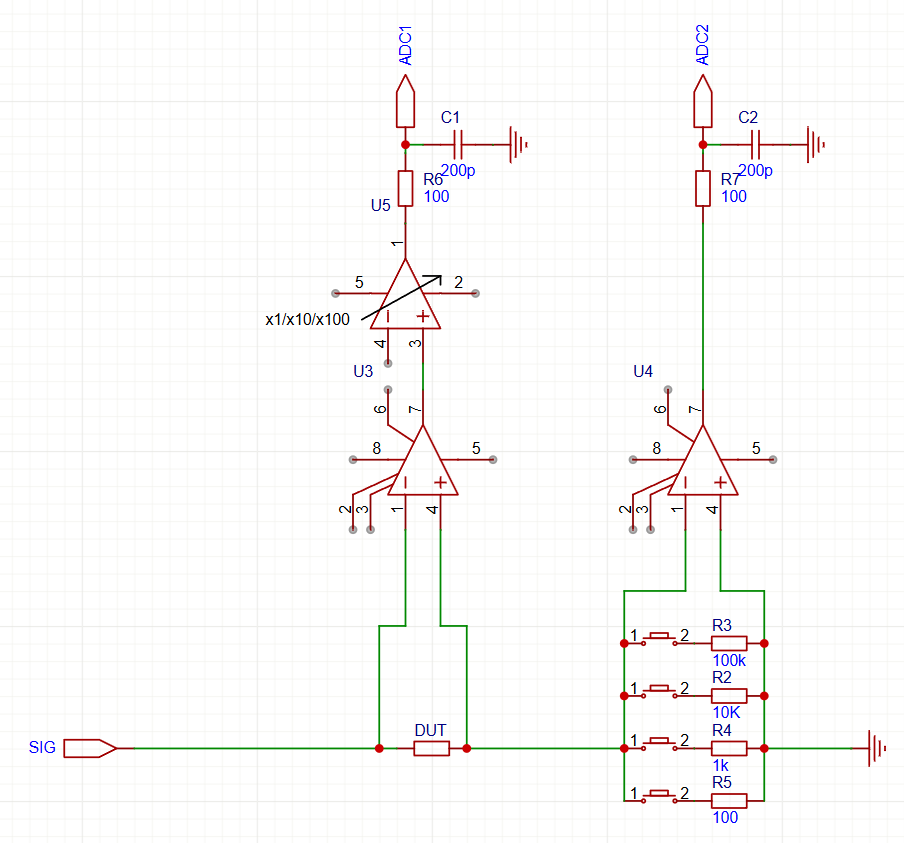

琢磨了两天，终于把精度和动态范围算明白了，设计搞完了

# 测量仪器
## 精度
### 例子：LCR

（选取不同参考电阻相比在通道2再加一组pga的好处有：
1. 便宜；
2. 在10欧-1M欧都不需要使用pga，pga的使用会带来幅度和相位偏差；
3. 也满足需求，测量高阻抗只存在极小电容和极大电阻，极小电容因为运放输入电容的存在也达不到精度，就是就算放大很大也达不到精度，极大电阻(>1M)一般不需要那么高精度，电感在低频率（<100k）不会到很高阻抗）

下面来计算精度：
$$
Z_{meas}=\dfrac{信号_{DUT}+噪声_{DUT}}{信号_{REF}+噪声_{REF}}*(Z_{REF}\pm 阻值精度)
$$
假设信号DUT测量精度d%，信号REF测量精度r%，阻值精度z%

$$
Z_{meas}=\dfrac{信号_{DUT}}{信号_{REF}}Z_{REF}*\dfrac{1\pm d\%}{1\pm r\%}(1\pm z\%)
\\ \approx Z_{DUT}*(1\pm d\%)(1\mp r\%)(1\pm z\%)
\\ \approx Z_{DUT}*(1\pm d\%\mp r\%\pm z\%)
$$

#### 精度公式
>$max(d\%,r\%,z\%)$

意味着每一路信号的测量精度和参考阻值的精度都要到精度指标

到了高频，运放的输入电容（若干pf）的影响开始变得显著，假设校准精度是c%，
$$
Y_{meas}=\dfrac{信号_{REF}+噪声_{REF}}{信号_{DUT}+噪声_{DUT}}*(G_{REF}\pm 阻值精度+ (1\pm c\%)jwC_{REF})\\-(1\pm c\%)jwC_{DUT}
\\ \approx (Y_{DUT}+jwC_{DUT})*(1\pm d\%\pm r\%\pm z\%\dfrac{G_{REF}}{G_{REF}+jwC_{REF}}\pm c\%\dfrac{jwC_{REF}}{G_{REF}+jwC_{REF}})\\-(1\pm c\%)jwC_{DUT}
$$

#### 考虑寄生电容后的精度公式
$(1+\dfrac{jwC_{DUT}}{Y_{DUT}})(d\%\pm r\%\pm z\%\dfrac{G_{REF}}{G_{REF}+jwC_{REF}}\pm c\%\dfrac{jwC_{REF}}{G_{REF}+jwC_{REF}}\pm c\%\dfrac{jwC_{DUT}}{Y_{DUT}})$

为了不对精度产生非常强的恶化， $\dfrac{jwC_{DUT}}{Y_{DUT}}$ 需要小于量级1，以10pf估算，电抗在100khz下是100k，那么测量阻抗需要<100k。假设在量级1，c%也需要到精度要求

但是校准这么小的电容不是一件容易的事情，假设校准精度c%=10%，那么在高频下只能接受测量阻抗降低。比如0.1%精度要求，要求参考阻抗是电容电抗的1%也就是在100khz用1k，以及待测阻抗在100k<1k。当待测阻抗>1k，就不得不接受测量精度的降低的现实。

然后还有一个要校准的是信号链的频率响应，高频会有衰减，比如10M的3dB截止频率，也会在100khz带来1%的衰减，假设频率响应校准精度为10%，勉强能到0.1%的精度

#### 总结
不管是待测阻抗还是参考电阻，要达到精度要求需要满足 $Z<\dfrac{100kHZ}{f}*\dfrac{精度}{0.1\%}\ k\Omega$ ，这个式子决定了最小测量电容为1nF，再小会有精度损失，这个最高满足精度的阻抗-频率曲线就是一个电容的曲线。最大可测电感是一个平方下降的曲线，在100khz 0.1%精度下是1mH

在测量时参考电阻根据频率有一个最高电阻，按照100k(100-1khz)/10k(1k-10khz)/1k(10khz-100khz)选取，这样运放输入电容带来的影响也在精度内（校准后）

顺便计算一下最小可测阻抗：按照100/1K/10k/100k欧的参考电阻，以及最高100倍的pga增益，100/10/100=100m欧，这是在精度内的阻抗，并不是说1m欧测不到，只是1m欧在标称0.1%精度下精度恶化成了10%

信号链的最小带宽（校准后影响在精度范围之内）：$BW=10M*\dfrac{0.1\%}{精度}$

### 信号测量，运放增益与ADC
要达到指定信号测量精度，对于一定分辨率的ADC，对于一定的底噪，不同的信号需要给多少的增益？

首先根据精度，可以选至少的位数（ENOB），比如12位ADC在千分之一的边缘，一般ENOB为10位，选边缘肯定就达不到千分之一精度，虽然说过采样可以提升精度，但是量化噪声和白噪声还是不一样的，但是在比量化台阶大的白噪声下量化噪声可以约等于白噪声。要比较稳千分之一精度肯定要16位ADC。如果12位想冲千分之一精度，需要把底噪放大到量化台阶量级，但是很多时候不允许那么大的放大范围（信号信噪比很大），那么过采样还是不能提高多少ADC位数。10位ENOB就只能当10位看

况且不是所有时候信号都是放大到撑满ADC测量范围的，比如12位ADC，一个信号只是放大到几百mV，量化噪声几mV，精度只有1%

所以能测量的信号首先是>底噪/精度，然后要放大到ADC量化噪声/精度。比如16位ADC，SNR为80dB，信号需要放大到100mV+才能到60dB SNR/千分之一精度，这样其实一格动态范围只有20dB，PGA的步长就是x10

手搓PGA的时候有注意点，比如我为了追求带宽（带宽高的好处是对信号的幅度和相位影响小，虽然带来噪声大，但是噪声还是很小的，相比于待测信号，而且软件上还会进一步低通滤波使得待测信号SNR达到要求），使用多级级联，然后开关选择。我比如想达到0.1%精度，也就是SNR 60dB，最大增益40dB，那么开关通道间隔离度要>100dB，不然会有最后一级往第一级的反馈导致的偏差（虽然也能校准，但是能少一点就少一点，多了还容易振荡），不仅在开关的选择上提出了挑战（模拟开关一般最高80dB隔离度，危），布线上也注意远离和包地

## 动态范围
### 例子：LCR
（这里是按照通道2也接pga而不是使用切换电阻的方案计算）假设我想测量1欧-1M欧的阻抗，动态范围有120dB，假设串联1k欧，意味着每个测量通道电压在1mV-1V之间变化，电压动态范围是60dB，单段动态范围20dB，所以需要三段。需要把1mV放大到100mV，PGA步长x10，那就是x1,x10,x100。这样的配置1m欧-1欧，1M欧-1G欧都是能测量的（对于16位ADC，对于12位ADC则是10m欧-100M欧），只是精度降低

关于底噪。比如16位ADC,100uV量化噪声。10nV/根号hz在10M带宽下是30uV，这个只是限制了放大倍数的上限，也就是10000倍，不要超过ADC量程。因为LCR测量里内部还有带宽很小的滤波器，比如10hz，那么底噪不会超过100nV，理论上100uV+的信号都能满足0.1%精度要求，但是这个就会要求1000的放大倍数。如果加上1000的放大倍数，可以提高范围外阻抗的测量精度
