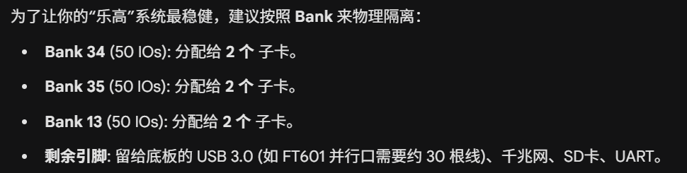

下午完成了通用板的系统设计，比较粗糙。为了能像电赛一样快速搭积木做开发/验证

# 中速采集通用板设计
## 需求
* 中速信号采集（100ksps-125Msps）
* 中速任意信号发生
* 中速方波发生

## 架构
### 核心板
* zynq7020

### 载板
* 6个自定义功能子卡接口（Mini PCIe/Samtec HSEC8）（信号引脚记得包地）
    * 
* 中低速通信接口
    * uart
* 高速通信接口
    * usb3.0
    * 千兆网口
* SD卡
* 引脚排针引出
* 时钟分配方案
    * fpga时钟引脚（4路同一个bank）
* hdmi接口？

### 功能子卡
* 低速8路ADC（几百k，一两M）
* 中速双路ADC（40-125Msps）
* 中速双路DAC（125Msps）
