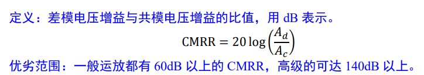
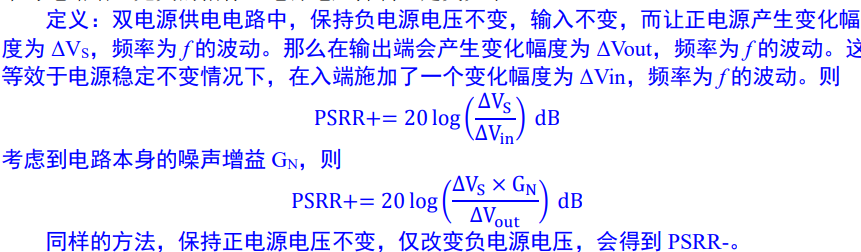
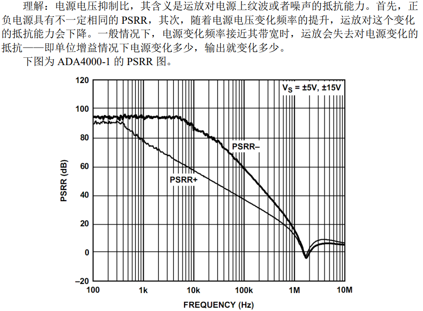
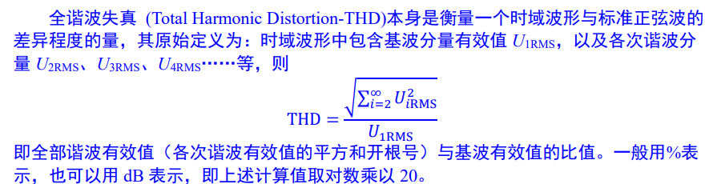
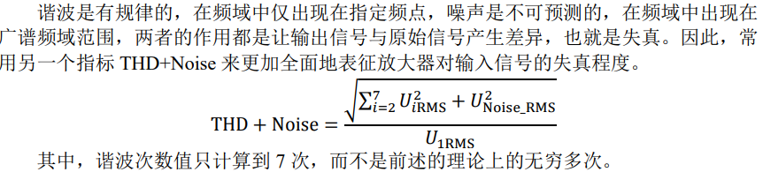

今天看了《你好，放大器》的第二章，相见恨晚（因为看了好多好多datasheet慢慢有了选型的方向，对精密/高速的指标有了感觉），知识整理如下：

## 运放指标
* 输入输出电压范围（是否RRIO）：无RRIO的运放输入输出会比电源轨少1V多，RRIO则少0.1V左右
### 直流性能
* 输入失调电压Vos：对直流精度的影响是Vos（与共模电压有关）（这个可以校正，但是Vos随时间和温度的漂移无法提前校正）
* 输入偏置电流Ib：对直流精度的影响是Ibx(Rs//Zin)（Rs是信号源阻抗，Zin是运放的共模输入阻抗）（就算交流耦合也不能忽视这个，如果Ib很大，交流耦合的电阻也很大，那么贡献的电压会远大于Vos，有可能在高倍率的放大下降低输出动态范围）
* Rin：共模输入阻抗，会与信号源阻抗分压（如果信号源阻抗已知，那么可以校准，否则应该选取Zin远大于信号源阻抗）
* 共模抑制比CMRR：（共模电压影响输出电压）

### 交流性能
* 噪声(注意数据手册的都是有效值，峰峰值要x6)
	* 输入电阻噪声 $n_r=\sqrt{4kTR_{in}}$ ；对于常温下1k电阻，是 $4nV/\sqrt{Hz}$
	* 运放电流噪声 $n_i=R_{in}i_n$ ，对于1pA，1k欧，是 $1nV/\sqrt{Hz}$ （这告诉我们，输入电阻不能太大，以及电流噪声在pA级别时要注意，可能成为主导噪声）
	* 运放电压噪声 $n_v$ ：一般来说是几 $nV/\sqrt{Hz}$ ，最好的能到1
* 单位增益带宽（GBW）
* 压摆率：V/us，假设输入信号频率最高是f，输出幅度是A，则选取SR>2piAf
* Zin中的差模输入阻抗和C，会在信号频率升高输入阻抗变小
* 电源电压抑制比PSRR（对电源纹波和噪声的抑制）
* 全谐波失真THD

