## 运放分类
### 精密运放
#### 低失调电压Vos
供电范围：
* 2.2-5.5V 低压运放
* 4.5-36V 通用运放

分类：
* e-trim：有1/f噪声，Vos在uv级别
* chopping：在开关频率有极大噪声，但是无1/f噪声。开关频率在几十k到几百k不等

### 高速运放

#### 低噪声
噪声一般可以达到1nv/根号hz左右
* BJT输入，输入阻抗小（kohm级别），偏置电流大
* 典型：OPA1612

#### 高阻输入，低偏置电流
噪声大于4nv/根号hz
* FET输入，噪声略大
* 典型：OPA656

### 电流反馈型运放
主要用于高速、需要较高压摆率、单级电压增益较大的场合

优缺点：
* 电压增益变大时，带宽减小不明显。因此，它更适合于实现单级较高增益的放大电路。
* 压摆率极大。这在大幅度输出，提高满功率带宽上有明显的优势。
* 它们一般都具有较低的噪声、较高的失调电压和偏置电流
* 对它们的使用有一定的限制。当要用它作为电压跟随器时，必须用电阻串联到反馈回路中。另外，电流反馈放大电路的反馈电阻需要缜密选择，不同增益下应具有不同的反馈电阻，多数的器件 Datasheet 中对此都有说明

#### 原理
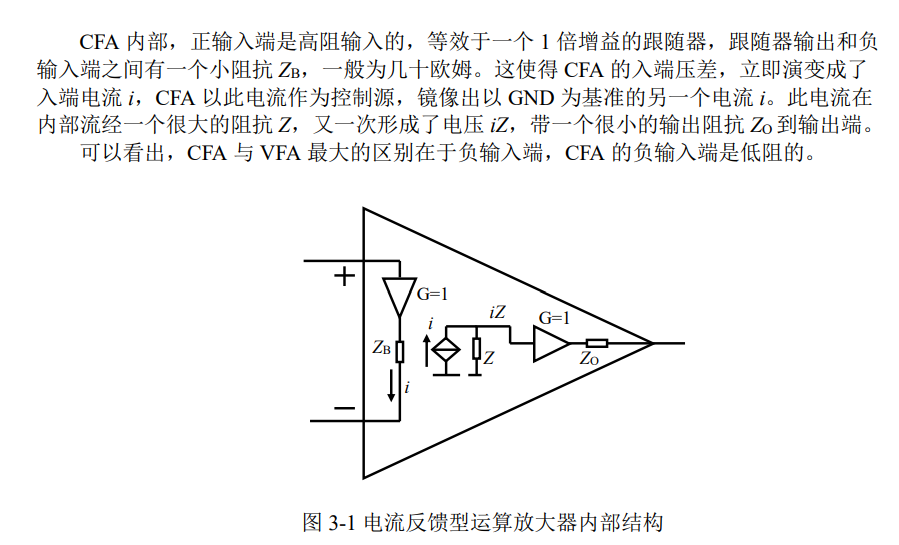

### 全差分运放
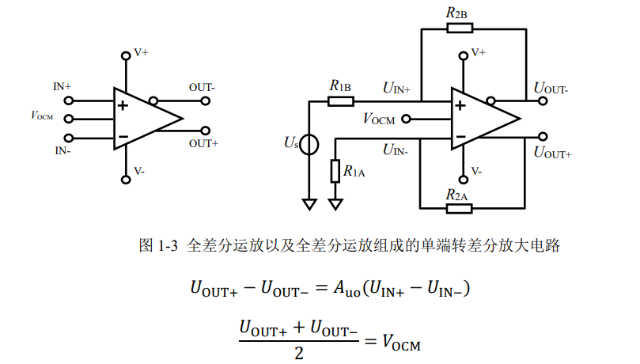

#### 结构
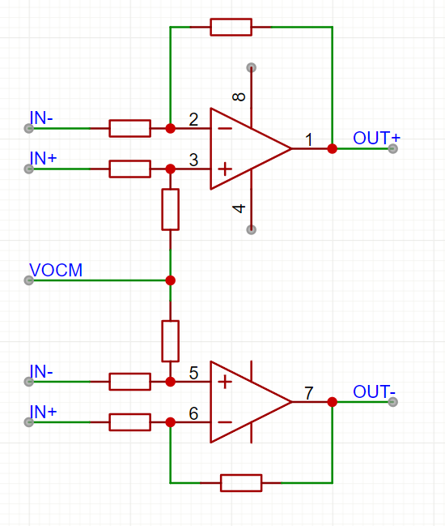

#### 特点
* 差分输入，差分输出（有一个脚设置输出共模电压）
* 输入阻抗不大

#### 注意点
* 接受浮空输入

如图，因为Vout-RF-RI-Vin-R2-R1这一路电流相等，就解出电平了
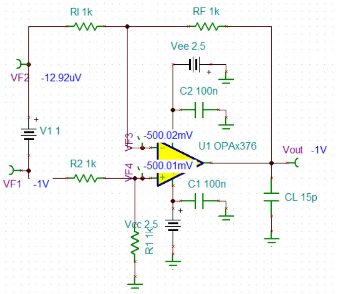

#### 应用
* 信号单端转差分
* 全差分放大

### 仪表运放
#### 结构
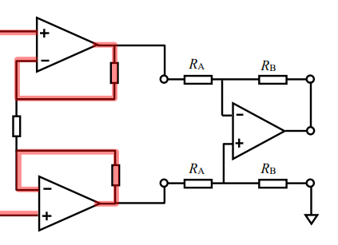

#### 特点
* 输入阻抗极大
* GBW一般在数M

#### 注意点
* 共模电压限制输出摆幅
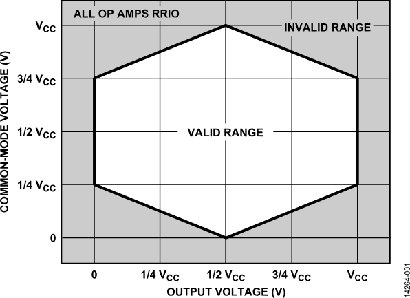
（这个钻石图随增益和输出参考电压的变化而变化）
* 不接受浮空输入

#### 钻石图计算
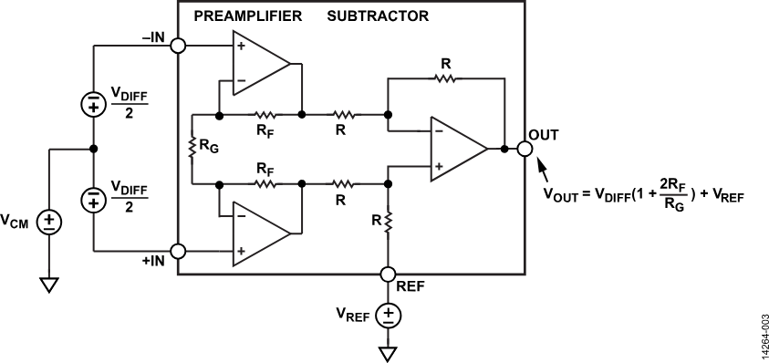

$$
G=1+\dfrac{2R_F}{R_G}
\\V_{OUT}=V_DG+V_{REF}
\\PRE1:VEE<GV_{CM}-\dfrac{V_{OUT}-V_{REF}}{2}<VCC
\\PRE2:VEE<GV_{CM}+\dfrac{V_{OUT}-V_{REF}}{2}<VCC
\\VEE<V_{CM}<VCC
\\VEE<V_{OUT}<VCC
$$

在线计算：https://tools.analog.com/cn/diamond/#difL=-0.1&difR=0.1&difSl=-0.1&gain=100&l=-8&pr=AD8422&r=8&sl=-8&tab=1&ty=1&vn=-15&vp=15&vr=2

#### 应用
* 阻抗测量

### PGA
* 带宽随增益变
* 增益误差小，稳定

### VGA
结构是电阻可变衰减阵列+恒定增益运放
* 带宽不随增益变
* 输出噪声随增益恒定（意味着放大倍数越大SNR越大）
* 关注增益误差（包括对频率，对增益，对温度），会对测量造成误差

## 经验性问题
### 运放电路外部电阻选择
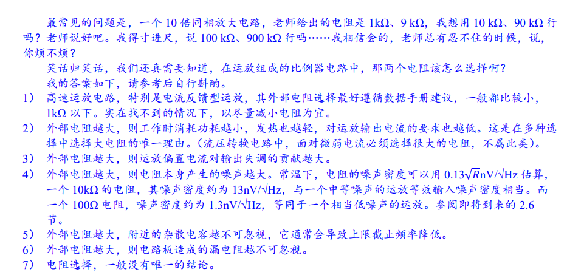

### 运放输入保护
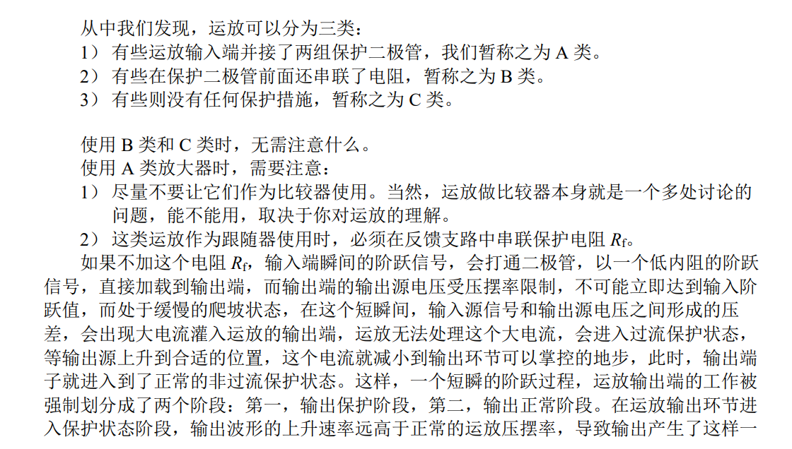
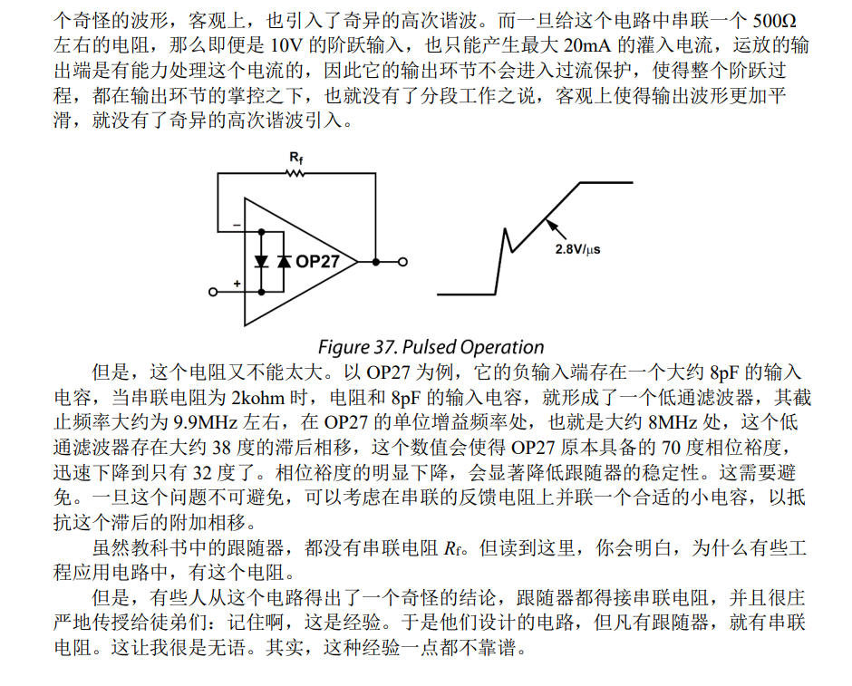

### LDO与电压基准
差别：
* LDO是射极/漏极输出，不接受输入电流；输出电流在百mA级别
* 电压基准芯片是运放输出，可以输入输出电流几十mA级别

### 信号限幅
* 串联稳压管接地最靠谱
* 使用二极管容易遇到电源单向电流问题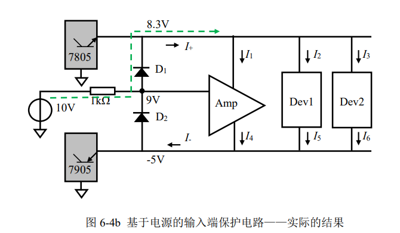
