整理了两天终于整完了

来个目录：
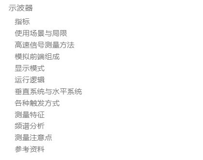

# 示波器

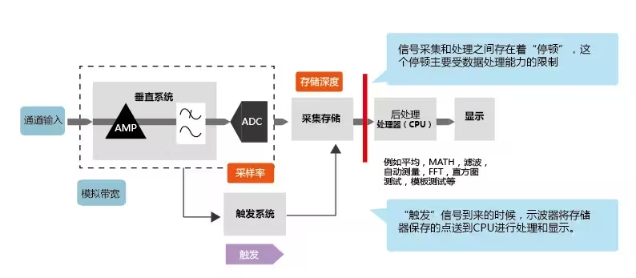

## 指标
* 采样率（sps：sample per second）：在现实中，准确地重建的一个信号，取决于采样率和插值算法。示波器提供了正弦内插法或线性内插。
示波器采集率 > 2.5 x 被测信号最高频率分量(sinc内插法)
示波器采集率> 10 x 被测信号最高频率分量(线性内插)
* 带宽（MHz）：为了确定示波器所需要的带宽，需要用“5 次谐波”原则（即信号基频x5）来评估被测信号的带宽。使用“5 次谐波”原则选择的示波器，最多会有不到 2％的测量误差。一般情况下，较高的带宽对更精确的重现信号更加有利。
* 底噪：底噪越小，能看到越小的信号。一般在百uv级别（使用10x探头就到1mv级别）
* 分辨率（bit）
* 存储深度：一次触发存储的波形点数（采样率x显示时间）（采样点多，触发捕获放大之后细节更精细，以及存储的波形长度越长）
* 波形捕获率：虽然示波器的显示是60hz，但是每一帧都是由1/60s内捕获的多个波形叠加而成的。波形捕获率，表示的是每秒钟捕获波形的次数，决定了示波器捕捉、处理和分析信号的效率。波形捕获率高的示波器波形能够更深入的洞察信号的行为。可以显着提高的示波器捕捉瞬态异常，像抖动、欠幅脉冲、毛刺等错误的概率。

## 使用场景与局限
* 应用场景：周期信号的特征观察/偶发信号的捕获
* 幅度局限：10x探头底噪1mV，所以测量信号幅度要>1mV（微弱信号需要预放大，为了提升观测的信噪比）
* 直流精度局限：有几十mV的误差，不适合精密测量
* 单端测量不能差分测量（差分信号需要预先差分转单端）
* 高速信号高阻测量还要额外的处理：因为探头阻抗随频率而下降，以及传输线电缆在信号频率高的情况下会带来信号的反射，所以可能会需要有源探头
* 存储深度局限：记录波形长度有限，不适合数字信号时序分析（逻辑分析仪干这事）

## 高速信号测量方法
探头带宽相对于50欧内阻信号源而言，也就是探头输入电阻下降到50欧的频率
### 常见探头参数
* 普通无源探头：阻抗的转折频率在10khz左右
	* 10x且示波器高阻输入：6pf//10Mohm，带宽500MHz，在电路测个10MHz方波没啥问题（假设方波的接收端是50欧负载）；测量正弦波的话50MHz没啥问题
	* 1x且示波器高阻输入：60pf//1Mohm，带宽50MHz，测个1MHz方波没啥问题；测正弦波的话5MHz没啥问题
	* 1x且示波器50欧输入：50ohm，带宽就是示波器带宽，测50欧内阻的信号源
* 有源探头：
	* 10x且示波器50欧输入：0.2pf//10Mohm，带宽15GHz
	* 1x且示波器50欧输入：2pf//1Mohm，带宽1.5GHz
	* 问题是：前端有缓冲级，信号输入范围不对可能削峰了不自知（尤其对于方波，削峰了信号形状不变但是幅度变小带来测量错误）

### 高速信号测量
* 减小探头电感：长长的地线改成短接地针
* 高阻测量下电缆长度需要小于1/10信号波长，比如1m的电缆，那么信号波长大于10m，频率小于30MHz（在这频率下10x探头阻抗大概10kohm）
* 对于更高频率信号的测量（30M+），50欧内阻信号源直接用50欧输入测，在电路中测的话，建议使用高带宽的有源探头（起码信号五次谐波频率的10倍吧，五次谐波是为了观测到尽可能多的信号特征，10倍是为了减小探头阻抗对电路的影响；比如15GHz带宽有源探头测个300MHz方波）；然后有源探头的输出是50欧内阻，接传输线，示波器50欧输入就不会有电缆传输线反射的问题
* 到了在电路中测量RF信号/超级高速的信号（300M+），我猜想在设计时就需要留出测量点，用耦合线分出一小部分功率，传输线接sma接口(或者有没有什么专用的接口，探头可以直插)，然后电缆进50欧输入的示波器（可能需要预放大一下（比如使用带放大的有源探头），假设耦合度是60dB，那么数字信号进入耦合线就是mV级别，示波器不容易观测）

## 模拟前端组成
参考 https://www.ti.com/solution/oscilloscopes-digitizers
以及LMH6518的datasheet
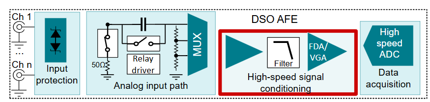
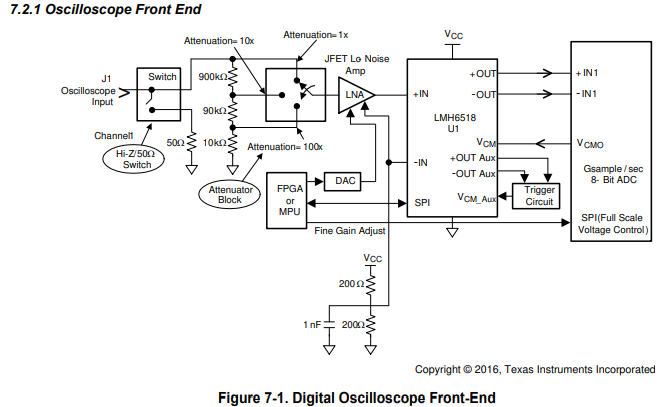

1. 输入调节：交/直流耦合，50欧/高阻输入，1/10/100倍衰减
2. 高阻减offset的LNA
3. VGA
4. ADC
5. 触发（这个也可以数字实现）

## 显示模式
* 连续触发（AUTO）：首先采样点相对于像素点是多的多的，所以一个波形好多点会映射到同一个纵列像素点上。然后数字荧光，在1/60秒内采集的若干波形叠加在一起，按照频次辉度显示。（与正常触发的区别是，根据时基的选择，连续触发一段时间未触发会自动触发，没有设置对触发会导致一团混乱的波形，但是起码能出波形）
* 正常触发（NORMAL）：触发一次叠一个波形到屏幕上，60帧更新，没触发没波形。
* 单次触发（SINGLE）：单次触发显示就暂停了，显示一个波形。因为采样点相对于像素点是多的多的，所以一个波形好多点会映射到同一个纵列像素点上，所以波形看起来有粗细。

注意，当显示暂停的时候，实际上是显示一个波形，不是好多个波形叠加。所以其实只存一个波形就够了。连续显示数字荧光的时候，每采一个波形直接叠到显示RAM上了，然后每1/60s再显示RAM更新到屏幕上，所以波形也不需要每个都存下来，只存最近的一个就行。

## 运行逻辑
**注意点：**
* 每个采集波形时间长度为屏幕横轴长度的数倍，比如3倍
* 抽样频率随时基变，以维持相同纵列叠相同个数的波形点（存储深度=采集时间x抽样频率，采集时间变小，抽样频率变大）。当抽样频率达到采样率时，同样维持采样时间为屏幕横轴长度的固定倍，那么相同纵轴叠的波形点变少，同时存储FIFO减小（因为采集时间远长于屏幕长度是对波形的浪费，所以就不加采集时间了）
* 余晖显示我的想法是叠到显示RAM上用一个低通，就能实现之前的数据慢慢地消失

**方式一（基于MPU的串行处理）：**
连续触发：ADC连续采集进检测触发程序->波形数据进抽样程序后进存储FIFO->检测到触发->继续采集存储FIFO 1/2的长度，完成一个波形->数据给MPU，MPU算完波形的参数->波形叠到显示RAM上->60帧显示

缺点就是，MPU限制数据流量，波形捕获率不能做到很大

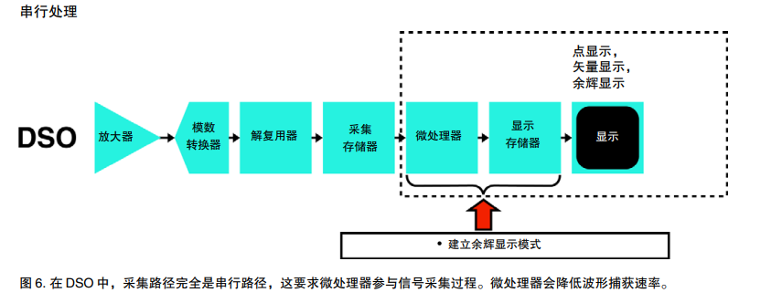

**方式二（基于FPGA的并行处理）：**
连续触发：ADC连续采集进检测触发程序->波形数据进抽样程序后进存储FIFO->检测到触发->继续采集存储FIFO 1/2的长度，完成一个波形->波形直接叠到显示RAM上//FPGA并行算波形的各种参数->60帧显示

优点就是波形捕获率大
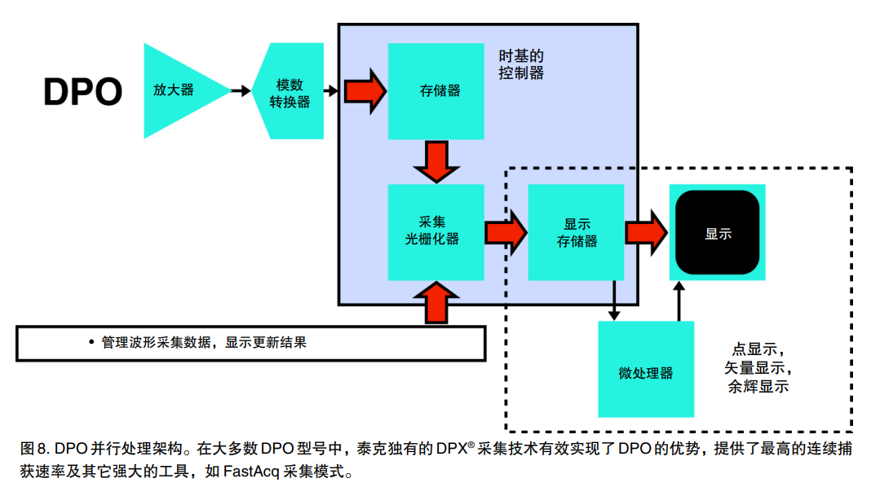

## 垂直系统与水平系统
### 垂直系统
range：
* 1mV/div
* 2mV/div
* 5mV/div
* 10mV/div
* 20mV/div
* 50mV/div
* 100mV/div
* 200mV/div
* 500mV/div
* 1V/div
* 2V/div
* 5V/div
* ...

offset：上下平移波形，可以连续调节

### 水平系统
时基base：
* 1ns/div
* 2ns/div
* 5ns/div
* ...

position：左右平移波形（相对于触发点），可以连续调节
调整延时后，存储FIFO的中心就是触发+延时的时间

## 各种触发方式
* 边沿电平
* 压摆率
* 脉冲特征，包括毛刺，欠幅脉冲，脉冲宽度
* 建立和保持时间的行为
* 串行数据码型

### 边沿触发与脉宽触发
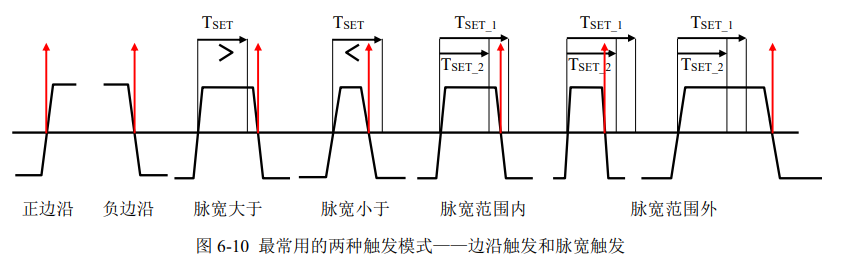

边沿触发有个问题，就是当波形噪声很大，会误触发，有两种优化方法：
1. 比较器后的结果进行滤波（类似按键消抖，根据时基设置一定的滤波时间）
2. 用滞回比较器，设置两个阈值（但是感觉噪声大了还是不行）
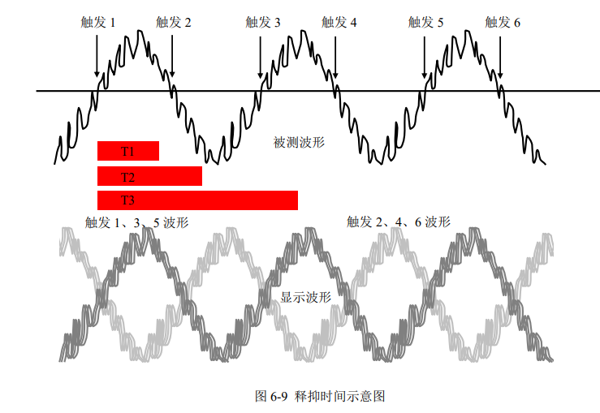

### 窗口触发
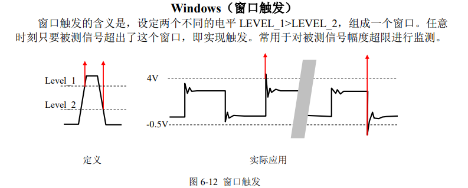

### 间隔触发
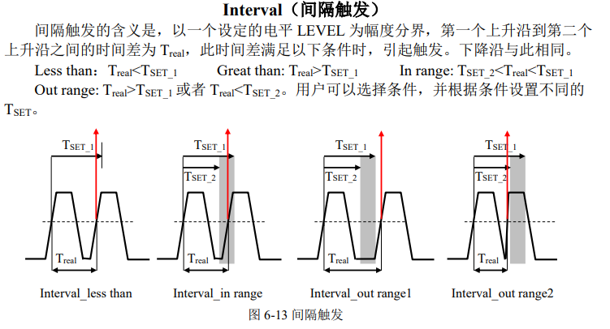

### 漏失触发
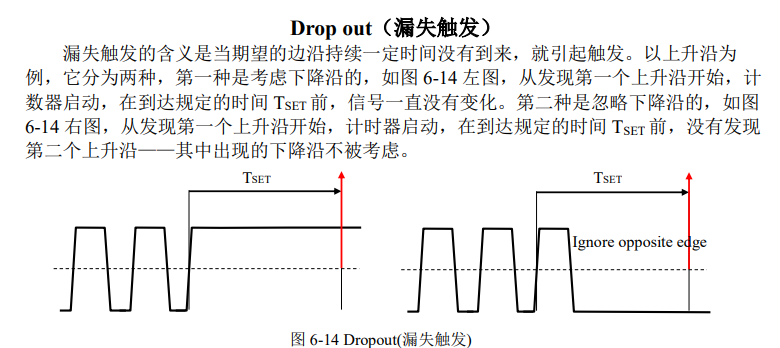

### 矮脉冲触发
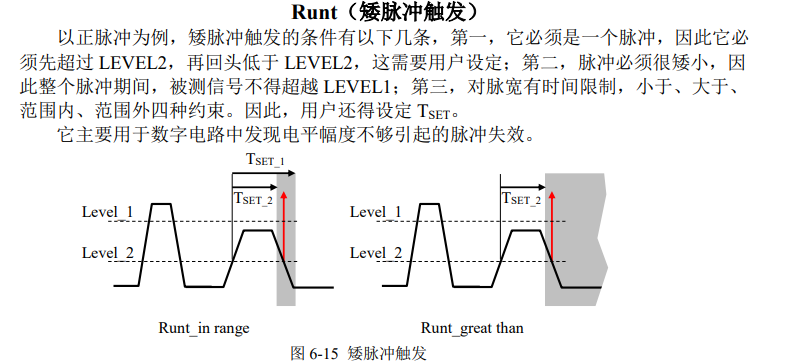

### 压摆率触发
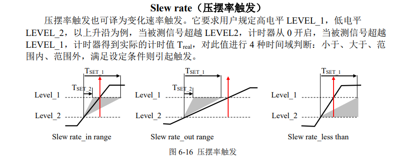

## 测量特征
* 垂直特征
	* Vpp：波形最高点与最低点的电压差
	* amplitude：去掉过冲和噪声后的波形幅度
	* Vmax/Vmin
	* Vaver
	* Vrms：直流有效值/交流有效值
	* 过冲量：上过冲/下过冲
* 水平特征
	* 频率
	* 占空比
	* 上升/下降时间
	* 脉宽

还可以用cursor测横轴和纵轴

## 频谱分析
一般示波器自带FFT功能，可以观测信号频谱

nb的示波器的数字荧光频谱分析（实现原理应该是一段时间内好几张频谱的叠加，概率低的为蓝色，概率高的是红色。因为点频信号和噪声都是恒定的，所以是红色；但是扩频信号频率一直在变，所以是蓝绿色）（这又叫实时频谱分析仪，频谱上用颜色表示出时域特征）：
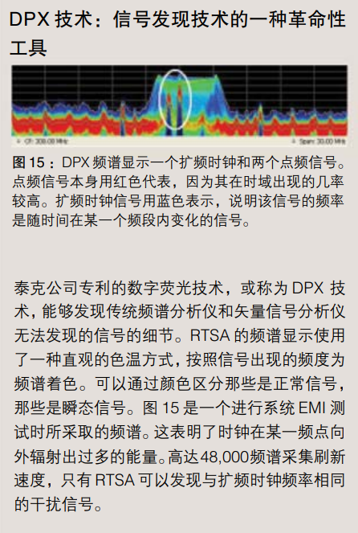

## 测量注意点
* 地线是真接地的。以及信号发生器的地线也是真接地的
	* 不能进行差分测量，只能单端（相对于地）
	* 地环路噪声问题
* 示波器探头的阻抗会对待测电路有影响，尤其是高频时
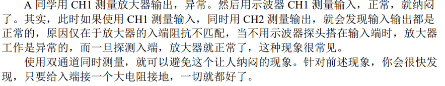

## 参考资料
* https://www.bilibili.com/opus/851083847446560853
* https://www.ti.com/solution/oscilloscopes-digitizers
* LMH6518的datasheet
* https://download.tek.com/document/54C-22137-1_1.pdf
* https://download.tek.com/document/55C-14546-4_0.pdf
* 你好放大器
