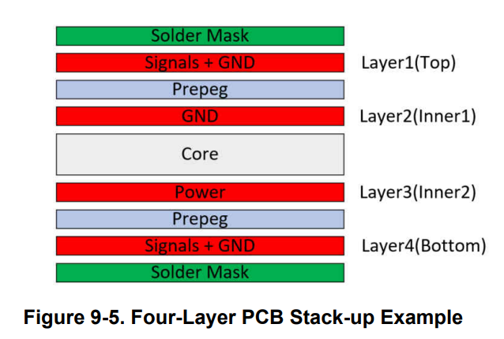
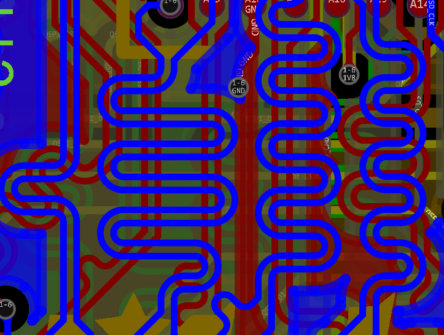
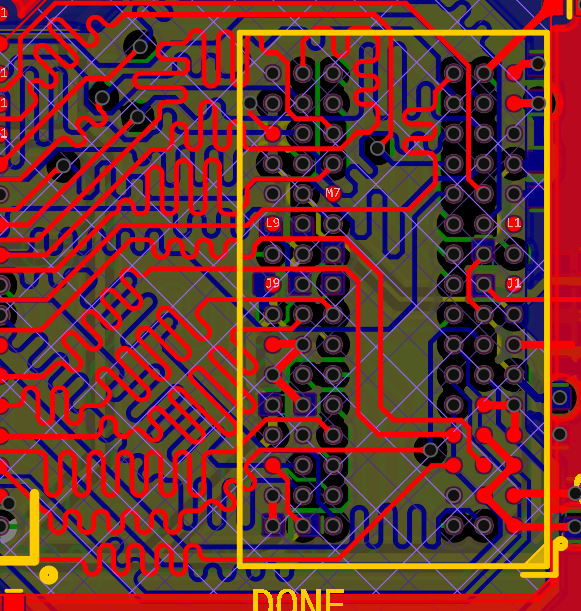
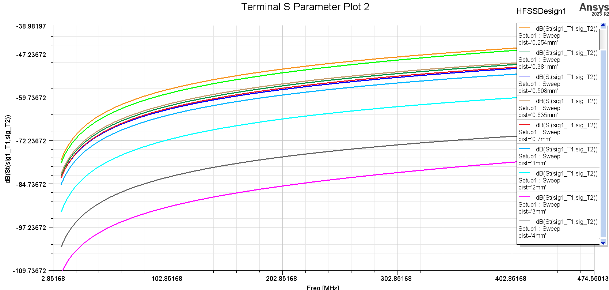
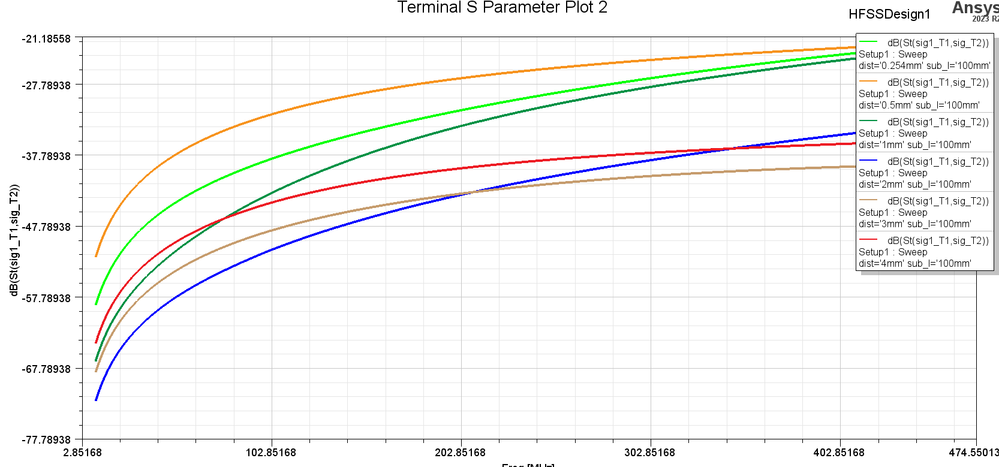
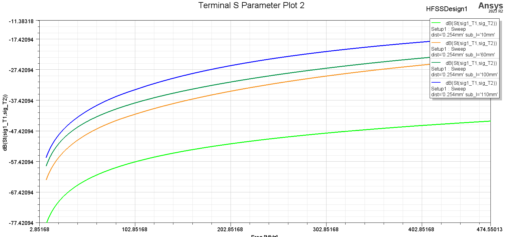
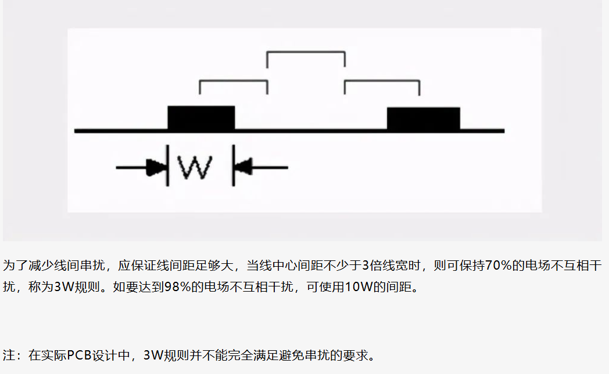
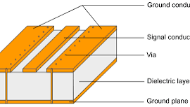

今天整理了PCB高级工艺，层压结构，以及高速信号走线注意点

## PCB高级工艺

### 钻孔填充
* 塞油墨：非焊盘上的孔会用阻焊油墨填满防止短路，但是焊盘上的孔不会被填充，会导致焊接时漏锡，以及焊盘不平整会导致焊接失效（一般线拉出来过孔打焊盘旁边，smt就没啥问题）
* 塞树脂（盘中孔）：树脂塞满孔，打磨平，表面电镀=>这样过孔打在焊盘比较平整，不会有焊接时漏锡和焊盘不平整导致的焊接失效问题

### 盲埋孔
一般层数>=8会有盲埋孔需求
#### 盲埋孔需求的产生：
* 空间的限制，比如打通孔占地方，影响别的走线。尤其底面是天线的时候，通孔肯定不能打到天线上。以及为了维护敏感信号打一长串包地过孔超级占地方，如果打成通孔，那条线又走的很长，会导致很多线走不过去。
* 信号完整性的需求：比如高速信号换层，通孔会带来很长一截残桩，会影响阻抗匹配，带来大的信号反射

#### 过孔分类
* 通孔：表层-表层
* 盲孔：表层-内层
* 埋孔：内层-内层

#### 制造工艺
* 钻孔：便宜，但是会有限制，要考虑到粘合的顺序，每次都是压好板然后钻孔，有些层到有些层的过孔是不允许的
* 激光打孔：贵，但是无限制，只要加钱。一般到三阶孔（打穿三层）
* 背钻：先钻出通孔，再把多余层从表面钻掉，最后树脂填平，表面电镀，再表面蚀刻。注意走线要按照通孔处理，而且要按照钻头直径的通孔处理，因为钻孔会把途径层给钻掉。小贵（因为要控制钻孔深度）。一般用于去除残桩

## 层压结构（layer stackup）
* PP：粘合板
* CORE：芯板
	* FR4：介电常数4.4左右，6G以内直接用，6G以上损耗大
	* 高频板：罗杰斯比较贵，铁氟龙便宜。介电常数稳定

### PCB制造工艺
1. 每个芯板（双面覆铜板）蚀刻
2. 每个芯板钻跨单层的盲埋孔
3. PP片粘合对应芯板，钻跨多层的盲埋孔（或者激光打孔，可以从表层打一层或两层，多层更贵）
4. PP片粘合对应芯板，钻跨更多层的盲埋孔（或者激光打孔）...
5. 最后粘完成整板，表层蚀刻完后钻通孔（或者激光打孔）
### 四层板

### 六层板
一般FPGA板都至少六层起步：
* L1 signal
* PP
* L2 gnd
* CORE
* L3 pwr
* PP
* L4 signal
* CORE
* L5 gnd
* PP
* L6 signal

### 八层板
对于RF板一般八层起步（因为一般还会有个FPGA来处理高带宽信号，或者底面还有天线），下面是顶层RF信号底层天线的版本

盲埋孔的考量：
* L1-L2（RF）,L3-L6(电源与信号),L7-L8钻孔（RF）
* L1-L6钻孔（顶层芯片的除RF信号都需要通到L3-L6）
* L1-L8钻孔（把天线信号通到L8）

层叠
* L1 signal(RF)
* CORE(RF)
* L2 gnd
* PP
* L3 signal
* CORE
* L4 gnd
* PP
* L5 pwr
* CORE
* L6 signal
* PP
* L7 gnd
* CORE(RF)
* L8 signal(RF)

## layout进阶技术
### 传输线
高速信号需要阻抗匹配
* 微带线
* 共面波导：隔离度高
* 带状线：在内层可以避免空间电磁耦合

### 差分线
两条信号线间距相等，耦合线模型
如LVDS

注意差分线之间要遵循3W原则（即间距>3倍线宽）

### 等长线
对信号时序有要求的线
如DDR

### 高速信号串扰问题
对于一些跳变非常快的数字信号，比如10M+的信号，串扰是非常值得考量的

下面是不同长度和间距的耦合线的隔离度图：
#### 10mm的并行长度，间距不同

#### 100mm的并行长度，间距不同

#### 间距0.254mm，并行长度不同

#### 一些直观结论
* 10mm的并行长度，间距10mil，隔离度在-60~-40dB，信号之间几乎无串扰
* 100mm的并行长度，间距10mil，隔离度在-40~-20dB，串扰有一点显著

但是如果模拟信号和数字信号并排，而且模拟信号是幅度非常小的信号（比如小于1mV，就算隔离度有60dB，也会有1/1000=1mV级别的信号耦合进模拟信号线，造成测量几乎不可用。这告诉我们，敏感信号就应该离数字信号远一点比如不同层，并且两边包地）

#### 结论
* 对于单片机的信号，算不上高速信号，间距10mil拉线并排完全没问题
* 时钟信号算高速信号，周围要铺地，打地过孔
* 那些10M+的信号，下面是一些克服串扰的措施
	* 加大平行布线的间距，遵循3W规则
	
	* 在平行线间插入接地的隔离线（共面波导）
	
	* 减小布线层与地平面的距离（这样线也可以细，电场范围小一点）
	* 布线就尽可能短，而且平行的距离短一点（比如小于10mm），尽快分开
	* 模拟信号离数字信号远一点，且有条件就信号两边包地
	* 高速信号终端匹配，防止反射回波辐射出去
	* 最敏感的信号放在内层，就不会受到外界辐射影响（比如把敏感信号和高频信号/功率信号放在不同层）

备注：
* 敏感信号：小信号，比如测量信号，天线接收信号
* 高频/功率信号：晶振，高速IO，天线发射信号，开关电源

### 其他注意点
* 连接器处需要有防ESD措施
* 信号输入考虑RFI滤波

## FPGA核心板组成
* 电源
* 晶振
* 复位
* 配置引脚
* USB-JTAG
* QSPI FLASH
* DDR3
* (USB-UART)
* (LED,SWITCH,BUTTON)
* (ETHERNET)
* IO引出
