## PCB常见寄生参数
100mil（2.54mm）长，10mil宽trace:
* 1nH
* 0.3pf
* 10m欧
* 能过0.5A电流

12mil直径，10mil高度via
* 0.1nH
* 能过0.5A电流

如果要减小过孔电感影响，可以并联多个过孔
这些寄生参数的电感量和电容寄生的ESL是一个等级的，不可以被忽略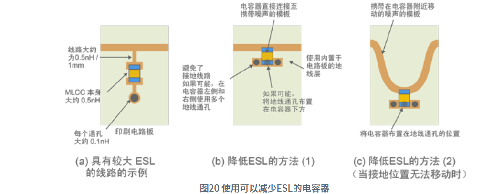

对于导线，可以估计杜邦线1cm 1m欧，0.5A，细飞线1cm 10m欧，10nH

## 电容寄生模型
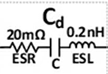

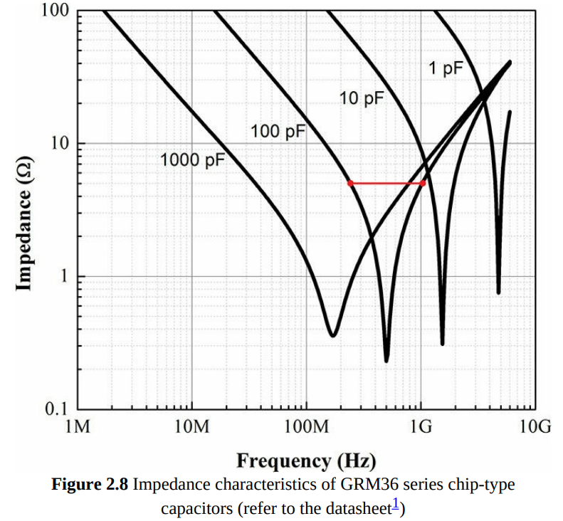

| 电容 | 参考谐振频率 |
| ---- | ------------ |
| 100p | 1G           |
| 100n | 30M          |
| 1u   | 10M          |
| 10u  | 3M           |
* 当放一排电容的时候，记得小电容靠近芯片放置（比如100n和1u）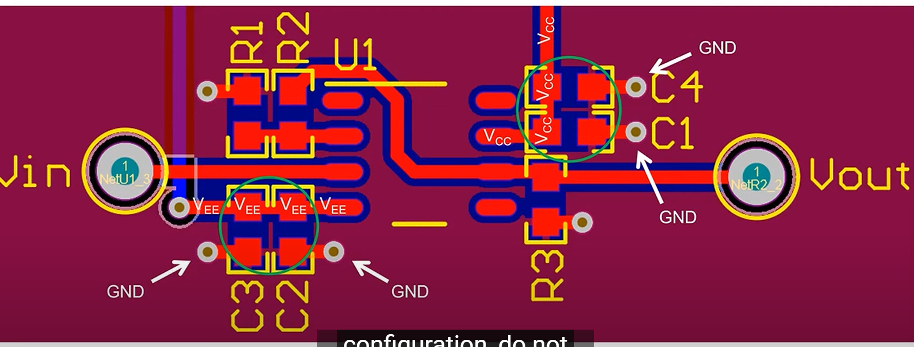
* 滤波应用里，馈通（三端）电容滤波效果更好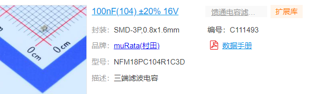
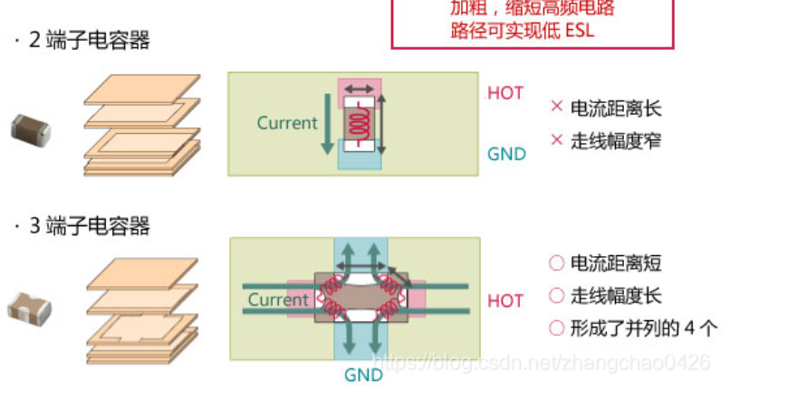

## 电感寄生模型
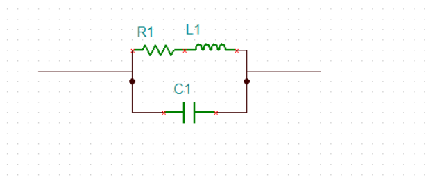

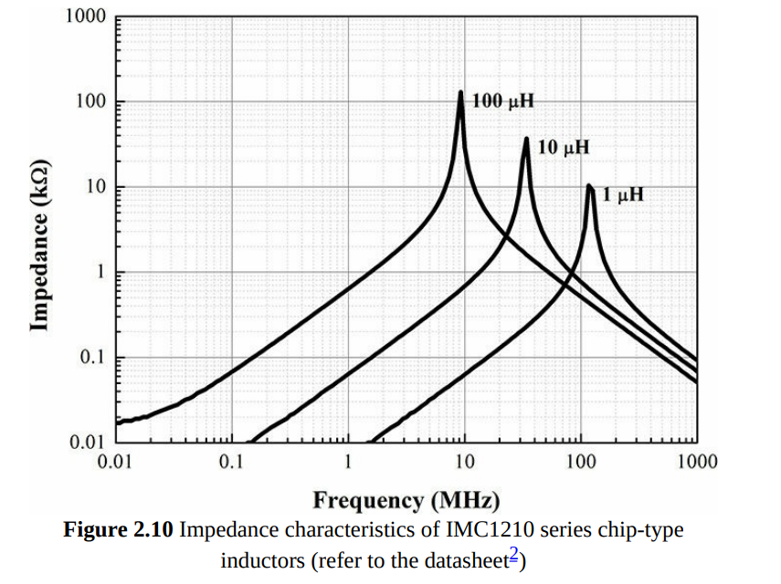

| 电感 | 参考谐振频率 | 参考寄生电阻 |
| ---- | ------------ | --- |
| 1uH | 100M           | 7m |
| 10uH | 30M         | 70m |
| 100uH  | 10M          | 700m |

## 磁珠的频率响应
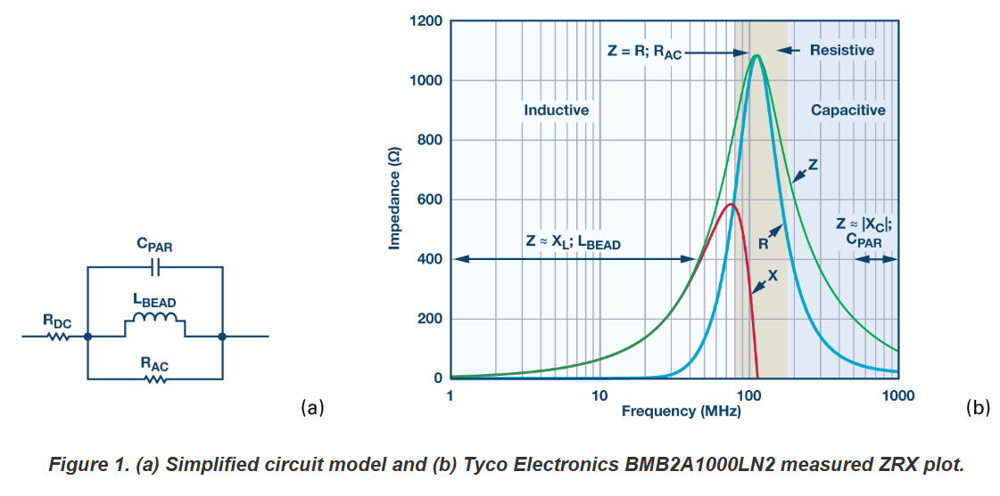
* 磁珠相当于R并L并上寄生电容，谐振频率下相当于R，这个R大概1k。用法不是直接串，直接串相当于100M陷波。要在磁珠后接电容到地，形成一个低通（-40dB/dec）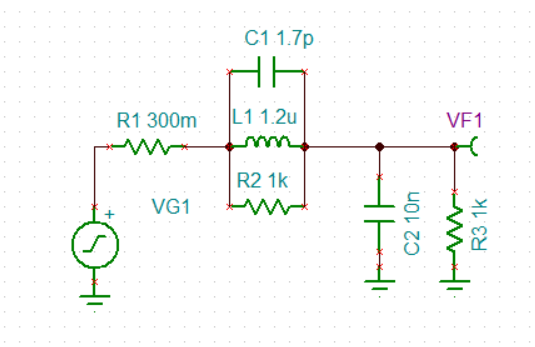
不接电容的频率响应：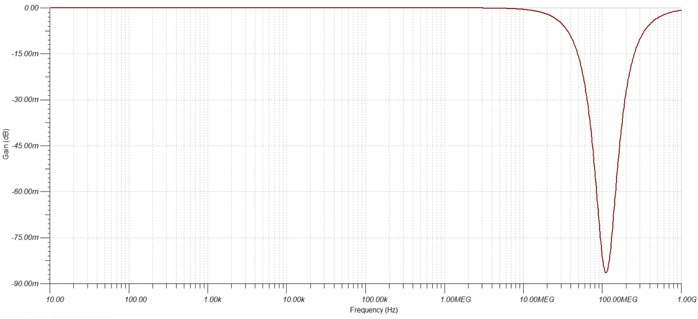
接电容的频率响应：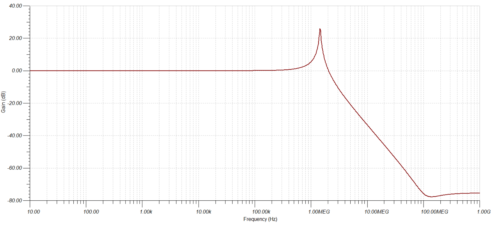
damping的方法：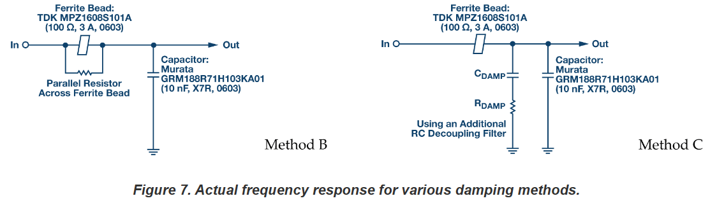
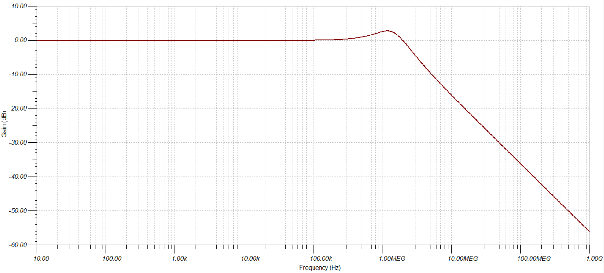
问题：高频衰减变慢

* 一般只用于额定电流的10%以内，因为容易饱和。
