对于电子线路接收机袁神的60db要求，拼尽全力无法战胜，下面记录我的战斗历程：

首先按照袁神的原理图，摁调电感与电容，最终搞出来52db。

然后开始好好设计：
## 0. 选取直流偏置
这里我选10mA, 5V的集电极电流电压

设计直流偏置电路，以及仿真用的DC_block电容与RF_chock电感
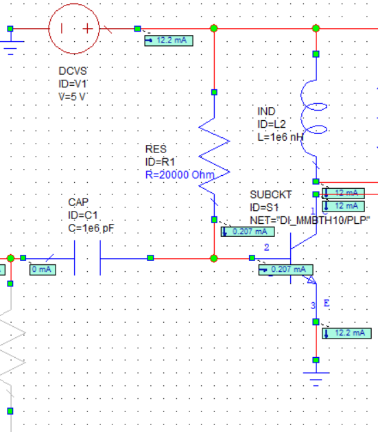

## 1. 调无条件稳定
因为这个晶体管在36M很容易振荡，如图，输入输出稳定圆（圆外稳定）
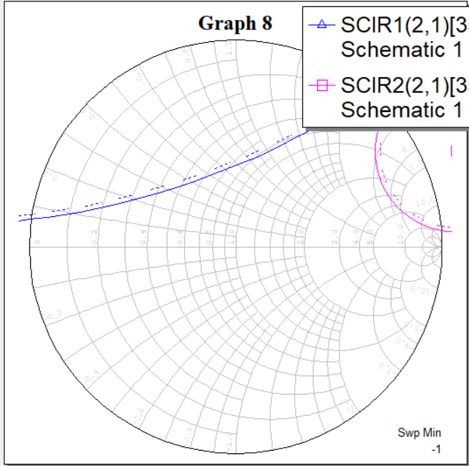
所以在输入串电阻，输出并电阻，调电阻阻值，使得两个圆都到单位圆外面去，且最大增益>30dB
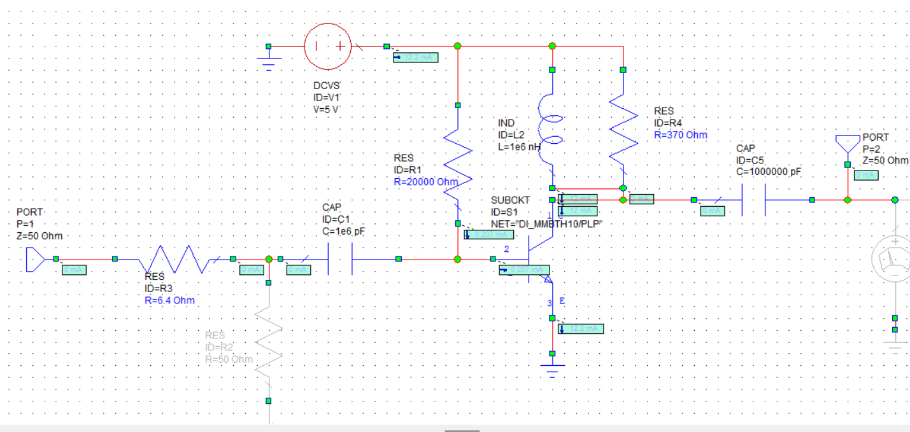
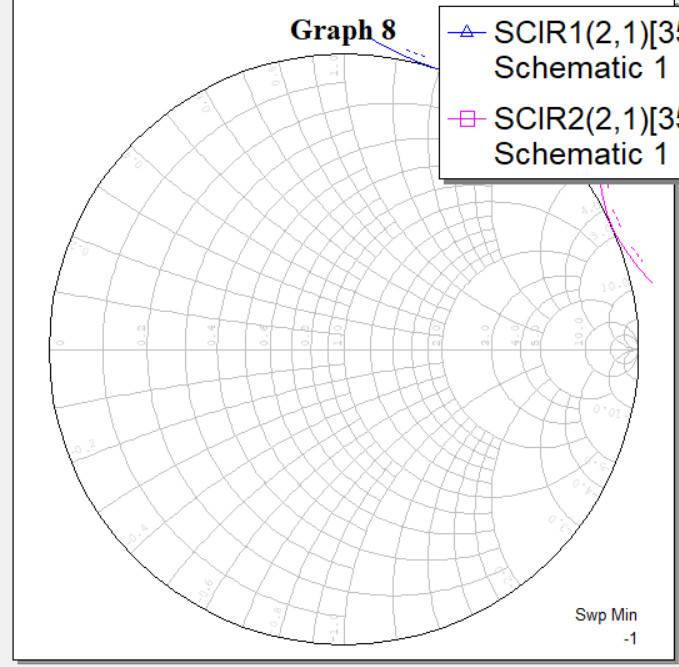
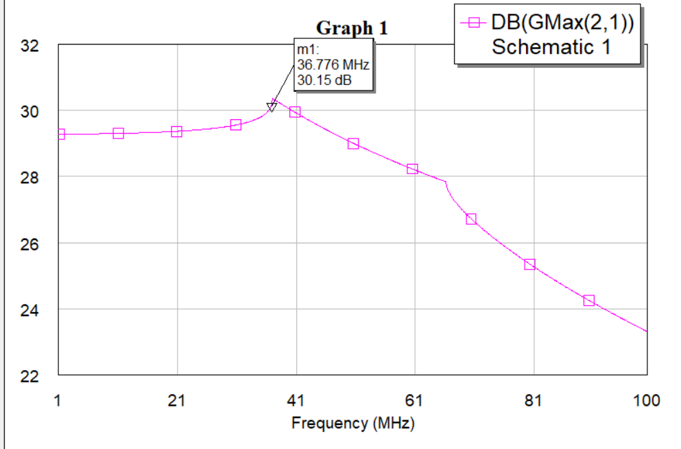

### 2. 选取输入输出阻抗
根据输入功率圆（available power gain）,选取输入阻抗点，设计输入匹配电路转换输入电阻到那个点
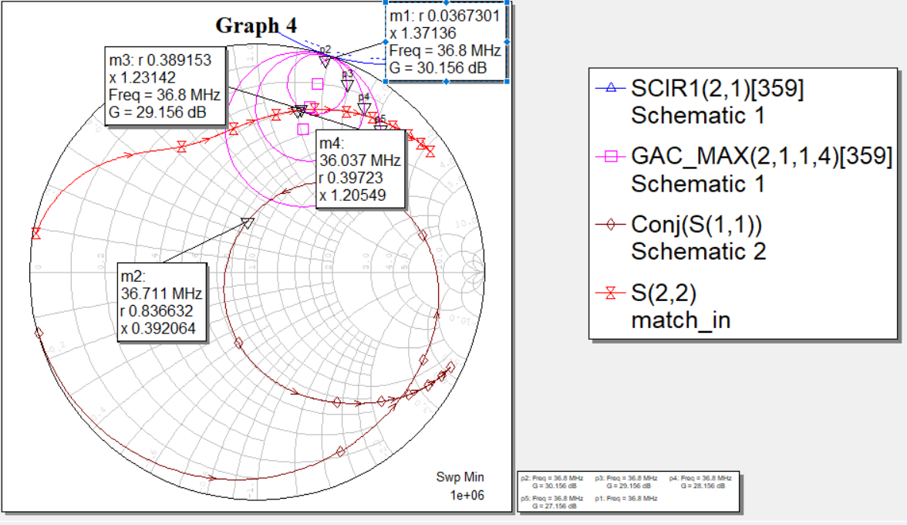
因为30db的那个点太离谱，很难匹配。我选取了29db的点m3，然后设计
匹配电路到那个点，如图点m4

**输入匹配电路**：
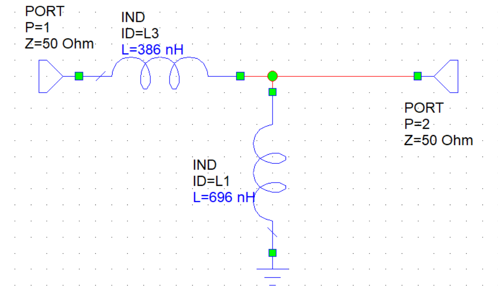

然后根据输出端的S22，设计**输出匹配电路**
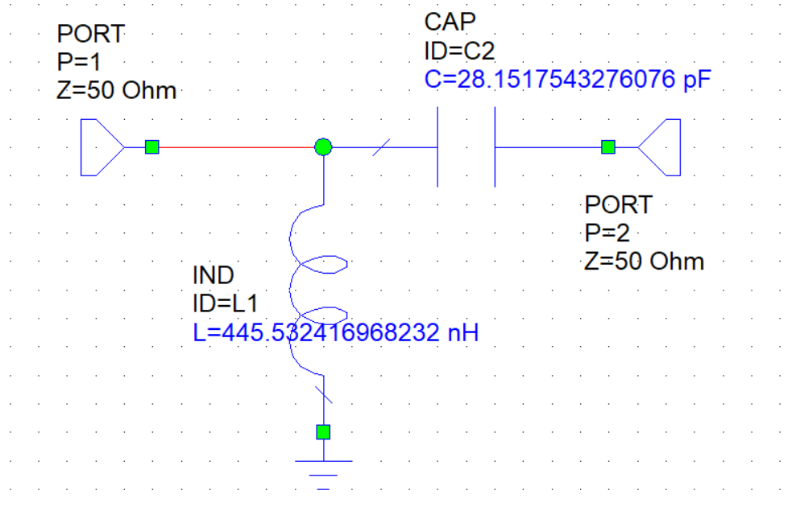

联合仿真：
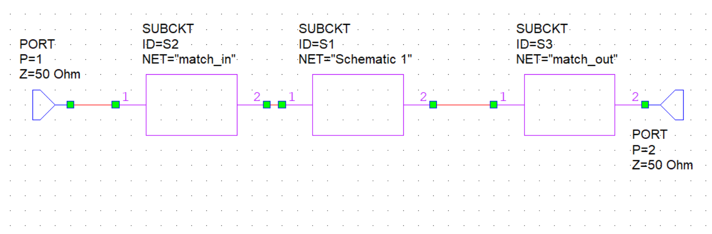

最后进行优化，优化输出匹配电路，设定优化指标增益>29db:
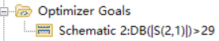

优化结果：
**增益**：
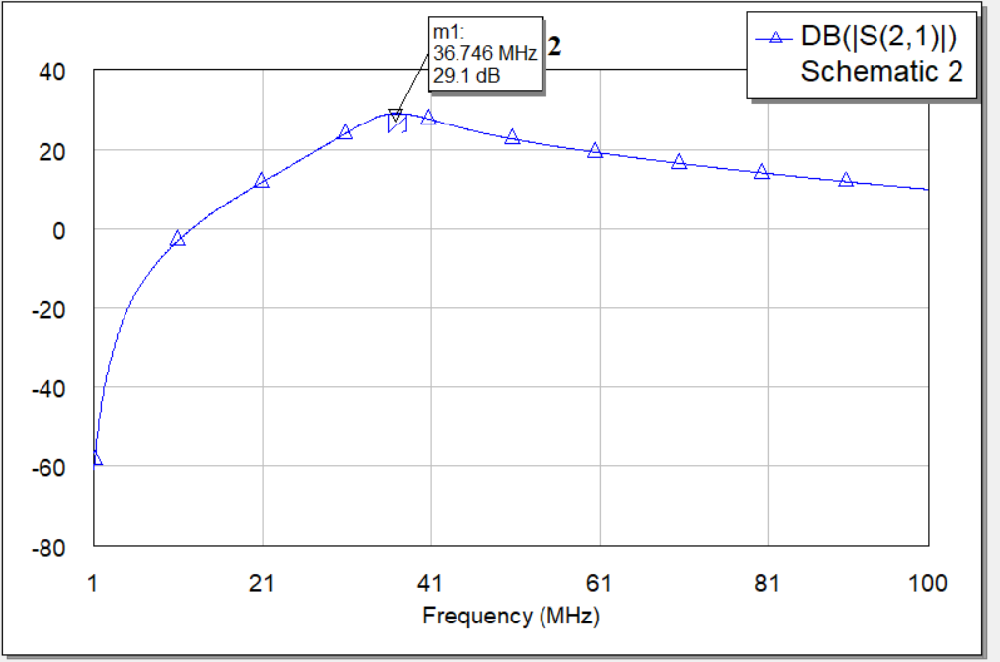
**输入输出匹配**：
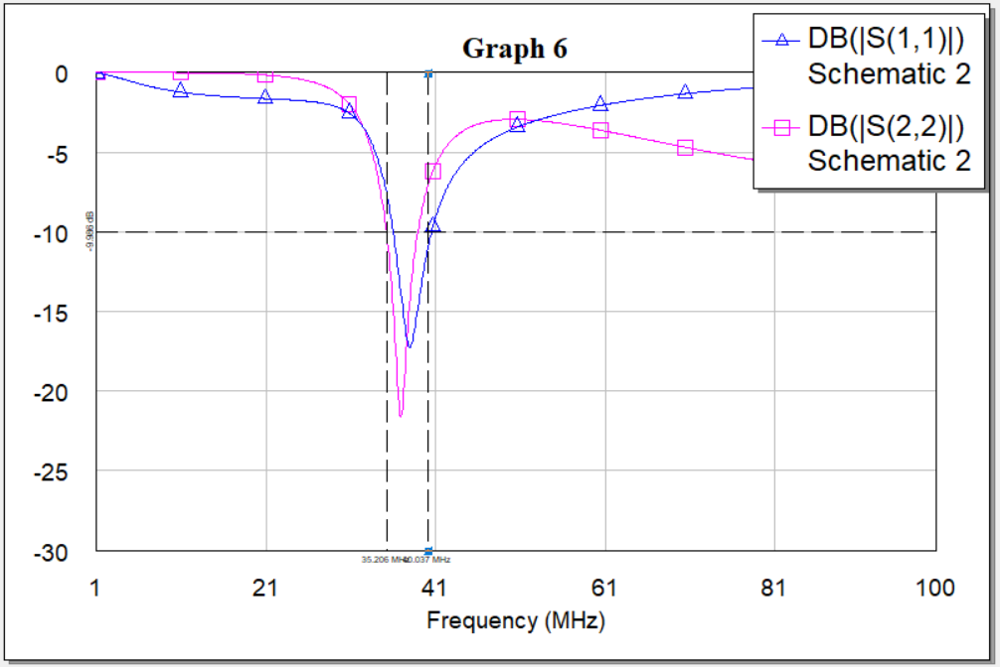

## 3. 仿真级联
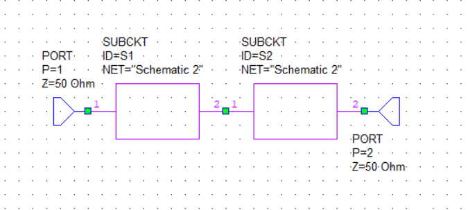

**增益**：
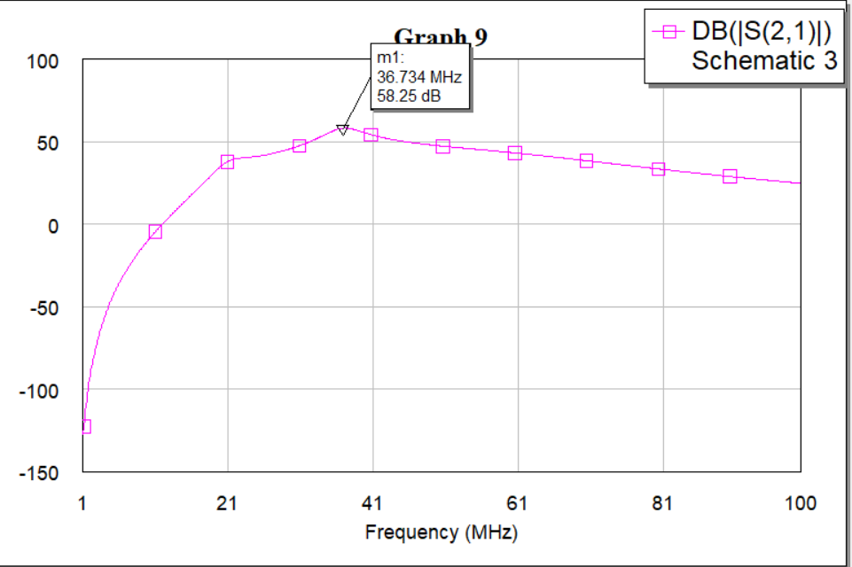

## 4. 仿真级联后的时域和频域结果，使用tina-ti
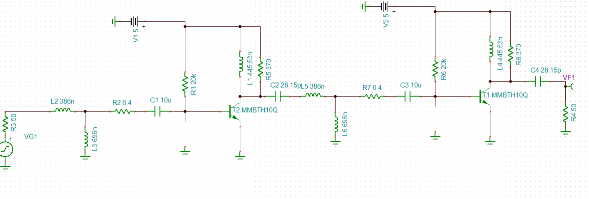
用1uv的输入来测试，如果没有振荡，幅度应该很小
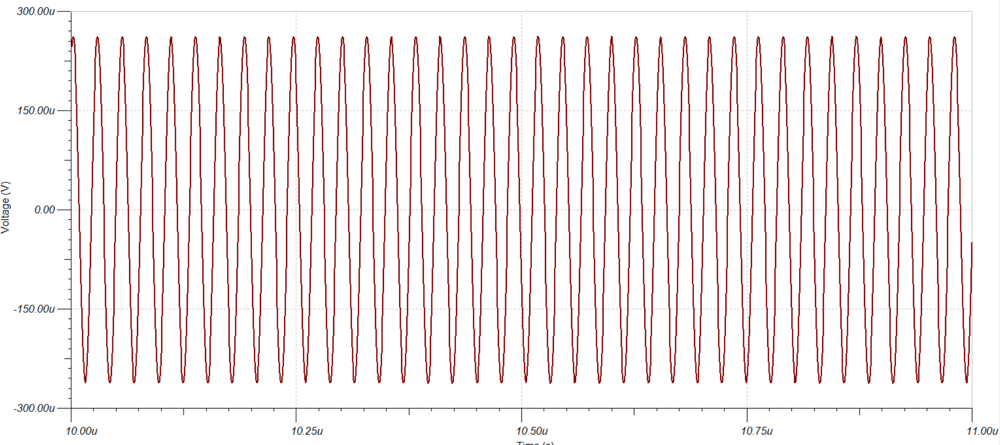

频域（这里要+6dB，也就是最终结果是54dB。我不知道为什么两个仿真器仿真结果不大一致）：
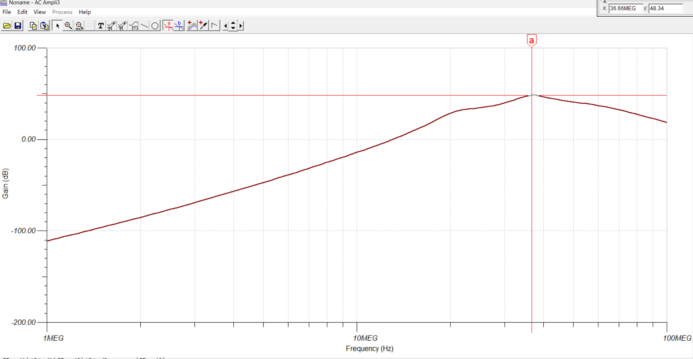

## 结论
拼尽全力才54dB，还没有考虑元件误差，元件寄生导致的Q值低，元件值有限这些问题。所以就拉倒了
