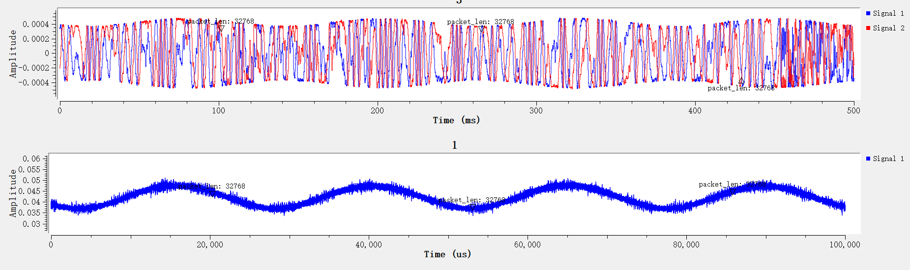
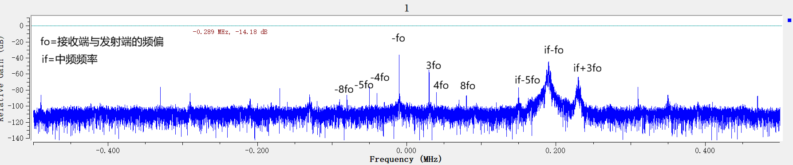
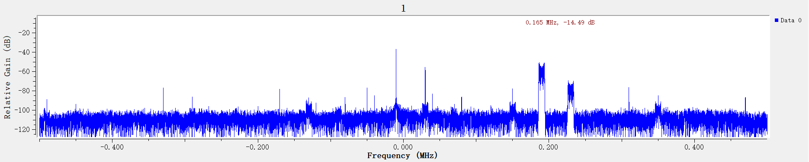

# RF是怎么打败我

## 问题提出

在做调制识别时，当我接收**带有细微频偏**的恒包络信号（如 FSK/FM）时，信号幅度出现了一种**原本不该存在的低频起伏（如 100Hz 的调幅波浪）**。 这个虚假的幅度波动，严重破坏了我的特征提取，导致我的算法把 FM/FSK 错误地识别成了 AM 信号。

引发这个现象的根本原因，是“带有频偏的目标信号”与“寄生杂散”发生了干涉，产生了拍频现象。

如图所示，这是接收到的中频信号，可以看到一堆的不理想特性

其中接收之所以不零中频，是因为AD936X芯片内部有dc cancel机制，会定期去除一下直流，会产生抖动，而且会有dc offset也就是各种泄露，所以就把信号放到中频接收。但是接收端假设不知道发射端的具体频率，那么扫频进行频率估计的时候可能会产生比较大的偏差。这里为了方便展示，采用`fo=10khz`,`if=200khz`的频偏进行模拟。

可以发现，首先信号不仅在`if-fo`上，而且`if-5fo`和`if+3fo`上也有分量。本来信号变频到任意频率应该幅度都是一样的。但是正是因为这些杂散，导致幅度上有调制。下面分析，为什么会产生这些杂散，以及这些杂散是怎么贡献到幅度的调制上的

## 杂散是怎么产生的

首先思考，那根dc附近的`-fo`是怎么产生的。可以想到，发射端有LO泄露等因素会导致LO的频率通过天线发射出去。而因为接收端与发射端有频偏，接收端LO频率比发射端LO高`fo`，导致接收到的LO泄露的那一根到`-fo`的位置。

下面思考，关于`-fo`的那些杂散怎么产生的。

### 关于奇数次谐波

* $I^3 = \cos^3(\omega t) = \frac{3}{4}\cos(\omega t) + \mathbf{\frac{1}{4}\cos(3\omega t)}$
* $Q^3 = \sin^3(\omega t) = \frac{3}{4}\sin(\omega t) - \mathbf{\frac{1}{4}\sin(3\omega t)}$

所以 $I^3+jQ^3= \frac{3}{4} e^{j\omega t}+\frac{1}{4}\mathbf{\ e^{-j 3\omega t}}$
同理 $I^5 + jQ^5 =  ... +k \mathbf{e^{+j 5\omega t}}$

所以奇数次谐波是单侧的，而且符号翻转

### 关于偶数次谐波
* $I^2 = \cos^2(\omega t) = \mathbf{\frac{1}{2}(1+\cos(2\omega t))}$
* $Q^2 = \sin^2(\omega t) = \mathbf{\frac{1}{2}(1-\cos(2\omega t))}$ 

所以没有二次谐波

* $I^4 = \cos^4(\omega t) = \dots + \mathbf{\frac{1}{8}\cos(4\omega t)}$
* $Q^4 = \sin^4(\omega t) = \dots + \mathbf{\frac{1}{8}\cos(4\omega t)}$ （注意，偶数次方的 $\sin$ 展开后也是 $\cos$）

当它们组合回复数 $I + jQ$ 时，第 4 次谐波部分是：$\cos(4\omega t) + j\cos(4\omega t)$。
复数域里只有一个纯粹的 $\cos$ 波，根据欧拉公式 $\cos(\theta) = \frac{1}{2}(e^{j\theta} + e^{-j\theta})$。 这意味着，纯 $\cos$ 波会同时在正频率和负频率产生两个完全对称的峰

所以偶数次谐波是双侧的

### 结论

所以一个 $w$ 能通过非线性效应产生的频率有 $-3w, \pm4w, 5w, ...$

## 杂散是怎么贡献到幅度的调制上的

因为射频链路的放大器，混频器的非线性效应，导致中频泄露以及频偏产生的`fo`产生了好多杂散。经过跟有用信号互调后，产生了有用信号附近的杂散。但是发现没有`if+4fo`和`if-4fo`是为什么呢？

>不知道，留给读者思考。感觉像是某种抵消了。我把信号换单音信号了还是看不到

那if附近的谐波是怎么导致幅度调制的呢？假设把信号搬移到0中频，那么两根谐波是对称的，是`4fo`（虽然大小不对称）。所以相当于信号本身加上信号与谐波 $cos(2\pi*4f_o+\phi)$ 相乘，所以被调制了。

其实我感觉dc附近的这些杂散都会干扰到扫频的信号的检测。需要扫频的时候中间加一个大窗就是无视掉。

## 所以能解决吗
我认为，只要存在频偏，只要采样窗口内包含频偏的一个周期，那么多增加的幅度只取决于失真度，不取决于频偏的大小。但是使用PLL是连续的，在单次采集的python脚本里实在有点麻烦。直接估计的话频偏会有点大

要么优化估计频偏的算法，要么与频偏带来的影响生活。所以优先选择后者，后者活不下去了再优化前者，或者refine条件也就是把问题继续简单化。还有就是我尝试发射的时候零中频但是败了，就是接收的时候幅度波动很明显，我不知道发生了什么。这点幅度波动完全不影响解调，但是判断调制方式的时候会产生影响
