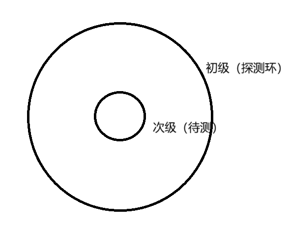
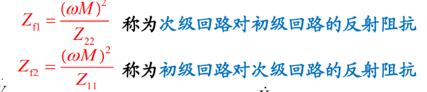

因为朋友的戒指丢了，今天晚上论证了一下非闭合的戒指能否通过金属探测器找回

先从电子线路的ppt搬来电感耦合公式：

那么初级看进去的阻抗是
$$
Z_1=jwL_1+\dfrac{w^2M^2}{Z_2}
$$

## case1: 戒指是闭合的
那么次级模型就是L串联R，戒指电阻可以忽略，那么就是L

环的电感公式：
$$
L=\mu_0 N^2r/2
$$

两个环的互感：
$$
M=\mu_0 Nr_2^2/2r_1
$$

初级环看进去的阻抗：
$$
Z_1=jwL_1+\dfrac{w^2M^2}{Z_2}
\\=jw\mu_0 N^2r_1/2(1-(\dfrac{r_2}{r_1})^3)
$$

假设戒指直径1cm，探测线圈直径10cm，那么变化电感是0.1%，与晚上手搓线圈的实验结果吻合

这能测吗？看起来千分之一很小，但是再联想到电子秤的应变片的电阻变化多少，那就会发现，测量的量程不能是0到L，而是L边上的一个小范围，那么 $\Delta L$ 的占比就会大。就是要把测量结果减去平常值再进行放大。

影响能否测到的因素就是噪声。噪声来源有外部环境噪声和内部电路噪声。内部电路的热噪声可以通过限制带宽做到非常小。如果在直流测量，还有运放的直流偏置影响，所以能测到数uV的直流电压。uV到V是120dB，所以直流测量的理论极限是 $10^{-6}$ 左右（信号变化量相比主信号）。交流测量的理论极限，运放的噪声是几nv/根号hz，假设探测器测量速率要在几hz级别，那么热噪声在几nv级别。那么理论极限大概是 $10^{-8}$。

结论是，闭合戒指是可以被金属检测器测到的

## case2: 戒指是非闭合的
直观感觉就是涡流没了。实际上还有，缺口相当于电容，但是涡流估计很小了。

那么次级模型就是L串联C

对这个串联LC的谐振频率进行一个估计：
$$
f_0=\dfrac{1}{2\pi\sqrt{C_2L_2}}
\\=\dfrac{1}{2\pi \sqrt{\mu_0\epsilon_0} \sqrt{\tfrac{S}{d}\tfrac{r_2}{2}}}
\\ \approx \dfrac{3*10^{8}}{2\pi \sqrt{10^{-2}*10^{-2}} }
\\=5 GHz
$$

测试频率肯定远低于这个频率，所以次级L串联C约等于C

初级阻抗：
$$
Z_1=jwL_1+\dfrac{w^2M^2}{Z_2}
\\=jwL_1+\dfrac{w^2 M^2}{\tfrac{1}{jwC_2}}
\\=jwL_1(1+\dfrac{w^2 M^2}{L_1L_2}*C_2L_2)
$$
其中 $\dfrac{M^2}{L_1L_2}$ 在之前的估计中是千分之一

那么初级阻抗的估计：
$$
Z_1\approx jwL_1(1+10^{-3}\dfrac{w^2}{w_0^2})
$$

假设测试频率 100kHz，那么电感的变化量是 $10^{-3}*(10^{-5})^2=10^{-13}$

这个变化量已经远小于之前的理论极限 $10^{-8}$ ，所以非闭合的戒指是不可金属探测器找回的
