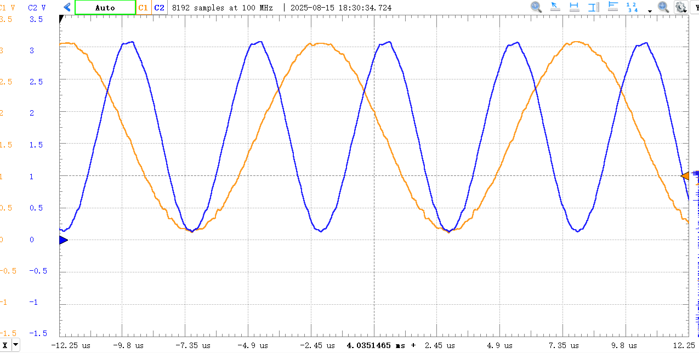
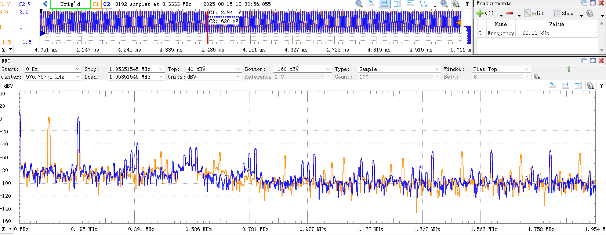
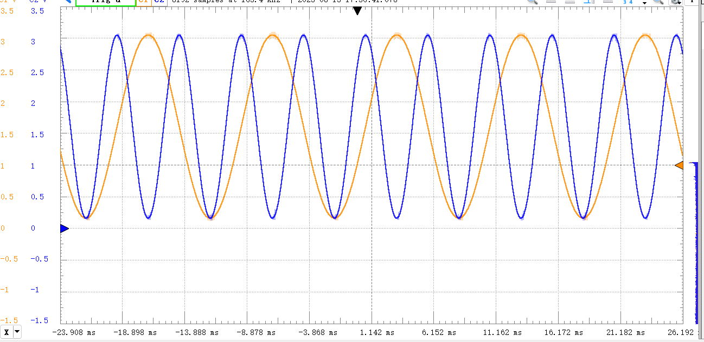
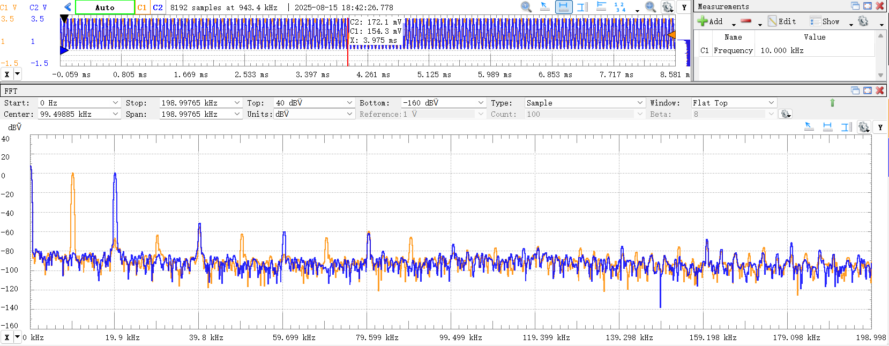
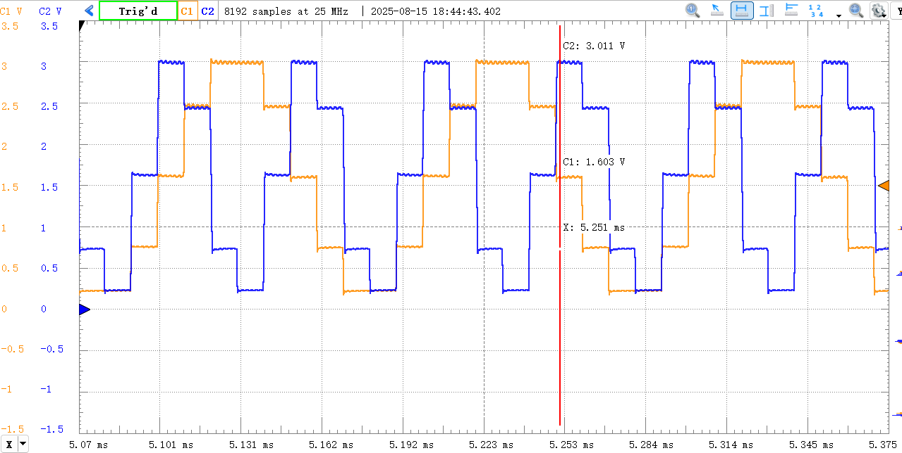
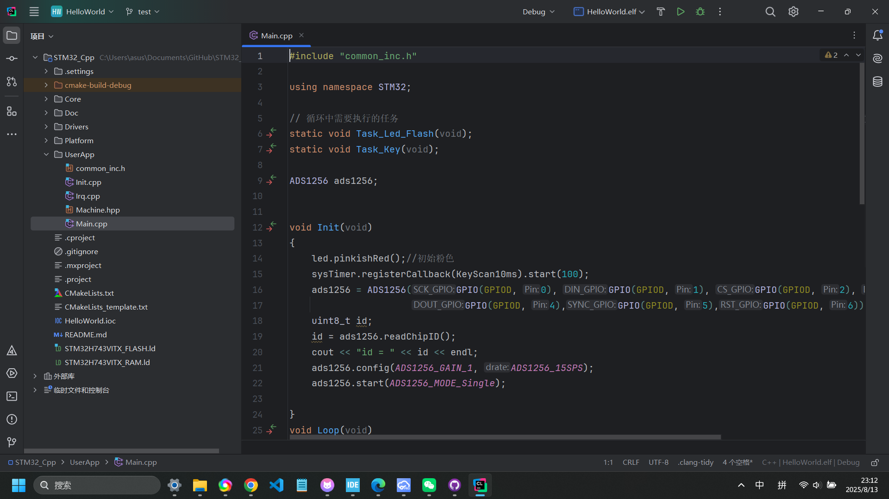

先开一个坑，未来继续填

# 信号发生器

## DAC

假设DAC采样率 a Msps

### 1. DDS算法

假设相位累加器32位，查找表8K个。频率分辨率dfxdT=1/2^32，即df=a MHz/2^32。频率分辨率不随频率变。如果10Msps，那么频率分辨率为0.002HZ

按照5ppm的频率精度算，0.002/5ppm=400hz，也就是要在400hz以上用，再低的频率需要降低DAC的采样率。不过还有一个好主意就是降低采样率的同时提高相位累加器位数，直接提高到64位。比如采样率降低10倍，然后使用64位相位累加器，频率分辨率一下达到要求，而且因为采样率降低十倍，那点64位计算也是能承受的。

这里算查找表index可以使用32位定点数来算，快，而且精准。是一次（32bitx32bit）乘法，加上移位操作大概两三时钟周期

### 2. 计算单周期循环发送方法

假设频率f Hz，一个周期有a e6/f个数字。

计算频率分辨率：a e6(1/f-1/(f+df))=1 => df=1/ae6 x f^2，频率越高df越高，频率精度越低

假设开40Msps，在400Hz以下用频率分辨率是0.004Hz 10ppm，也还好。但是算以下这数组得多大：40e6/4e2=1e5，100k，不小了，根据常见MCU的RAM就一两百KB来看，而且存的数组一般还是16位2B的

### 3. 抖动法

我不会\~

### 总结

在我会的范围内，还是dds香。当然dac的实现方法有dac或者pwm，pwm的优势是低频精度高（分辨率随采样率降低而升高），而且线性度比dac高。所以实现信号发生器会考虑pwm生成直流和低频部分，dac生成中频部分

按照h7的石粒10Msps应该没问题，就相位累加+查找，5周期内搞定，cpu带宽被占用10%。如果是集中计算代价更小，因为相位变量加载1周期，每次累加+算index（一个乘法）+查找+存进缓冲是两三周期（因为计算和存储可以流水线执行），平均下来算每一个数三次操作，3/48占用cpu带宽就6%。但是中断开销无敌大，所以不能用中断。可以使用DMA双缓冲（circular） + 软件相位累加，开半完成和全完成中断，一半传完就开始填空的部分。

## 实现

核心算法

``` cpp
    static void dma_halfcomplete_handler(uint32_t *object) {
        DDS_DAC *dds = (DDS_DAC *)object;
        uint16_t *table1 = dds->table1;
        uint16_t *table2 = dds->table2;
        uint32_t p_word1 = dds->P_WORD[0];
        uint32_t p_word2 = dds->P_WORD[1];
        uint32_t dp1 = dds->dP[0];
        uint32_t dp2 = dds->dP[1];
        uint32_t* dac_buffer = dds->dac_buffer;
        uint32_t dac_buffer_len = dds->dac_buffer_len;

        for(uint32_t i = 0; i < dac_buffer_len >> 1; i++) {
            uint32_t index1 = (uint32_t) (p_word1 >> DDS_TABLE_DIV);
            uint32_t index2 = (uint32_t) (p_word2 >> DDS_TABLE_DIV);
            dac_buffer[i] = table1[index1] + (table2[index2] << 16);
            p_word1 += dp1;
            p_word2 += dp2;
            if(p_word1 >= P_WORD_MAX) p_word1 -= P_WORD_MAX;
            if(p_word2 >= P_WORD_MAX) p_word2 -= P_WORD_MAX;
        }
        dds->P_WORD[0] = p_word1;
        dds->P_WORD[1] = p_word2;

    }

    static void dma_complete_handler(uint32_t *object) {
        DDS_DAC *dds = (DDS_DAC *)object;
        uint16_t *table1 = dds->table1;
        uint16_t *table2 = dds->table2;
        uint32_t p_word1 = dds->P_WORD[0];
        uint32_t p_word2 = dds->P_WORD[1];
        uint32_t dp1 = dds->dP[0];
        uint32_t dp2 = dds->dP[1];
        uint32_t* dac_buffer = dds->dac_buffer;
        uint32_t dac_buffer_len = dds->dac_buffer_len;

        for(uint32_t i = dac_buffer_len >> 1; i < dac_buffer_len; i++) {
            uint32_t index1 = (uint32_t) (p_word1 >> DDS_TABLE_DIV);
            uint32_t index2 = (uint32_t) (p_word2 >> DDS_TABLE_DIV);
            dac_buffer[i] = table1[index1] + (table2[index2] << 16);
            p_word1 += dp1;
            p_word2 += dp2;
            if(p_word1 >= P_WORD_MAX) p_word1 -= P_WORD_MAX;
            if(p_word2 >= P_WORD_MAX) p_word2 -= P_WORD_MAX;
        }
        dds->P_WORD[0] = p_word1;
        dds->P_WORD[1] = p_word2;
    }
```

毛估估了一下更新一个数据大概需要10个周期不到。开了DWT用来计时，但是第一次测出来要20个周期。把优化从o0改o2，然后就只要5-10个周期了。

## 效果

最高能到20Msps x 2ch

高频100k不是很好看

高频谐波分量有-40dbc


低频还好

低频谐波分量大概-60dbc


对谐波分量怎么理解：

1. 低频的谐波-60dBc，因为DAC的INL DNL的非线性导致DAC就10位ENOB差不多，算一下10位1/1024是不是差不多-60dB
2. 高频的谐波，因为内部缓冲运放压摆率跟不上导致的谐波

## 彩蛋：当采样率比较低会发生什么

（忽略这垃圾的电源带来的小纹波）



目前看下来三大问题：

1. 时钟抖（怀疑也是万恶的电源问题）
2. 电源纹波
3. 内部缓冲带来的带宽和压摆率限制（导致高频谐波）

---

本来只是想DAC搓搓DDS，逛CSDN的时候发现了一个大神仓库，已经实现了我的理想：STM32框架cpp化。而且配了clion，太人性了
https://github.com/mico845/STM32_Cpp/tree/master


一进去看到有ads1256和ad9959的驱动非常感动，而且还有DAC的DDS配套的DMA驱动之类。不过不是很懂为什么要把驱动层用LL重写一遍，为了追求性能吗？

感觉自惭形秽，自己还是个菜鸡...不管怎样，先拿来主义了
