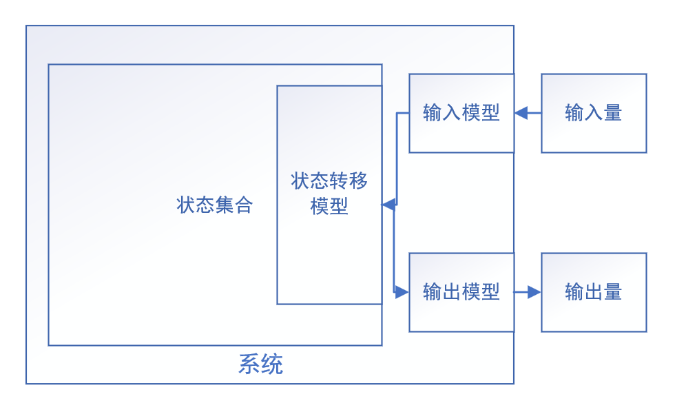

终于开始学习了。一周的课感觉进度飞快

# 信号处理概论

## 状态与系统

### 状态

状态分为物理状态和语义状态。A physical state describes the objective, measurable material condition of a system (such as mass, velocity, or quantum dynamic states), while a semantic state represents the abstract meaning, interpretation, or information assigned to that system by an observer.

### 系统
系统包含一个关心的且完备的状态集合。所谓完备，指状态转移方程能完全只依赖输入量和状态，不依赖系统内部其他变量。

### 系统模型
**状态空间法：**
状态转移模型： $\dot{s}(t)=g(s(t),input(t))$
观测模型（输出模型）： $output(t)=h(s(t),input(t))$

**传递函数法（LTI）：** $output(s)=H(s)*input(s)$
如果是LTI的，状态转移方程可以转换到s域然后带入观测方程，就变为传递函数法

### 求解问题
**状态估计：**
1. 估计当下状态
2. 预测未来状态和输出
3. 校正之前估计的状态

**系统辨识：**
1. 系统结构选择
2. 估计系统参数（这也可以归为状态估计，当作不变的状态）

## 信号
信号是状态的物理载体。我们观察，处理信号，本质上为了从与状态相关的信号中尽可能得到状态本身。

什么是相关：状态和信号的关系，可以是deterministic的，比如状态是一堆信号的某个函数上的相关，可以是线性的，也可以是非线性的。也可以是stochastic的，统计上的相关。

现实的测量会带来几个因素：
* 信号带有噪声
* 状态是由很多信号表征的，而我们不知道或者不能测量全所有信号。或者信号到状态的模型是不精确的
* 状态也同时可以有不同的表征方式，每种方式都可以独立得到同种信息，带有不同的噪声和工作条件

噪声的影响是多次测量得到的测量值有个噪声带来的方差，但是期望是真实值。而如果没测量全信号，那么多次测量得到的测量值与真实值有一个期望上的偏差，而这个偏差取决于没有测量的那部分信号或者模型的不精确/非线性。如果这个没有测量的信号是时变的，那么偏差也是时变的。如果这个信号是随不同的样本变化的，那么偏差也是随不同样本变化的。

我们的任务是，
1. 为了获取某个状态，我们需要确定需要测量哪些信号
2. 搭建信号采集系统，以尽可能减少噪声的采集
3. 获得信号后，怎么处理以尽可能还原状态

- **任务1的方法：** 建立精确的数学模型；或者用假设检验，就是首先有标准的测量方式能够得到精确或者近似精确的值（之所以说近似精确因为测量总是带有噪声，用这种方式标定的测量方法精度不会超过标定的方法），然后去测量可能相关的信号，统计并检验是否有相关性，偏差和方差有多少（如果没有标准的测量方式怎么办？说明这个状态没有被定义，那就需要先被定义）。反正不管怎样都要系统建模，不管是数学模型还是统计模型
- **任务2的方法：** 合适的传感器（方向性，噪声，带宽），放大器和滤波器（放大增益，带宽，噪声系数，线性度），合适的ADC（采样率，ENOB） 
- **任务3的方法：** 在任务1完成后，理应能够逆变换。这个逆变换涉及到估计和检测理论（decision theory）

## 估计与检测理论

状态分为连续状态和离散状态。从信号得到连续状态使用估计理论，从信号得到离散状态使用检测理论。（估计系统参数也算在状态估计里，因为参数可以看作不变的状态）。估计和检测理论本质上都是最小化误差或者猜错的概率，尽可能猜的准确一些
