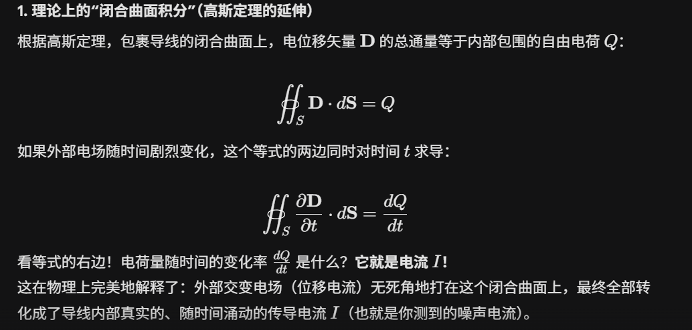
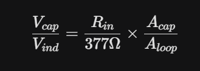

工作第一周，首先老板测出来波形不大正弦。我认为有两大原因

### 1.1 波形不正弦？干扰问题
一个是**EMI干扰**，因为功放是D类，开关频率又很高。机箱都是洞，而且是敞开的，所以机箱封了约等于没封。我建议把接收端放的远一些，然后加吸波材料。一个是共地带来的**地干扰**，老板发现别人的电路有一个磁珠接地（就是不直接共地，两个地接一个磁珠），很神奇，但是自己尝试加磁珠接地效果不好。我用网分测试发现别人的磁珠电阻非常小，自己加的磁珠电阻比较大。老板说根据阻抗曲线他用电感拟合过那个未知器件（网分测量曲线后才猜测是磁珠）。我说你或许用电感并联电阻也会有磁珠效果。对于这个为什么电阻小反而效果好的原因，你可以先想象一下，示波器地线浮空噪声超级大，但是地线连接之后噪声就消失了，是为什么？

对于这个问题，要回到第一性原理上，捡起来忘得干干净净的大学物理2。空气中浮动的是电磁波，也就是交变的电场和磁场。对于非闭合的，是交变电场作用在电容上，导线相当于线天线，交变电场产生位移电流，**电流源模型**。对于闭合的，是交变磁场作用在导线环上，**电压源模型**。因为高中做了那么多题目了所以导线环确实很能理解是电压源模型。但是为什么开路导线是电流源模型呢？脑子里直觉感觉电压不是电场积分吗？但是翻一翻麦克斯韦方程，会发现高频下电场不是保守场，不同路径线积分数值不同，会受交变磁场的影响。所以就不能理所当然当电压源。但是翻一翻会发现还有一个位移电流的公式。下面积分是对每一个金属棒表面积分，所以每个金属棒都有电荷的流入流出，这个电流只取决于电场。所以电压取决于负载电阻和电场。所以是电流源模型。

然后为什么示波器探头开路比短路噪声大得多呢？估计一下位移电流产生的噪声和磁感应产生的噪声的比例：

当高阻输入的时候，开路电场噪声大得多。当50欧输入的时候，短路磁感应的噪声大得多。但是注意，不管高阻低阻，这个环路面积都是一样的。所以Vind都是一样的，只是Vcap在高阻低阻发生了变化。所以不管怎样在示波器上都只能看到开路噪声电压，看不到环路的磁感应电压，因为环路小。在很猛的开关电源/D类功放附近或许能看到。

对于开路探头是电流源模型，为什么没有磁感应的电压源呢？因为磁感应环路的阻抗太大（假设探头开路相当于0.1pf电容，在1Mhz下是1.59M欧），电压除以阻抗变成很小的电流，相对于耦合进来的电流就很小忽略不计了。对于短路探头是电压源模型，为什么没有电场感应的电流源呢？因为唯一与空气接触的是负载那里，那里与负载并联一个电流源，但是负载与短路导线并联阻抗为0（不过高频了就是一个电感跟负载并联了，但是这俩导线基本上都是平行的，电感不会很大，在1Mhz撑死0.x欧），所以电流源不会产生显著的电压。

### 1.2 波形不正弦？非线性失真问题

耦合进来那么多干扰，对于运放电路，首先可能发生交调互调，然后发生削顶失真，这些失真都可能对原频率造成影响，导致相位和幅度测量的误差。

老板说，干扰就干扰了，反正我们也就测一个频率点。上述就是为什么不能要干扰的原因。

### 1.3 波形不正弦？结论
1. 需要加进一步的屏蔽和吸波材料，以及位置上远离发射端和接收端
2. 地线加低阻抗的磁珠隔离
3. 单端传输改差分（双绞屏蔽线）
4. 前端加合适的带通滤波器
5. 确保那些运放的SR GBW没啥问题，以及带宽足够所以两个通道的频率响应不会对结果造成大的影响（如果你追求1%的精度，带宽就要是待测频率的100倍，因为两个通道还会有通道不一致性，如果单靠校准可能不能达到期望精度）

老板说，我们软件如果搞出来没问题，我们暂时没时间改硬件了，差不多得了。我 🫨 看你或者客户需要的精度吧。不改就不改了，我不多说了。我认为硬件是根本，你如果只追求顶层改一改差不多得了那就差不多得了。

### 2.1 测量相位-频率关系

老板：我已经能测出相位啦，你给我写一个控制器。我说，你先写一个调试接口，可以设置频率，读取相位。或者通过网线/串口的自动化测试脚本。我先要确认能否人肉控制，因为这是定点控制。如果能人肉控制，那么机器一定能控制。所以第一步要测的就是相位-频率关系。所以我让老板加了vio设置频率。老板：vio为什么要有输入？不是只有输出就好了？我说：那你怎么看数据。老板：ila不已经能够看数据了，vio不是重复了吗？我：vio是单个点，不是ila那样看一个时间片段，还是不一样的。而且如果要实时调试就需要能看到数据而不只是设置数据。

### 2.2 相位测出来数据很怪？
首先我说，数据问题有两种可能
1. 本身这玩意特性就这样，你没有算错
2. 算法有问题

为了验证1，需要把数据导出来，我用matlab的算法计算相位，然后与fpga的相位比较。计算完之后发现数据本身没问题，很好的线性。但是fpga的结果有问题。老板开始debug。我说，如果仿真没问题，那么算法就没问题。老板：仿真没问题啊，吻合的啊。那我说，仿真和实际只是相差输入的数据流，那你把真实数据喂进去试试。老板又说，不过dds还没有仿真进去。我：那你先改一改testbench试试。老板debug一会，发现自己变量拉错了。我无语。

我已经给老板写了一版相位解调了，仿真验证过没问题，但是他不用。

### 2.3 怎么定义谐振点
老板说，我们根据示波器定义相位零点。老板又说，我们根据别人的仪器，他们说什么是谐振点，我们就定义哪个是谐振点。

我第一步：我们先把数学模型画一下，然后你要确定你要优化什么目标。你是要清洗的更干净呢，那什么能让它清洗的更干净？你是要让功放的压力最小，想要优化功率，那什么点能让功率最小呢？老板云里雾里。他折腾一通之后开摆了，爱定义哪个点哪个点了。因为我不是项目的设计者，我也没那个心思帮他思考这个谐振点的定义，我上面已经给了，谐振点的定义不是自己随便定义的，是取决于你项目的需求和衡量标准的，你这些都没有给我我想破脑袋也想不出来的。

### 2.4 控制
刚开始老板质疑pid控制器能实现锁相环。我觉着没问题啊，这玩意定点控制啊。锁定时间应该取决于系统动态响应时间。老板坚信，四个周期就能锁定。我祝福他能够研发出来。我不研发，因为我不信。

老板：你仿真一下，我不信。我把系统的动态响应建模了，仿真进去，pid控制器完全没问题，而且验证了tan比角度本身会让锁定更快。

我ai很快写出来控制器，一上去不大对，我把kp改成负的就能够锁定了。ai加持下我没有那么通fpga但是效率仍然能够很高。我验证过仿真没问题，综合没问题，接上去基本上就不大会出问题的。
