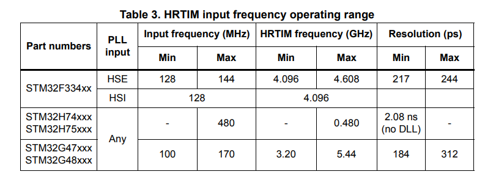
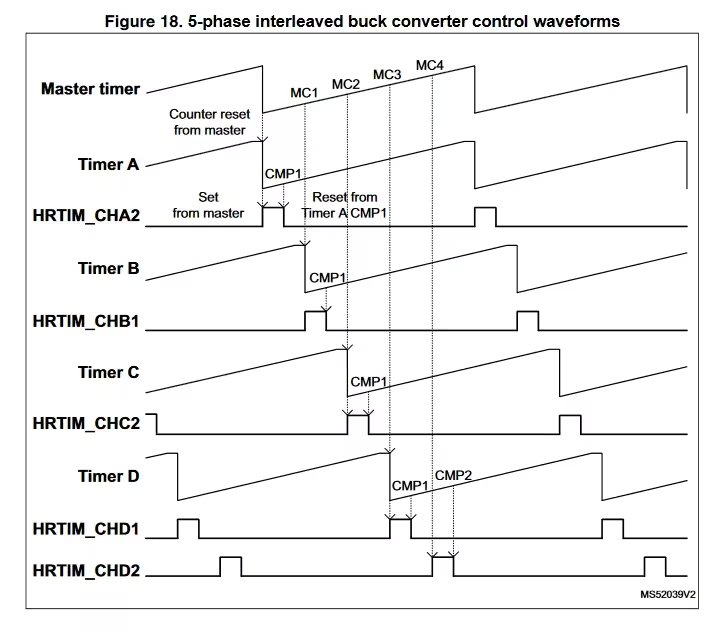
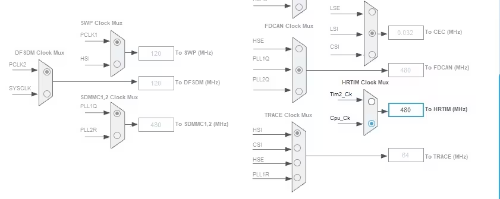
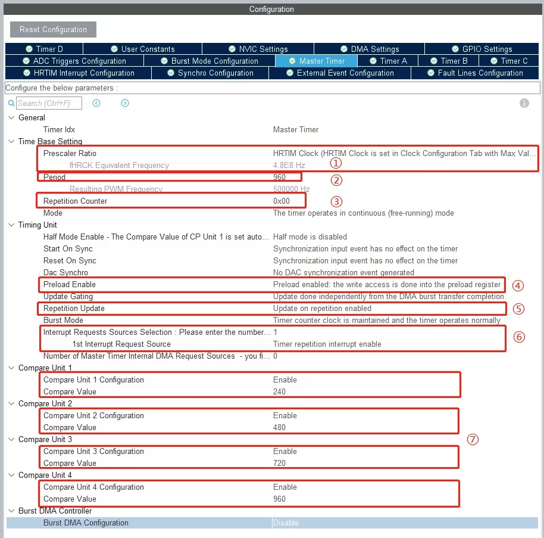
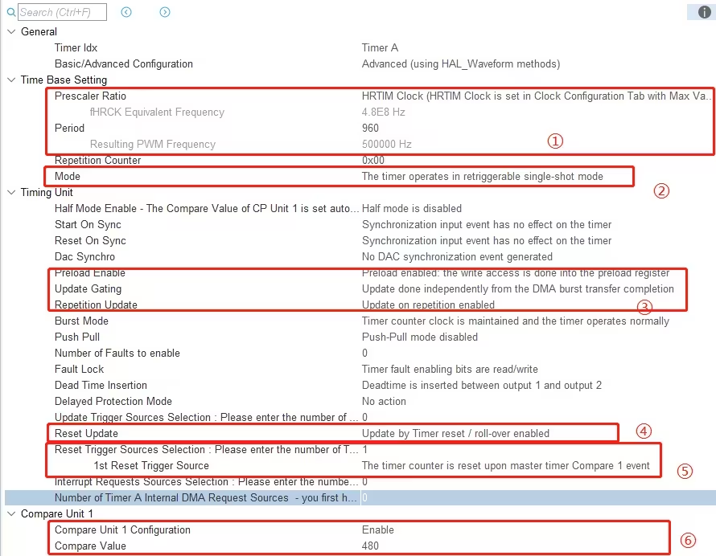
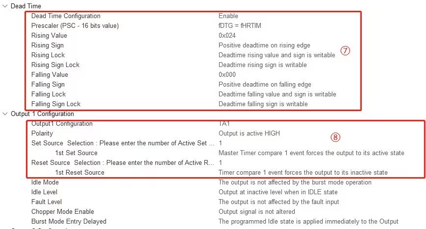
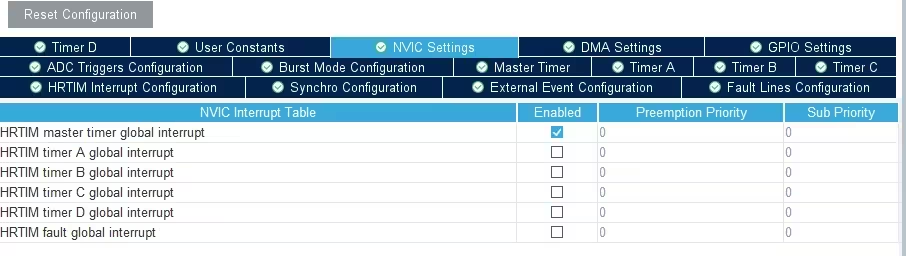
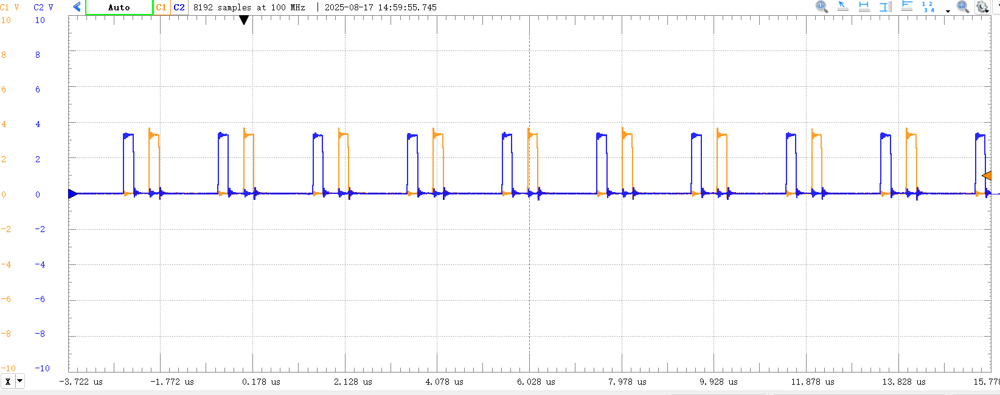

# HRTIM

## 特色



* 除了H7，其他带有HRTIM的系列有DLL，相当于时钟x32
* 有一个主定时器和五个独立定时器
* 每个定时器pwm不再是ccr和polarity定义，而是根据set事件和reset事件设置。set事件和reset事件都可以设置若干个触发源，相当于若干个触发源的或。
* 每个定时器有4个compare。每个compare可以作为本定时器和其他定时器的各通道的set/reset触发源
* 以及除了update事件是一个触发源以外，对update还进行了一个分频n，多了一个repetition事件。就是方便控制的时候不是每个cycle都控制而是n cycle再控制
* 每个独立定时器的清零（reset）也可以由若干事件触发（注意这个reset是cnt清零，不是上述通道电平设置）
* 五个独立定时器每个有两个通道，通道之间可以设置死区

## 怎么产生多路同步频率相同相位差和占空比可调的pwm？

* 一个思路就是一个主定时器有若干个compare可以触发其他定时器，主定时器周期计数，其他定时器单次retriggerable，定时器reset事件是主定时器comparex，通道set事件是主定时器comparex，通道reset事件是各定时器的compare
  
* 另外一个思路就是独立设置每个通道的set与reset，每个通道使用两个compare，主定时器周期计数，其他定时器单次retriggerable，定时器reset事件是主定时器update，那么每个定时器计时都是同步的

### 实现

(这下面基本是抄b站笔记的配置，给以后留个参考)

#### 1. 设置HRTIM时钟



#### 2. 配置MASTER

1. HRTIM的频率，F334和G474都能在主时钟的基础上倍频，H7不行，只能调整到480M上
2. Master时钟的周期，决定了开关频率，我这里配置的500kHz，在这个频率下PWM分辨率约10bits
3. Repetition Counter用来控制中断频率，0x00意味着每个周期进一次中断
4. Preload Enable需要enable
5. Repetition Update也要enable
6. Interrupt Requests Sources数量调整到1，并且调整中断源
7. 需要几路移相就开几个Compare Unit
   

#### 3. 配置独立定时器

1. 时钟和周期与Master一致，其实周期随便配置，配成0xFFFF都没问题
2. 这里要改成单次触发模式，否则在调整移相角时占空比会出问题
3. Preload和Repetition Update和Master一样
4. 这里一定要打开，将寄存器更新延后到了reset时刻
5. 设置定时器清零事件：Reset Trigger要改成Master Timer Compare event，这个和前面配置的Master Cpmpare Unit是对应的
6. Compare Unit用于控制波形，我这里是占空比50%的半桥，所以前面Dead Time Insertion Mode改成了Deadtime is inserted，这里只需要使用一个Compare Unit
7. 死区按照自己想法设置
8. 输出配置：设置通道的set和reset事件，就可以设置占空比




#### 4. 开中断



### 代码

``` cpp
	HAL_HRTIM_WaveformOutputStart(&hhrtim, HRTIM_OUTPUT_TA1);
	HAL_HRTIM_WaveformOutputStart(&hhrtim, HRTIM_OUTPUT_TA2);
	
	HAL_HRTIM_WaveformOutputStart(&hhrtim, HRTIM_OUTPUT_TB1);
	HAL_HRTIM_WaveformOutputStart(&hhrtim, HRTIM_OUTPUT_TB2);
	
	HAL_HRTIM_WaveformOutputStart(&hhrtim, HRTIM_OUTPUT_TC1);
	HAL_HRTIM_WaveformOutputStart(&hhrtim, HRTIM_OUTPUT_TC2);
	
	HAL_HRTIM_WaveformOutputStart(&hhrtim, HRTIM_OUTPUT_TD1);
	HAL_HRTIM_WaveformOutputStart(&hhrtim, HRTIM_OUTPUT_TD2);
	
	HAL_HRTIM_WaveformCountStart_IT(&hhrtim, HRTIM_TIMERID_MASTER | HRTIM_TIMERID_TIMER_A | HRTIM_TIMERID_TIMER_B |
											 HRTIM_TIMERID_TIMER_C | HRTIM_TIMERID_TIMER_D);
```

### 效果



## 参考文献

* https://www.bilibili.com/opus/822523203974856793
* https://www.st.com/resource/en/application_note/an4539-hrtim-cookbook-stmicroelectronics.pdf
