h7，启动！
# 🔷 H7入门到入土（1）- 架构

## 内核架构
我感觉cm7给我的体感是主频提高（包括存储++以及cache的使用），增加了对双精度浮点数的支持（DSP友好）
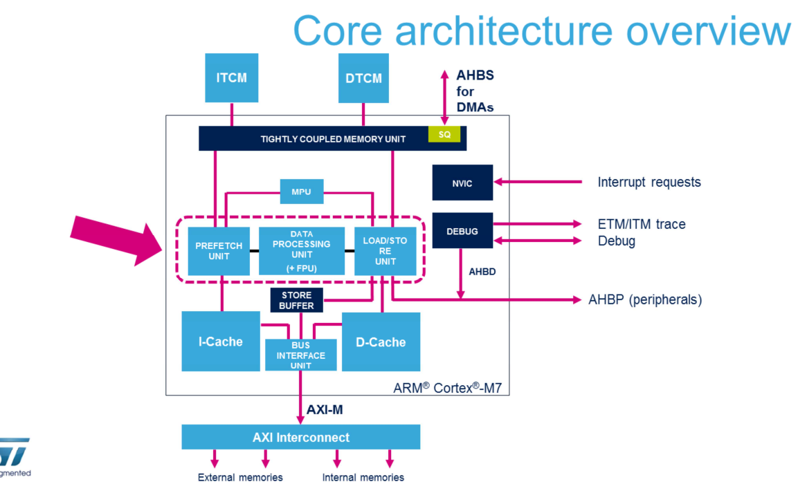
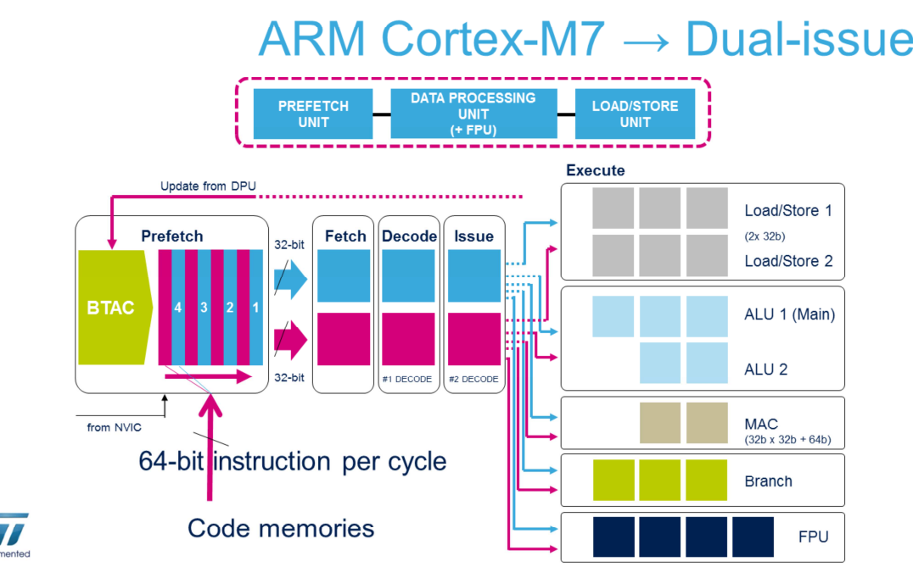
* 指令双发射
* 双32位/单64位存储通道
* 但是ALU是单路执行，虽然有两个32位ALU，但是是独立执行

## mcu架构

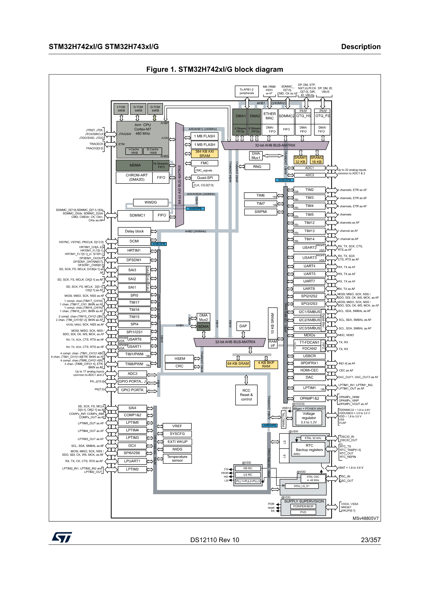
## 总线架构
### 三个domain
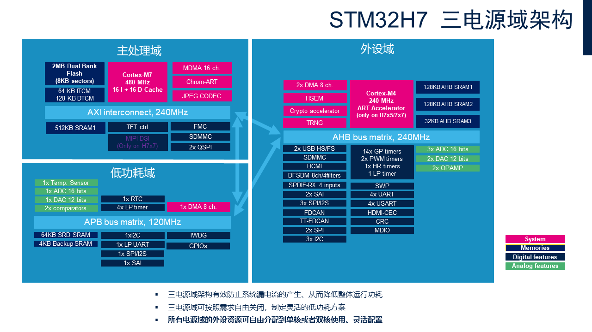
* D1:主处理域，包括AXI总线，内核，主存（TCM+SRAM1），外部存储器（FMC,QSPI...），MDMA
* D2:外设域，包括AHB总线，几个SRAM，各通信接口，定时器，模拟部分（AD/DA,OPAMP），DMA1/2
* D3:低速低功耗域，包括APB总线，SRAM，GPIO，部分通信接口，低功耗模拟部分（AD/DA 比较器），RTC，低功耗定时器，BDMA

### 总线互连

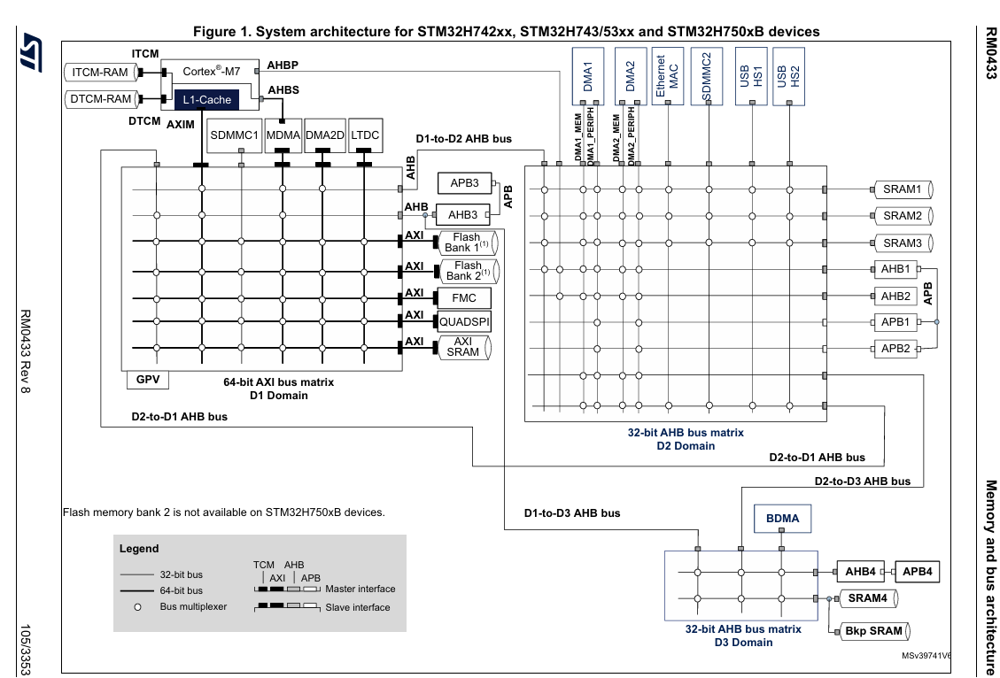

#### CPU总线
* TCM内存与内核有专用总线
* MDMA访问TCM内存通过AHBS总线
* 内核通过AXIM跟D1 SRAM，以及内部flash，以及外部存储器qspi/fmc通信
* 内核通过AHBP访问高速外设（AHB1/APB1/AHB2/APB2），通过AXIM访问低速外设（AHB4/APB4）以及不重要的外设（AHB3/APB3，好像只有WWDG），但是不经过缓存（因为这些外设的地址已经被配置成了DEVICE）
* 内核通过AXIM访问D2 SRAM，可以配置缓存

#### 域的互连总线
* D1域到D2域的D1-to-D2 AHB bus
允许D1域中的主接口外设访问D2域里面的从接口外设。比如D1域里面的DMA2D访问D2域里面的SRAM1。
* D2域到D1域的D2-to-D1 AHB bus
允许D2域中的主接口外设访问D1域里面的从接口外设。比如D2域里面的DMA2访问D1域里面的AXI SRAM。
* D1域到D3域的D1-to-D3 AHB bus
允许D1域中的主接口外设访问D3域里面的从接口外设。比如D1域里面的DMA2D访问D3域里面的SRAM4。
* D2域到D3域的D2-to-D3 AHB bus。
允许D1域中的主接口外设访问D2域里面的从接口外设。比如D2域里面的DMA2访问D3域里面的SRAM4。

#### 总线互连表格
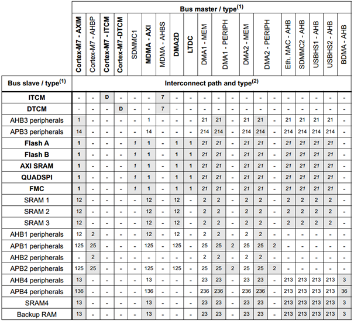
* 黑色加粗字体是64位总线（ITCM，DTCM，Flash A，Flash，AXI SRAM，FMC等），普通字体是32位总线。
* 访问通路（每个小方块里面的字符）
    * 任何有数字的表示有访问通路。
   *  短横杠“-”表示不可访问。
    * 有灰色阴影的表示有实用价值的访问通路。
* 表格中具体数值所代表的含义
   * D=direct
    * 1=via AXI bus matrix
    * 2=via AHB bus matrix in D2
    * 3=via AHB bus matrix in D3
    * 4=via AHB/APB bridge in D1
    * 5=via AHB/APB bridge in D2
    * 6=via AHB/APB bridge in D3
    * 7=via AHBS bus of Cortex-M7
    * 多个数值组合 = 互连路径以数字的顺序经过多个矩阵或/和桥。
* 总线访问类型
    * 普通字体表示32位总线。
    * 斜体表示32位总线主机端/ 64位总线从机端。
    * 粗体表示64位总线。

### AXI总线
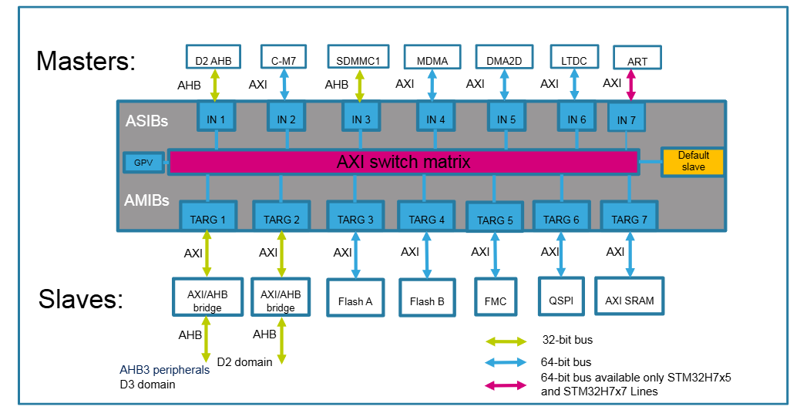

#### ASIB
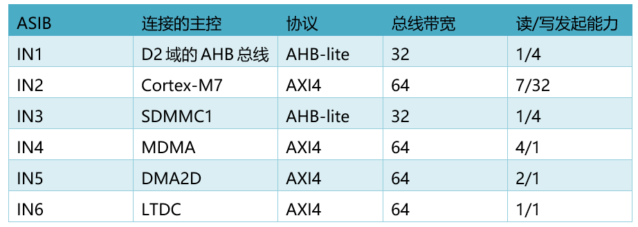

#### AMIB
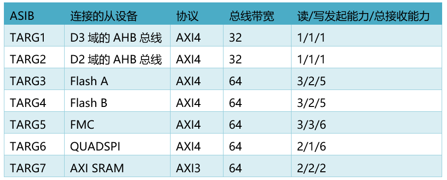

## 存储结构
### FLASH
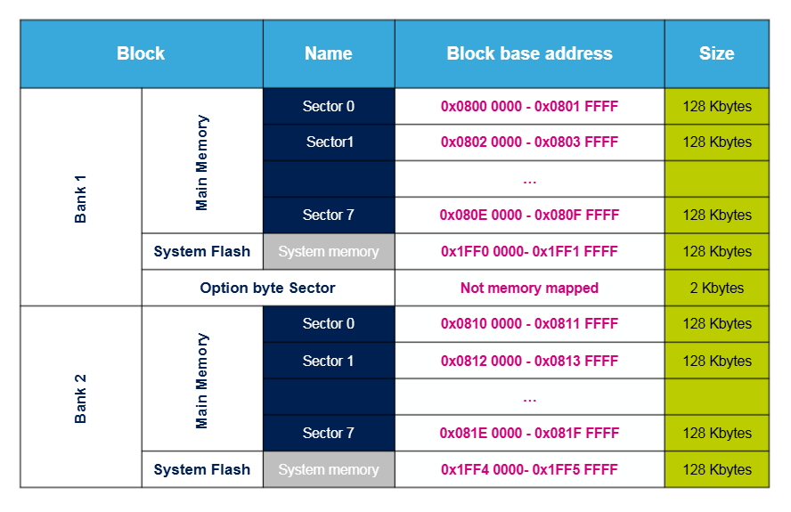

H7中已经没有F1和F4系列中的ART Chrome加速，通过H7中的Cache加速即可。具体延迟数值和主频关系如下：
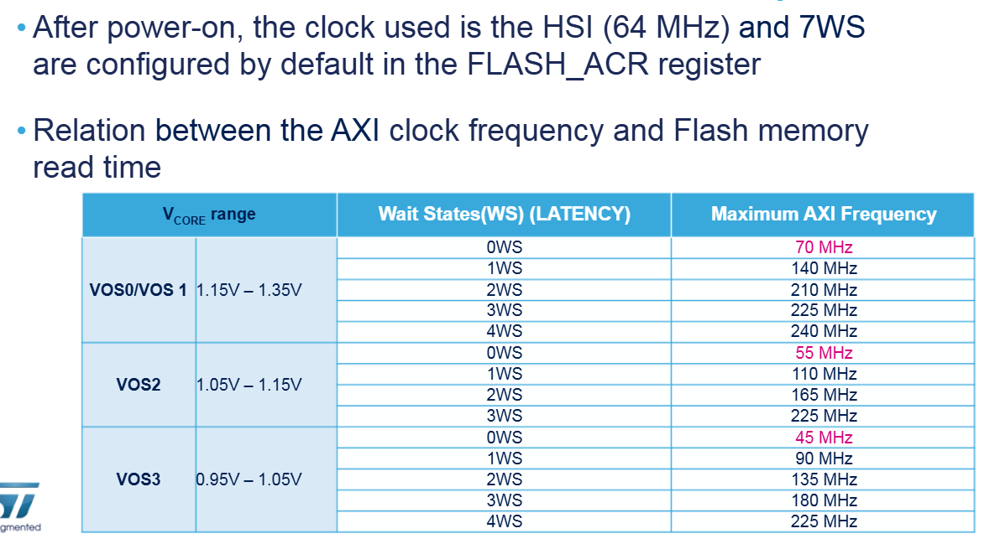

flash本身速度70M, 266bit（多出来10bit校验位）, 适配AXI总线64bit 240M,所以不会对性能产生影响
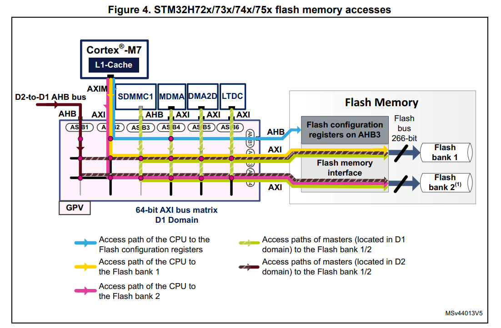

### SRAM
#### TCM区

TCM : Tightly-Coupled Memory 紧密耦合内存 。ITCM用于运行指令，也就是程序代码，DTCM用于数据存取，特点是跟内核速度一样，而片上RAM的速度基本都达不到这个速度，所以有降频处理。

速度：480MHz。

DTCM地址：0x2000 0000，大小128KB。

ITCM地址：0x0000 0000，大小64KB。

#### AXI SRAM区

位于D1域，数据带宽是64bit，挂在AXI总线上。除了D3域中的BDMA主控不能访问，其它都可以访问此RAM区。

速度：240MHz。

地址：0x2400 0000，大小512KB。

用途：用途不限，可以用于用户应用数据存储或者LCD显存。

#### SRAM1，SRAM2和SRAM3区

位于D2域，数据带宽是32bit，挂在AHB总线上。除了D3域中的BDMA主控不能访问这三块SRAM，其它都可以访问这几个RAM区。

速度：240MHz。

SRAM1：地址0x3000 0000，大小128KB，用途不限，可用于D2域中的DMA缓冲，也可以当D1域断电后用于运行程序代码。

SRAM2：地址0x3002 0000，大小128KB，用途不限，可用于D2域中的DMA缓冲，也可以用于用户数据存取。

SRAM3：地址0x3004 0000，大小32KB，用途不限，主要用于以太网和USB的缓冲。

#### SRAM4区

位于D3域，数据带宽是32bit，挂在AHB总线上，大部分主控都能访这块SRAM区。

速度：120MHz。

地址：0x3800 0000，大小64KB。

用途：用途不限，可以用于D3域中的DMA缓冲，也可以当D1和D2域进入DStandby待机方式后，继续保存用户数据。

#### Backup SRAM区

备份RAM区，位于D3域，数据带宽是32bit，挂在AHB总线上，大部分主控都能访问这块SRAM区。

速度：120MHz。

地址：0x3880 0000，大小4KB。

用途：用途不限，主要用于系统进入低功耗模式后，继续保存数据（Vbat引脚外接电池）。

### CACHE
#### I-CACHE
16kB
32字节预取（一行）

#### D-CACHE
16kB
32字节预取（一行）

当进行DMA操作时，先要clean并invalidate缓存免得出现数据一致性问题

## DMA
### MDMA
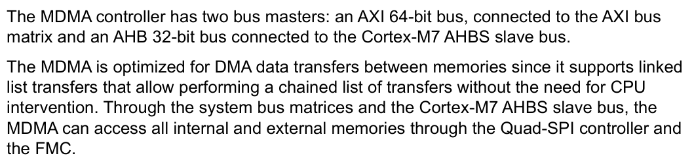

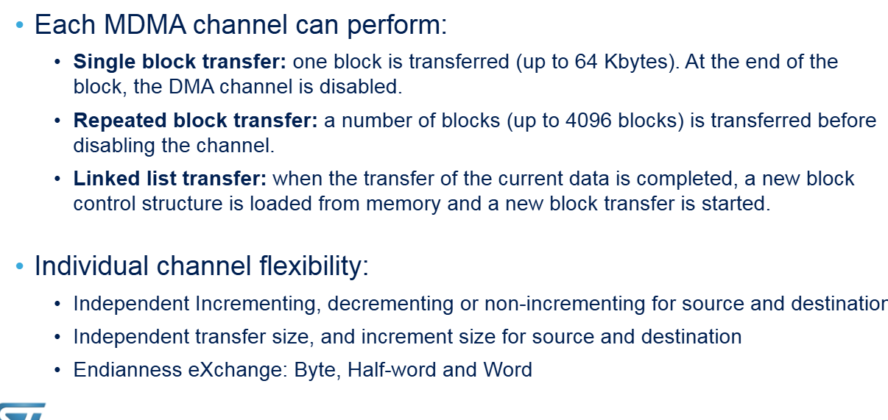

应该就是数据块传输用的，跟外设应该没啥关系。看到可以传输链表

### DMA1/2
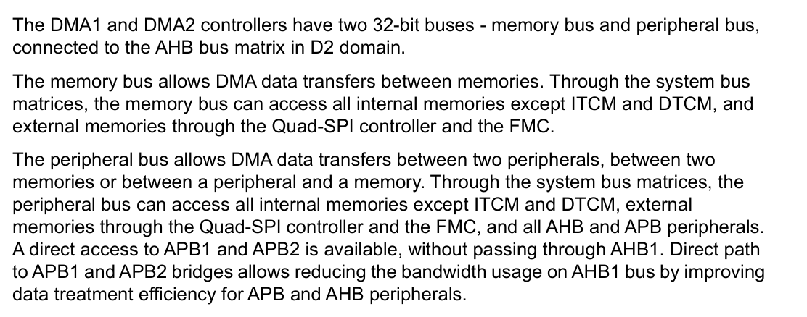
就普通DMA

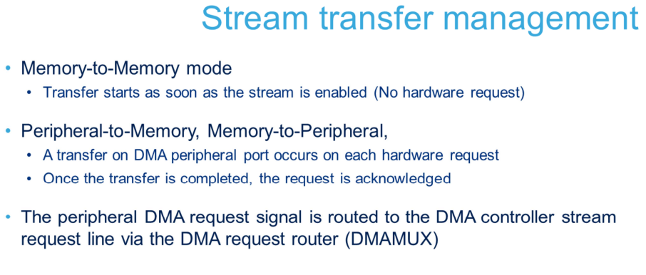
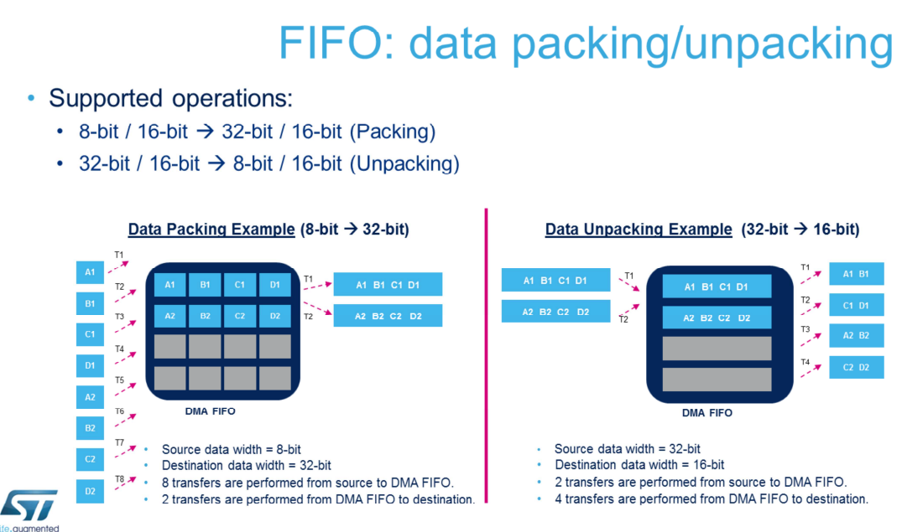
可能是用来提升一下总线利用率

### BDMA
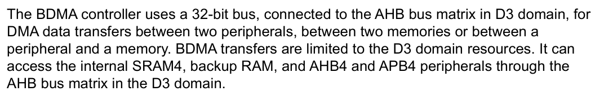

## 电源系统
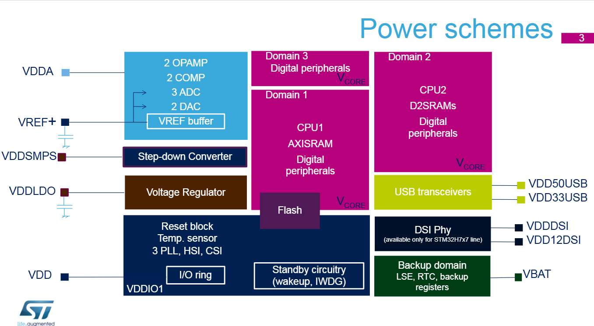
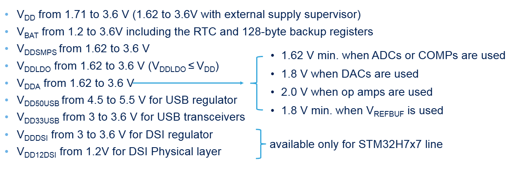
### 供电方式
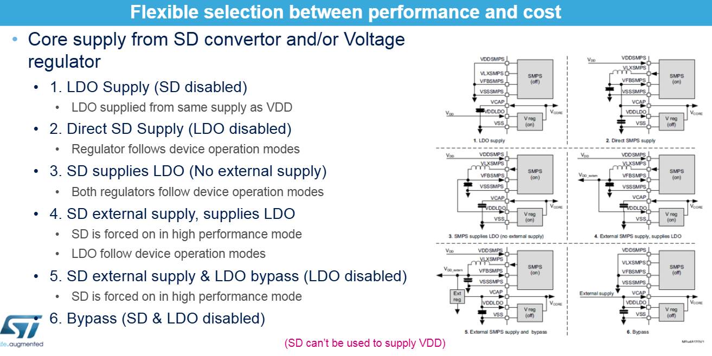
#### BUCK供电
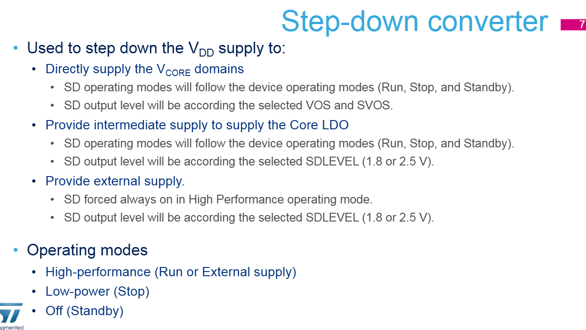

#### LDO供电
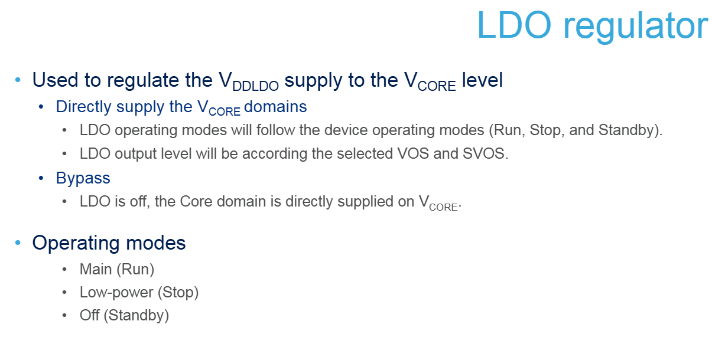

## 参考资料
* https://www.cnblogs.com/armfly/p/10678069.html
* h7 datasheet
* h7 reference manual
* https://www.st.com/content/st_com/en/support/learning/stm32-education/stm32-online-training/stm32h7-online-training.html
