# 🔷 H7入门到入土（2）- MPU

MPU有16个区域，每个区域8个子区域，每一个子区域>=32B且是32B的倍数，那么区域>=256B

内存有优先级，就是region编号。优先级越高，在定义重叠的时候选取高优先级的定义。应该有个编号-1的默认定义，所以不定义任何region也会有一定的配置。我猜测默认配置里面normal memory是可缓存的？
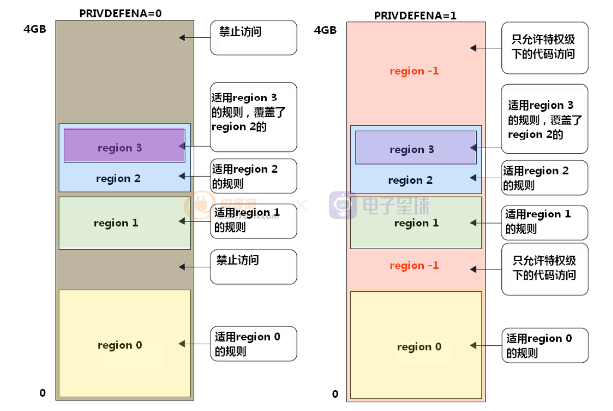

## 配置寄存器

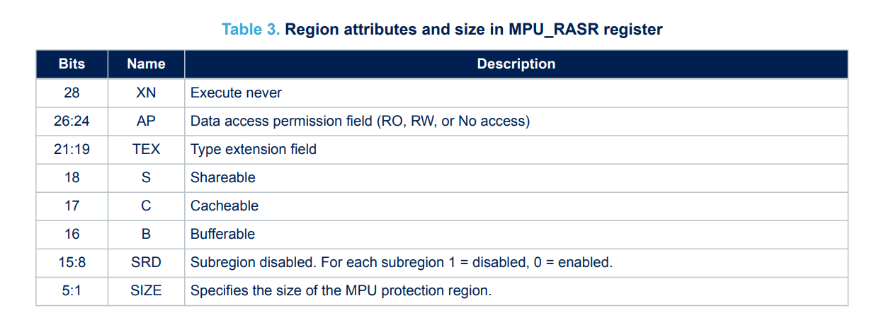

* XN是关于内存是否能执行代码
* AP控制内存访问权限
* 其他就看表格说明了。以及下面进行诠释

## 内存类型

* normal（用于普通内存）：可能会乱序存储，合并存储。可以设置缓存不缓存，缓冲不缓冲
* device（用于外设）：相同外设不会乱序，合并存储，不同外设可能会乱序存储。默认不可缓存，可总线缓冲
* strongly-ordered（一般不用）：都不会乱序，合并存储。默认不可缓存，不可总线缓冲

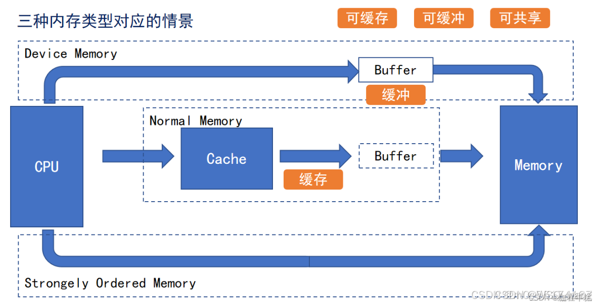

### 什么是总线Buffer?

感觉类似解决总线速率不同的fifo，就是cpu负责无脑发数据，不需要等待总线空闲再发

### 关于缓存cache

#### 读写策略

* write-back：写回缓存后不写进存储器，直到缓存行被清理
* write-through：写回缓存后同时写进存储器
* write-allocate：写的时候如果未命中，则从存储读一行（32B）进缓存再写进缓存。no write-allocate意味着未命中直接写存储，不会加载入缓存
* read-allocate：读的时候如果未命中，则从存储读一行（32B）进缓存

内存类型和缓存策略由TEX和C/B/S这几个寄存器位配置
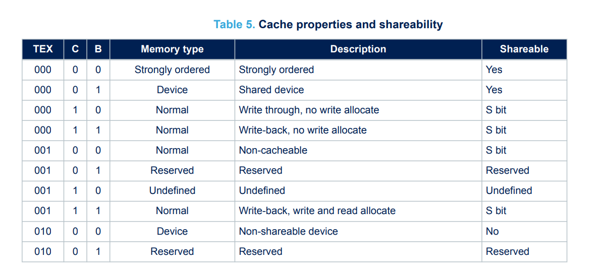
一般来说，我们不会配置normal memory为non-cacheable，因为损失性能。数据一致性可以软件维护。所以TEX一般就是000，然后通过配置CBS来配置内存类型和读写策略。

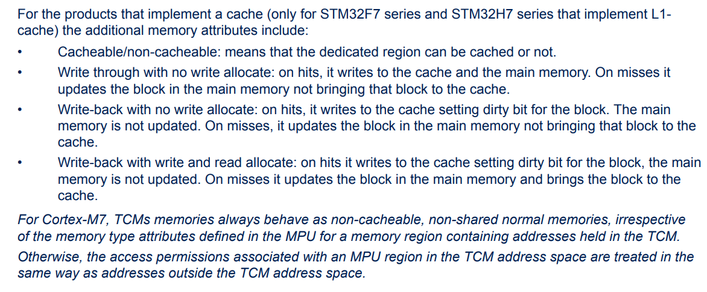

## 内存访问权限

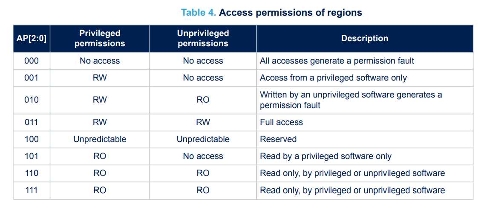
一般来说就是full access

## 子区域

通过subregion disable bits可以关闭区域内的一些子区域的配置，1为disable
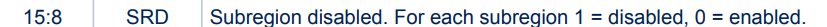

## 关于speculation mode

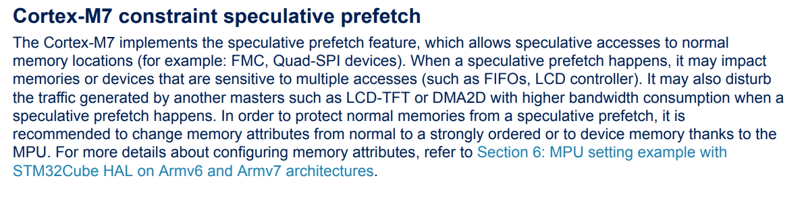
好像是说cpu会有一些预测，会带来乱序存取/不必要的存取。但是fifo读了之后就没了，lcd读了也可能会扰乱其行为，所以建议把这些外设内存设置为device/strongly-ordered

## CUBE默认内存配置

### flash执行代码（xxx_FLASH.ld）

| 区域名 | 起始地址 | 大小 | 存放内容 | 备注 |
|----|----|----|----|----|
| **FLASH** | 0x0800 0000 | 2048 KB | `.isr_vector`（中断向量表）、`.text`（程序代码）、`.rodata`（常量）、C++ 构造析构表等 | 启动时 CPU 从这里取指令（执行代码存储位置） |
| **ITCMRAM** | 0x0000 0000 | 64 KB | **未使用**（可用于放执行代码实现 0 等待取指） | 必须在 `.ld` 手动分配段，适合高性能函数 |
| **DTCMRAM** | 0x2000 0000 | 128 KB | **未使用**（可用于高速数据存取，CPU 直连） | DMA 不能访问 |
| **RAM_D1** | 0x2400 0000 | 512 KB | `.data`（已初始化全局变量）、`.bss`（未初始化全局变量）、堆（0x200 B）、栈（0x400 B） | 这是当前唯一实际使用的 RAM 区域 |
| **RAM_D2** | 0x3000 0000 | 288 KB | **未使用**（适合 DMA 缓冲区等） | 需要在 `.ld` 添加段映射才能用 |
| **RAM_D3** | 0x3800 0000 | 64 KB | **未使用**（低速共享 RAM） | 常用于待机域数据 |

修改默认的.ld文件，给剩下几个域分配空间：

``` c
/*
******************************************************************************
**
**  File        : LinkerScript.ld
**
**  Author      : STM32CubeIDE
**
**  Abstract    : Linker script for STM32H7 series
**                2048Kbytes FLASH and 1056Kbytes RAM
**
**                Set heap size, stack size and stack location according
**                to application requirements.
**
**                Set memory bank area and size if external memory is used.
**
**  Target      : STMicroelectronics STM32
**
**  Distribution: The file is distributed as is, without any warranty
**                of any kind.
**
*****************************************************************************
** @attention
**
** Copyright (c) 2023 STMicroelectronics.
** All rights reserved.
**
** This software is licensed under terms that can be found in the LICENSE file
** in the root directory of this software component.
** If no LICENSE file comes with this software, it is provided AS-IS.
**
****************************************************************************
*/

/* Entry Point */
ENTRY(Reset_Handler)

/* Highest address of the user mode stack */
_estack = ORIGIN(AXI_SRAM) + LENGTH(AXI_SRAM);    /* end of RAM */
/* Generate a link error if heap and stack don't fit into RAM */
_Min_Heap_Size = 0x2000;      /* required amount of heap  */
_Min_Stack_Size = 0x1000; /* required amount of stack */

/* Specify the memory areas */
MEMORY
{
  DTCMRAM (xrw)  : ORIGIN = 0x20000000, LENGTH = 128K
  AXI_SRAM (xrw) : ORIGIN = 0x24000000, LENGTH = 512K
  SRAM1 (xrw)    : ORIGIN = 0x30000000, LENGTH = 128K
  SRAM2 (xrw)    : ORIGIN = 0x30020000, LENGTH = 128K
  SRAM3 (xrw)    : ORIGIN = 0x30040000, LENGTH = 32K
  SRAM4 (xrw)    : ORIGIN = 0x38000000, LENGTH = 64K
  ITCMRAM (xrw)  : ORIGIN = 0x00000000, LENGTH = 64K
  FLASH (rx)     : ORIGIN = 0x08000000, LENGTH = 2048K
  FLASH_POINT (rx) : ORIGIN = 0x08000000 + 128K, LENGTH = 1920K  /* ???????????????????????????????Boot??????? */
}

/* Define output sections */
SECTIONS
{
    /* The startup code goes first into FLASH */
  .isr_vector :
  {
    . = ALIGN(4);
    KEEP(*(.isr_vector)) /* Startup code */
    . = ALIGN(4);
  } >FLASH

  /* The program code and other data goes into FLASH */
  .text :
  {
    . = ALIGN(4);
    *(.text)           /* .text sections (code) */
    *(.text*)          /* .text* sections (code) */
    *(.glue_7)         /* glue arm to thumb code */
    *(.glue_7t)        /* glue thumb to arm code */
    *(.eh_frame)

    KEEP (*(.init))
    KEEP (*(.fini))

    . = ALIGN(4);
    _etext = .;        /* define a global symbols at end of code */
  } >FLASH

  /* Constant data goes into FLASH */
  .rodata :
  {
    . = ALIGN(4);
    *(.rodata)         /* .rodata sections (constants, strings, etc.) */
    *(.rodata*)        /* .rodata* sections (constants, strings, etc.) */
    . = ALIGN(4);
  } >FLASH

  .ARM.extab  (READONLY) : { *(.ARM.extab* .gnu.linkonce.armextab.*) } >FLASH
  .ARM (READONLY) : {
    __exidx_start = .;
    *(.ARM.exidx*)
    __exidx_end = .;
  } >FLASH

  .preinit_array  (READONLY)   :
  {
    PROVIDE_HIDDEN (__preinit_array_start = .);
    KEEP (*(.preinit_array*))
    PROVIDE_HIDDEN (__preinit_array_end = .);
  } >FLASH

  .init_array (READONLY) :
  {
    PROVIDE_HIDDEN (__init_array_start = .);
    KEEP (*(SORT(.init_array.*)))
    KEEP (*(.init_array*))
    PROVIDE_HIDDEN (__init_array_end = .);
  } >FLASH

  .fini_array (READONLY) :
  {
    PROVIDE_HIDDEN (__fini_array_start = .);
    KEEP (*(SORT(.fini_array.*)))
    KEEP (*(.fini_array*))
    PROVIDE_HIDDEN (__fini_array_end = .);
  } >FLASH

  /* used by the startup to initialize data */
  _sidata = LOADADDR(.data);

  /* Initialized data sections goes into RAM, load LMA copy after code */
  .data :
  {
    . = ALIGN(4);
    _sdata = .;        /* create a global symbol at data start */
    *(.data)           /* .data sections */
    *(.data*)          /* .data* sections */
    *(.RamFunc)        /* .RamFunc sections */
    *(.RamFunc*)       /* .RamFunc* sections */

    . = ALIGN(4);
    _edata = .;        /* define a global symbol at data end */
  } >AXI_SRAM AT> FLASH

  /* Uninitialized data section */
  . = ALIGN(4);
  .bss :
  {
    /* This is used by the startup in order to initialize the .bss section */
    _sbss = .;         /* define a global symbol at bss start */
    __bss_start__ = _sbss;
    *(.bss)
    *(.bss*)
    *(COMMON)

    . = ALIGN(4);
    _ebss = .;         /* define a global symbol at bss end */
    __bss_end__ = _ebss;
  } >AXI_SRAM

  /* User_heap_stack section, used to check that there is enough RAM left */
  ._user_heap_stack :
  {
    . = ALIGN(8);
    PROVIDE ( end = . );
    PROVIDE ( _end = . );
    . = . + _Min_Heap_Size;
    . = . + _Min_Stack_Size;
    . = ALIGN(8);
  } >AXI_SRAM

    ._DTCM_Area_128KB :
      {
       . = ALIGN(4);
        *(._DTCM_Area_128KB)           /* .data sections */
        *(._DTCM_Area_128KB*)          /* .data* sections */
       . = ALIGN(4);
      } >DTCMRAM AT> FLASH

  ._AXI_SRAM_Area_512KB :
      {
       . = ALIGN(4);
       . = ALIGN(4);
      } >AXI_SRAM AT> FLASH
      
	_sidata1 = LOADADDR(._SRAM1_Area_128KB);
    ._SRAM1_Area_128KB :
      {
       . = ALIGN(4);
	    _sdata1 = .;        /* create a global symbol at data start */
	    *(._SRAM1_Area_128KB)           /* .data sections */
	    *(._SRAM1_Area_128KB*)          /* .data* sections */	
	    . = ALIGN(4);
	    _edata1 = .;        /* define a global symbol at data end */
      } >SRAM1  AT> FLASH

	_sidata2 = LOADADDR(._SRAM2_Area_128KB);
    ._SRAM2_Area_128KB :
      {
       . = ALIGN(4);
	    _sdata2 = .;        /* create a global symbol at data start */
	    *(._SRAM2_Area_128KB)           /* .data sections */
	    *(._SRAM2_Area_128KB*)          /* .data* sections */	
	    . = ALIGN(4);
	    _edata2 = .;        /* define a global symbol at data end */
      } >SRAM2 AT> FLASH

	_sidata3 = LOADADDR(._SRAM3_Area_32KB);
    ._SRAM3_Area_32KB :
      {
       . = ALIGN(4);
	    _sdata3 = .;        /* create a global symbol at data start */
	    *(._SRAM3_Area_32KB)           /* .data sections */
	    *(._SRAM3_Area_32KB*)          /* .data* sections */	
	    . = ALIGN(4);
	    _edata3 = .;        /* define a global symbol at data end */
      } >SRAM3 AT> FLASH

	_sidata4 = LOADADDR(._SRAM4_Area_64KB);
    ._SRAM4_Area_64KB :
      {
       . = ALIGN(4);
	    _sdata4 = .;        /* create a global symbol at data start */
	    *(._SRAM4_Area_64KB)           /* .data sections */
	    *(._SRAM4_Area_64KB*)          /* .data* sections */	
	    . = ALIGN(4);
	    _edata4 = .;        /* define a global symbol at data end */
      } >SRAM4 AT> FLASH

     ._CPU_FLASH :
     {
      . = ALIGN(4);
      . = ALIGN(4);
     } >FLASH_POINT

  /* Remove information from the standard libraries */
  /DISCARD/ :
  {
    libc.a ( * )
    libm.a ( * )
    libgcc.a ( * )
  }

  .ARM.attributes 0 : { *(.ARM.attributes) }
}


```

### RAM执行代码（xxx_RAM.ld）

| 区域名 | 地址范围 | 大小 | 用途 |
|----|----|----|----|
| **ITCMRAM** | 0x0000 0000 – 0x0000 FFFF | 64 KB | 没用到（适合放热点代码） |
| **DTCMRAM** | 0x2000 0000 – 0x2001 FFFF | 128 KB | 存放已初始化数据 `.data`、未初始化数据 `.bss`、堆、栈 |
| **RAM_EXEC** | 0x2400 0000 – 0x2407 FFFF | 512 KB | 存放 ISR 向量表、代码 `.text`、常量 `.rodata` 等（这里直接在 RAM 中运行） |
| **RAM_D2** | 0x3000 0000 – 0x3004 7FFF | 288 KB | 没在这个脚本里用到（可能留给 DMA 缓冲等） |
| **RAM_D3** | 0x3800 0000 – 0x3800 FFFF | 64 KB | 没用到（可扩展存储） |

### 配置MPU

* 配置AXI SRAM （地址为0x24000000，大小512KB）的 MPU 属性为 `Write back`, `Read allocate`，`Write allocate`。
  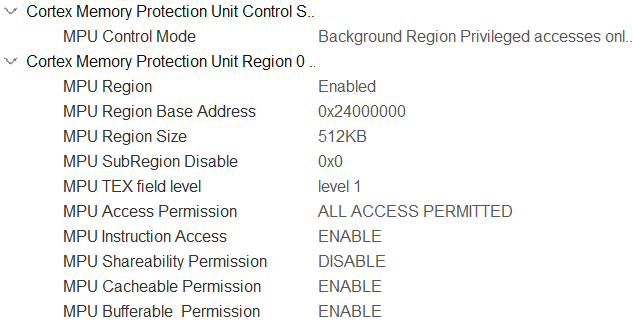
* 配置 FMC 扩展 IO （地址为0x60000000，大小64KB）的 MPU 属性为 `Device` 或者 `Strongly Ordered`。
  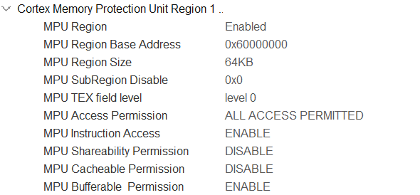
* 配置 SRAM1 （地址为0x30000000，大小128KB）的属性为 `Write through`,` read allocate`，`no write allocate`。
  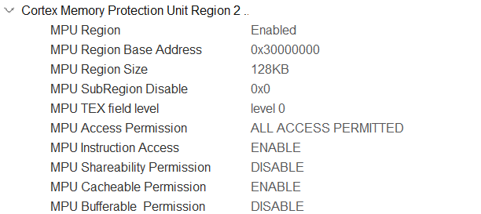
* 配置 SRAM2 （地址为0x30020000，大小128KB）的属性为 `Write through`, `read allocate`，`no write allocate`。
  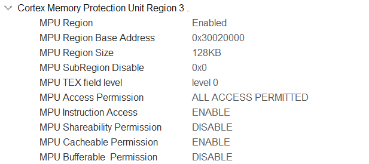
* 配置 SRAM3 （地址为0x30040000，大小32KB）的属性为 `Write through`, `read allocate`，`no write allocate`。
  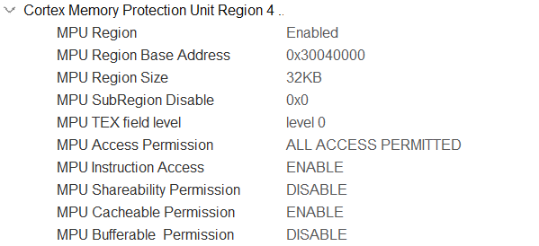
* 配置 SRAM4 （地址为0x38000000，大小64KB）的属性为 `Write through`, `read allocate`，`no write allocate`。
  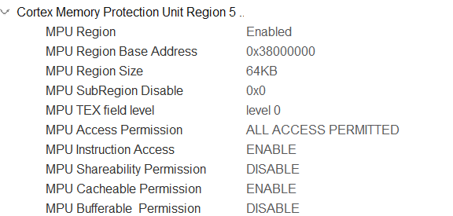

## 怎么将变量放在特定的内存区域内？

加入attribute声明

``` c
#define     __AT_DTCM_      __attribute__((section("._DTCM_Area_128KB")))
#define     __AT_AXI_SRAM_      __attribute__((section("._AXI_SRAM_Area_512KB"))) __attribute__ ((aligned (32)))  /**< 将指定对象存放于AXI_SRAM */
#define     __AT_SRAM1_         __attribute__((section("._SRAM1_Area_128KB"))) __attribute__ ((aligned (32)))     /**< 将指定对象存放于SRAM1 */
#define     __AT_SRAM2_         __attribute__((section("._SRAM2_Area_128KB"))) __attribute__ ((aligned (32)))     /**< 将指定对象存放于SRAM2 */
#define     __AT_SRAM3_         __attribute__((section("._SRAM3_Area_32KB"))) __attribute__ ((aligned (32)))      /**< 将指定对象存放于SRAM3 */
#define     __AT_SRAM4_         __attribute__((section("._SRAM4_Area_64KB"))) __attribute__ ((aligned (32)))      /**< 将指定对象存放于SRAM4 */
#define     __AT_CPUFLASH_2to8_ __attribute__((section("._CPU_FLASH")))  __attribute__ ((aligned (32)))           /**< 将指定对象存放于内部FLASH */

#define     ALIGN_32B(buf)      buf __attribute__ ((aligned (32)))
//对齐为了放cache能放在一行
```

进行一波定义（变量默认放在AXI_SRAM，所以放入其他内存需要加标识。比如D2域的外设相关缓存放SRAM1/2/3，D3域放SRAM4）

``` c
__AT_SRAM1_ uint16_t buffer[N] = {0};
```

注意放在其他内存的变量没有自动初始化，要手动复制初值。

``` cpp
//来自.ld的内存地址
extern uint32_t _sidata1;
extern uint32_t _sdata1;
extern uint32_t _edata1;
extern uint32_t _sidata2;
extern uint32_t _sdata2;
extern uint32_t _edata2;
extern uint32_t _sidata3;
extern uint32_t _sdata3;
extern uint32_t _edata3;
extern uint32_t _sidata4;
extern uint32_t _sdata4;
extern uint32_t _edata4;

void System::memory_init(){
	memory_copy(&_sidata1, &_sdata1, &_edata1);
	memory_copy(&_sidata2, &_sdata2, &_edata2);
	memory_copy(&_sidata3, &_sdata3, &_edata3);
	memory_copy(&_sidata4, &_sdata4, &_edata4);
}
```

注意如果要在一个对象里把一个数组放在其他内存里，需要外部定义然后把数组指针赋进去，而不是在对象内部定义
