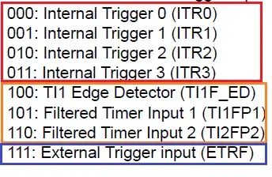
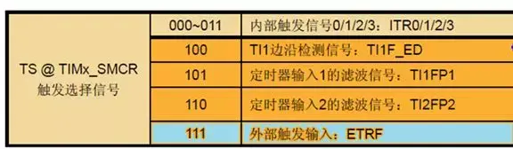
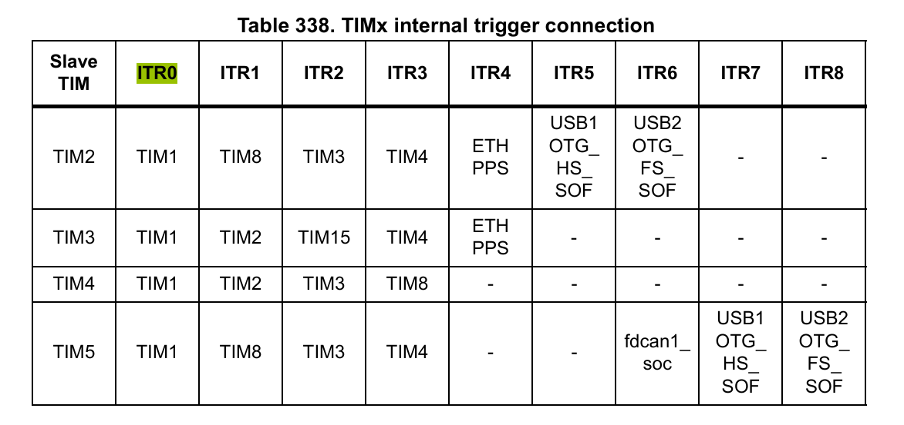
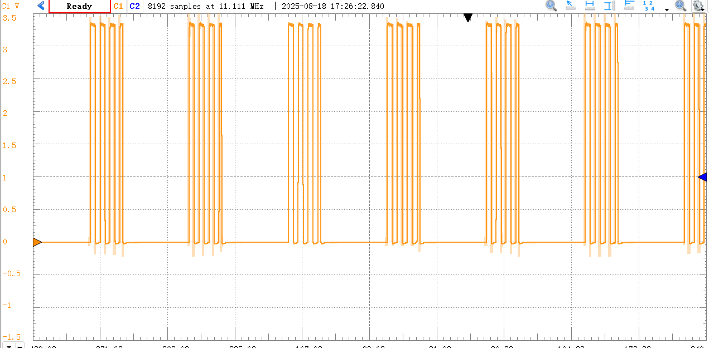
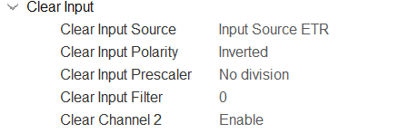
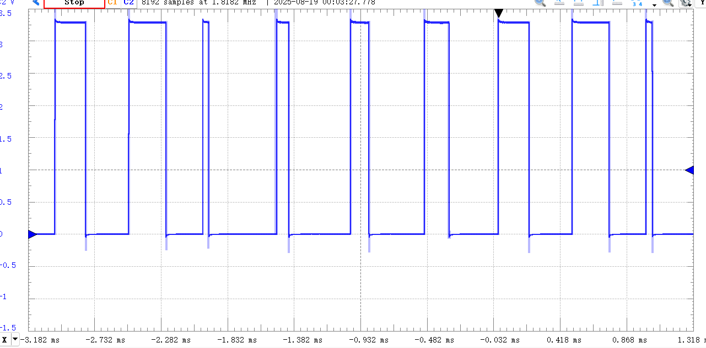
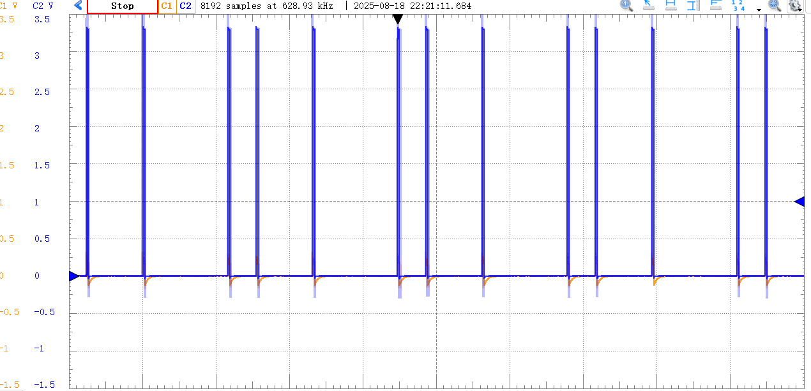

信号分为模拟信号与数字信号。信息的传递依赖于调制。

* 模拟信号的调制很熟悉了，AM/FM/PM，调制幅度/频率/相位
* 数字信号的调制分为PAM/PPM/PDM，调制幅度（0/1），脉冲间距（相位），占空比

下面介绍如何实现数字信号的调制（基带信号的产生与上变频），先介绍一些定时器基本知识，为上变频铺垫：

# 定时器主从模式

## 触发信号

### 用途：

1. 对计数器复位
2. 启动或停止计数器的计数动作
3. 使能计数器模块的工作
4. 通过触发信号为计数器提供时钟源

### 来源：

可以为其他定时器的TRGO/通道12的输入/外部触发
这些信号都是边沿检测的小脉冲（上升沿/下降沿/双沿）
每个定时器只能产生一个TRGO，TRGO来源为update/某一路的compare事件




TRGO与ITRx映射表：


## 从模式的分类

1. 复位模式 【Reset mode】
2. 触发模式 【Trigger mode】
3. 门控模式 【Gate mode】
4. 复位模式+触发模式 【Combined reset trigger mode】
5. 外部时钟模式1 【External clock mode 1】
6. 编码器模式 【encode mode】
7. ETR IO as Clearing Source

### 1. 复位模式

触发时

* CNT->0
* 不会自动使能定时器

### 2. 触发模式

触发时

* 使能定时器
* 不会CNT->0

### 3. 门控模式

根据触发输入信号的电平来启动或停止计数器的计数

* 不会CNT->0

### 4. 复位模式+触发模式

* CNT->0
* 使能定时器

### 5. 外部时钟模式1

相比时钟源直接设成ETR的区别：

* 这个从模式不仅可以用外部时钟，还可以用内部TRGO

### 7. ETR IO as Clearing Source

类似门控，但是不是启动或停止计数器的计数，而是设置reset

* 在特定电平CNT->0
* 不会关闭/使能定时器

## 怎么产生调制的pwm(上变频)



首先，产生调制有两步

* 在一个边沿复位为0，并开启计数
* 在一个边沿复位为0，并暂停计数

我先尝试了各种从模式，发现只要CNT没复位到0，pwm在不计数的时候电平是不一定的。反正1-4就没有一种模式可以同时执行这两步的。但是我发现模式7可以，就是在一个电平全都复位为0，就约等于不计数，而计数实际上是使能的。

当然还有实现方式就是主从模式都不开，就开主定时器的update和compare中断，在中断执行这两步。缺点就是中断开销，时间不是很确定，在cpu占用率高的时候时间就很不一定。

所以模式7的配置方法：


然后slave和trigger都不用开


如果我要在低电平的时候清零cnt，需要设置polarity为inverted


剩下配置pwm频率和占空比

结束，查一下这个ETR对应哪个引脚，把数字基带信号接到ETR引脚上就可以了。注意要在程序里面使能定时器

## 下变频

下变频除了模拟检波再进比较器（最好是施密特触发器，考虑到检波会有纹波；或者按照按键消抖的思路处理也可以）转化为数字信号外，还可以直接进比较器然后进行数字检波

数字检波的思路：

1. 上升沿置为1
2. 下降沿开始计时，计时超过一个载波周期置为0

但是这个单片机实现起来就蛮麻烦的，提供一个思路：

1. EXTI 上升沿触发中断，置为1。关闭上升沿中断。
2. 下降沿触发EXTI中断，开始定时器计时，并关闭下降沿中断。同时下降沿作为外部触发给从定时器的reset用来清零。当定时器计满后触发update中断，置为0。如果一直下降沿就一直清零计不满，所以还是1.

# 数字基带信号发生

## PAM/PDM

我称之一类，都是设置占空比。PAM 双极性0/1就占空比0/100%，使用定时器pwm

思路就是dma从内存传输到CCR寄存器，建立流式传输就开dma传输半中断和完成中断，并且circular传输

注意CCR preload要开。如果dma request是CCx，在比较边沿请求，没一会CCR就更新上去影响结果



函数

``` cpp
HAL_TIM_PWM_Start_DMA(&htim, channel);
```

这里我对函数有魔改，因为当compare接近arr的时候，下一次传输无法在update时更新上去，就不是很对，所以我把dma request改成了update，但是问题是发现如果这个update请求给了两个dma用会发生奇奇怪怪的问题，所以我本来想arr和ccr联动的，联动不起来，除非用dma burst(加fifo一次传n个寄存器)

## PPM

设置周期

思路就是dma从内存传输到ARR寄存器，建立流式传输就开dma传输半中断和完成中断，并且circular传输

注意ARR preload要开



函数

``` cpp
HAL_TIM_Base_Start_DMA(&htim);
```
