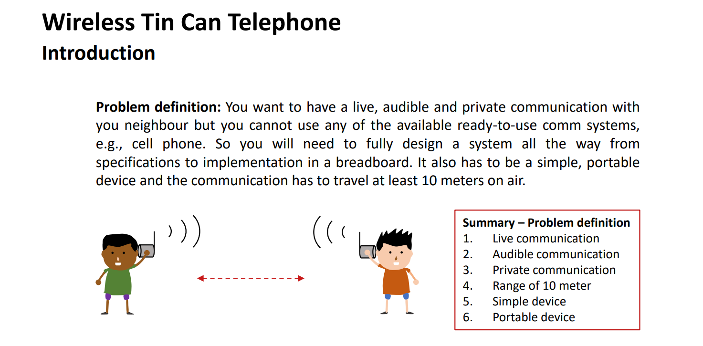
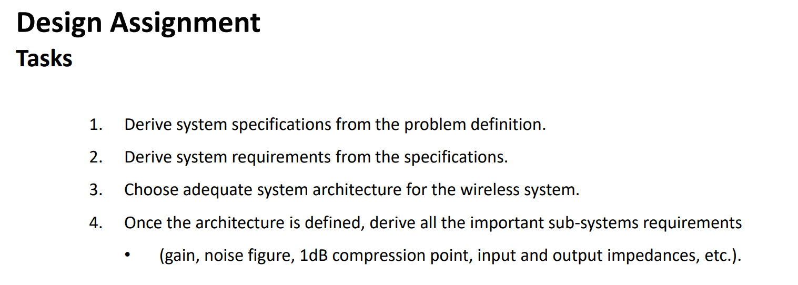

电子线路的课程设计太保姆了，导致覆盖了自己设计的过程；我这里贴上国外电子线路的课程设计，力求从工程的开始，也就是需求分析，完整设计一个收发机

我记得我大一的时候还想着，我以后一定要设计一个收发机。当我不在教室的时候，lj要点我名，我可以远程回答（这是大一小灯我不去上lj的课跑去上checkin的课。lj于是连着点了我三次名让我回答问题。我遂发邮件说我膝盖受伤走不动路，lj遂不再点我名）。但是又一想，手机不就结束了。但是不行，我要设计自己的手机！

## 一. 需求分析

1. 实时通话：要有话筒和喇叭；然后按照对讲机，是半双工的，同一时间只能有一个人按下按键说话
2. 发射功率0-20dBm：对应功放的选型
3. 无线通信距离10m，通话良好：意味着10m内SNR>20dB，对应接收机LNA的放大倍数与NF
4. 可携带：电池供电

## 二. 系统架构和指标设计

### 发送机架构
话筒输入->音频放大电路->FM调制模块->功放->低通滤波->可变衰减->天线

### 接收机架构
天线->可变带通滤波器->LNA->FM解调模块（下变频到中频（可变的频率发生器）再IF滤波并放大（AGC）再PLL解调）->可调增益运放->音频功放->耳机输出

### 指标设计
* 通信频率为87-108M可调，带宽200k
* 发射机20dBm对应6Vpp，所以功放P1dB>20dBm
* 10m接收功率为0.4mW，-4dBm, 对应400mVpp。反正FM放大不影响，削峰就削了，那我第一级LNA选20dB增益。按照200k带宽计算，按照-174dbm/hz的热噪声，噪底是-114dBm，按照20dB的最终信噪比，余量其实是非常大的。我感觉灵敏度做到-80dBm没有问题。
* 剩下中间级增益具体设计时再定
* 发射机输出阻抗50欧，接收机输入阻抗50欧

## 未来计划
* 打算先做接收机。起码能听到电台听个响；或者可以先测试信号仪器给
* 到时候测发送机的时候先接30db衰减再接频谱仪看功率（不过感觉示波器也能看），确定功率没问题再接天线（测试时确保上电时输出端口都接负载，以免功放受伤害）
