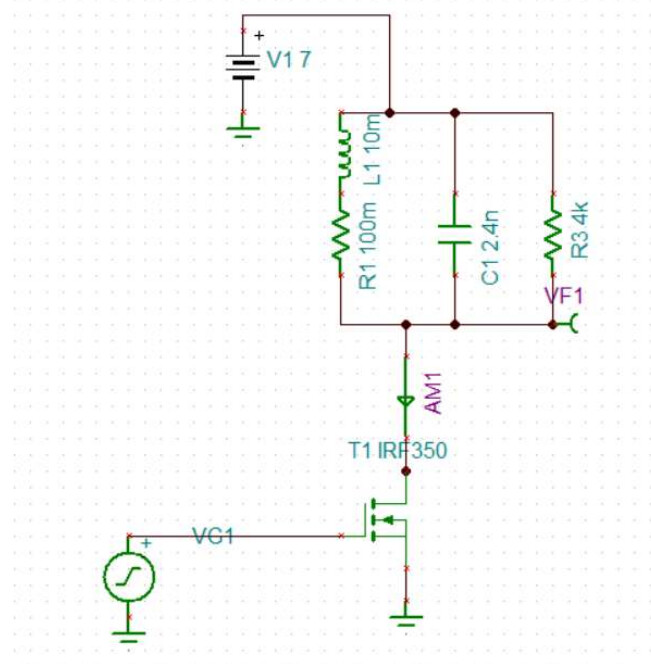
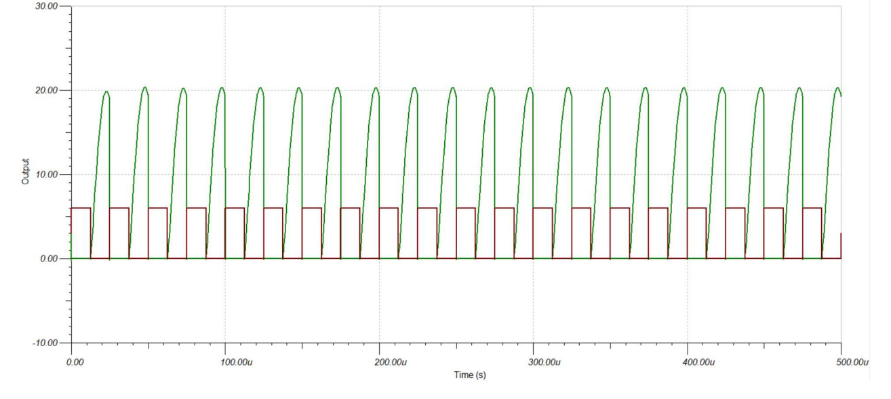
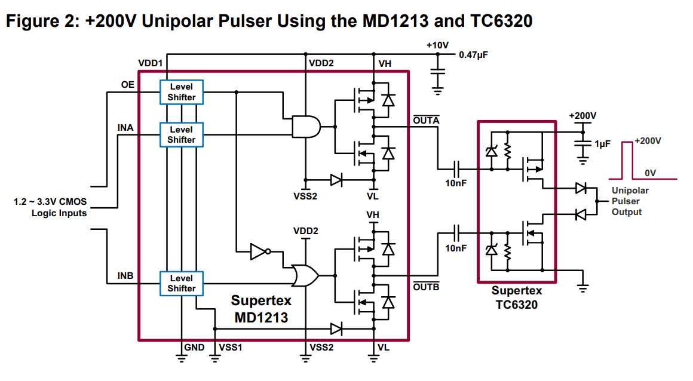
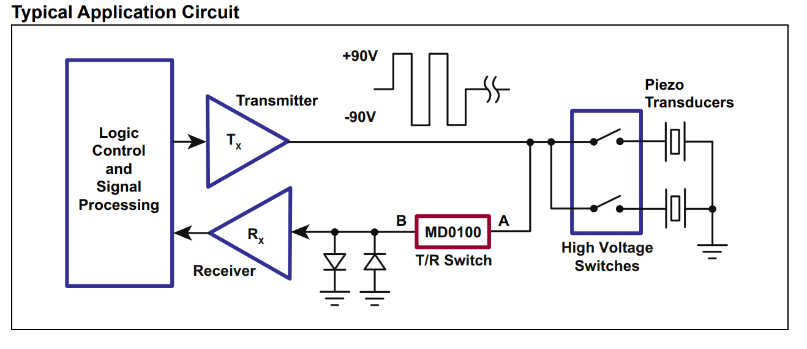
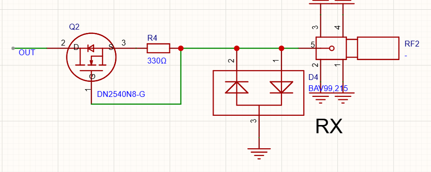
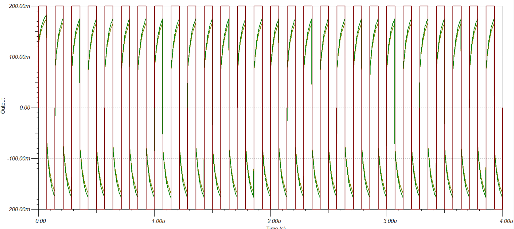
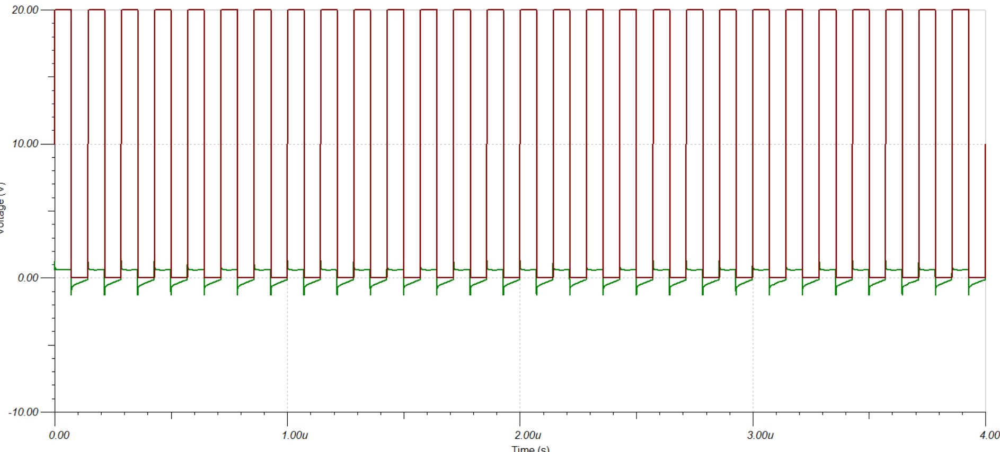

今天搞完了超声脉冲发生器的设计。设计7MHz，100V

对于高压脉冲的发生，我目前感觉有三种方法
1. 基于谐振的放大（电压放大Q倍）
2. 使用变压器的放大
3. 电源轨本身就是高压

比如之前超声小车，我的发射电路：

仿真结果：

在本次应用里，因为介质的不确定，导致阻抗和谐振点的不确定，所以不考虑用谐振方法。然后变压器在7MHz匝数也很少，放大倍数也少（淘宝上只找到5:15的），所以暂时不考虑

那就选用电源高压的桥式电路。其中桥式电路又分为半桥和全桥。我本次采用半桥。虽然全桥可以电源电压除以2，50V就会比100V看起来安全很多。但是我很懒。

原理也就是mos驱动+mos

然后需要画TR开关，以免发射端把接收端干烂。如果只是用限幅电路，串联电阻要非常大。这样对小信号不友好。成品TR开关芯片比如MD0100仅支持+-100V以内的电压。我这个有点极限。然后gemini说可以用耗尽型FET搓TR开关，某种恒流源

仿真反射电压：

仿真发射电压：

看起来还行？

那为啥不用模拟开关？好问题。我也会考虑的
