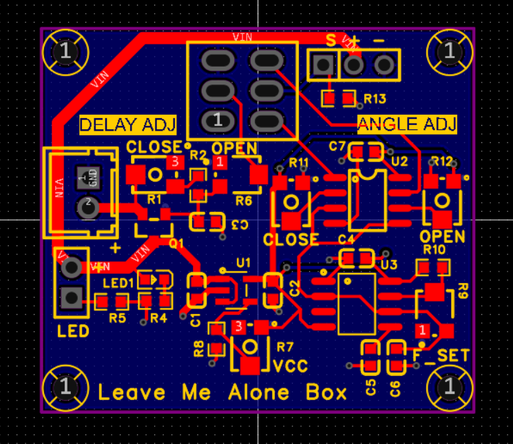
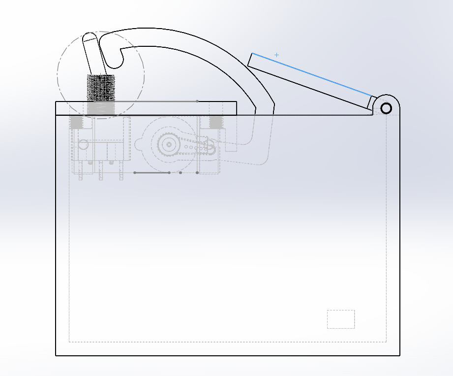
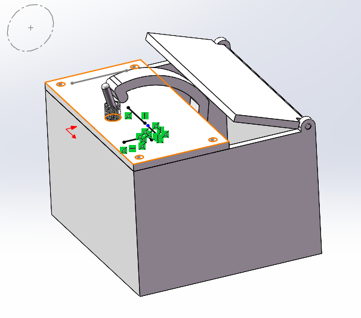
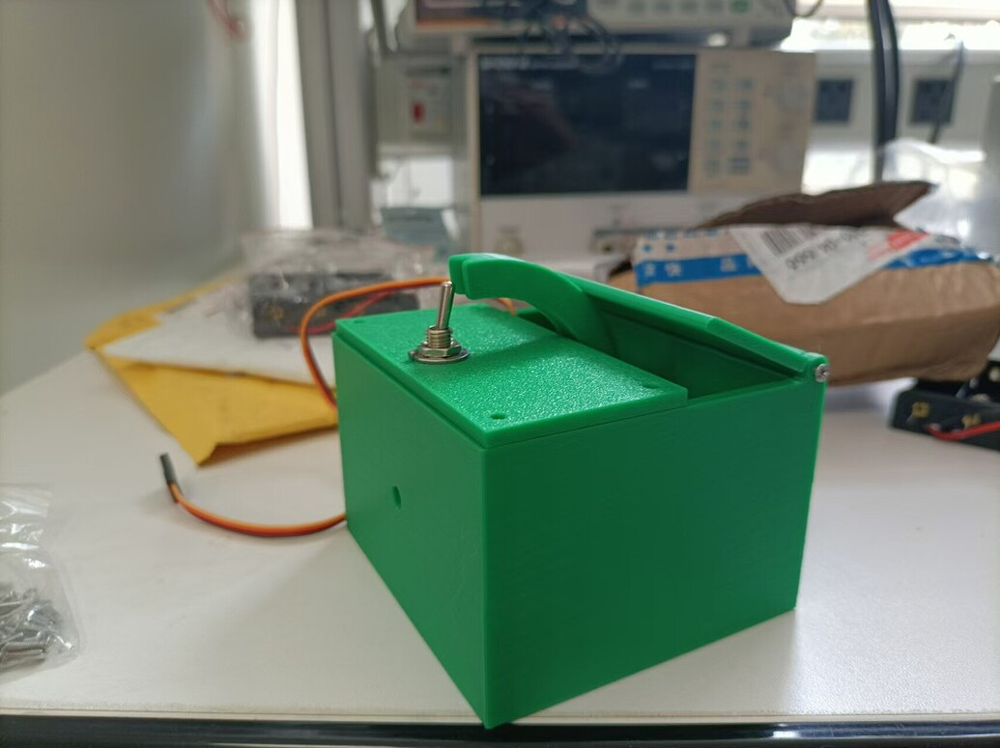
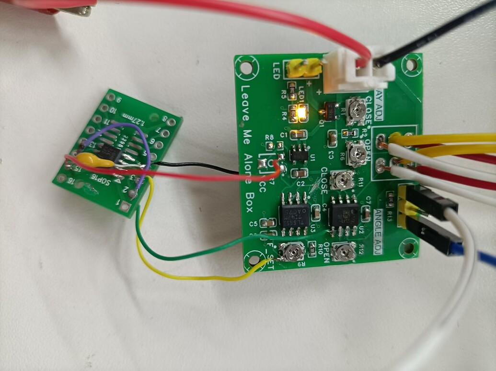

恰逢朋友生日，想做一个好玩的礼物，刚好看了香农的纪录片，受到他的无聊盒子的启发（无聊盒子就是打开开关会自己把开关敲掉的智障盒子），也来复刻一个。遂开干，花了一个周末上午画完 PCB，一个周末下午加晚上画完机械。

## PCB

## 机械

然后感谢学创的 3D 打印，让我用上了拓竹，质量和速度比闪铸不知道高多少。

这是刚组装完的机械：

## 调试

因为不幸的设计失误，开始割线飞线：

## 最终效果

<video controls preload="metadata" src="_images/useless-box-demo.mp4"></video>

## 一些问答

做这个需要什么基础？需要电路知识，面包板或洞洞板的实操经验，再跟着 B 站教程就会了。

电路上的一点经验：用 555 的三角波直接给比较器输入端，会有负载效应，影响频率。
