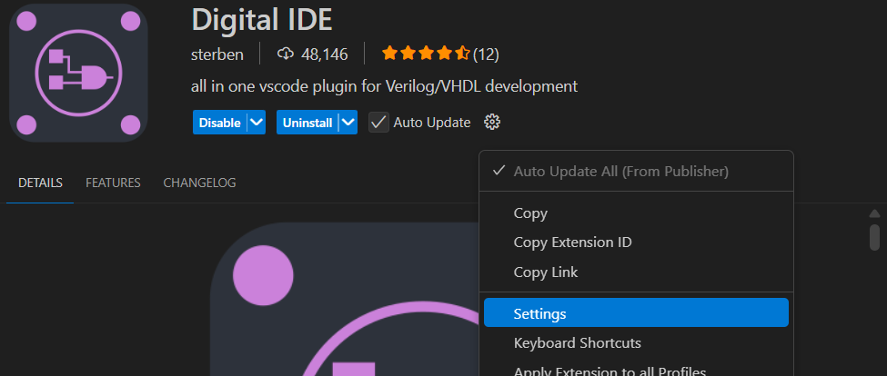
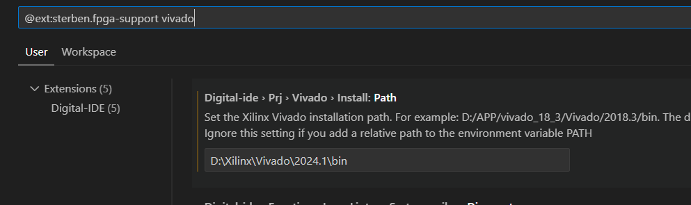
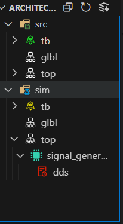
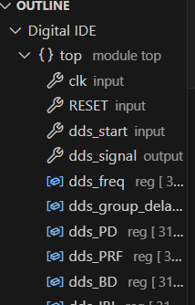
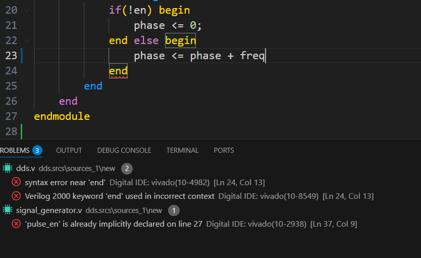
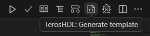
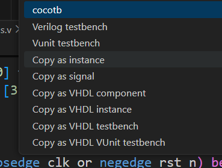
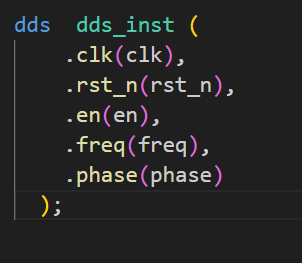

今天是跟环境大战的一天（SJTU的网怎么这么差啊啊啊）

## 安装verilator
<details>
首先是安装verilator，代码查错。应该是相比vivado更严格

* 首先安装wsl的ubuntu，我选了Ubuntu-22.04。--list可以列出所有能安装的版本
`wsl --install -d <Distrbution Name>`
* 然后启动ubuntu，进行一个初始化需要的工作
    * 换国内源
        * 备份原来的 sources.list `sudo cp /etc/apt/sources.list /etc/apt/sources.list.bak`
        * 编辑 sources.list `sudo nano /etc/apt/sources.list`,一通ctrl k删除所有内容，替换成清华源。然后ctrl x,输入y,enter，就保存退出了
        ``` bash
        deb https://mirrors.tuna.tsinghua.edu.cn/ubuntu/ jammy main restricted universe multiverse
        deb https://mirrors.tuna.tsinghua.edu.cn/ubuntu/ jammy-updates main restricted universe multiverse
        deb https://mirrors.tuna.tsinghua.edu.cn/ubuntu/ jammy-backports main restricted universe multiverse
        deb https://mirrors.tuna.tsinghua.edu.cn/ubuntu/ jammy-security main restricted universe multiverse
        ```
    * `sudo apt update`
    * `sudo apt upgrade`
* 安装必要库（若第三、四个库安装时报错，则可以直接忽视。）
``` bash
sudo apt-get install git perl python3 make autoconf g++ flex bison ccache
sudo apt-get install libgoogle-perftools-dev numactl perl-doc help2man
sudo apt-get install libfl2
sudo apt-get install libfl-dev
sudo apt-get install zlibc zlib1g zlib1g-dev
```
* 仓库克隆到本地 `git clone https://github.com/verilator/verilator`
* 编译
``` bash
autoconf
./configure
make -j 'nproc'
sudo make install
```
* 检查是否安装成功 `verilator --version`
</details>


## 安装vscode插件
<details>
 gnd尝试了好几个插件，都遇到各种问题，比如文件路径，跨文件夹就找不着了，感觉是一个include path问题。没琢磨明白verilator查找路径该怎么设置，遂放弃

最终尝试`digital ide`插件，用vivado作为linter，记录如下
* 下载插件，然后进入设置

* 搜`vivado`，设置path为自己vivado的bin的path

看看效果


    

其他还有一键例化的工具，比如`TerosHDL`，下载该externsion后打开verilog文件，右上角图标

选**copy as instance**

即可将例化模板复制到粘贴板里，再选择你需要例化的位置，粘贴即可


</details>
