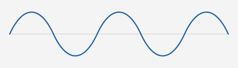

# Hello world!

这是这个网站的第一篇文章。它记录了网站是怎么搭起来的、以后怎么更新，顺便把常用的 Markdown 写法都试一遍，确认它们能正常显示。

## 建站用了什么

这个网站放在 [GitHub Pages](https://pages.github.com/) 上，所有页面都由一个 Python 脚本 `build.py` 生成。没有用现成的博客框架，脚本读取文件夹，输出一堆静态网页。

| 用途 | 工具 |
| --- | --- |
| 解析 Markdown | markdown-it-py、mdit-py-plugins |
| 代码高亮 | Pygments |
| 读取文章开头的信息 | PyYAML |
| 显示公式 | KaTeX |
| 自动构建和发布 | GitHub Actions |

文件夹决定了网站的结构：

- 根目录下每个文件夹都是导航栏的一项。
- `articles` 里的文章按时间排列，可以按标签筛选。
- 其他文件夹显示成卡片，可以一层层点进去。
  - Markdown 笔记会转换成网页。
  - 导出的实验 HTML 原样保留，嵌在带导航栏的页面里。

搜索功能也在浏览器里完成：构建时把所有文字存进一个索引文件，不需要服务器。

## 怎么更新网站

平时只需要三步：

1. 把文章、笔记或实验放进对应的文件夹。
2. 运行 `bash preview.sh`，在本地看看效果。
3. 提交并推送，GitHub Actions 会自动发布。

```bash
git add .
git commit -m "新增一篇文章"
git push
```

文章开头通常只需要写标签。标题取自一级标题，日期取最后修改日期，摘要取第一段：

```markdown
---
tags: [统计, 数学]
---

# 文章标题

第一段会成为摘要。
```

## Markdown 渲染测试

### 文字样式

这是**粗体**，这是*斜体*，这是***粗斜体***，这是~~删除线~~。

这是[站外链接](https://github.com/)，这是[站内链接](seminar_x.md)，这是[跳到本页的公式部分](#公式)。

需要原样显示符号时可以转义：\*不是斜体\*，\# 不是标题，\$x\$ 不是公式。价格写成 $5 和 $6 时也不会被当成公式。

### 公式

#### 内联公式

欧拉公式 $e^{i\pi} + 1 = 0$ 写在句子中间。样本均值是 $\bar{x} = \frac{1}{n}\sum_{i=1}^{n} x_i$，正态分布记作 $X \sim \mathcal{N}(\mu, \sigma^2)$，集合写作 $A \subseteq \{x \in \mathbb{R} \mid x > 0\}$。

下标和星号不会被当成 Markdown：$a_1 * b_1 + a_2 * b_2$ 和 $x_{i}^{*}$ 都能正常显示。

这句话的**粗体里也有公式 $E = mc^2$**，列表里也可以有：

- 方差：$\mathrm{Var}(X) = E[X^2] - (E[X])^2$
- 信噪比：$\mathrm{SNR} = 10 \log_{10} \frac{P_s}{P_n}$ dB

#### 独立公式

傅里叶变换：

$$
X(f) = \int_{-\infty}^{\infty} x(t)\, e^{-j 2\pi f t}\, dt
$$

紧贴上一行文字也可以：
$$
P(A \mid B) = \frac{P(B \mid A)\, P(A)}{P(B)}
$$

写在一行里也可以：$$\sum_{k=1}^{n} k = \frac{n(n+1)}{2}$$

多行对齐：

$$
\begin{aligned}
(a + b)^2 &= (a + b)(a + b) \\
          &= a^2 + 2ab + b^2
\end{aligned}
$$

矩阵和分段函数：

$$
A = \begin{pmatrix} 1 & 2 \\ 3 & 4 \end{pmatrix}, \qquad
|x| = \begin{cases} x, & x \ge 0 \\ -x, & x < 0 \end{cases}
$$

很长的公式在窄屏上可以左右滚动：

$$
\hat{\beta} = (X^{\top} X)^{-1} X^{\top} y, \quad
\mathrm{Var}(\hat{\beta}) = \sigma^2 (X^{\top} X)^{-1}, \quad
\hat{\sigma}^2 = \frac{1}{n - p} \sum_{i=1}^{n} \left(y_i - x_i^{\top} \hat{\beta}\right)^2, \quad
t_j = \frac{\hat{\beta}_j}{\sqrt{\hat{\sigma}^2 \left[(X^{\top} X)^{-1}\right]_{jj}}}
$$

### 引用

> 这是一段引用，里面可以有**粗体**、`内联代码`和公式 $a^2 + b^2 = c^2$。
>
> 这是引用的第二段。
>
> > 这是嵌套的引用。
>
> - 引用里的列表
> - 第二项
>
> ```python
> print("引用里的代码")
> ```
>
> $$
> \nabla \cdot \mathbf{E} = \frac{\rho}{\varepsilon_0}
> $$

### 代码

内联代码像这样：`print("hello")`、`x <- c(1, 2, 3)`。里面的符号都原样显示，不会变成公式或样式：`$x^2$`、`**不是粗体**`、`<div>`。

Python：

```python
import numpy as np

def snr_db(signal: np.ndarray, noise: np.ndarray) -> float:
    """计算信噪比（dB）。"""
    return 10 * np.log10(np.mean(signal**2) / np.mean(noise**2))

print(f"SNR = {snr_db(np.ones(4), np.full(4, 0.1)):.1f} dB")  # 20.0 dB
```

R：

```r
x <- c(2, 4, 4, 4, 5, 5, 7, 9)
t.test(x, mu = 4)
```

C：

```c
#include <stdio.h>

int main(void) {
    printf("Hello world!\n");
    return 0;
}
```

没有指定语言的代码块，不高亮，`$` 和 `<tag>` 也原样显示：

```
$x^2$ 和 <tag> 都是普通文字
**这里也不是粗体**
```

很长的代码行可以左右滚动：

```python
result = some_function(first_argument=1, second_argument=2, third_argument=3, fourth_argument=4, fifth_argument=5, sixth_argument=6)
```

### 列表

无序列表：

- 第一项
- 第二项
  - 嵌套项
    - 再嵌套一层

有序列表：

1. 第一步
2. 第二步
   1. 第二步的第一小步
   2. 第二步的第二小步
3. 第三步

任务列表：

- [x] 搭好网站
- [x] 写第一篇文章
- [ ] 把所有笔记都放上来

### 表格

对齐方式可以分别设置，单元格里也可以有 `代码` 和公式：

| 分布 | 均值 | 方差 | 说明 |
| :--- | :---: | :---: | ---: |
| 正态 | $\mu$ | $\sigma^2$ | `rnorm` |
| 二项 | $np$ | $np(1-p)$ | `rbinom` |
| 泊松 | $\lambda$ | $\lambda$ | `rpois` |

### 图片



### 脚注

脚注写在正文里[^1]，内容显示在文章末尾[^note]。

[^1]: 这是第一条脚注。
[^note]: 脚注里也可以有公式 $x^2$ 和 `代码`。

### 分隔线

上面是一段。

---

下面是另一段。

### HTML

Markdown 里也可以直接写 HTML：

<details>
<summary>点击展开</summary>

这里是折叠的内容，公式 $y = ax + b$ 也能显示。

</details>

### 测试一些其他内容
