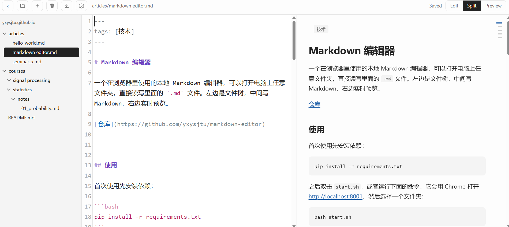

# Markdown 编辑器

一个在浏览器里使用的本地 Markdown 编辑器，可以打开电脑上任意文件夹，直接读写里面的 `.md` 文件。左边是文件树，中间写 Markdown，右边实时预览。

[仓库](https://github.com/yxysjtu/markdown-editor)



## 使用

首次使用先安装依赖：

```bash
pip install -r requirements.txt
```

之后双击 `start.sh`，或者运行下面的命令，它会用 Chrome 打开 <http://localhost:8001>，然后选择一个文件夹：

```bash
bash start.sh
```

也可以直接指定要打开的文件夹：

```bash
bash start.sh "C:/Users/me/notes"
```

按 Ctrl+C 停止编辑器。编辑器还开着时再运行脚本，只会多打开一个窗口；多个窗口可以各开一个文件夹。

## 功能

- 公式（`$...$`、`$$...$$`）、代码高亮、表格、脚注、任务列表，预览随编辑区滚动
- 自动保存，也可以按 Ctrl+S；文件被其他程序改过时会询问，不会悄悄覆盖
- 预览框右侧有目录缩略条（2 个以上标题时显示），鼠标悬浮时展开，也可以用图钉固定；点标题时预览和编辑区一起跳转
- 在左边的文件树里，拖拽可以把文件或文件夹移到别的文件夹，双击可以重命名。同名时会拒绝，不会覆盖；文件里的相对链接和图片路径不会自动修改
- 按 Ctrl+V 粘贴截图等图片，默认保存到打开的文件夹下的 `fig` 文件夹并插入 Markdown 引用；文件夹可以在 Settings 里修改。如果剪贴板里同时有文字（比如从 Excel 复制），会按文字粘贴
- 表格里按 Enter 新增一行并整理对齐（中文按两个英文字符宽度计算），在最后的空行再按一次 Enter 退出表格。只处理以 `|` 开头、第二行是分隔行的表格
- 列表里按 Tab 往里缩进一级，子项一起移动，Shift+Tab 往外退一级
- `+` 右边的垃圾桶把当前打开的文件移到系统回收站，可以恢复
- 预览里点相对路径的 `.md` 链接，会直接打开那个文件
- 文件开头的 frontmatter 不显示在正文里，其中的 `title`、`date`、`tags` 显示在预览顶部
- 保留文件原有的换行符，不是 UTF-8 编码的文件会拒绝打开，避免存坏

## 修改编辑区的颜色

颜色写在 `static/editor.css` 里，搜索 `.cm-s-default` 就能找到。改完保存，刷新编辑器页面就能看到，不用重启。

每一行对应一种语法，`color:` 后面就是颜色。比如把标题改成红色：

```css
.cm-s-default .cm-header { color: #d32f2f; font-weight: 700; }
```

颜色可以写成 `#d32f2f` 这样的十六进制，也可以写 `red`、`blue` 这样的颜色名。还可以改 `font-weight`（`700` 是粗体，`400` 是常规）和 `font-style`（`italic` 是斜体）。

| 要改的内容 | 规则里的名字 |
| --- | --- |
| 标题 | `.cm-header` |
| 一级、二级、三级列表（符号和文字） | `.cm-variable-2`、`.cm-variable-3`、`.cm-keyword` |
| 粗体、斜体、删除线 | `.cm-strong`、`.cm-em`、`.cm-strikethrough` |
| 链接和图片说明、网址 | `.cm-link` 和 `.cm-image-alt-text`、`.cm-url` |
| 代码 | `.cm-comment`，还要同时改 `.cm-comment.cm-math` |
| 公式 | `.cm-math` |
| 转义的 `\` 和后面的符号 | `.cm-formatting-escape` |
| 引用 | `.cm-quote` |
| 表格 | `.cm-table` |
| HTML 标签 | `.cm-tag`、`.cm-bracket`、`.cm-attribute`、`.cm-string` |
| 分隔线 | `.cm-hr` |
| 任务框 `[x]` | `.cm-formatting-task` |
| frontmatter 的字段名 | `.cm-atom` |
| 语法符号：`#`、`**` 和 `*`、反引号、`>`、链接括号 | `.cm-formatting-header`、`.cm-formatting-strong` 和 `.cm-formatting-em`、`.cm-formatting-code`、`.cm-formatting-quote`、`.cm-formatting-link` |

要注意的地方：

- 同一段文字符合多条规则时，文件里靠后的规则优先。列表和表格的规则放在前面，所以它们里面的代码、公式等能显示各自的颜色，调整顺序时要留意。
- `.cm-keyword` 也用于 frontmatter 里的 `true`、`false`，`.cm-string` 也用于 frontmatter 里加引号的文字，它们的颜色会跟着变。
- 这里只影响中间的编辑区。右边预览的样式在同一个文件后面的 `.prose` 部分，预览代码块的高亮来自 Pygments。

## 说明

- 点右上角的 Settings 可以调编辑区的字号和图片文件夹，配置保存在 `preferences.json` 里，不会提交到 git。
- 只在本机运行，其他网站和其他电脑都不能访问。
- 编辑器组件和公式从 CDN 加载，需要联网。
- 文件树会跳过以 `.` 开头的文件和文件夹，以及 `node_modules`、`__pycache__`、`venv`。
- 最近打开的文件夹记录在 `recent.json` 里，不会提交到 git。


