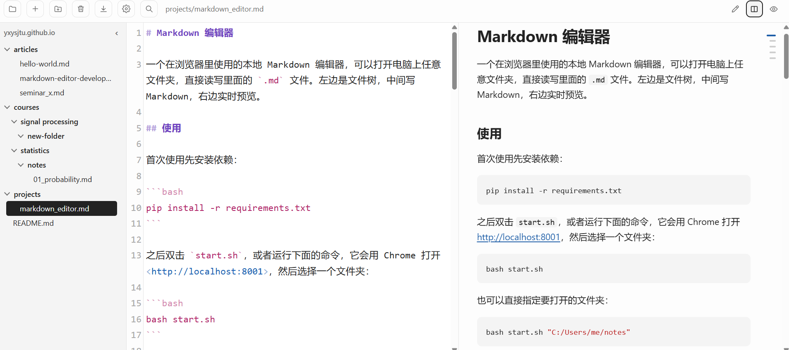

# Markdown 编辑器的开发历程

这篇文章记录我为什么要自己做一个 Markdown 编辑器，它有哪些功能，以及怎样使用。



## 起因

起因是我想要方便地编辑博客的文章和笔记，但现有的工具用起来都有些不满意的地方：

- **水源笔记**：害怕 jAccount 失效。
- **HackMD**：要收费，而且最近网站感觉不是很稳定。
- **Typora 和 Obsidian**：不支持同时看编辑和预览视图。
- **VS Code**：看着有点狭窄，比较像代码视图。

所以我打算自己做一个：在浏览器里使用，可以打开电脑上任意文件夹，直接读写里面的 `.md` 文件。左边是文件树，中间写 Markdown，右边实时预览。

## Feature

- **编辑和预览同时看**：预览随编辑区滚动，也可以切换成只编辑或只预览。
- **文件都在自己电脑上**：直接读写普通的 `.md` 文件，不需要账号，只在本机运行。
- **公式和代码**：支持公式、代码高亮、表格、脚注和任务列表，编辑区的语法高亮颜色可以自己改。
- **自动保存**：也可以按 Ctrl+S；文件被其他程序改过时会询问，不会悄悄覆盖。
- **文件树**：拖拽可以移动文件或文件夹，双击可以重命名，可以新建文件和文件夹，侧栏可以收起。
- **删除可以恢复**：删除的文件和文件夹会移到系统回收站。
- **粘贴图片**：按 Ctrl+V 粘贴截图，图片会自动保存并插入引用。保存的文件夹可以在 Settings 里修改。
- **目录**：预览框右侧有目录缩略条，鼠标悬浮时展开，也可以用图钉固定。点标题时预览和编辑区一起跳转。
- **导出**：可以导出 Markdown、HTML 和 PDF。HTML 是单个文件，样式和本地图片都嵌在里面。
- **笔记之间跳转**：预览里点相对路径的 `.md` 链接，会直接打开那个文件。
- **编辑区字号**：可以在 Settings 里调节。

## 用了什么

编辑器是一个本地网页应用：Python 写的小服务器负责读写文件和渲染预览，界面在浏览器里运行。

| 用途 | 工具 |
| --- | --- |
| 本地服务器 | Python 标准库 `http.server` |
| 编辑区 | CodeMirror |
| 解析 Markdown | markdown-it-py、mdit-py-plugins |
| 代码高亮 | Pygments |
| 读取文章开头的信息 | PyYAML |
| 显示公式 | KaTeX |
| 移到回收站 | Send2Trash |

## 怎样使用

先下载代码并安装依赖：

```bash
git clone https://github.com/yxysjtu/markdown-editor.git
cd markdown-editor
pip install -r requirements.txt
```

之后运行下面的命令，它会用 Chrome 打开编辑器，然后选择一个文件夹：

```bash
bash start.sh
```

也可以直接指定要打开的文件夹：

```bash
bash start.sh "C:/Users/me/notes"
```

更详细的说明都写在[仓库](https://github.com/yxysjtu/markdown-editor)的 README 里，包括怎样修改编辑区的颜色。
