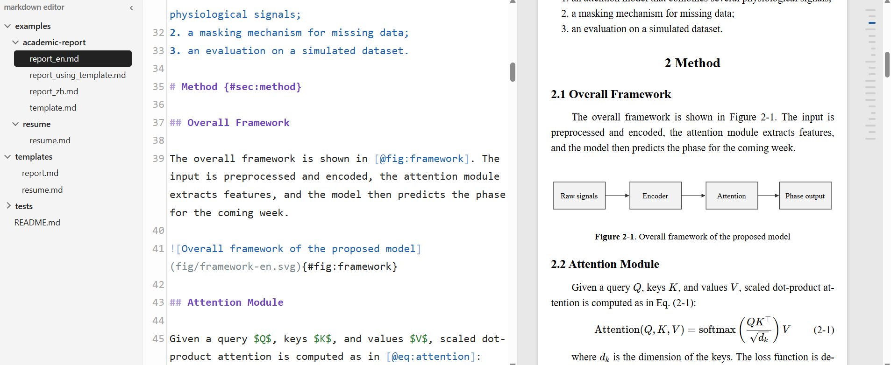
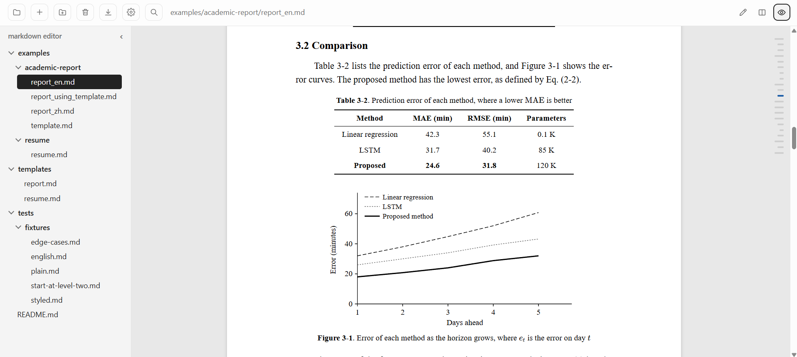

# Markdown 编辑器的开发历程

这篇文章记录我为什么要自己做一个 Markdown 编辑器，它有哪些功能，以及怎样使用。





## 起因

起因是我想要方便地编辑博客的文章和笔记，但现有的工具用起来都有些不满意的地方：

- **水源笔记**：害怕 jAccount 失效。
- **HackMD**：要收费，而且最近网站感觉不是很稳定。
- **Typora 和 Obsidian**：不支持同时看编辑和预览视图。
- **VS Code**：看着有点狭窄，比较像代码视图。

所以我打算自己做一个：在浏览器里使用，可以打开电脑上任意文件夹，直接读写里面的 `.md` 文件。左边是文件树，中间写 Markdown，右边实时预览。

## Feature

- **编辑和预览同时看**：预览随编辑区滚动，也可以切换成只编辑或只预览。
- **文件都在自己电脑上**：直接读写普通的 `.md` 文件，不需要账号，只在本机运行。
- **公式和代码**：支持公式、代码高亮、表格、脚注和任务列表，编辑区的语法高亮颜色可以自己改。
- **自动保存**：也可以按 Ctrl+S；文件被其他程序改过时会询问，不会悄悄覆盖。
- **文件树**：拖拽可以移动文件或文件夹，双击可以重命名，可以新建文件和文件夹，侧栏可以收起。按住 Ctrl 点击或者拖一个框可以多选，一起移动或删除。
- **删除可以恢复**：删除的文件和文件夹会移到系统回收站。
- **粘贴图片**：按 Ctrl+V 粘贴截图，图片会自动保存并插入引用。保存的文件夹可以在 Settings 里修改。
- **查找替换**：可以区分大小写、全词匹配和用正则表达式，全部替换可以一次撤销。
- **目录**：预览框右侧有目录缩略条，鼠标悬浮时展开，也可以用图钉固定。点标题时预览和编辑区一起跳转。
- **导出**：可以导出 Markdown、HTML 和 PDF。HTML 是单个文件，样式和本地图片都嵌在里面。PDF 由本机的 Chrome 或 Edge 直接生成，带书签。
- **学术报告**：文件开头写 `template: report`，就会变成论文的版式，标题、图、表、公式和代码自动编号，还能交叉引用。
- **模板**：字体、字号和编号格式可以在文件开头改。也可以自己写模板，比如自带的简历模板，不用改编辑器的代码。
- **笔记之间跳转**：预览里点相对路径的 `.md` 链接，会直接打开那个文件。
- **编辑区字号**：可以在 Settings 里调节。

## 开发过程

### 先把日常写作做顺手

最开始只想解决写博客和笔记的问题，所以先做了编辑、预览、文件树、自动保存、粘贴图片和导出。之后是一些用的时候才发现的小事：连续点文件夹会被当成重命名、消息一直不消失、Ctrl+F 不该把预览视图切走，这些都是自己用着用着改掉的。

### 想直接用它写报告

后来我想用它写学术报告，最终目标是导出 PDF，不用再为了排版换工具。文件开头写 `template: report` 之后，版式会按国内论文的常见要求排，编号和引用的写法尽量和 Pandoc 的 pandoc-crossref 一致：

```markdown
{#fig:arch}

如[@fig:arch]所示。
```

PDF 花的时间比想象中多。一开始用浏览器的打印窗口，但是它生成不了 PDF 的书签，所以改成由编辑器调用本机的 Chrome 或 Edge 直接生成。跨页的代码块也是一个坑：框会被切开，最后改成短代码整块放在一页，太长只能跨页时每页的框各自闭合。

### 从一个报告到一套模板

报告做好之后，我想要自定义样式，而且最好不用写 CSS。这件事分几步做下来，最后的结构和一开始想的不太一样：

1. 在文件开头的 `style` 里改字号、边距和编号格式。
2. 把这些设置放进单独的模板文件，多份文档可以共用。
3. 模板可以自带 CSS，这样不改代码也能做出简历这种完全不同的版式。
4. 模板放进 `templates` 文件夹后可以按名字引用，在任何文件夹里都能用。
5. 把自动编号拆成内置的 `numbered`，`report` 也变成一个普通的模板。

第 5 步是我觉得最重要的改动。之前报告是写死在代码里的特例，别的模板很难做到和它一样的事。拆完之后，内置的只剩下普通文档和自动编号，其他都是普通文件，继承关系也很清楚：

```text
none       内置，普通文档
numbered   内置，加上自动编号和交叉引用
report     templates/report.md，继承 numbered，再加上 report.css 的外观
my-school  自己写的模板，继承 report，只写要改的项
```

写一个简历模板只需要两个文件。CSS 里写了 `var(--accent)`，`accent` 就成了文档可以改的选项，用模板的人不用碰 CSS：

```markdown
---
extends: none
css: ./resume.css
style:
  accent: "#1a5fb4"
  paper: A4
---
```

```css
h1 { color: var(--accent); text-align: center; }
.date { color: #666; }
```

正文里写 `[2020 – 至今]{.date}` 和 `::: contact` 就能加上 class，不用写 HTML。

### 模板可能来自别人

模板和 Markdown 文件可能是别人给的，所以不能让它们想做什么就做什么。预览和导出时不运行脚本，模板的 CSS 只能影响文档内容，碰不到编辑器界面，也不能联网。模板也不能带 Python 代码，否则打开一个文件就等于在自己电脑上运行别人的程序。

这部分踩过两个坑。一个是检查 CSS 时，把注释符写进字符串可以骗过括号检查，跑出隔离范围。另一个是本来想用现成的插件解析 `[文字]{.date}`，结果它的限制管不到这种写法，`style` 属性会原样输出，所以换成了自己写的一小段规则。这两个都是写测试和检查时发现的，不是用的时候碰到的。

### 怎么保证没改坏

拆模板这种改动，用户应该什么都感觉不到。所以每次大改之前，我先导出几份 PDF 存作基准，改完再逐页比较像素，并比较书签。后来把这些检查放进了仓库，有单元测试，也有 PDF 对比脚本。

### 现在还做不好的

因为 PDF 是浏览器打印出来的，有些事受限于浏览器：脚注在文章末尾，不在每页底部；不支持页眉；参考文献要自己手写。版式要求严格的毕业论文，我还是会用 Typst 或者学校给的 LaTeX 模板。这个编辑器更适合笔记、课程报告和简历这类文档，写起来轻松，样式也好改。

## 用了什么

编辑器是一个本地网页应用：Python 写的小服务器负责读写文件和渲染预览，界面在浏览器里运行。

| 用途 | 工具 |
| --- | --- |
| 本地服务器 | Python 标准库 `http.server` |
| 编辑区 | CodeMirror |
| 解析 Markdown | markdown-it-py、mdit-py-plugins |
| 代码高亮 | Pygments |
| 读取文章开头的信息 | PyYAML |
| 显示公式 | KaTeX |
| 移到回收站 | Send2Trash |
| 导出 PDF | 本机的 Chrome 或 Edge |

## 怎样使用

先下载代码并安装依赖：

```bash
git clone https://github.com/yxysjtu/markdown-editor.git
cd markdown-editor
pip install -r requirements.txt
```

之后运行下面的命令，它会用 Chrome 打开编辑器，然后选择一个文件夹：

```bash
bash start.sh
```

也可以直接指定要打开的文件夹：

```bash
bash start.sh "C:/Users/me/notes"
```

更详细的说明都写在[仓库](https://github.com/yxysjtu/markdown-editor)的 README 里，包括报告的写法、怎样写模板和怎样修改编辑区的颜色。
