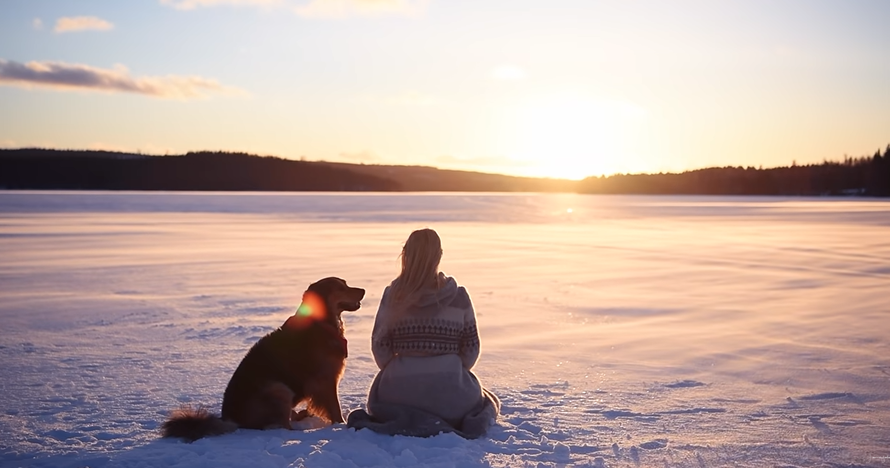

# Living with the Dark Winters in Sweden

>Accept the cycles in nature and the cycles in ourselves. And learn to live with them, Like a dance.

@[youtube](https://www.youtube.com/watch?v=3zTR4ayDG38)

## 1. A Land of Light and Darkness — 光明与黑暗之地

My name is Jonna, and I live in the north of Sweden.

Sweden is a country with a lot of light. And it's also a country with a lot of darkness. It all depends on what season it is.

Just like many other countries in the Northern Hemisphere, there is a strong contrast in light conditions between summer and winter.

In the winter, it's dark almost all the time. And in the summer, it's light all the time.

During the summer, in the very north of Sweden, the sun never sets between the end of May and the middle of July. So you can see the sun 24 hours a day.

And that is called the midnight sun.

Then, during the winter in the very north of Sweden, it's the opposite.

For a couple of weeks, the sun never rises above the horizon, which means there is no direct sunlight for an extended period.

And that is called the polar night.

These extreme contrasts in light are caused by the tilt of the Earth's axis in relation to the sun. And the further north you go, the bigger the contrast.

I live in the middle north of Sweden, and if I'm lucky and there's a clear sky, I can see the sun above the treetops for about an hour during the darkest time of the year.

It's the middle of the day, and this is how high the sun goes up now. It's just a little bit above the horizon, or above the trees.

But winters like this one, when it's been cloudy every day, I actually didn't see a glimpse of the sun for over a month.

Just a few days ago, at the beginning of January, I got to feel the sunlight on my face again.

This is the first glimpse of the sun we've seen in over a month.

Do you see this?!

And that feeling, when you begin to feel the sunlight again in January, is always overwhelming.

It's like seeing the sun for the first time in your life.

Even if it can be hard sometimes with these kinds of light conditions, I really love it, and I would never want to change it.

I think the light is never as beautiful as it is during these most extreme times of the year.

## 2. The Beauty of the Midnight Sun — 午夜阳光之美

When it's summer, I usually change my rhythm and stay up all night, then sleep in the forenoon instead.

The light is so beautiful in the middle of the night.

And as a filmmaker and photographer, it's like a dream to be out and capture the beauty of the bright nights in June.

Then, in the winter, even if we don't get much sunlight, we at least get a few hours of twilight during the day.

And that light is the most beautiful kind of daylight that I know.

It's like experiencing a long sunrise without a sun.

When the sky is clear and the sun rises just a tiny bit above the treetops, it spreads a soft, pink light all over the landscape.

And that is beyond beautiful.

Around three in the afternoon, it's already getting dark, and it makes the evenings feel never-ending.

## 3. The Beauty Hidden in Darkness — 黑暗中隐藏的美

But the darkness makes us see what is never visible in the light.

Because actually, we do get sunlight — from thousands of suns far, far away.

I live in a place where there is no light pollution, and the night skies are breathtaking.

For me, that is one of the reasons I really love the winter here.

And now and then, the sun sends us a greeting in the darkness.

Particles from storms on the surface of the sun travel towards the Earth, interact with our magnetic field and atmosphere, and create the Aurora Borealis — the northern lights that dance across the sky.

I can never find the right words to describe how much I love standing under the northern lights on a cold and dark winter night.

I can take the darkness any day, as long as I get to see the stars and the northern lights.

It makes it all worth it.

## 4. The Challenges of Winter — 冬季的挑战

But even though there is so much beauty to find in these special kinds of light conditions that we have here in the north, I would be lying if I said that it's always easy to live with and adapt to them.

Because it's not.

Well, the summer is easy. I don't think you can have too much light.

The only thing people often ask me is whether it's harder to sleep when it's light all night.

For me personally, if I want to sleep during the night, I have no problem with that.

And for those who do find it a problem, it can often be fixed with thick, dark curtains.

But the winter and the darkness are definitely much more challenging.

And I can only speak from my own experience now.

The lack of sunlight makes me more tired.

During the darkest and coldest months, between November and March, I sometimes struggle to keep up my energy.

It's harder to get up in the morning when it's dark outside. Our bodies naturally want to wake up with the sun.

And in the afternoon, I often get confused about the time, since the darkness makes it feel much later than it really is.

The lack of daylight also makes things more difficult for me as a filmmaker, since I only have about one hour of good light to film in a day, compared to 24 hours of beautiful light in the summer.

So the darkness, combined with the cold, makes things a bit more challenging.

And I know I'm not the only one who struggles to keep up their energy during this time of year.

But of course, there are many things you can do to make the winters a little easier.

I want to mention a few things that help me adapt better to the lack of sunlight.

## 5. Finding Energy Through Movement — 通过运动找回能量

For me personally, I think the tiredness I feel in winter is the hardest part.

My energy level is so low sometimes.

And the cure for that isn't always to sleep more. It can actually be to do the opposite.

So I try my best to stay active, move my body as much as I can, and get as much daylight as possible.

I go for long walks with my dog every day.

And if the weather is good, I like to go out into the forest with my snowshoes and my camera, or go skiing.

I also love taking ice baths.

It's something I started doing a few years ago, combined with breathing exercises using the Wim Hof Method.

And it has become my favorite way of boosting my energy when I need it the most.

Going into that freezing water is actually the last thing my body wants to do at that moment.

But putting myself into that kind of discomfort awakens something in me that helps me reset my body.

For me, it has been a great source of energy and joy during the wintertime.

It's not for everyone, of course, and it's important to learn about the risks and safety precautions before trying an ice bath for the first time.

I really feel a big difference in my energy levels during winter when I move my body in some way.

It doesn't need to be a full workout.

Just something. A little every day that makes you feel alive.

注：这里保留了 Jonna 对冰浴的个人体验，但冰水浸泡存在冷休克、心律失常及溺水风险；Wim Hof 式屏息呼吸尤其不应在水中或临水时进行。

## 6. Preserving Summer for Winter — 把夏天保存到冬天

When we can't get enough energy from the sun, I think it's even more important to make sure we get enough energy and nutrition from our food.

Nature has so much to give us in the summer that we can harvest and save for the winter, when we need it the most.

Here in the north, we have plenty of berries in the forest.

So I like to pick tons of blueberries and lingonberries and put them in the freezer, so that we can eat berries and drink berry juice every single day throughout the winter.

I also like to pick different herbs and dry them to make my own tea for the winter.

One of my favorite teas to drink when it's cold and dark outside is simply made from birch leaves.

I pick them just as they begin to unfold in spring, while they're still small and light green.

And the tea smells and tastes just like spring.

In the middle of winter, it feels so comforting to have a piece of spring to remind you of the wonderful time to come, when everything is blooming and the birds are singing again.

And of course, I also take vitamin D supplements, since we don't get enough sunlight to produce vitamin D during many months of the year.

Even though that will never replace the sun, I believe it can help a little bit.

The list of things you can do to handle the darkness is endless.

These were just a few.

## 7. Accepting the Cycles of Nature — 接受自然的周期

But I think the most important thing of all is to accept and adapt to the cycles of nature.

I definitely feel a big difference in energy between summer and winter, both in nature and in myself.

And that doesn't mean that it's right or wrong.

It's just different.

I think winter and darkness can cause a lot of unnecessary suffering when we try to force ourselves to feel the same as we do in summer.

It's okay to feel tired.

It's okay to feel a lack of inspiration.

And it's okay to need more sleep and to let things slow down.

A flower would never force itself to bloom in the cold winter.

So why would we?

This way of thinking changed how I deal with the different seasons.

I love the winters just as much as I love the summers.

They both have their own benefits and challenges.

And I think it gets much easier when we let go and accept what we feel instead of fighting it.

**And accept the cycles in nature and the cycles in ourselves.**

And learn to live with them.

**Like a dance.**

## 8. The Balance of Light and Darkness — 光与暗的平衡

So this is what it's like to live with the light and darkness in the north of Sweden, from my perspective.

The extreme contrasts in light also create greater contrasts between the seasons.

And they all have their own beauty.

I love the constantly changing seasons, and the fact that you can see and feel how the light changes a little bit with every single day that goes by.

The beautiful balance of light and darkness is my greatest source of inspiration.

And it makes every day feel new and different.

