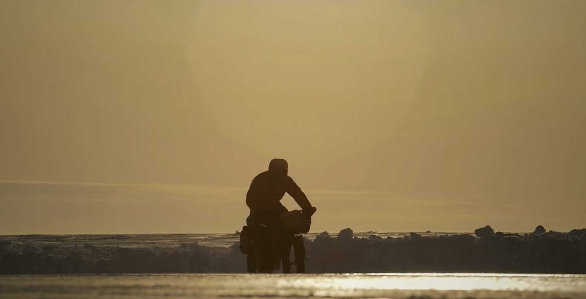

# The Frozen Road

A Solo Cycling Journey to the Arctic Ocean

[video](https://www.youtube.com/watch?v=YzU2wGcosNM&t=231s)

## 1. Beyond the Known World — 地图边缘之外

Here I am, 24 years old, professionally unemployed, and getting a lot of snow in my face.

I'm in Canada's Yukon Territory. It's late winter, and I'm cycling to the end of the American continent, halfway through my ride around the world.

My route would carry me almost 2,000 kilometers north through one of the world's last great wildernesses, to the Inuvialuit village of Tuktoyaktuk, perched on the shores of the frozen Arctic Ocean.

But as a boy from England, this was a long way from anything I knew. On a map of my experiences, it lay somewhere beyond its edges.

So I chose a camera as my companion to tell my story, although most of the time I seemed to cycle past it or cycle into it.

I spent the first week on small trails that snaked through the Yukon's great wild spaces, my tires following the century-old footsteps of prospectors — men who, like me, had stood on their own map's edge and wanted to take a peek at what lay beyond.

Although generations apart, perhaps we shared that same heady concoction of fear and excitement, that same need to seek the raw tonic of wilderness.

I was crossing frozen lakes and rivers for the first time in my life, riding through thick snowy forests past towering mountains.

Each night, I lay alone in my tent, listening to the rumbling sound of ice shifting beneath me. And each new day, the creak of my bike and my rasping breath would try to break the great white silence that suffocates sound here.

It felt like I was living between the pages of a Jack London novel.

And all I needed now was to find myself a little log cabin somewhere.

## 2. Loneliness and Solitude — 孤独与独处

These places are great, but at the same time, I'm experiencing it all just by myself.

And there is this big duality on solo travel trips between loneliness and solitude.

You can feel so happy in those moments of solitude, where you're just like, "It's just me."

There's a huge philosophical side to doing big trips.

I've never really felt the same amount of pure happiness and elation unless I'm doing something by myself.

I feel that pushing my own boundaries, and the inherent risks of being alone, bring more rewards with them.

But then, on the flip side, there's definitely that side of me that wants to be sharing it with someone.

As soon as I hit the highway and start making more kilometers north, that's when the cold is going to hit me.

I'm so inexperienced with it. I mean, I rarely ever see snow, so this is all new to me.

## 3. The Feeling of Being Small — 感受到自己的渺小

I was moving further north now, leaving the old gold-rush trails behind me and following the Dempster Highway, a gravel road that cuts through mountains and tundra, past the Arctic Circle, to the frozen sea that was my finish line.

It was cold and desolate here, and save for the occasional truck or herd of caribou, I was the only soul around.

The weather could be extreme — storms, winds, bitter cold.

I couldn't help but be moved by the might of it all.

It made me feel very small.

When I told friends back home where I was going to cycle, I was often met with, "Why?"

I guess it looked to them like a pretty pointless task.

But I think it's important to feel small sometimes, to gain that sense of place.

And riding north, I realized that this was the real purpose of what I was doing.

## 4. When Everything Falls into Place — 一切都恰如其分

The world around me is pretty calm right now.

Life feels really calm.

It's one of those moments where everything just seems like it's falling into place.

There's none of this questioning what our place is, worrying, and thinking about what path to be leading.

As soon as you're somewhere like this, it all kind of just makes a lot of sense.

And yeah, it's just really, really calm.

Very contented.

Oh, I love going on trips like this.

What a journey.

Almost at the end of my first real leg. I started at the bottom of South America, down there, and somewhere in that big blue haze over there is the Arctic Ocean, where I'm finishing the Americas and heading to Asia.

What a place.

Having the time of my life.

## 5. Into the Wilderness — 深入荒野

I reached a small hamlet high above the Arctic Circle, a chance to resupply my food and take a look at a map.

Locals told me of a possible route north down the frozen Peel River that would stay open until new snow came.

It would be a welcome detour from the Dempster Highway, so I went to find out more.

Before I left town, some guys approached me and told me that a pack of wolves had been spotted on the river a couple of days earlier.

I weighed up the risk and decided to continue.

It was only going to be a two-day detour anyway.

Yes, it was exhilarating riding down the river — the wildest place I'd ever been, for sure.

But it's funny how emotions can seesaw out here.

As the sun began to set, I started to worry about what lay in the woods.

I'm so scared of this threat of wolves, and I don't know if I'm being completely irrational.

But then the only person I can reason with is myself.

And I'm just going around in circles, telling myself that it's fine, and telling myself that no, I need to be careful.

Just over and over again.

I just can't decide.

All I want to do is share the weight of the decision with someone. But it's just me.

Any stupid situation I get myself into, I've got to get myself out of.

## 6. When Solitude Becomes Isolation — 当独处变成孤立

Overnight, I'd become trapped on the river.

There'd been a storm forecast for later that week, but it had come early.

I hadn't bargained for this.

I was 60 kilometers from the town at the end of the river. Sixty kilometers from help.

A long way to haul my heavy bike through deep snow in Arctic temperatures.

I had a day and a half's worth of food left, and I knew that somewhere in the trees there was a pack of wolves, hungry after a long winter.

I was becoming trapped in my mind.

Fear, hunger, loneliness — they all began to take control.

You do question why you're doing it.

The ups and the downs, when I'm still no happier for it.

I told myself I'd have a really positive mind today.

But when it's as empty as this, I just feel so alone.

I don't like this.

I don't want to be here.

I just want to have that wonderful option of handing in my ticket and saying, "Right, that's me done."

I'm in a place I have no experience of. I've never been here. I don't really know where I am.

## 7. The Reality of Being Alone — 独自一人的真正代价

Unknown to me, the village at the end of the river had dispatched their search and rescue team, as I hadn't been seen since before the storm.

They found me just a few kilometers away from the town.

The seriousness of my situation was brought home by the gun they carried for the wolves and the body sled they towed behind them.

I'd been pushing for three days, almost 50 kilometers, trapped in my own head.

Romantic solitude had turned into a nightmare of isolation.

The same thought had kept repeating itself: if the worst happens, nobody — not even my family — knows where I am.

Traveling solo can be like walking a tightrope.

I'd pushed my limits looking for that sense of solitude, that sense of fulfillment.

But I'd been knocked off and learned the full reality of being alone.

## 8. The Rocky Road to Your Dreams — 通往梦想的崎岖之路

I can't lie. I was shaken by what I'd been through, more than I think I caught on camera.

I was ready to go back home.

But I knew that I couldn't.

I'd set off over a year ago to cycle around the world, and this was only the end of my second continent.

I needed to show myself that I could do it.

And so I found myself waking up one morning on the crust of a frozen ocean, a million miles away from where I thought I'd ever be.

It's so cold.

But this is the last day of cycling.

Sixty kilometers to go, and then I'll have hit the Arctic Ocean, the Arctic Sea, and I'll be finished.

I don't think I quite realize just how much this ride has taken its toll on me.

But it's a rocky road to realizing your dreams, and there's no other road I'd rather be following.

## 9. Perhaps Finish Lines Are Better Shared — 终点也许更值得分享

At last, the finish line.

What a sight for some very sore eyes.

I thought about ending my story here, but that wouldn't be the whole truth.

I'd always known that there would be no welcome party when the road finally stopped.

So instead of walking off into a sunset, I sat in the bathroom of a small store — the only warm place I could find — and thought about the lessons this journey had taught me.

Maybe I'd proved something to myself by going beyond the edges of my map: that any man who is a man can travel alone.

But I also realized that perhaps finish lines are better shared.

