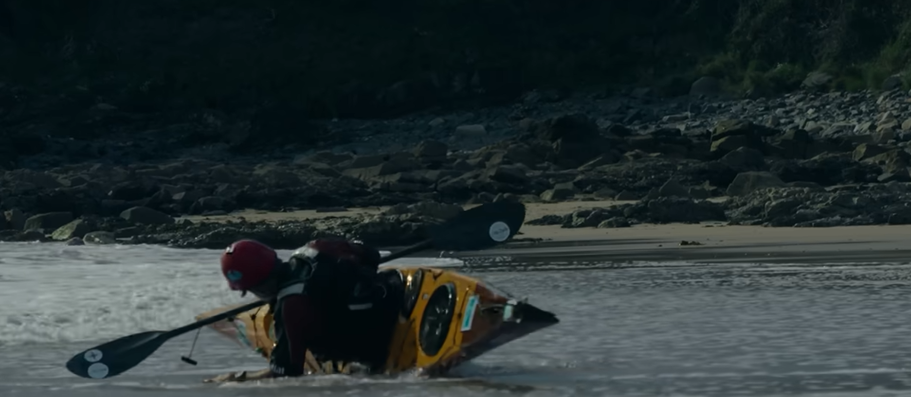

# Wild Sea
>Reconnecting with Oneself Through Sea Kayaking

@[youtube](https://www.youtube.com/watch?v=C66xpMMc3pQ&t=53s)

## 1. The Ocean as My Home — 海洋是我的家

My relationship with the ocean has been a kind of immersion into the ocean, if you like. It's been a way of life. It's offered me adventure and numerous challenges, and it's also been part of a natural healing process for me from past traumas.

It's a connection to nature that has really helped me manage some of the situations I've found myself in throughout life.

I guess, although it sounds very romantic, I like to think of the ocean as being my home. Certainly, in so much as I live on a boat, go swimming every day, and when I go to work, I'm going to work in a sea kayak or, at times, on a sailboat.

Immersing myself in this environment has allowed me to explore both the ocean and the coastal seascapes. But it's also allowed me to explore, at a very deep and intimate level, that emotional landscape that lies inside all of us.

You know, when I get up in the morning, get out of bed, and my eyes are still a bit sleepy, I go down to the beach. It's like every day is a new baptism. It's like every day I'm just totally immersing myself in Mother Nature.

And I've never once come out of the ocean feeling worse than when I went in.

It's such an incredible experience. You're focusing. You're in your head. You're in your breath. Absolutely beautiful.

## 2. My Military Past — 军旅经历与创伤

I was raised on a military camp in North London, and following in my father's footsteps, I joined the army at the age of 16.

My first few years of service saw me in West Germany with NATO, took me to Northern Ireland, and then out to Central America, where I was patrolling the jungles of Belize. I also served with the United Nations in Cyprus.

Experiencing the outdoor life of a soldier left a positive mark on me. Although military discipline didn't really resonate with me, I loved the teamwork, the camaraderie, and the simple outdoor lifestyle that those operations offered me.

I really enjoyed what military life was about for me at that time.

I went in at 16 and came out at 25.

I was lost. I was lost, and I was really angry towards the military.

They'd sort of turned me into this fighting man. When I needed to fight to protect my family, those skills had come in handy. But I was never taught how to keep those skills in check.

When I reached out to them for support, they turned their backs on me. And that left a deep-seated anger in me. It was an anger that was to last for quite a few years.

You know, you can only be angry with a system or angry with others for so long before you turn that anger onto yourself.

And, over a period of time, my life just started to fall apart.

## 3. The Journey Around Japan — 环绕日本的旅程

When I met Heraz [name uncertain], I asked her where she'd most like to paddle, and she'd said Hokkaido.

I said to her, "How do you fancy paddling around all of it?"

So we started to develop a plan. But when we realized just how badly affected Japan was by typhoons, tsunamis, monsoons, and earthquakes, how do you plan for anything like that?

So we just decided that we'd turn up in Tokyo and paddle as far as we could in the time that we had.

We were sheltering from typhoons, sometimes one after another. The swell could get pretty big, and sometimes the weather would hold us up for days.

Sometimes I had these moments where anger and anxiety would blossom. I would paddle as hard as I could. I can remember so much anger venting itself.

But what I found was, no matter how hard I stabbed the ocean with that blade, it would yield. It would accept all of my energy, and it just sucked it out of me.

I needed to feel challenged. I needed to feel as if life was worth living. And sea kayaking gave me that desire to give back.

I think it was while I was going around Japan that I realized:

This is me. This is what I do. This is where I'm supposed to be.

I was in that **flow** state.

What I found was that the positive aspects of what I'd learned in the military — how to look after people in stressful environments, how to develop strategies under pressure, and how to read the environment ahead — would all find their way into my sea kayaking.

And that's what I started to develop.

I started to outline a career, a roadmap forward. I needed to build myself up into something that was credible, of substance, and of meaning.

And all that came about while I was on that journey in Japan.

It developed in me a thirst for more — a thirst for more adventure and a thirst for more experiences.

We finished back where we started, exactly six months to the day.

And I came back totally refueled.

## 4. Adventure Is What Happens Beyond the Plan — 冒险始于计划之外

When you start to plan a journey, you come up with a blueprint for how you're going to complete that journey.

Now, having completed quite a few, not one of them has ever gone according to plan.

As soon as you start bringing in environmental factors — wind, waves, tides, swell, surf — you know that things are going to start going wrong.

But they're not going wrong. They're just giving you the adventure that you're craving.

And I was craving that adventure.

## 5. Nature Reveals Who We Really Are — 自然让我们看见真正的自己

I've alluded before to people being like onions.

We develop this husky exterior. I had a really thick, husky exterior when I left the army.

And what I find is that being out in the wilderness, or being out in nature, gives you the capacity to **remove those layers and expose the real you — who you are.**

And that's what I get so much from it.

I find myself on expedition. I find myself when I'm on a journey.

That's when I'm happiest.

When I take people away on an expedition, I never know what they're going to experience.

And what I've found is that nature does give them what they need, not necessarily what they want.

It brings out a certain feral side of their nature. It brings out the real, natural person that lies inside those layers.

I've had people who've lost life partners come on expeditions to try and refind themselves.

I've had people who've lost jobs or who are trying to realign their careers.

Different people come on an expedition for different reasons.

My job is to keep them safe in a wilderness environment. Sometimes I'm there to pick up the pieces, and that might be in a physical sense or it might be in an emotional sense.

If you're going to engage in the wilderness, you need to be prepared for it.

And I love being able to provide that training. I love getting people out on courses and making them stronger paddlers or stronger outdoor individuals.

## 6. Learning from Jeff — 同伴眼中的 Jeff

这一段切换到另一位受访者的视角。

I've known Jeff for a few years, and we met through our passion for swimming, really.

We obviously shared a passion for expeditions, for being out in nature, and for pushing ourselves.

The nice thing about Jeff was that he understood I was experienced in the water and comfortable in dynamic situations, but I hadn't spent much time in a kayak.

So he was very happy to allow me into situations that he might not have let a learner with no previous ocean experience enter.

He would say, "This is technically out of your comfort zone, but you can totally do this."

When I first went kayaking with Jeff, I realized that I'd spent my life in and around the sea, but all of a sudden, I was experiencing and interacting with it in this new way.

It added a depth that I didn't know was there to the way I interacted with the world around me.

I think Jeff would be quite open in saying that his path through life hasn't been linear, which he's very honest about.

Different careers, living in different places, ups and downs, and ebbs and flows.

The fact that he's found something in which he's now so experienced — I don't think there are many people who offer the kinds of lessons that Jeff is offering.

Sea kayaking has been where he's really found himself.

And I think if you can be around that, you absorb a lot of his interesting takes on life.

## 7. A Life of Healing, Challenge and Adventure — 疗愈、挑战与冒险

My connection to the ocean has been one of healing, one of challenge and adventure.

Although it came from a traumatic past, it's offered me a life that has been so rich and rewarding.

I've enjoyed paddling numerous coastal miles towards endless horizons. I've seen some sunsets and wildlife of an incredible variety.

It's been a place of adventure. It's been a place where I've managed to challenge myself.

At the time, life was really hard. What I found was that the ocean offered me an escape — an escape from those unhappy moments.

It felt as if I was coming home as well.

And I think that's what's so important: when you feel so comfortable in an environment that should be really scary.

The people I've met along the way have also been a magical part of the experience.

I've made friends in so many different countries around the world.

It's been a fantastic way of not just seeing new places, but learning about new cultures in a totally different way from how I would have experienced them in the military.

## 8. My Body Is My Home — 身体才是真正的家

纪录片最后转向南乔治亚岛的探险，随后以这段独白收尾。

It doesn't matter where you live.

**Your body is your home.**

Wherever I go, my home carries my spirit.

And my spirit has a desire to explore.

And that always draws me on —

To the next headland.

The next horizon.

The next adventure.
