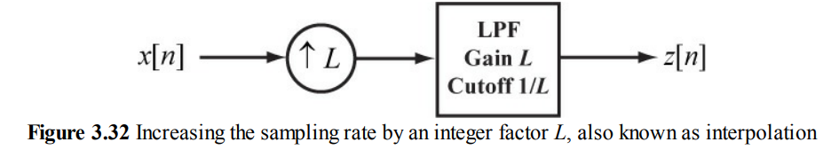
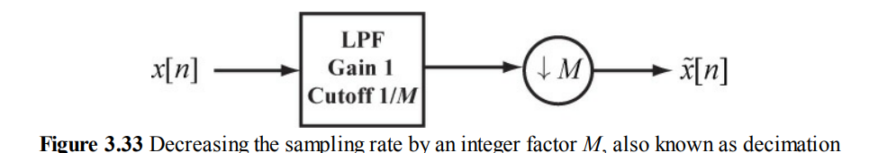
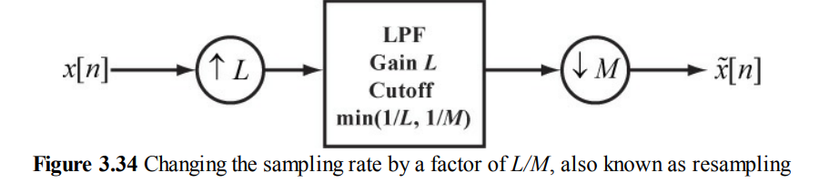

#  连续信号采样重建

## 系统模型

连续信号->抗混叠滤波器->ADC->离散信号->(采样速率变换)->数字滤波器->(采样速率变换)->反sinc滤波器->DAC->重建滤波器->连续信号

## CT->DT: 采样

* 采样需要带限信号，不然会损失信息
* 一般会在ADC前加抗混叠滤波器，取截止频率为采样频率的1/2
* 采样后$F_D(e^{jw})=\dfrac{1}{T}F_C(j\dfrac{w}{T})$

## DT->DT：数字滤波

一般使用差分方程进行计算

如果要用（CT/DT->数字滤波器->DT/CT）实现跟（CT->模拟滤波器->CT）一样的效果，也就是用数字滤波器实现跟模拟滤波器一样的频域处理：

* 首先用理想低通/带通滤波器的频域与模拟滤波器频域相乘（限制带宽，避免采样后混叠）
* 再对相乘后的频域的冲激响应进行采样，并且xT，即$TF_D(e^{jw})=F_C(j\dfrac{w}{T})$

* 然后再进行数字滤波，有 两种方法
  * 求出信号频域，与系统频域相乘后IDFT转回时域
  * 求系统时域（取一段时间截断），与信号时域卷积

例子：要实现等效的微分器，数字滤波器的频域是$F_C(j\dfrac{w}{T})=j\dfrac{w}{T}$

## 采样速率变换

### 升采样

1. 先插值（L-1）个0：$\bar{s}[n]=\sum s[k]\delta[n-kL]$

   插值0在连续频谱里面不变，但是离散频谱相当于连续频谱的窗口变成L倍宽，会复制L个频谱。频谱的高度不变，宽度变为原来1/L

2. 后低通滤波，截止频率为$\dfrac{\pi}{L}$，以及乘L来弥补一下能量损失

### 降采样

1. 先低通滤波（把可能混叠的谐波/噪声滤除），截止频率为$\dfrac{\pi}{M}$
2. 后降采样M（即M个选一个，$\tilde{x}[n]=y[nM]$）。降采样下频谱高度除以M，宽度乘M

### 有理分式采样

先升采样L再降采样M，两个滤波器可以合并：

## DT->CT: 重建
* 理想重建：卷积sinc $y(t)=\sum x[n]\delta(t-nT)\otimes \dfrac{sin(\pi f_s t)}{\pi f_s t}$
    * 问题：非因果，模拟滤波器无法实现

* 实际：
    * 0-order hold: 卷积矩形脉冲
    相当于频域乘：

    * 1-order hold: 三角脉冲
    相当于频域乘：

* 为什么一阶比零阶好：因为采样后频域在$2n\pi/T$有copy，零阶频域在这附近振荡较大，那些copy没有完全衰减掉，而一阶衰减快一点。但是对信号的频域影响更大（但是在加重建滤波器后显然零阶更好）
* 对于频域sinc衰减的弥补，可以用数字滤波器实现反sinc，在输出前预加重一下高频
* 对于高次谐波，需要加重建滤波器滤除
* 如果DAC的频率可以更高，可以考虑升采样再DAC输出，为了方便重建滤波器的选取，LPF的slope不用那么陡峭（不然残余高频分量很难消除）
