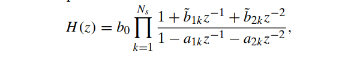

# 运算结构
## 系统框图

### 基本单元

* 信号相加
* 信号放大缩小
* 信号时延

例子：

### direct form 1
先实现零点再实现极点

注意分母系数正负号

这里加法器不合并的原因是硬件上本来加法器就是两输入一输出的，无法节省元件

### direct form 2（canonic form）
先实现极点再实现零点（用了系统的交换律）

两者在数值精度有限时输出很不一样，而且type2节省延时元件

例子：

## 信号流图
### 表示

每个节点的值是流入节点的和

* 源：单入多出
* 加法器：多入多出

怎么判断零极点？是一个回路，是极点；箭头方向打架/支路顺着主路走，是零点

### transposed form
x[n]和y[n]互换，箭头反向，系数不变，系统函数不变

源和加法器可能互换

## IIR基本结构

### 直接型

#### form1

#### form2

直接型受数值精度影响很大，零极点偏移大

### 串联型

拆成一阶系统和二阶系统的乘积
$$
H(z)=\prod \dfrac{b_{0k}+b_{1k}z^{-1}}{1-a_{1k}z^{-1}}\prod \dfrac{b_{0k}+b_{1k}z^{-1}+b_{2k}z^{-2}}{1-a_{1k}z^{-1}-a_{2k}z^{-2}}
$$
也可以把一阶系统凑成一对一对的，就变成都是二阶系统的乘积，和落单的一个一阶系统的乘积

节省乘积次数可以把b的系数提出来（当使用浮点数，数值范围不是问题的时候），但是通常还是用5乘积的形式（当使用定点数，有数值范围），因为可以把gain均匀地分布在每一级，防止某一级发生饱和

串联型易于调整每一级的增益，避免数值溢出；而且零极点精度高

### 并联型

拆成FIR+一阶系统+二阶系统

也可以把一阶系统凑成一对一对的，就变成都是二阶系统的和，和落单的一个一阶系统的和，加上FIR部分

实际表示：

并联型可以并行计算，运算快；但是不易调整整个系统的零点，不适用于对零点位置精度要求高的滤波器，比如带阻

## FIR基本结构

### 直接型

### 串联型
拆成二阶相乘

### 线性相位结构

节省一半乘积

## 数值精度问题

### 对系数的量化误差
* 直接型：带来极点误差大

* 串联型：对极点误差小
* 对于二阶系统
	* 直接型
	会带来极点可实现点不均匀，靠近实轴极点误差大
	* 
	极点可实现点均匀

### 运算带来的量化噪声
* 在输出信号中输出，降低信噪比
* 可能引发振荡（对于IIR）

### 超过数值运算范围
对于定点数而言，很容易overflow，可能会带来振荡，需要控制增益/分级
如果用浮点数就没这个问题，但会带来更高的硬件实现难度和更高量化噪声