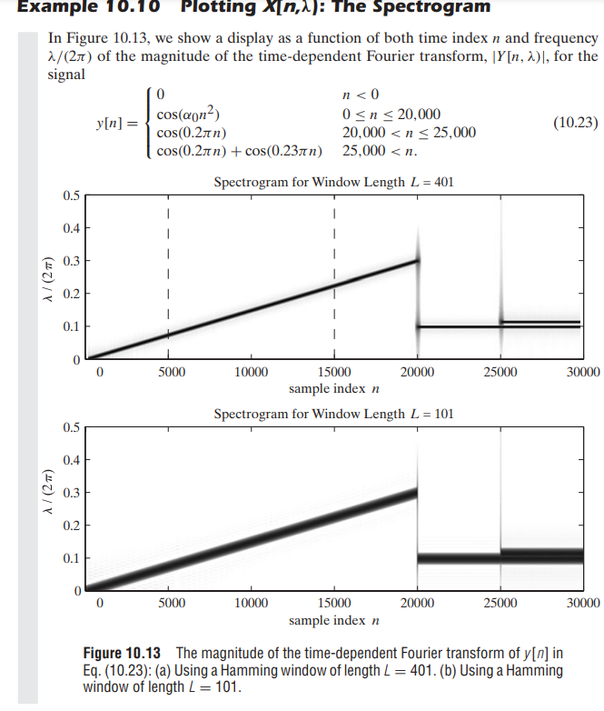
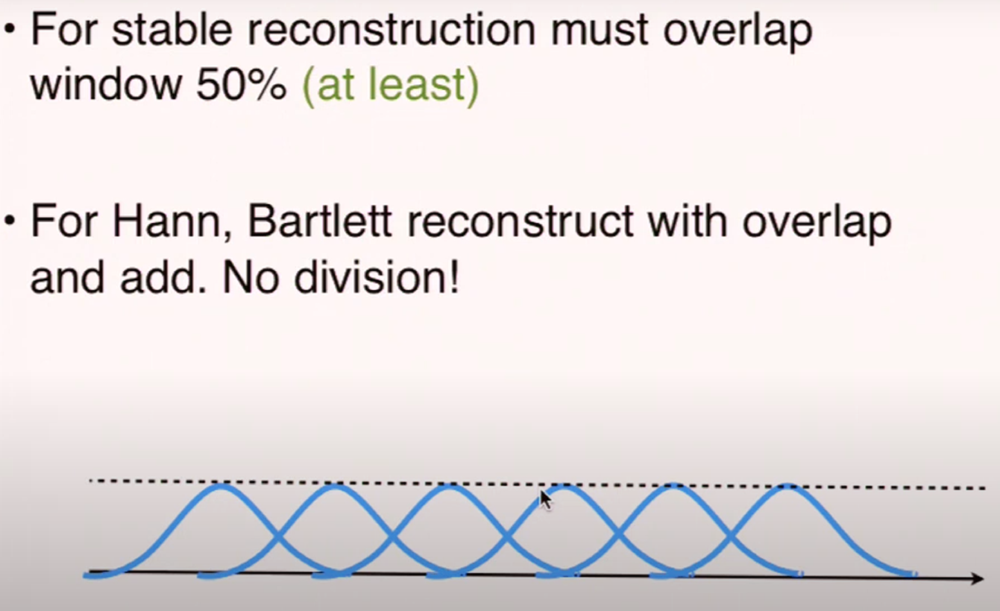
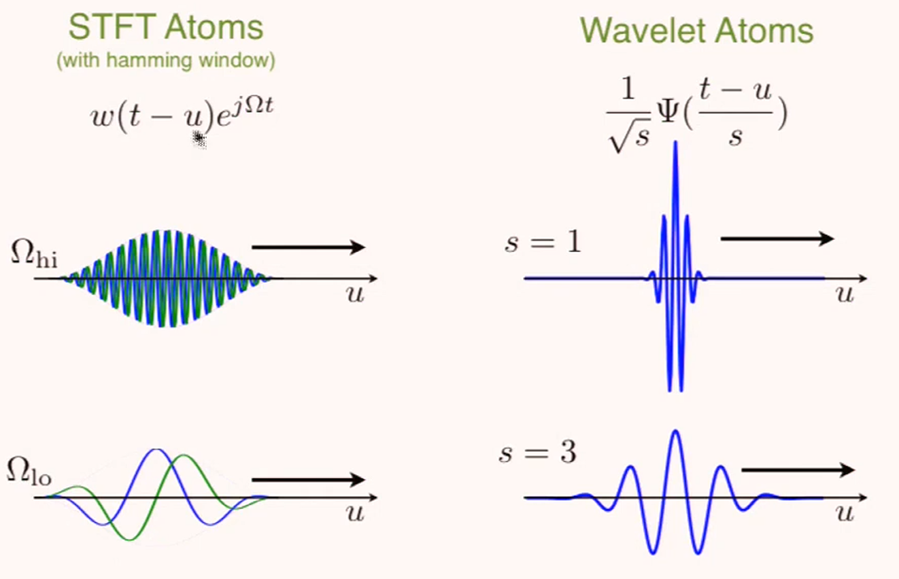

# 频谱的采样

## CTFT周期信号与主周期信号频谱

周期信号的频谱(f)是主周期信号频谱的采样并除以T，即
$$
\tilde{F}_c(f)=\dfrac{1}{T}\sum_k \delta(f-\dfrac{k}{T})F_c(f)
$$
周期信号频谱(f)的delta前的系数就是傅里叶级数的系数

## DTFT周期信号与主周期信号频谱

设DTFT时域采样间隔$T_s$

因为DTFT的频谱就是CTFT的频谱/T然后周期延拓然后频率轴伸缩，这里的f指DTFT频谱的$f\in (-\dfrac{1}{2},\dfrac{1}{2})$，设主周期长度$T=NT_s$，所以
$$
\tilde{F}_d(e^{j2\pi f})=\dfrac{1}{NT_s}\sum_k \delta(\dfrac{f}{T_s}-\dfrac{k}{NT_s})F_d(e^{j2\pi f})
\\=\dfrac{1}{N}\sum_k \delta(f-\dfrac{k}{N})F_d(e^{j2\pi f})
$$
结论是周期离散信号的频谱(f)是主周期信号频谱的采样并除以N

## CTFT->DTFT->DFT

* CTFT->DTFT：对信号进行采样，采样间隔$T_s=\dfrac{1}{f_s}$，频谱(f)乘$f_s$并且按$f_s$周期延拓，然后频率轴伸缩成$f\in (-\dfrac{1}{2},\dfrac{1}{2})$
* DTFT->DFT：对频谱(f)进行采样，采样间隔$\dfrac{1}{N}$；相当于时域上的N周期延拓，但是因为定义反变换里除以N，所以时域上就不算乘N了

# 系统响应

怎么求解信号经过滤波器后的输出？下面是三种方法

1. 用差分方程进行计算，通常应用于MCU/FPGA等实时计算的场合
2. 把整个信号进行FFT，与滤波器频谱相乘，再IFFT，适用于信号长度不是很长
3. 信号切成一片片单独计算响应并叠加，适用于信号长度很长/时间无限

## 求解线性卷积

时域卷积的长度：设脉冲1长度M1，脉冲2长度M2，卷积长度M1+M2-1
什么时候时域环形卷积和时域卷积相等？**M1+M2-1<=N**

所以当满足上述条件时，可以用DFT计算线性卷积，因为FFT可以提速所以可以算的很快。或者是为了满足上述条件而信号补零使得N=M1+M2-1，以及为了满足FFT的条件把N加到2的指数。信号补零对DFT频谱的影响是频谱采样点不同，对卷积计算没影响。

如果信号线性卷积的长度超过了N，环形卷积表现出来就是时域上的混叠，相当于**线性卷积的序列按照N周期混叠**。

比如在计算信号经过FIR的响应，一个是可以逐点计算，那么每个点的输出计算要乘N次，一个是可以一次性计算一段长度信号的输出，比如长度为M，如果逐点计算乘法次数MN，但是如果用FFT乘法次数大概2Mlog2M。但是当数据量非常大的时候，一次性FFT不现实，会切分成片进行计算，下面是两种方法：

### overlap-and-add

设系统响应为时间有限序列，长度为P/或者已知系统响应的频域

设信号总长度为L0

1. 选取FFT长度N
2. 将信号切分成长度为M的片，其中M满足M+P-1<=N，M选N+1-P。将信号片补零到N长度（补P-1个0），进行环形卷积（FFT相乘再IFFT）
3. 卷积结果会多出（P-1）个，需要与下个时间片的卷积结果相加
4. 切到最后切不出M个信号点，最后一截直接补0到N长度即可
5. 算完之后记得取结果的前L0+P-1个点

### overlap-and-save

1. 选取FFT长度M
2. 将信号切分成长度为M的片，这样线性卷积出来结果长度M+P-1，然后进行M的周期延拓就是环形卷积的结果，发现前（P-1）个由于时域混叠，所以不可用；剩下环形卷积的（M-P+1）个点都是线性卷积的结果，没有混叠。
3. 这样就对切片产生要求。要求每次切片往当前时间点前切（P-1）个点，求解完环形卷积后去掉开头的（P-1）个点，剩下（M-P+1）个点添加到结果上去
4. 最开头往前切（P-1）个点的含义就是在开头补（P-1）个0；最末尾长度不够就补0

可以这样理解，每个信号点输出（线性卷积）与该信号点和前（P-1）个信号点都相关，所以切分的时候需要把前（P-1）个信号点也切进去。

# 频谱分析

频谱分析主要的目的是用来观测信号的频域以及时域特征，不是用来滤波的

首先，虽然因为计算的原因，只能对信号先采样再算频谱。又因为计算的原因，只能算出频谱的离散个点。但是最终目标，就是尽可能近似信号的连续频谱，也就是DFT->DTFT->CTFT。

DFT对于时间有限信号而言，就是DTFT的频域采样。DFT对于周期信号而言，对主周期分析，就是DTFT的delta前的系数（xN）

下面的频谱分析指时间无限长信号（功率信号）

## 周期信号频谱分析（stationary）
### DFT

对于时间有限信号，DFT相当于对信号的周期延拓，频域上的采样。频域上如果要重建回DTFT频谱，卷积sinc即可。
#### 定义
$$
X[k]=\sum_{n=0}^{N-1}x[n]e^{-j\tfrac{2k\pi}{N}n}\\
x[n]=\dfrac{1}{N}\sum_{k=0}^{N-1}X[k]e^{j\tfrac{2k\pi}{N}n}
$$

为了书写的方便，可以令$W_N=e^{-j\tfrac{2\pi}{N}}$，也就是$W_N^{kn}=e^{-j\tfrac{2k\pi}{N}n}$

反变换$x[n]=IDFT(X[k])=\dfrac{1}{N}DFT(X[N-k])=\dfrac{1}{N}DFT^*(X^*[k])$

#### 性质 

性质基本与DTFT一样，注意一下对称性和周期性，还有时移

* **时移**：时域环形时移=频域x相移                                                                                                                                                                                                                                                                                                                                                                                                                                                                                                                                                                                                                                                                              
* **对称性**：$X[k]=X^*[N-k]$
* **对偶性**：$X[n]\iff Nx[-k]=Nx[N-k]$
* **时域环形卷积**=频域相乘：$\sum_{m=0}^{N-1}x[m]y[(n-m)_N] \iff X[k]Y[k]$（**环形卷积n-m要取模N！！！要分类讨论m<=n和m>n两部分**）
* **时域相乘**=1/N频域环形卷积：$x[n]y[n] \iff \dfrac{1}{N}\sum_{l=0}^{N-1}X[l]Y[(k-l)_N]$

### FFT

#### decimation in time
取序列$x[2n]$与$x[2n+1]$，其DTFT

则原DTFT
则DFT

又因为G和H N/2周期，所以刚好可以表达X[k]。所以只需要分析两个降采样时间序列的DFT。
对于时间复杂度的求解：$a_n=2a_{n-1}+\dfrac{n}{2}$，算出来是$\dfrac{n}{2}log_2n$级别的乘法和$nlog_2n$级别的加法

简化：

#### decimation in frequency
频域降采样取序列$X[2k]$和$X[2k+1]$，其对应时间序列的周期叠加是：
$$
x_0[n]=x[n]+x[n+N/2]
\\x_1[n]=e^{-\tfrac{j2\pi n}{N}}(x[n]-x[n+N/2])
$$
两个序列都是N/2周期

相当于decimation in time的transposed form

### 分析方法

对于周期信号的分析，因为不可能得到完整的时间序列，只能取一段进行分析，并且期望分析的频谱尽可能接近离散傅里叶级数

比如一个sin，对一个周期T采样N次，和对两个周期2T采样2N次，DFT频谱上，假设频率轴转换成连续时间的频率轴，相同频率下，2N次的DFT结果是N次的DFT结果的2倍，而信号没有变。但是我们希望看见的频谱也没有变，在f上的高度就相当于有几个$e^{j2\pi ft}$

所以是先求主周期的DFT，再除以N

但是对于一般周期信号的频谱分析，我们不能提前知道其周期，取一段不能刚好取到主周期。下面分析其影响

取周期信号长度为N的一段，相当于DTFT频谱的一个个delta卷积窗函数（矩形窗）的频谱（Nsinc），然后DFT相当于对频谱的采样。长度N如果不是周期的整数倍，一个是**频率采样的影响**，采样不会采样在sinc的最高点，造成信号主频率和幅度的判断误差；一个是sinc下降缓慢，会有波纹叠加到其他原先是delta的频率点上，带来**频谱泄露**；一个是sinc卷积的影响，sinc主瓣有宽度，导致频率很接近的两个信号无法分辨，也就是有限的**频率分辨率**

(如图，采样的影响，不够密的采样可能会把peak漏掉，或许可以软件重建（升采样）或者信号时域先乘窗口再zero padding)

怎么让近似更精确？

* 选取合适窗函数，频域下降快，波纹小，减少**频谱泄露**
* 选取尽可能多的采样点，提高**频率分辨率**
* 截出一段信号后，进行末尾补零，频谱采样可以更密

下面是具体的步骤：

1. 根据频谱泄露的要求，选取合适窗口（比如选取blackman窗口，频谱泄露最小，但是main lobe宽，需要选取更大的时间窗口）

2. 先确定`df=4/T`（频率分辨率），确定时间窗口长度T（这个估计比较粗略，精细的估计需要根据窗口的main lobe width；比如$\dfrac{8\pi}{N}\rightarrow \dfrac{4}{NT_s}=\dfrac{4}{T}$）。
3. 然后根据信号带宽确定采样频率`fs=Ndf`，得到窗口函数长度N
4. 最后信号与窗口函数相乘后作zero padding（至少4倍的N，会比较精确）（注意如果不补零，只要非周期采样，一定会有巨大的误差，不管取时间窗口长度多少，因为卷积的脉冲变窄与采样的变窄同时发生），然后FFT相当于一个频域的插值
5. 最后除以窗口面积$\sum w[n]$

## 非周期信号频谱分析（nonstationary）

### STFT

对于频谱时变的信号，选取短的时间窗口好观察频域特征的变化

* window的长度与类型决定了频率分辨率，window越长，main lobe越窄，频率分辨率越高
* window的长度决定了时间分辨率，频谱结果是时间窗口的所有频率的叠加，window越长，时间分辨率越低
#### 定义
逐点滑动的窗口

或者
$$
X[n_0,w]=DTFT(x[n]w[n-n_0])
$$

信号DTFT和STFT的关系：DTFT相当于STFT按照时间轴sum（把时间轴压缩掉）

#### 频率分辨率与时间分辨率

#### Filter bank intepretation

可以看作一个个带通滤波器的时域输出，拼成了STFT的图

#### 重建

如果使用不重叠的窗口，就需要IFFT信号除以窗口。但是除以窗口就相当于噪声放大。一个比较好的解决方式是窗口有一部分重叠

应用：

比如一个频域特征随时间改变的信号（non-stationary），想对其进行自适应滤波，去除噪声

就是使用STFT，每次取一个时间窗口，计算频域，观察频域特征，去除噪声，重建回去

### 小波变换

对于STFT，时间分辨率和频率分辨率是固定的。比如对于频率很低的信号，不需要高时间分辨率，但需要高频率分辨率（也就是窗口长一点频域估计准一点）；对于频率很高的信号，不需要高频率分辨率（这里看的是分数带宽，高的频率容许高一点的频率误差），但是需要高的时间分辨率（也就是窗口短一点时域变化估计准一点）；要实现如此大的动态范围的观测，可以使用小波变换

小波的思想是，低频变换，窗口宽；高频变换，窗口窄

## 平稳随机信号功率谱分析（stationary）
