## 增益/插入损耗

### 定义

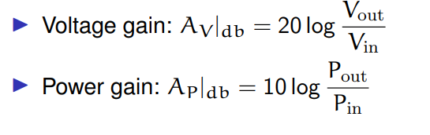

* 电压增益
* 功率增益

这两个增益当输入电阻=负载电阻时相等

**插入损耗**
$$
IL=10log\dfrac{P_{in}}{P_{out}}
$$

**dbm定义**

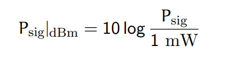

## 非线性

假设有用信号 $s(t)=A_scosw_st$ ，干扰信号 $i(t)=A_{i1}cosw_{i1}t+A_{i2}cosw_{i2}t$ ，系统响应 $y(t)=a_1x+a_2x^2+...$ 

如果是一个干扰信号，
$$
y(t)=a_1(1+\dfrac{3a_3}{4a_1}A_s^2+\dfrac{3a_3}{2a_1}A_{i1}^2)s(t)+...
$$

最大的干扰在三阶产物

### 失真度

小信号放大器衡量失真度，使用THD，就是

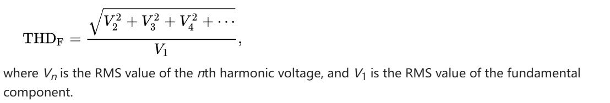

### 增益压缩（1dB压缩点）【大信号/大干扰】

当输入信号功率超过 $P_{1dB}$ 的时候，增益开始下降1dB（这个输入信号不仅包含了需要放大的小信号，还包含干扰信号。如果干扰信号足够大，那么小信号的增益几乎没有（比如周围有其他频段的发射台，而接收机前端滤波器的选择性不够））

主要的原因是放大器输出范围的限制导致的削峰
$$
A=a_1(1+\dfrac{3a_3}{4a_1}A_s^2+\dfrac{3a_3}{2a_1}A_{i1}^2)
$$
其中$a_3<0$，所以输入信号和干扰信号的增大都会使增益下降

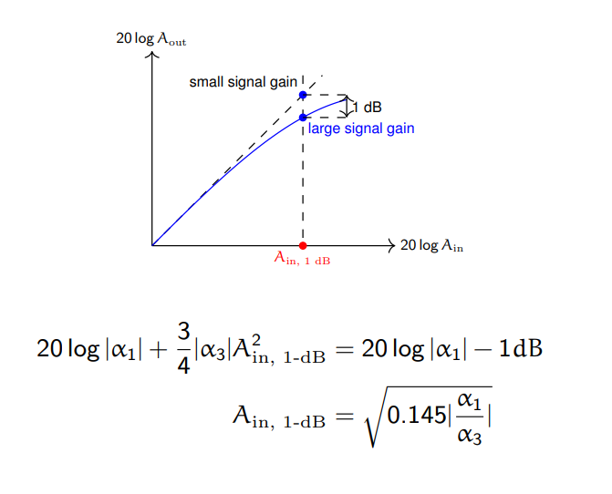

### 交调【信号-干扰】

当一个弱有用信号和一个带有幅度调制的强干扰信号，同时输入至一个非线性系统时，调制从干扰信号转移到有用弱信号上

在上述一个干扰信号的输出中，那个来自干扰信号的幅度的平方会调制到期望信号上，如果期望信号带有幅度调制（比如QAM），那么就会很受干扰

### 互调（IP3）【干扰-干扰】
如果是两个干扰信号，

$$
y(t)=a_1[1+\dfrac{3a_3}{4a_1}A_s^2+\dfrac{3a_3}{2a_1}(A_{i1}^2+A_{i2}^2)]s(t)
\\+a_2A_{i1}A_{i2}[cos(w_{i1}+w_{i2})t+cos(w_{i1}-w_{i2})t]
\\+\dfrac{3}{4}a_3[A_{i1}^2A_{i2}cos(2w_{i1}\pm w_{i2})t+A_{i1}A_{i2}^2cos(w_{i1}\pm 2w_{i2})t]
+...
$$

第二行是二阶互交调产物，第三行是三阶互交调产物。一般来说，二阶会落在带外，但是三阶很容易落在带内（主要是2w1-w2和2w2-w1）（虽然还有很多奇数阶产物都容易落在带内，但是通常比三阶互交调的分量小很多，所以忽略不计）

就是对于放大器而言，临近频道的互调产物容易落入带内。

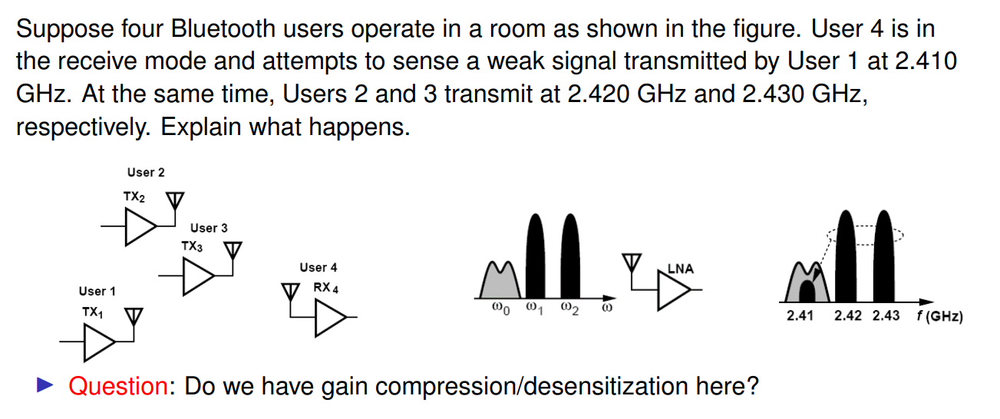

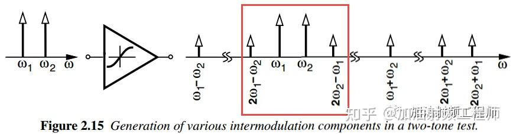

**IIP3**：相同输入功率下（干扰与期望信号），干扰双音信号产生的互调功率跟期望信号输出功率相同时的输入功率（OIP3则是输出功率）

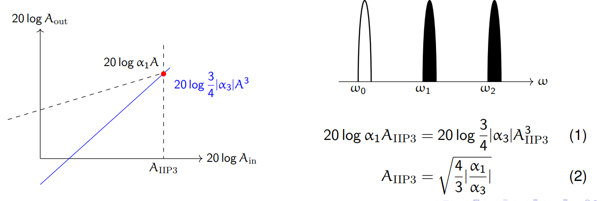

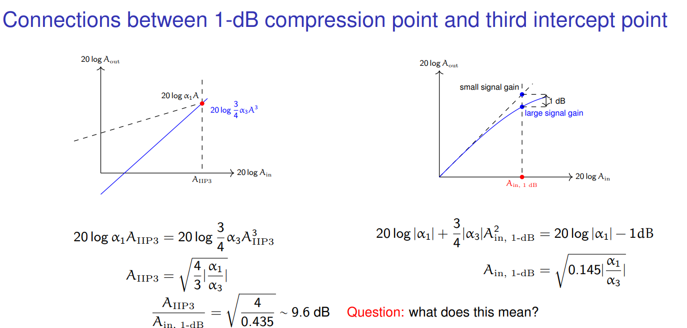

#### 互调级联

最后一级的非线性比较关键

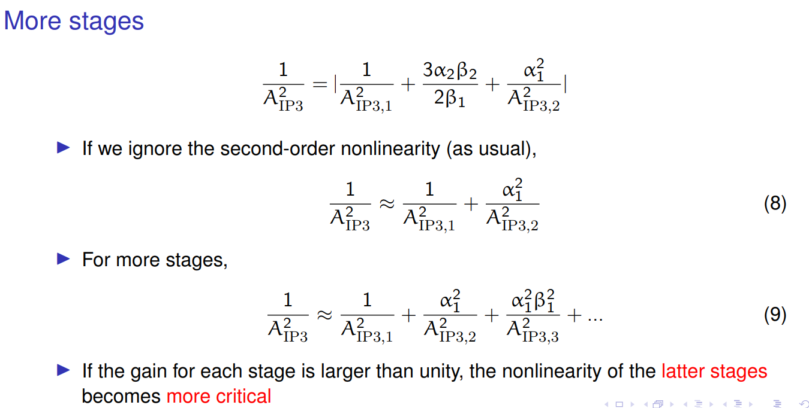

## 噪声

### 噪声分类

* thermal noise：电子无规则运动。频谱上白噪声。$V=\sqrt{4kTBR}$
* shot noise：电流或光信号由离散的粒子（如电子、光子）组成，这些粒子的到达时间和数量具有随机性，导致瞬时值的波动。常见于势垒器件（如二极管、晶体管）或光电探测器中，载流子需克服势垒（如PN结），其随机穿越行为引发噪声。
* flicker noise：频谱上1/f衰减。

### 热噪声模型

#### 电阻噪声模型

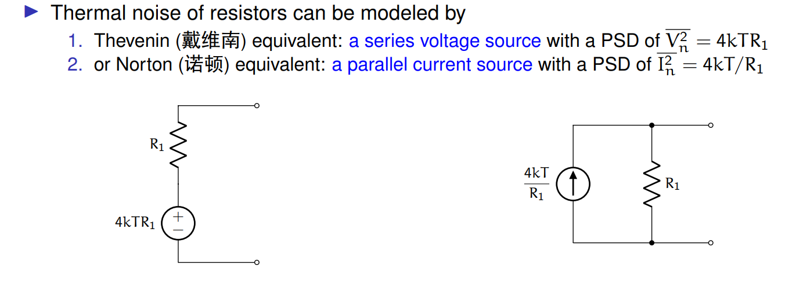

#### 晶体管噪声模型

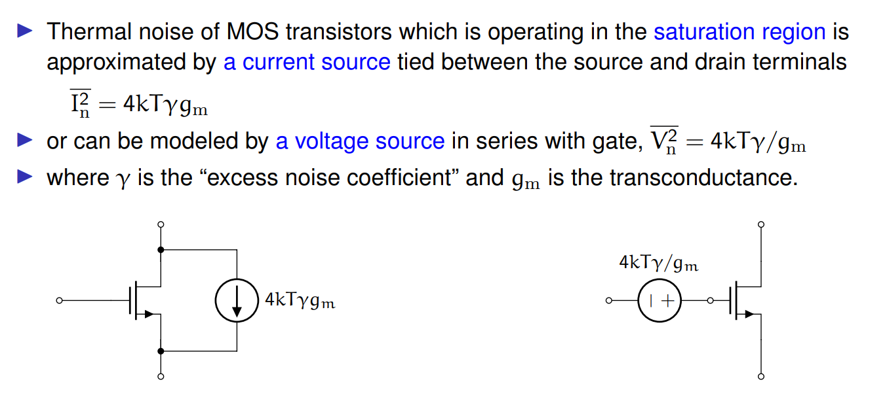

#### 二端口器件噪声模型

等效输入噪声电压与电流

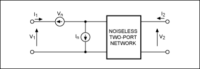

### 噪声系数

#### 定义

 $T_D$ 代表器件等效输入噪声温度， $T_s$ 代表信号噪声温度

$$
F=\dfrac{SNR_{in}}{SNR_{out}}
\\=1+\dfrac{T_D}{T_s}
\\NF=10lgF
$$

当计算单器件的噪声系数时，取 $T_s=T_{amb}$ 即环境温度

#### 级联
比如三级放大器，gi是放大倍数，Ti是器件等效输入噪声温度：

$$
(\dfrac{S}{N})_{out}=\dfrac{g_1g_2g_3S}{k(g_1g_2g_3T_s+g_1g_2g_3T_1+g_2g_3T_2+g_3T_3)B}
\\=\dfrac{1}{1+\dfrac{T_1}{T_s}+\dfrac{T_2}{g_1T_s}+\dfrac{T_3}{g_1g_2T_s}}(\dfrac{S}{N})_{in}
$$

那么 $F=1+(F_1-1)+\dfrac{F_2-1}{g_1}+\dfrac{F_3-1}{g_1g_2}$ 

**Friss formula**：
$$
F=F_1+\dfrac{F_2-1}{g_1}+\dfrac{F_3-1}{g_1g_2}+...
$$

**衰减器件的级联模型**
有耗衰减不会损失信号源内阻的热噪声功率，只会损耗已经被放大的噪声。假设信号衰减倍数是L：
$$
SNR_{in}=\dfrac{S}{kT_{amb}B}
\\SNR_{out}=\dfrac{S/L}{kT_{amb}B}
\\ F=L
$$

参与级联计算的时候，等效为g=1/L，F=L的放大器

