（TODO）

# 接收机

## 接收机指标
* 灵敏度（sensitivity）：对于一定SNR的最低输入电压
* 输入动态范围（dynamic range）：$DR=\dfrac{P_{max}}{P_{min}}$
* 噪声系数（noise figure）：$NF=\dfrac{(S/N)_{input}}{(S/N)_{output}}$

## 接收机架构
### 超外差接收机

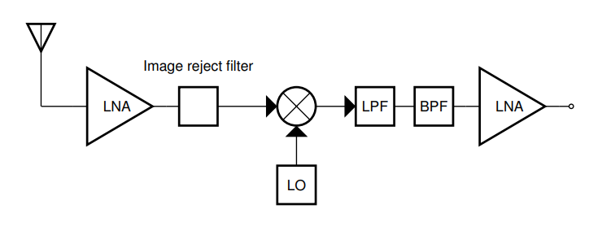

**使用超外差相比零中频的好处**：
* RF放大器增益不需要很高，增益主要放在IF级。因为高频放大器实现高增益成本高，而且容易因为电磁波泄露的反馈导致不稳定问题。
* RF滤波器易于实现（主要是对于单边带信号，需要非常陡峭的滤波）：因为在RF频率，信号分数带宽比较小，如果只把信号选出根据channel的spacing需要的滤波器Q值较大难以实现，所以先滤波（可变），放大，（可变LO）下变频到固定的IF，然后这里分数带宽就会大，滤波器好实现。
* 对于模拟通信，AM和FM，处理都不需要下变频基带处理的，而是在IF解调，AM是在IF直接检波，FM是在IF检测频率
* 下变频到IF时，不需要正交变频

**组成与设计考虑**：
* 这个可变的RF带通滤波器用一个可调的tuner实现
* 第一级的RF放大器是AGC（可变增益）
* 对于low side变频，镜像频率是RF频率关于IF的对称频率（低频）；对于high side，镜像频率是-RF频率关于IF的对称频率（高频）
* high side变频比low side变频LO的频率范围更容易实现，因为如果IF频率在RF频率的一半，那么如果是low side，LO频率$f_{LO}=f_c-f_{IF}$很低。这样对于LO的调节范围而言，分数带宽非常大。如果要易于实现，需要LO调节的分数带宽小，这样要求LO的频率高。而且high side还有的好处是，镜像频率高，更容易滤除。但是对于SSB信号，high side会导致边带反转。

* 为了下变频不混叠，对于RF滤波器带宽$B_{RF}$的要求：$B_T<B_{RF}<min(2f_{IF},2f_{LO})$。对于high side变频，只需要$B_T<B_{RF}<2f_{IF}$，所以IF频率越高对RF级的BPF的要求越低，但是IF越高对IF的BPF的选择性要求就越高。而且这个RF滤波器可以用低通实现，要求是$B_T<B_{RF}<f_{LO}$。但是最好还是用带通，因为可能其他频率的干扰信号很大，会使放大器饱和/产生交调
* 对于混频器的LO要格外小心，杂散可能会带来信号混叠（同时也要防止其他信号耦合进来，比如高频数字信号，时钟信号）

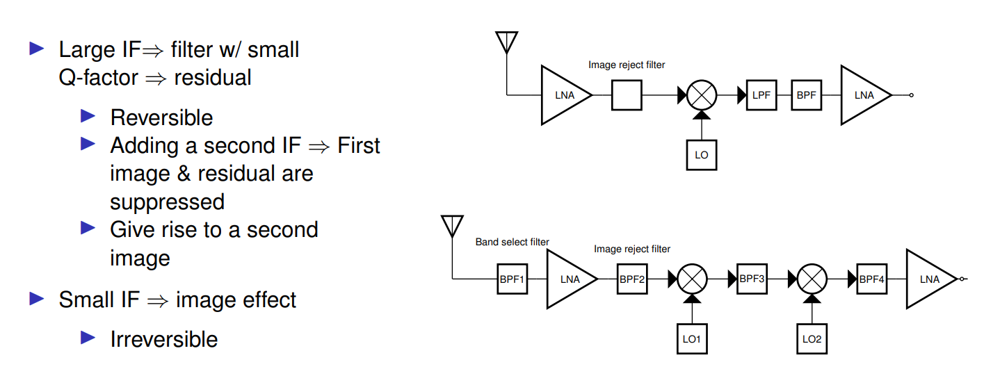

两级中频可以提高中频BPF的选择性

### 零中频接收机

正交下变频

问题：

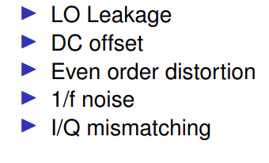

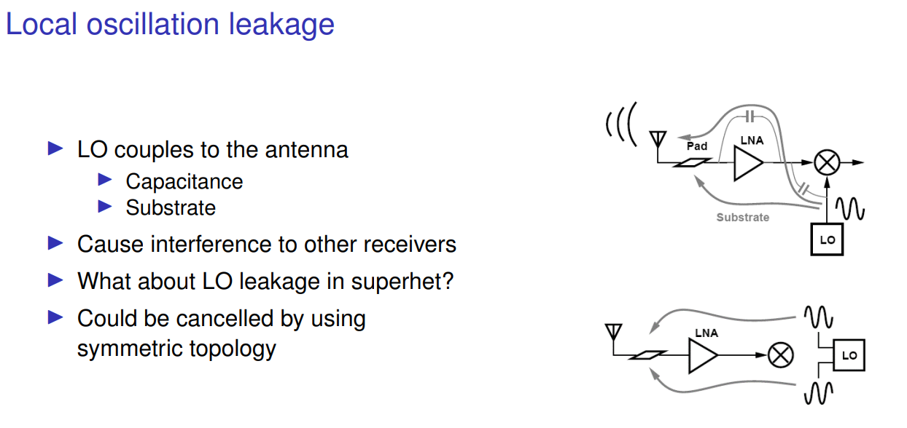

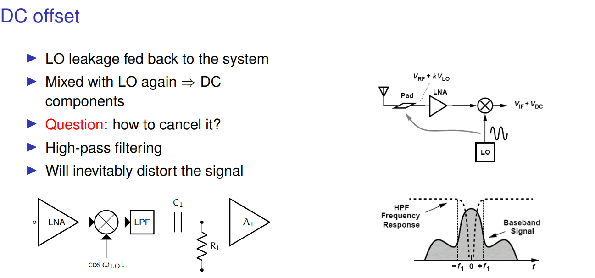

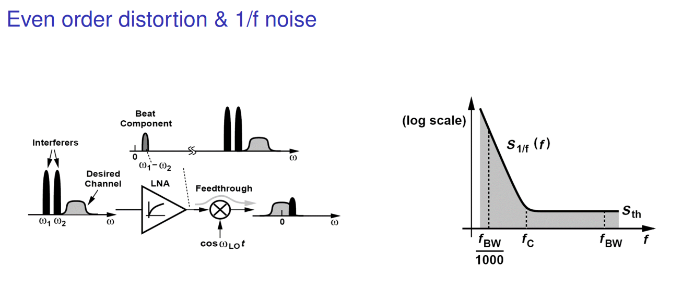

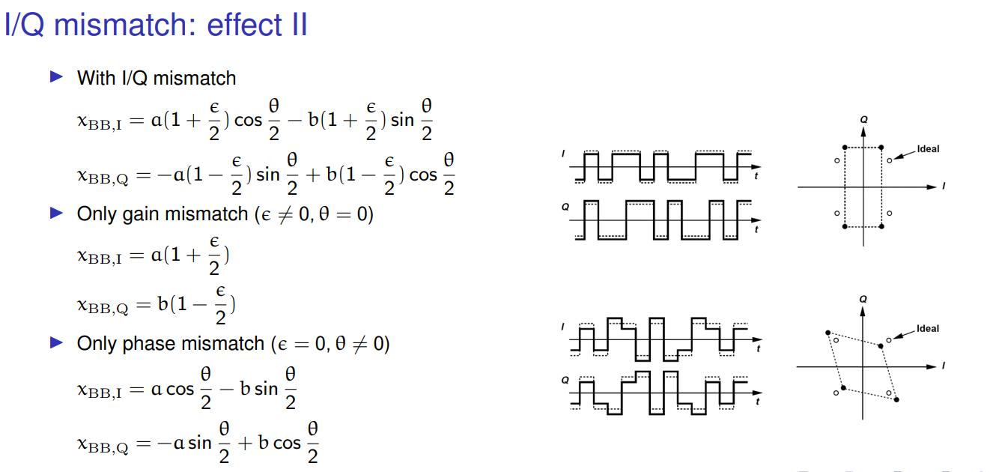

所以倾向于使用低中频接收机，先下变频到中频，再正交解调

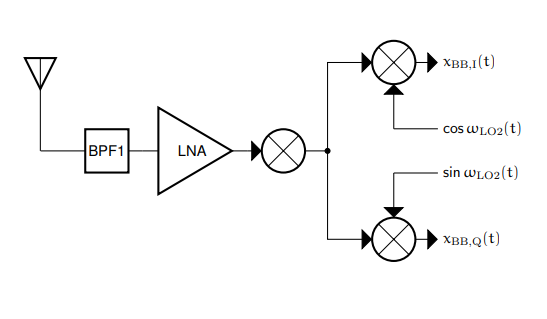

**直流偏移对星座图影响：**

离原点偏移一个向量

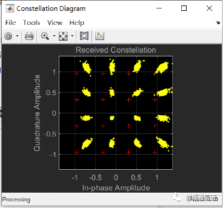

**幅度不平衡对星座图影响：**

从正方形变长方形

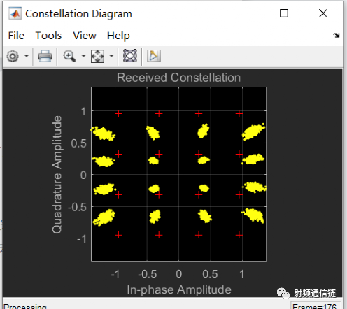

**相位不平衡对星座图影响：**

正方形变平行四边形

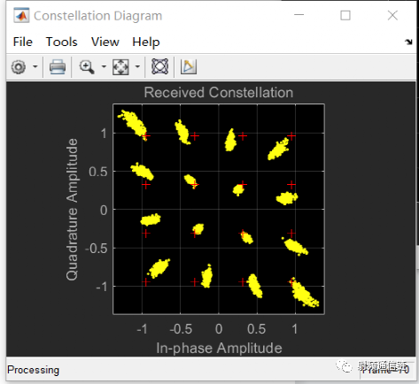

### 镜像抑制接收机

#### Hartley architecture

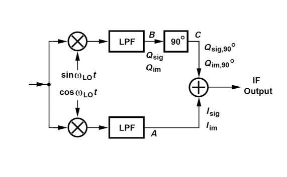

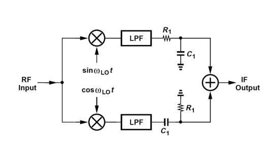

#### Weaver architecture

### SDR

可以先下变频到比较低的中频再采样，数字IQ解调到基带
或者直接IQ解调（零中频）

**hackrf:**

**rtl-sdr**:

**AD9361**:

**收发机**：先下变频到IF再IQ解调

### 频谱仪
#### 模拟实现
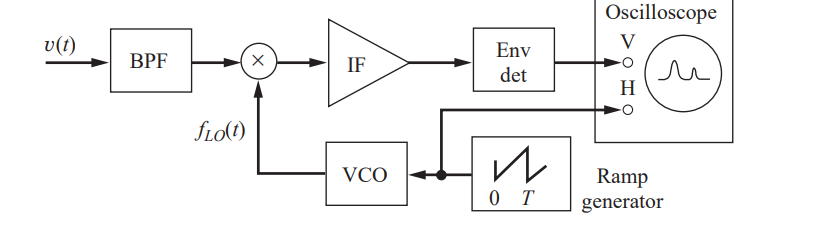

这个BPF是扫描范围的带通，假设low side变频，BPF会把低频的镜像频率滤除；然后IF前有一个可调宽度（RBW:resolution bandwidth）的BPF，通过这一滤波器的频率成分的能量用检波器检测

频谱仪的显示相当于信号频谱卷积上IF的BPF频谱，所以RBW越大信号噪底越大，但是对于单频信号的峰值没啥影响，只是RBW越宽显示出来单频信号频谱越宽

RBW越小，信号稳定下来时间越长，所以扫描越慢

#### 数字实现

不同长度的窗口对应不同的RBW。如果没有那么快的ADC，还是要一截截下变频扫描下来。

# 发射机

## 发射机指标

## 发射机架构

### 零中频

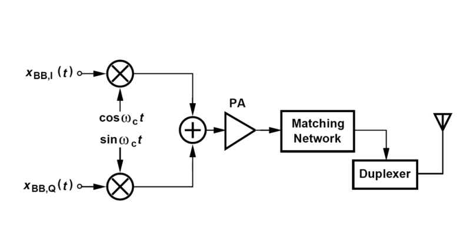

问题

* LO泄露到天线
* PA输出泄露回LO