# 谐振结构

## 谐振电路作用

* 滤波
* 阻抗匹配
* 电压放大（串联谐振）/电流放大（并联谐振）

## 串联谐振

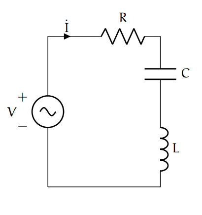

### 谐振频率

$$
w_0=\dfrac{1}{\sqrt{LC}}
$$

### Quality factor

#### 定义

$$
Q=w_0\cdot \dfrac{energy\ stored}{average\ power\ dissipated}
\\=w_0\dfrac{\tfrac{1}{4}LI^2+\tfrac{1}{4}LI^2}{\tfrac{1}{2}I^2R}
\\=\dfrac{w_0L}{R}=\dfrac{1}{w_0CR}
\\=\dfrac{1}{R}\sqrt{\dfrac{L}{C}}
$$

#### 能量损耗时间常数

衡量无输入下谐振回路幅度/e的时间常数：
$$
\tau=\dfrac{2L}{R}=2\dfrac{Q}{w_0}
$$

### 电流谐振曲线

对于$\Delta w$比较小，有以下近似
$$
\dfrac{I(\Delta w)}{I_{max}}=\dfrac{1}{1+jQ\dfrac{2\Delta w}{w_0}}
$$
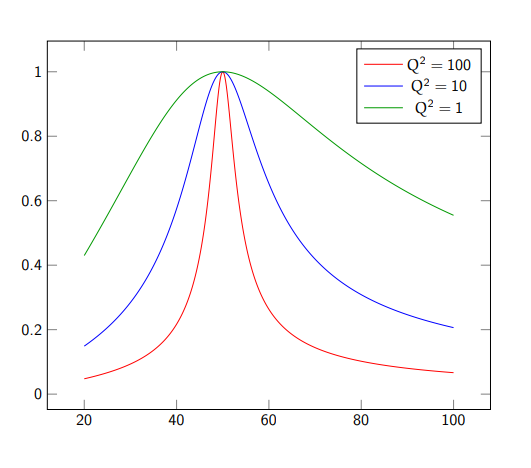

### 3dB带宽

$$
B=\dfrac{w_0}{Q}
$$

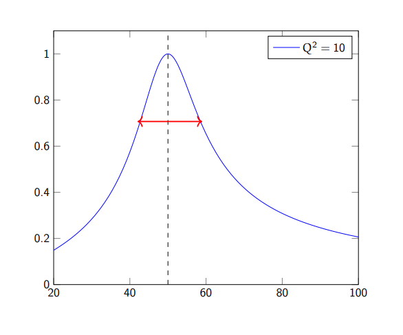

### 电压放大

电感/电容的电压是信号源电压Q倍
$$
|\dfrac{V_{o}}{V_s}|=\dfrac{wLi}{V_s}=\dfrac{wLV_s/R}{V_s}=Q
$$

## 并联谐振

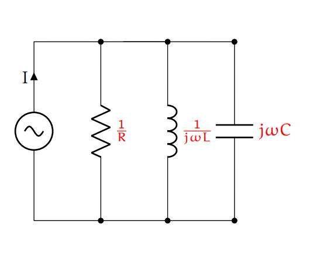

### 谐振频率

$$
w_0=\dfrac{1}{\sqrt{LC}}
$$

### Quality factor

#### 定义

$$
Q=w_0\cdot \dfrac{energy\ stored}{average\ power\ dissipated}
\\=w_0\dfrac{\tfrac{1}{4}CV^2+\tfrac{1}{4}CV^2}{\tfrac{1}{2}V^2/R}
\\=\dfrac{w_0C}{G}=\dfrac{1}{w_0LG}
\\=R\sqrt{\dfrac{C}{L}}
$$

### 电压谐振曲线

对于$\Delta w$比较小，有以下近似
$$
\dfrac{V(\Delta w)}{V_{max}}=\dfrac{1}{1+jQ\dfrac{2\Delta w}{w_0}}
$$

### 3dB带宽

$$
B=\dfrac{w_0}{Q}
$$

### 电流放大

电感/电容的电流是信号源电流Q倍
$$
|\dfrac{I_{o}}{I_s}|=\dfrac{wCv}{I_s}=\dfrac{wCI_sR}{I_s}=Q
$$

# 串并转换

在特定频率处复阻抗相等

## 串转并

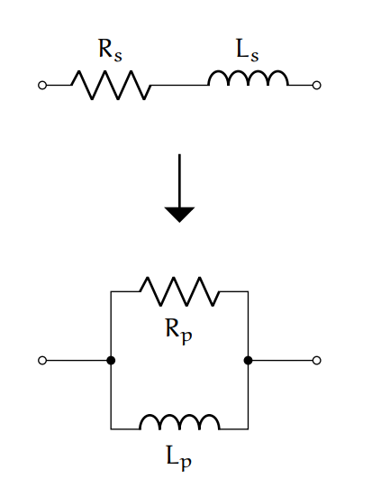

Q值不变
$$
R_p=(Q^2+1)R_s
\\L_p=(1+\dfrac{1}{Q^2})L_s
\\C_p=\dfrac{1}{1+\tfrac{1}{Q^2}}C_s
$$
如果$Q>>1$，则$R_p=Q^2R_s$，$L_p=L_s,C_p=C_s$

## 并转串

上面反一下

# 阻抗匹配

## L型匹配

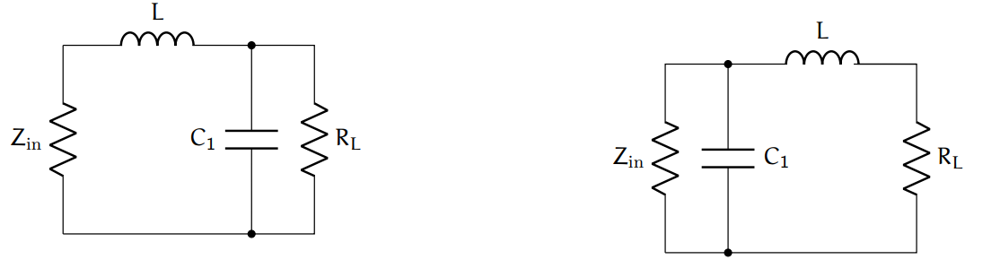

* 若待匹配阻抗小于目标阻抗，则串一个电抗，再串转并
* 若待匹配阻抗大于目标阻抗，则并一个电抗，再并转串

## Π/T型匹配
因为L型匹配不能控制Q，所以加一个元件用来控制Q
### Π型匹配

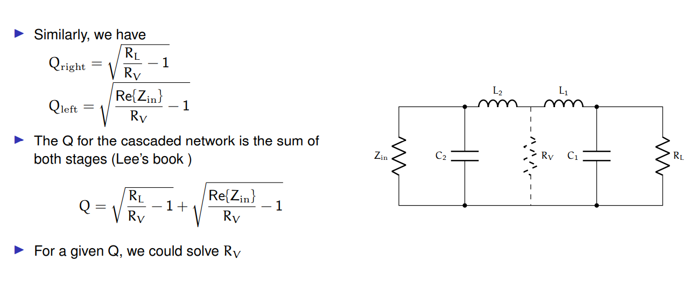

对于左右两个网络都是变换到一个阻抗，所以总的Q相当于左右Q相加（分母平均损耗功率相同）

### T型匹配

与pi型匹配不同的是高频响应，pi是趋近于短路，T是趋近于断路

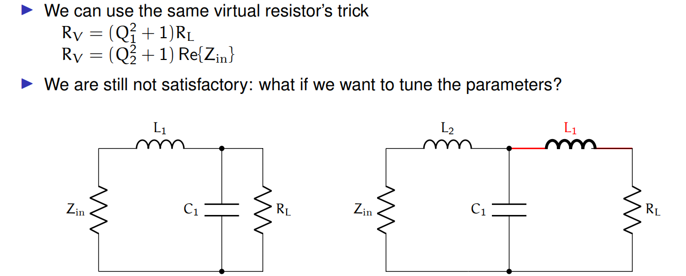

## 抽头匹配

可以用来调阻抗匹配，就是连续可调

### 抽头电容匹配

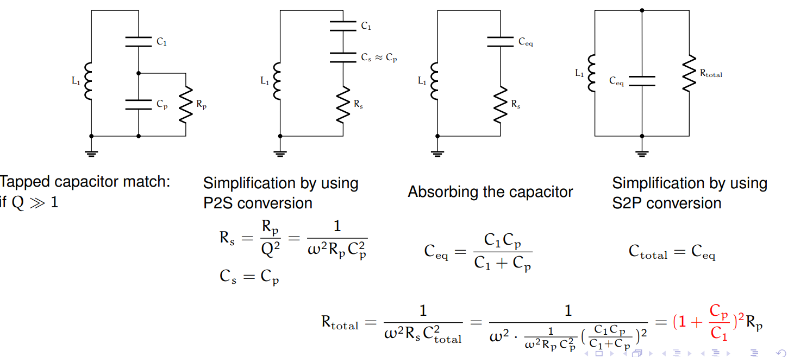

### 抽头电感匹配

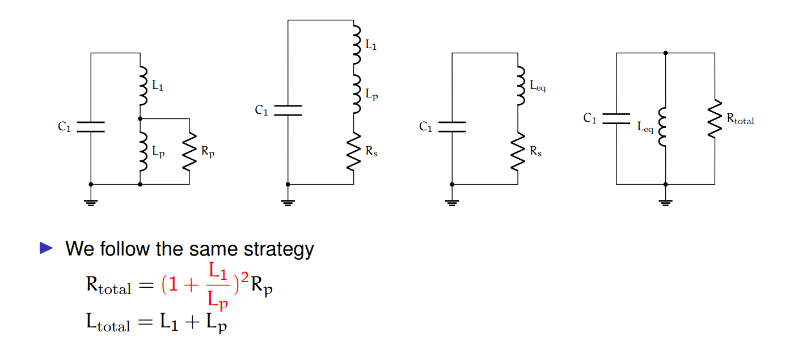

抽头还可以变换电抗，比例也同上

## 阻抗匹配网络的插损和噪声

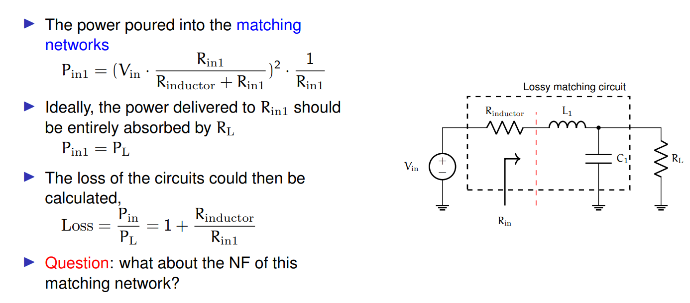

# 变压器

## 作用

* 交流耦合，隔离
* 单端转差分（巴伦）
* 功率合成
* 反相->反馈网络
* 升压降压
* 阻抗变换

## 耦合系数k

$$
k=\dfrac{M}{\sqrt{L_1L_2}}
$$

## 模型

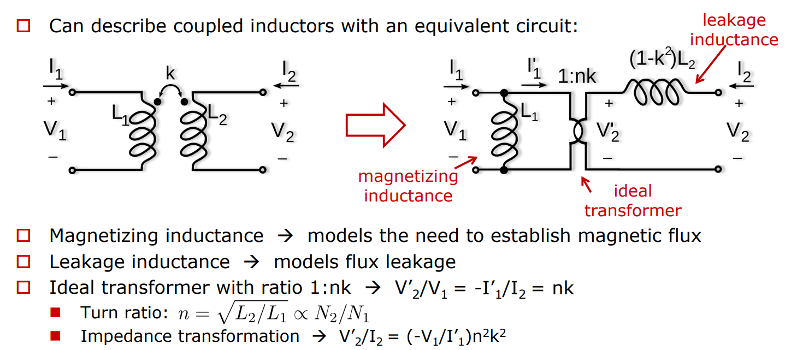

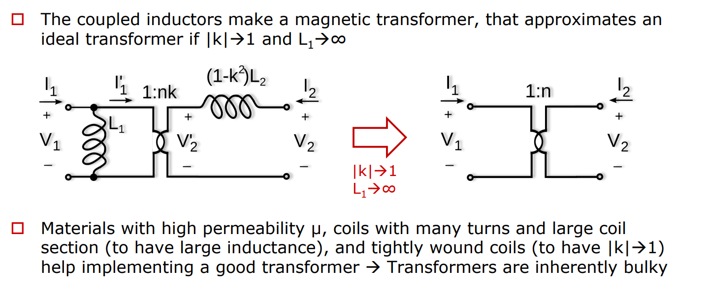

## Quality Factor

电感越大，Q越大

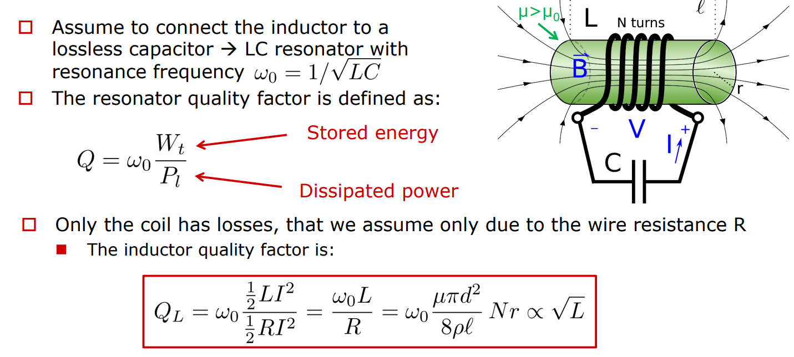

## 巴伦

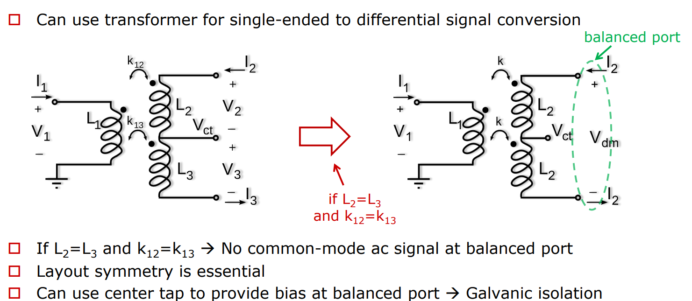
