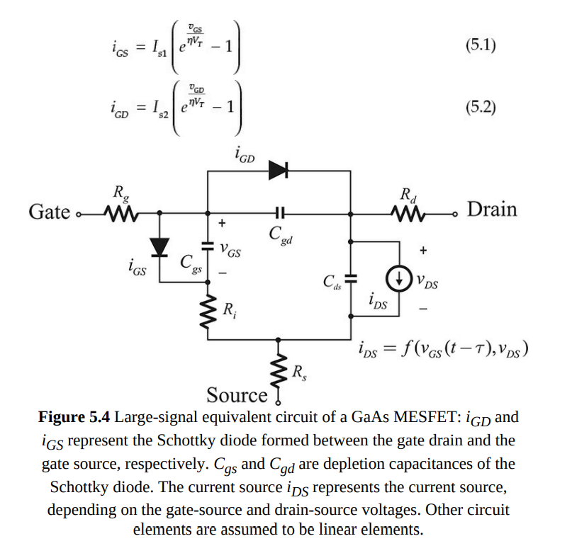
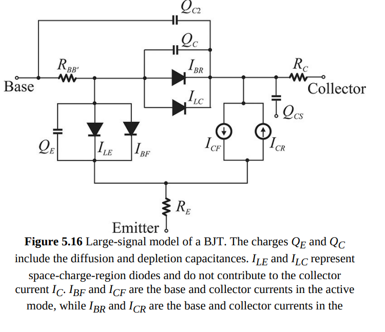
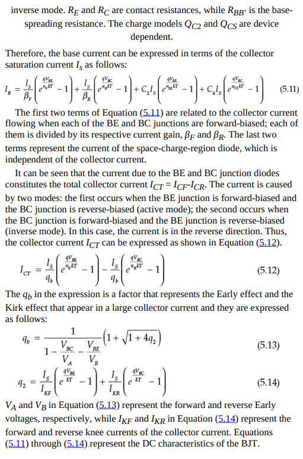

(TODO)

# 晶体管模型

## FET
### 增强型
MOSFET，原理是VGS控制导电沟道宽度（耗尽层再吸一点电子就变成反型层，这一层电子从两个N型区吸收），当VDS>VGS即VD>VG的时候被夹断（也就是D那里的电子不被吸引出去），进入饱和区，VDS增大电流不大变

初始导电沟道不形成，VGS>VTH的时候才形成。工作在开关模式是VGS决定开关上限电流，只要工作电流小于上限电流就是开关模式，然后VGS决定等效电阻；工作在放大模式是加直流偏置的时候VD>VG。

一般用于开关。因为gate的电容较大，不用于高频放大器

### 耗尽型
JFET/MESFET，其中JFET的栅极是pn结，MESFET的栅极是肖特基结，速度更快。然后GaAs MESFET使用衬底砷化镓，电子迁移率更高，适用于微波电路

工作原理是栅极不加电压时，外延层（n型）电子为多子，沟道宽度最宽。栅极加负压后，栅极pn结反偏，形成耗尽层，沟道宽度变窄。施加小于阈值电压的负压后，沟道消失。如果栅极加正压，则pn结导通，不是正常的工作模式。

如果漏极加正压，靠近漏极的耗尽层变宽，对应的就是Rds变大。加超过一定阈值的正压之后进入饱和区，电流几乎不变

MESFET之所以可以应用在微波电路，是因为肖特基结的反偏电容很小

#### 直流偏置
也就是设置VDS和IDS

一般来说，偏置电流越大，跨导（增益）越高。但是看这个MESFET的图好像变化不大，可以看作跨导恒定，电流与输入电压线性。VDS就是输出的最大电压，选到进入饱和区的电压。然后再根据输出的最大电压以及负载阻抗（这个好像是要调阻抗匹配的？这是后一步骤，那输出电流振幅怎么确定？）确定输出电流振幅，然后偏置电流起码要比这个输出电流振幅要大。以及注意这是小信号放大，功率不要超了，不然VGS会>0发生什么不好的后果。

#### 小信号等效电路

输入阻抗：相当于引线电感串联肖特基电容串联衬底电阻
S参数在等电阻圆上运动，过实轴的时候是谐振点

输出导纳：Rds并联Cds。Rds是那个IV特性在饱和区的斜率，我感觉都差不多，好像偏置电流高一些Rds也高一些。
S参数在等导纳圆上运动，从实轴电阻点沿电容方向运动到短路点。但因为引线电感的影响，所以只是刚开始是沿等导纳圆向短路点方向运动，频率高了那个Rds开始无关紧要，约等于一个电感串一个电容，在等电阻圆上运动。过实轴的那个点为谐振点。

S21在低频下是-2gmZ0，高频的时候输出并联阻抗变小（电容），增益变小，同时也有输入端的影响

S12在低频时是2jwCgdZ0

#### 大信号等效电路

### 转折频率
电流增益为1的时候，即$(\dfrac{1}{jwC_{gs}}+R_i)y_m=1$

## BJT
硅的晶体管工作频率稍微低一些，还有GaAs HBT能用在>10GHz的场合

### 原理

感觉偏置电流越大gm越大，因为电流放大倍数大致是定的，那么那条vbe-ibe曲线斜率越大，跨导越大

### 小信号等效电路
主要因为在高频应用，Cpi的影响远大于gpi，所以省掉gpi

S11与FET差不多

S22因为刚开始是RB+Z0的影响大，所以在等电阻圆上动。后来gc的影响大，在等电导圆上动。最后因为引线电感的影响，又穿过实轴，类似LC串联的等电阻圆

### 大信号等效电路

### 转折频率

电流增益为1的时候，即$\dfrac{g_m}{jwC_{\pi}}=1$