# 小信号放大器

## 晶体管模型
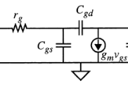

### 输入模型

米勒简化：假设电压放大倍数为k(有相位的，比如负载为R就是-180度)

反馈电容那一路的电流可以等效为并联(1-k)Cgd（但是不意味着等效电路就是这样，只是输入可以这样看）

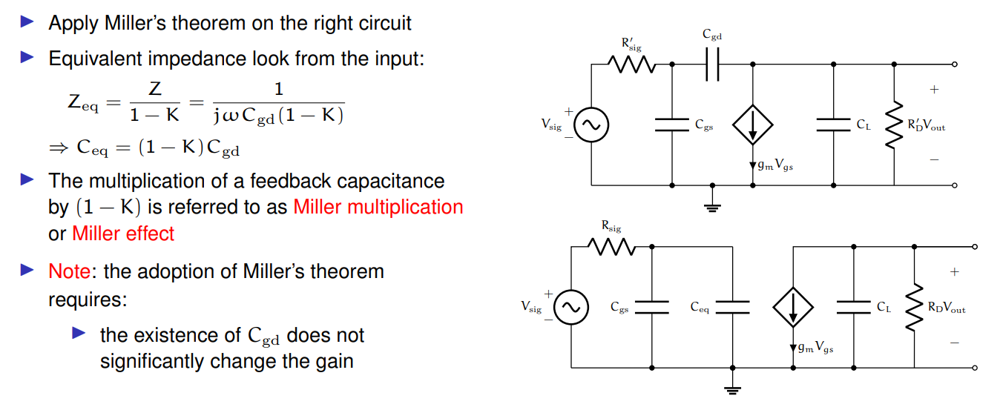

### 输出模型

假设输出导纳非常大，远大于反馈电容。那么输出端Cgd可以当作没有。就可以看作电压控制电流源。如果考虑iv曲线有一定斜率，就要加入输出导纳

一般来说，后一级有pf级电容，这个电容作为负载也会降低增益

然后向输入级的反馈电容也会对这一级的导纳产生影响

以及本身的Cds

### 增益

最大电压增益：$A_v=g_mr_o$

3db转折频率为fT，然后20dB/dec下降。这是因为输入电阻电容和输出电阻电容导致的极限

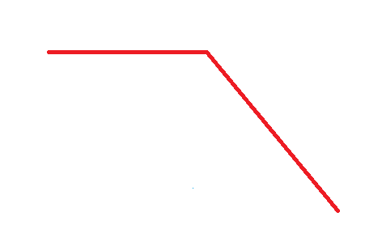

这个输入电容对增益的影响可以用输入阻抗匹配来解决，下面会介绍输入串电感和源端/发射极串电感。

然后输出电容对增益的影响可以用电感负载来解决，但是代价就是窄带。

### 带宽

由于输入电容和米勒电容，$ f_T=\dfrac{1}{r_g(C_{gs}+(1-k)C_{gd})} $

其中$k=g_mZ_{out}$

## 直流偏置选取与方法

（TODO）

电流镜

## 中频放大器

### 设计挑战
相比低频放大器而言，寄生参数（输入输出电容）会降低增益/带宽，同时反馈电容会影响稳定性。

### 设计指标
* 高增益
* 高带宽
* 稳定性

不考虑噪声和输入输出阻抗匹配

### 电路结构

目标就是，输出电压尽可能大，且输出电阻尽可能大，且带宽尽可能大

#### 单调谐放大器

使用LC并联谐振作为负载，为了抵消后级负载电容影响。尤其当C远大于后级负载电容的时候，后级负载电容就约等于没影响。那么选取LC的值可以控制Q，继而控制增益。

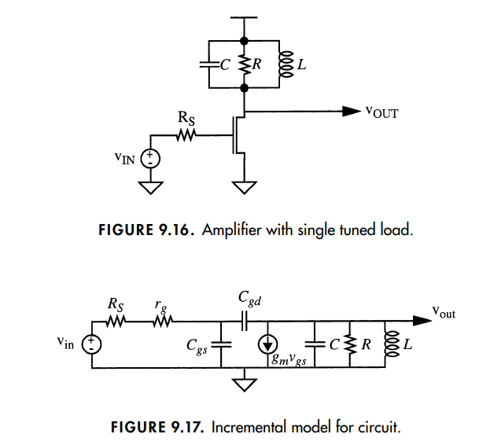
$$
C_{eq}=(1+g_mR)C_{gd}
$$

##### 增益

在谐振频率$w_0=\dfrac{1}{\sqrt{LC}}$附近
$$
A_v=\dfrac{g_mR/(1+jQ\tfrac{2\Delta w}{w})}{1+jwR_{in}C_{in}}
$$
其中$R_{in}=R_s+r_g,C_{in}=C_{gs}+(1+g_mR)C_{gd}$

也就是最大增益还是在晶体管最大增益的曲线上的一个峰（这个峰是负载的谐振特性导致的），主要受到输入电容的影响导致衰减

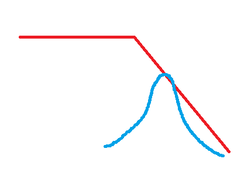

感觉这个谐振回路就是起到作为一个大负载，提高增益的作用。如果是一个电流源理论上能实现红色曲线，不知道为什么不使用电流源

我仿真了一下，在高频增益下降厉害，因为电流镜在高频电容效应很明显

##### 带宽

$$
BW=\dfrac{f_0}{Q}
$$

Q为输出级品质因素，包括晶体管的输出阻抗，谐振回路的阻抗和后一级的输入阻抗

##### 稳定性

因为振荡是当信号源为0也就是电压源为0短路的时候，输入阻抗为负值的时候。也就是信号源导纳//输入电容//反馈负阻。不能看成串联模型

当$Z_{out}$非常倾向电感性的时候，即频率小于谐振频率的时候，米勒电容反馈回去会倾向于负阻。令$C_g=C_{gs}+C_{gd}$

输入导纳：
$$
Y_{in}=G_{in}+jwC_{in}
\\=\dfrac{1}{R_s+r_g}+jw(C_{gs}+C_{gd}(1+g_mZ_{out}))
\\=\dfrac{1}{R_s+r_g}-w^2g_mLC_{gd}+jwC_g
$$

在上述电感性的假设下，$w^2g_mLC_{gd}<w_0^2g_mLC_{gd}=\dfrac{g_mC_{gd}}{C}$，让这个数小于$\dfrac{1}{R_s+r_g}$即可（这点存疑，未来再思考）

这样可以看出，$g_m$越小，反馈电容越小，C越大，稳定性越好？本质还是电感小了，稳定性就上去了。

我感觉，这个负阻不是越负越不稳定，而是只要变化区间使得总阻抗存在零阻就行？主要是考虑电导与电阻的负阻的一些矛盾，让我不大清楚

**怎么改善稳定性问题？**

让$Z_{out}$不那么电感性：比如负载并联RLC增大电容并降低电感，比如增加G也就是降低R（这意味着降低增益）

让$Z_{in}$不那么电感性：输入串联或并联电阻，会抵消输入源阻抗的影响（为啥$Z_{in}$要电感性才会振荡？我猜振荡条件，当阻抗没有抗性成分的时候，阻抗是负阻（我感觉器件非线性会导致负阻变零阻稳定振荡）。抗性成分起到选频的作用）

具体阻抗和振荡条件未来再推吧（TODO）

别人是这么说的

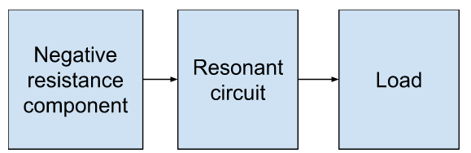

#### 级联

增益相乘（把后级输入电阻考虑进去的增益）

带宽缩小

稳定性值得考量（因为前一级的输出阻抗有电感成分，以及后一级输入阻抗可能有负阻成分。必要可以考虑做成无条件稳定的版本）

## LNA
### 设计挑战

* 相比中频放大器，这个往往指微波放大器。因为输入电容的影响，导致增益非常低，所以需要抵消输入电容影响。因为传输线效应，以及对功率增益的追求，需要做阻抗匹配。
* 而且还有低噪声的追求
* 因为上到了更高的频段，反馈电容的效应也会越明显。稳定性是个比较大的问题。

### 设计方法

* 降低反馈电容影响：共射的负载接共基电路
* 提高稳定性：输入串/并电阻，输出并电阻
* 提高增益：输入输出阻抗匹配
* 降低噪声：输入匹配接近最佳噪声匹配点

### 基于器件模型的设计方法

#### 共射共基电路

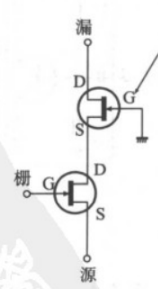

使得米勒电容的k=-1

#### 稳定性指标

无条件稳定：

* 输出负载接任何正阻抗，输入阻抗不会出现负阻
* 输入源阻抗为任何正阻抗，输出阻抗不会出现负阻

(TODO 基于阻抗的稳定性判定方法)

提高稳定性方法：

* 输入串/并电阻
* 输出并电阻

#### 输入输出匹配方法

**输入匹配：**

源电感反馈，可以控制阻抗实部的值

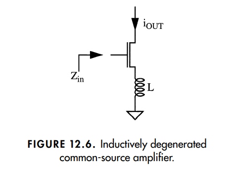

计算得，
$$
Z_{in}=jwL+\dfrac{1}{jwC_{gs}}+\dfrac{g_m}{C_{gs}}L
$$

调整串联谐振的谐振频率：串电感（之所以不是串电容，因为本来就是为了让栅极获得最大电压，也就是那个电容获得最大电压。如果串了个小电容，虽然能提高谐振频率，但是与栅极电容分压了。）

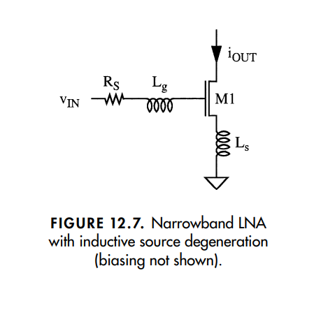

总的放大级跨导：
$$
{g_m}'=g_mQ_s=\dfrac{g_m}{w_0C_{gs}(R_s+\dfrac{g_m}{C_{gs}}L_s)}=\dfrac{g_m}{w_0C_{gs}(R_s+w_TL_s)}
$$
**输出匹配：**

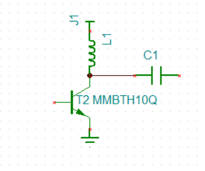

**合起来：**

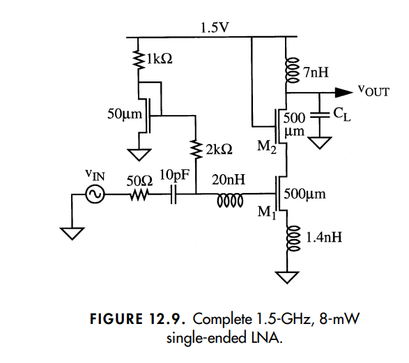

#### 最大增益

最大电压增益(假设阻抗匹配)：
$$
\dfrac{V_o}{V_s}={g_m}'\dfrac{R_o}{2}\sqrt{\dfrac{R_s}{R_o}}
\\=\dfrac{g_m\sqrt{R_o/R_s}}{4w_0C_{gs}}
\\=\dfrac{w_T}{w}\dfrac{\sqrt{R_o/R_s}}{4}
\\=\dfrac{A_{v_{max}}}{4w_0C_{gs}\sqrt{R_oR_s}}
$$

随便估算一下，$g_m=10m,R_o=100k,A_{v_{max}}=1000,R_s=50,w_0=2\pi*1G,C_{gs}=1p$，则$\dfrac{V_o}{V_s}\approx 10=26dB$

| freq | gain(dB) |
| ---- | -------- |
| 1G   | 26       |
| 2G   | 20       |
| 10G  | 12       |

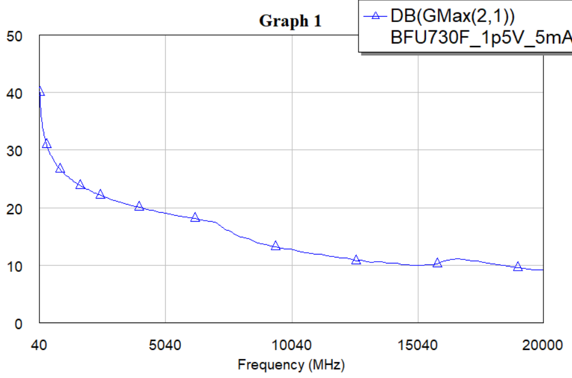

所以那些超1G的LNA增益在十几dB非常合理

超10G的LNA感觉只能多级？不然增益太低了？

阻抗多少不匹配对增益的影响，那么就要用到微波理论的那堆S参数了

(TODO)

#### 噪声系数

**MOS噪声模型：**

（TODO）

漏极噪声：
$$
\bar i_{nd}^2=4kT\gamma g_{d0}B
$$
栅极噪声：
$$
\bar i_{ng}^2=4kT\delta g_{g}B
$$

其中$g_g=\dfrac{w^2C_{gs}^2}{5g_{d0}}$

相关系数：

（TODO 中间的推导 在thomas lee的书里有，但好复杂）

最后推导出
$$
F_{min}\approx 1+\dfrac{2}{\sqrt{5}}\dfrac{w}{w_T}\sqrt{\gamma \delta (1-|c|^2)}
$$
其中$w_T=\dfrac{g_m}{C_{gs}}$，可以看作某种转折频率。是不是$w_T/w$在增益里似曾相识，这个越大，增益越大，噪声越小

**最佳噪声匹配（输入阻抗）**

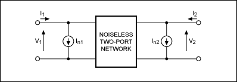

 一个噪声双端口网络也可以表示为一个无噪声双端口网络加外部电流噪声源In1和In2

​								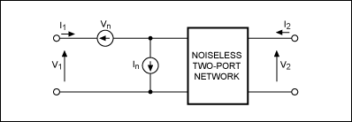 

同样，一个噪声双端口网络还可以表示为一个无噪声双端口网络加输入端上的外部噪声源Vn和In。

1. 二端口网络用Z矩阵刻画，因为这是线性电路，所以[V]=[I][Z]+内部源的贡献，这个内部源的贡献等效为外部输入输出串联电压源；

2. 当二端口网络用Y矩阵刻画，[I]=[V][Y]+内部源的贡献，这个内部源的贡献等效为外部输入输出并联电流源；

3. 当二端口网络用ABCD矩阵刻画
    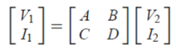
    内部源会在这个式子后面加上一项内部源的贡献，就等效为输入的串联电压源和并联电流源

  

(TODO 为什么噪声不依赖负载？那个noiseless network看进去也是有输入阻抗的吧)

我们在讨论噪声圆的时候，其实是固定放大电路的输入阻抗（负载阻抗），改变源阻抗。但是所谓改变源阻抗，不是说焊上特定的电阻，因为源内阻越大，最大输出功率越小。我们不希望损失功率，所以使用阻抗变换电路改变源阻抗。改变源阻抗的同时也改变了源电压。比如之前是Vs0R0，变换成Rg，而源功率不变，也就是V2/R不变，那么现在的Vs^2=Vs0^2/R0xRg（读者也可以自己验证一下，源的内阻的热噪声功率经过无耗阻抗变换电路之后也没有变）

我们再来算一下信噪比：
$$
V_{ntot}=\sqrt{4kTBR_g+V_n^2+I_n^2R_g^2}
\\SNR=\dfrac{V_s^2}{V_{ntot}^2}=\dfrac{\tfrac{V_{s0}^2}{R_0}R_g}{4kTBR_g+V_n^2+I_n^2R_g^2}
\\=\dfrac{\tfrac{V_{s0}^2}{R_0}}{4kTB+\tfrac{V_n^2}{R_g}+I_n^2R_g}
\\F\le 1+\dfrac{V_nI_n}{2kTB}
$$

为了使SNR最大，也就是分母最小，也就是 Rg=Vn / In。

### 基于S参数的设计方法（数据驱动）

（TODO 设计原理）

#### 1. 确定直流偏置 {-}
##### 1.1 确定直流偏置参数 {-}
选择有NF数据的偏置电压VCE或者选择VCEmax/2
选择有NF数据的偏置电流IC或者选择ICmax/2或者选择ICtyp

画出各偏置下的GPmax和NF，确保选取的偏置的极限满足这些要求

##### 1.2 确定直流偏置电路 {-}

#### 2. 确定输入输出阻抗 {-}
##### 2.1 确定稳定性 {-}
画该频率下的输入阻抗稳定圆和输出阻抗稳定圆。
画K factor关于频率的图，>1则在该频率点无条件稳定

如果不是无条件稳定，且有无条件稳定的要求，需要输入输出加电阻（在输出并联电阻能减少对NF的影响）/源极射极加电感/或者选型就换晶体管

##### 2.2 画输入阻抗的增益圆和噪声圆，选取满足要求的 $\Gamma_s$ {-}

##### 2.3 根据选取的 $\Gamma_s$ 设计输入匹配电路 {-}

##### 2.4 测量此时的S22，设计输出匹配电路 {-}

##### 2.5 看一眼此时的S21,NF是否大致满足要求。然后把S11,S22,S21,NF的要求给optimizer继续优化参数 {-}

输入输出匹配：

增益：

噪声：

#### 3. 把几大指标仿真出来，确定指标满足需求 {-}
* 增益
* 稳定性
* 噪声
* 带宽
* 失真（P1dB，IIP3）

直接使用spice模型进行非线性仿真，包括AC和transient，如果有振荡的话不给激励瞬态都有输出。

如果不幸振荡了，就要换 $\Gamma_s$ ，或者修改输入匹配电路，使得具有一些陷频特性

（这里增益要+6dB，也就是15.5dB，因为这个gain是相对信号源的幅度，不是功率）

#### 4. layout，然后电磁仿真 {-}

### 从S参数提取电路参数

（TODO）

## 参考文献

* the design of cmos radio-frequency integrated circuits
* microwave circuit design: a practical approach using adsq
