# Mixer

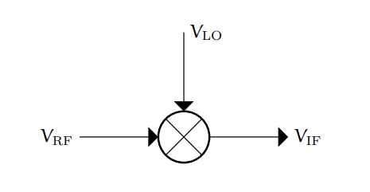

RF经过LO上下变频到IF

## 混频产生原理

### 非线性

$$
V=f(LO,RF)
$$

产生RF,LO的直通，nRF和nLO的谐波，nRF与mLO的交叉。也就是一堆谐波

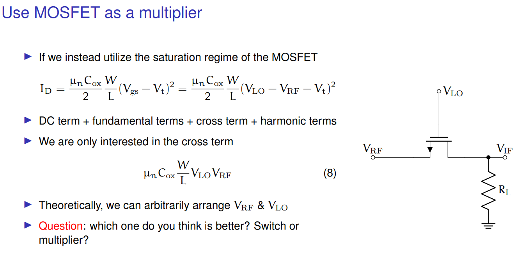

当偏置MOS在饱和区的时候就是这个非线性模型

### 时变（开关）

比如开关

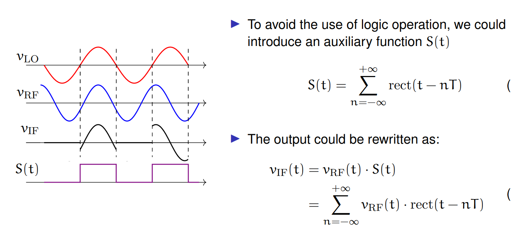

最后输出频率就是$\pm w_{RF} \pm nw_{LO}$，$n=0,1,2...$（通常选取LO频率高于RF，为了防止混叠）

也就是RF直通，RF与nLO的交叉

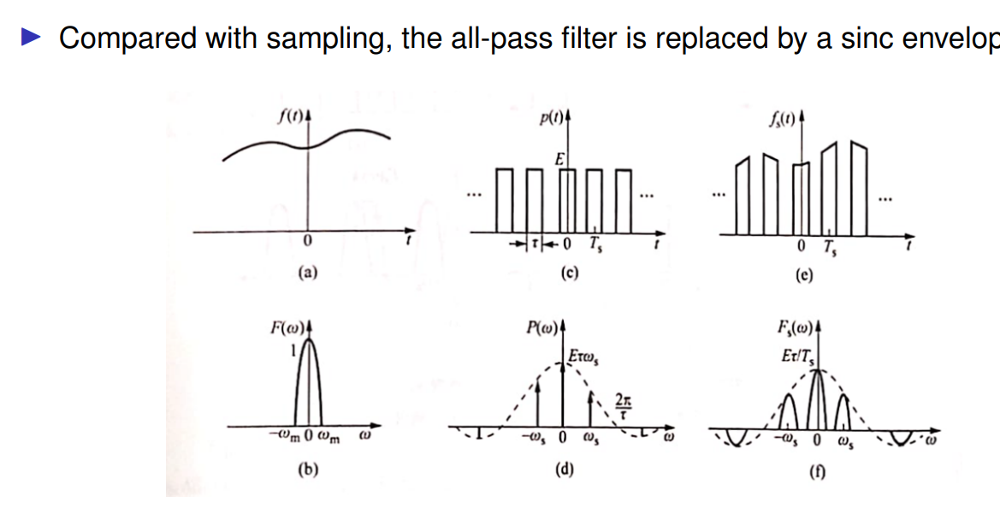

如果把矩形波的占空比慢慢减小，会发现越来越接近采样函数。频谱延拓也越来越均匀。就约等于可以看成采样，只不过频谱sinc包络版

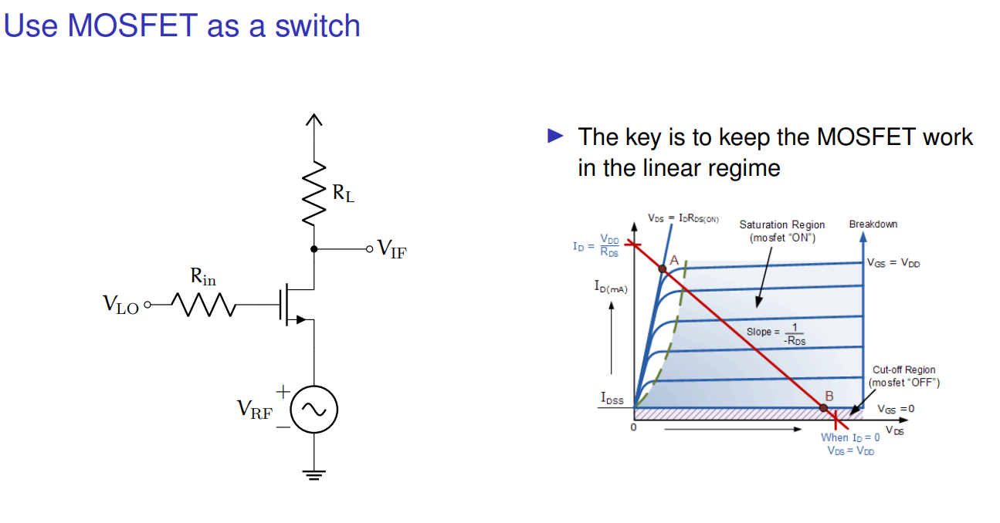

当偏置MOS在线性区就能实现开关模型

## 指标

### conversion gain

$$
conversion\ gain=\dfrac{V_{IF}}{V_{RF}}=conversion\ loss*A_v
$$

无源就只有conversion loss，有源就相当于conversion loss后面接了一级放大器，来弥补这个损失

### NF

略大于conversion loss，比如有源还会加入晶体管噪声

### 谐波抑制

可以看到输出会有多少其他的干扰分量

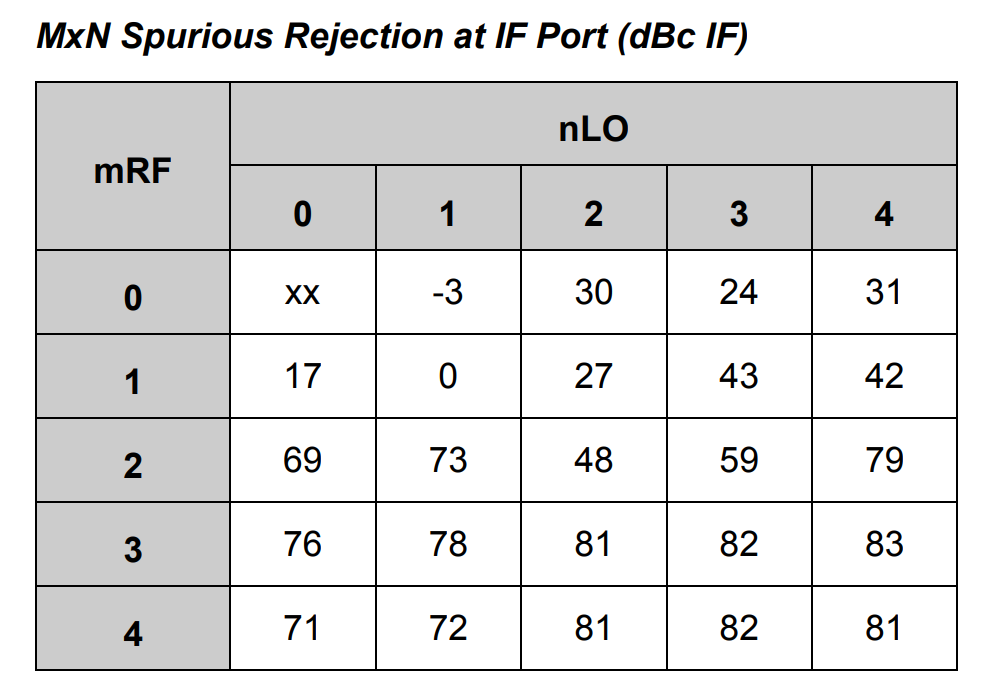

## 抑制干扰

### 干扰源

* LO-RF泄露：会在IF产生干扰DC分量（零中频接收机的缺陷）
* LO-IF泄露：如果LO和IF频率相近，则不能被滤掉（所以超外差需要频率规划）
* RF-LO隔离：如果RF和LO在同一频率，则RF会干扰LO的锁定（零中频接收机的缺陷）
* RF-IF隔离：（好像影响不大？反正不同频段）
* IF-LO
* IF-RF
* 镜像频率：靠频率规划/使用抗镜像结构（超外差，零中频接收机没这个烦恼。如果高边注入，LO频率高于RF，镜像好滤除一些）

### 单平衡结构

$$
f(RF,LO)=DC+RF奇次LO偶次+RF偶次LO奇次+RF奇次LO奇次+RF偶次LO偶次
\\f(RF,\overline{LO})=DC+RF奇次LO偶次-RF偶次LO奇次-RF奇次LO奇次+RF偶次LO偶次
\\\implies f(RF,LO)-f(RF,\overline{LO})=2(RF偶次LO奇次+RF奇次LO奇次)
$$

可以干掉LO-RF泄露导致的DC干扰（会在符号解调上叠加一个offset向量），以及其他LO的偶次谐波交叉项

### 双平衡结构

$$
(f(RF,LO)-f(RF,\overline{LO}))-(f(\overline{RF},LO)-f(\overline{RF},\overline{LO}))=4RF奇次LO奇次
$$

可以干掉LO-RF泄露导致的DC干扰和LO-IF泄露的干扰，以及其他RF的偶次谐波交叉项

### 抗镜像结构

（TODO）

涉及到一堆90度移相器，在频谱中把镜像抵消掉

## 电路

### 无源

#### 单开关混频器

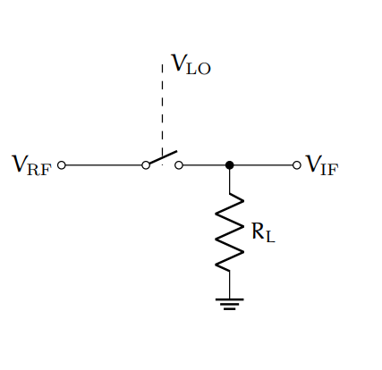

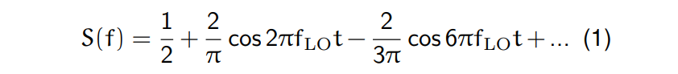
$$
conversion\ gain=1/\pi=-10dB
$$
但是会有RF feed through，由于LO的直流分量

#### 双开关混频器（单平衡）

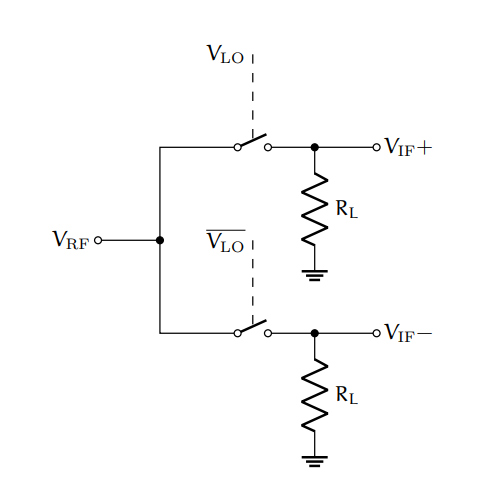

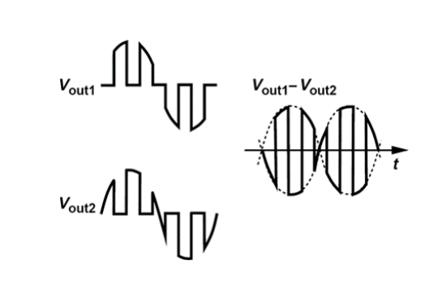
$$
conversion\ gain=2/\pi=-4dB
$$

**二极管实现**

不过这个是RF的反相

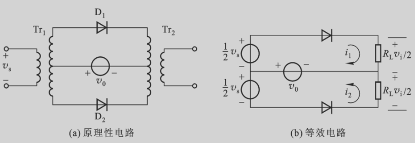

#### 四开关混频器（双平衡）

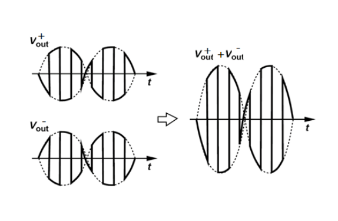
$$
conversion\ gain=-4dB
$$

**晶体管实现**

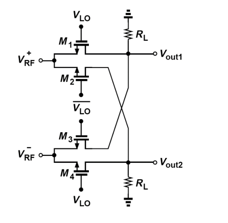

### 有源

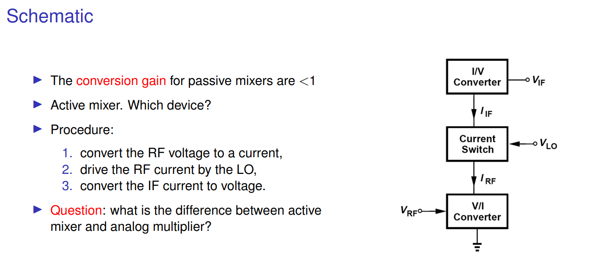

#### 双开关混频器（单平衡）

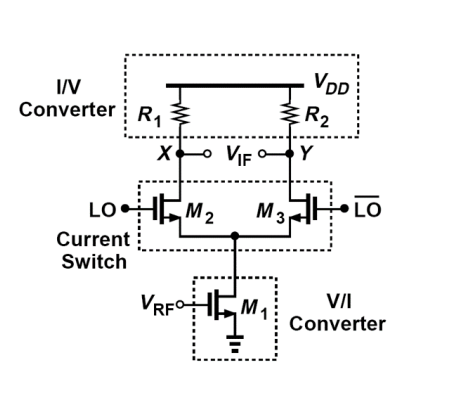
$$
conversion\ gain=\dfrac{2}{\pi}A_v
$$

#### 四开关混频器（双平衡）

Gilbert cell:

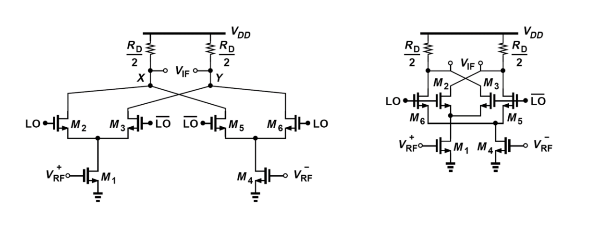