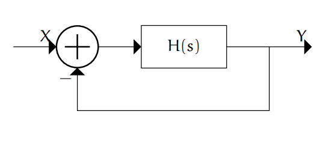
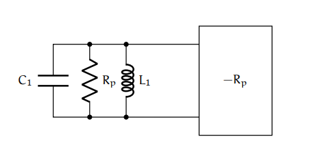
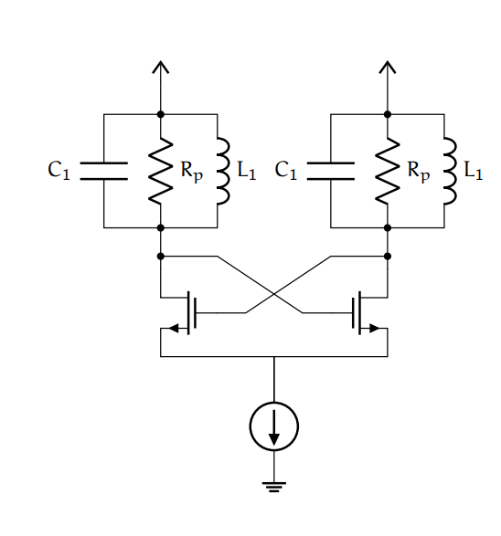
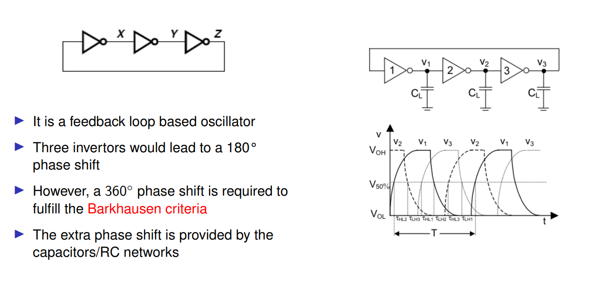
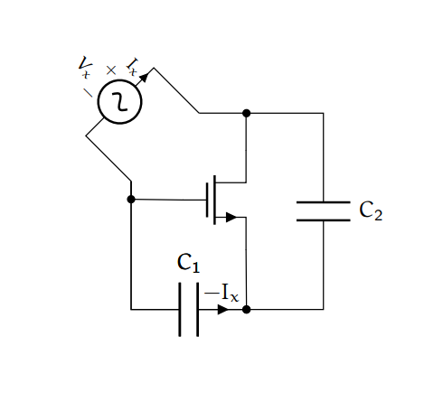
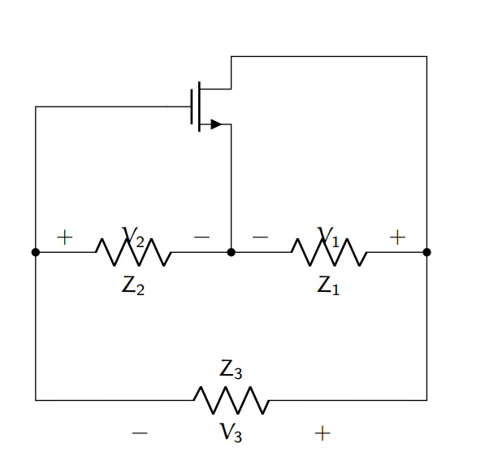
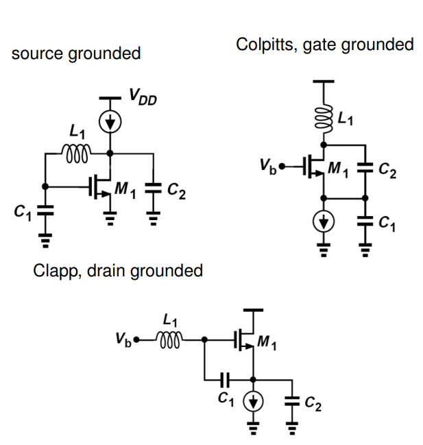
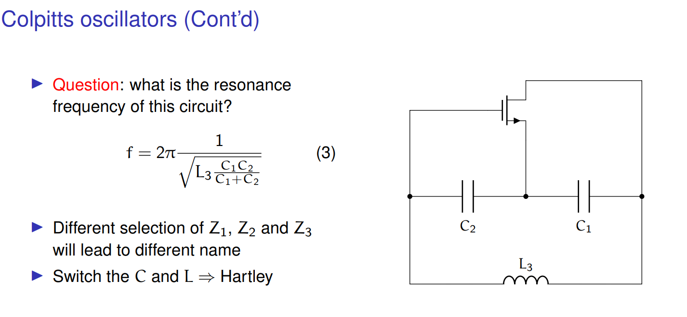
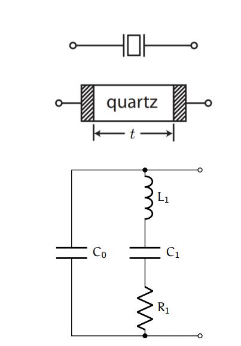
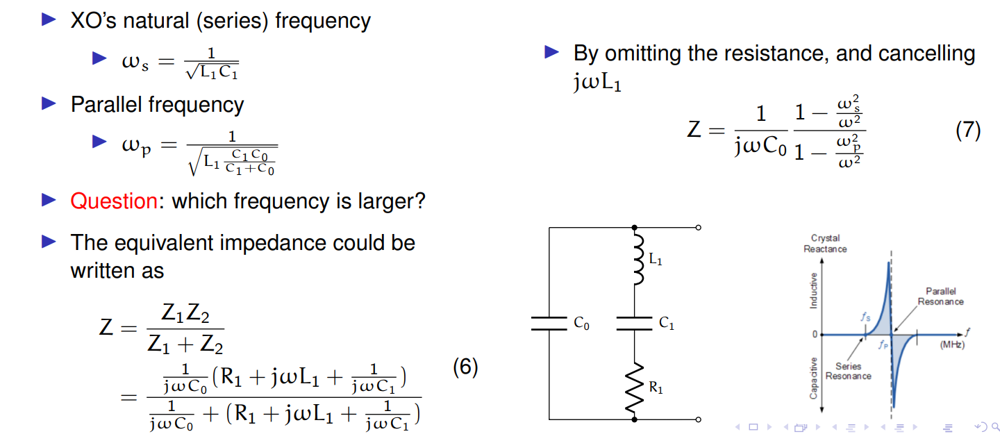

# Oscillator

## 振荡产生原理

### 系统角度

环路开环增益的频率响应在-180度的时候增益大于1，就会振荡

所以思路就是增益+360度相移反馈+选频网络

### 负阻角度

所以思路就是负阻+选频网络，具体分为串联谐振和并联谐振。串联谐振负阻绝对值需要大于寄生电阻，并联谐振负阻绝对值需要小于寄生电阻。选频网络Q越大频率稳定性越高。

## 指标

### 频率稳定性

### 相位噪声

## 实现

### cross coupled oscillator

### ring oscillator

### 三点式振荡器

#### 实现负阻的基础单元

$$
Z_{in}=\dfrac{1}{jwC_1}+\dfrac{1}{jwC_2}-\dfrac{g_m}{w^2C_1C_2}
$$
相当于C1串C2串负阻

#### 三点式基本结构

(TODO 为什么Z2和Z1一定同性质电抗，而Z3反性质)

#### 具体实现结构

### 晶振

#### 频率响应

#### 晶振电路

### VCO

数学模型：
$$
w_{out}=kV+w_0
$$

使用变容器，比如pn结反偏，或mos管

#### VCO电路

