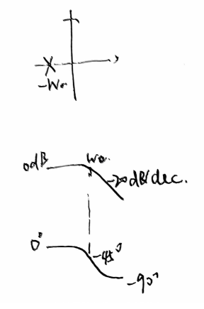
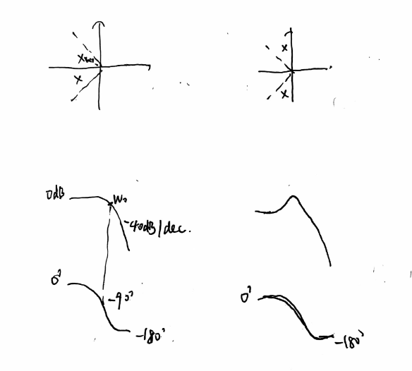
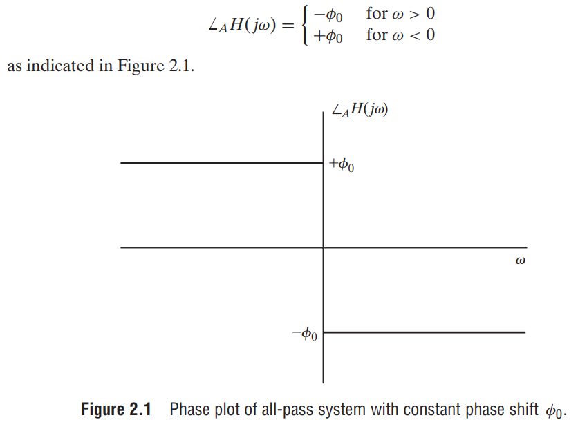
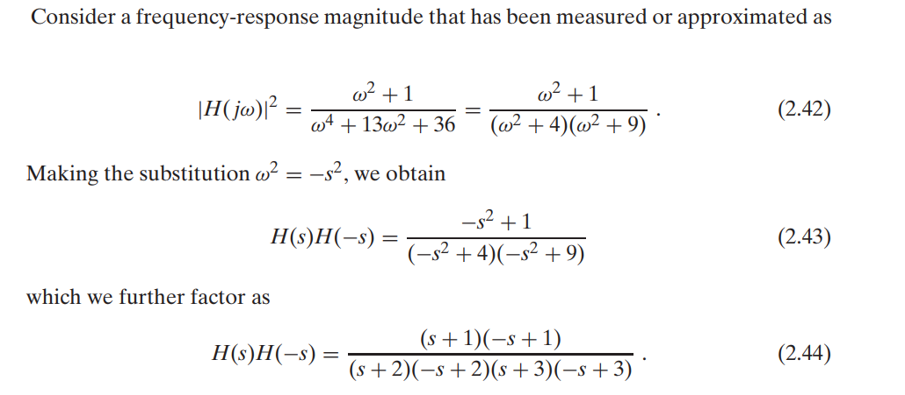

# s变换（Laplace Transform）

## 定义
$$
F(s)=\int_{-\infty}^{\infty} f(t)e^{-st}dt
\\f(t)=\dfrac{1}{2\pi j}\int_{\sigma-j\infty}^{\sigma+j\infty}F(s)e^{st}ds
$$
收敛域ROC：因果信号最右极点右，非因果信号最左极点左

## 应用

适于刻画半边信号（因果）瞬态响应，分析系统连接下的反馈系统的性能（快准稳）

## 性质
| 性质     | 时域                             | s域                                                          | ROC                                          |
| -------- | -------------------------------- | ------------------------------------------------------------ | -------------------------------------------- |
| 时移     | $f(t-t_0)u(t-t_0)$               | $e^{-st_0}F(s)$                                              | 不变                                         |
| s域平移  | $e^{s_0t}f(t)$                   | $F(s-s_0)$                                                   | 从$Re(s)>\sigma_0$到$Re(s)>Re(s_0)+\sigma_0$ |
| 尺度变换 | $f(at)$                          | $\dfrac{1}{a}F(\dfrac{s}{a})$                                | $Re(s)>a\sigma_0$                            |
| 时域反向 | $-f(-t)$                         | $F(s)$                                                       | ROC反向                                      |
| 时域微分 | $\dfrac{f(t)}{dt}$               | $sF(s)-f(0^-)$                                               | 可能变大                                     |
| s域微分  | $-tf(t)$                         | $\dfrac{dF(s)}{ds}$                                          | 不变                                         |
| 时域积分 | $\int_{-\infty}^{t}f(\tau)d\tau$ | $\dfrac{F(s)}{s}+\dfrac{f^{(-1)}(0^-)}{s}$ 其中$f^{(-1)}(0^-)=\int_{-\infty}^{0^-}f(\tau)d\tau$ | 不变                                         |
| s域积分  | $\dfrac{f(t)}{t}$                | $\int_{s}^{\infty}F(n)dn$（这里积分路径是什么？与虚轴平行直线？） |                                              |
| 时域卷积 | $f_1(t)\otimes f_2(t)$           | $F_1(s)F_2(s)$                                               | ROC取交集                                    |
| 时域乘积 | $f_1(t)f_2(t)$                   | $\dfrac{1}{2\pi j}\int_{\sigma-j\infty}^{\sigma+j\infty}F_1(n)F_2(s-n)dn$ | $Re(s)>\sigma_1+\sigma_2$（ROC右移）         |

| 定理                 |                                                       |
| -------------------- | ----------------------------------------------------- |
| 初值定理（因果信号） | $f(0^+)=\underset{s\rightarrow \infty}{lim}sF(s)$     |
| 终值定理             | $f(+\infty)=\underset{s\rightarrow \infty}{lim}sF(s)$ |

## 变换对
下面只记录因果信号，对应非因果信号的变换对按照$L(-f(-t))=F(s)$
| f(t)                              | F(s)                   | ROC        |
| --------------------------------- | ---------------------- | ---------- |
| $\delta(t)$                       | $1$                    |            |
| $\delta(t-T)$                     | $e^{-sT}$              |            |
| $\sum_{n=0}^{\infty}\delta(t-nT)$ | $\dfrac{1}{1-e^{-sT}}$ | $Re(s)>0$  |
| $u(t)$                            | $\dfrac{1}{s}$         | $Re(s)>0$  |
| $e^{-at}u(t)$                     | $\dfrac{1}{s+a}$       | $Re(s)>-a$ |
| $t^nu(t)$                         | $\dfrac{n!}{s^{n+1}}$  | $Re(s)>0$  |
| $sin(wt)u(t)$                     | $\dfrac{w}{s^2+w^2}$   | $Re(s)>0$  |
| $cos(wt)u(t)$                     | $\dfrac{s}{s^2+w^2}$   | $Re(s)>0$  |

## 传输函数
对于因果信号和无源因果系统，可以用传输函数表达。把复杂的线性动力学方程可以转化为简单的传输函数的乘积

对于有理分式：

### 分子分母系数表达

$$
F(s)=\dfrac{b_0+b_1s+...+b_ms^{m}}{a_0+a_1s+...+a_ns^n}
$$

### 零极点表达

$$
F(s)=k\dfrac{(s-z_1)...(s-z_m)}{(s-p_1)...(s-p_n)}
$$

### 拆解成分式和

$$
F(s)=\dfrac{k_{11}}{s-p_1}+\dfrac{k_{12}}{(s-p_1)^2}+...+\dfrac{k_{1n_1}}{(s-p_1)^{n_1}}
\\+\dfrac{k_{21}}{s-p_2}+\dfrac{k_{22}}{(s-p_2)^2}+...+\dfrac{k_{2n_2}}{(s-p_2)^{n_2}}
\\+....
$$

这样拆解方便转换成时域响应：
$$
一阶衰减：\dfrac{k}{s-p}\iff ke^{pt}u(t)
\\二阶谐振：\dfrac{as+b}{s^2+w^2}\iff (acos(wt)+\dfrac{b}{w}sin(wt))u(t)
\\二阶振荡衰减/临界衰减/衰减：\dfrac{as+b}{s^2+2\gamma s+w^2}=\dfrac{a(s+\gamma)+(b-a\gamma)}{(s+\gamma)^2+(w^2-\gamma^2)}
\\=\begin{cases}
(acos(\beta t)+\dfrac{b-a\gamma}{\beta}sin(\beta t))e^{-\gamma t}u(t)=ke^{-\gamma t+j(\beta t+\phi)}u(t) & w^2-\gamma^2>0, \beta=\sqrt{w^2-\gamma^2}\\ 
(k_1t+k_2)e^{-\gamma t}u(t) & w^2-\gamma^2=0\\
(k_1e^{-\gamma_1 t}+k_2e^{-\gamma_2 t})u(t) & w^2-\gamma^2<0\\
\end{cases}
$$

## 频率响应
### 零极点频率响应

首先把传输函数化为零极点表达。频率响应即虚轴上的值$F(jw)$

#### 一阶原点极点

积分器$\dfrac{k}{s}$

* 幅频：-20dB/dec
* 相频：-90 deg

* 时域：直流分量$ku(t)$

更高阶不可实现，因为冲激响应发散

#### 一对虚轴极点

无损谐振器/有源谐振器$\dfrac{as+b}{s^2+w^2}$

* 时域：稳态振荡 $(acos(wt)+\dfrac{b}{w}sin(wt))u(t)$

#### 一阶左半平面实轴极点

一阶低通$\dfrac{k}{s+a}$

* 幅频：在转折频率a后-20dB/dec
* 相频：0->-90 deg
* 群时延：在转折频率a达到峰值

* 时域：衰减瞬态分量$ke^{-at}u(t)$

#### 一对左半平面共轭极点

二阶振荡衰减/临界衰减/衰减（低通）：$\dfrac{as+b}{s^2+2\gamma s+w^2}$

* 低通转折频率约等于极点矢量长度
* 当极点矢量与实轴负半轴的角度$\theta<45^o$时
  * 幅频响应单调递减
  * 冲激响应指数衰减
  * 阶跃响应平滑上升
* 当极点矢量与实轴负半轴的角度$\theta>45^o$时
  * 幅频响应在谐振频率有峰值
  * 冲激响应振荡衰减
  * 阶跃响应会有过冲

#### 

### 相位与群时延

#### 恒定相位

$$
x(t)=s(t)cos(w_0 t-\phi_0)
$$

#### 线性相位与群时延

群时延（定义延时为+，所以是相位的负导数）：
$$
\tau_g(w)=-\dfrac{d}{dw}arg(H(jw))
$$
线性相位即群时延恒定
$$
x(t)=s(t-\tau_g)cos(w_0(t-\tau_g))
$$

如果在信号带宽内非广义线性相位（恒定群时延），会引起信号的色散

#### 广义线性相位

恒定相位与线性相位的叠加，相当于载波先恒定相移$\phi_0$，再整个信号群时延$\tau_g$
$$
x(t)=s(t-\tau_g)cos(w_0(t-\tau_g)-\phi_0)
$$

### 小带宽信号进系统后的时域输出

如果信号带宽相比系统很小，系统频率响应可以近似看作线性：

* 幅度$|H(jw)|=kw+b$
* 角度$arg(H(jw))=-\phi-\tau_g w=\dfrac{\pi}{2}-(\phi+\dfrac{\pi}{2})-\tau_g w$

组合一下，就是$H(jw)=(k*(jw)+jb)e^{-j((\phi+\dfrac{\pi}{2})+\tau_g w)}$

解释一下，相当于：（k倍微分+b倍载波移相90度）$\rightarrow $ 载波移相$-(\phi+\dfrac{\pi}{2})$$\rightarrow $ 群时延$\tau_g$

比如来解调一个FM信号$x(t)=Acos(w_ct+\phi(t))$

这个信号进系统后的输出：

因为解调FM信号使用检波方法，不关心载波的相位和群时延，我们现在只看（k倍微分+b倍移相）
$$
y(t)=-A(k(w_c+{\phi}'(t))+b)sin(w_ct+\phi(t))
\\=-A(k{\phi}'(t)+(kw_c+b))sin(w_ct+\phi(t))
$$

### 全通系统

即幅频响应为1，满足一个零点消掉一个极点，零点极点对满足关于虚轴对称（负共轭）
$$
H(s)=\prod \dfrac{s+a_k^*}{s-a_k}
$$
在极点频率群时延最高，可以用来补偿系统相频响应

### 最小相位系统

或者说是相同幅频响应下最小群时延的系统

所有零极点都在左半平面

任意系统都可以表示成最小相位系统和全通系统的乘积

### 从幅频响应得到最小相位系统的传输函数

例子：

## 信号周期延拓的拉式变换

$$
F(s)=F_1(s)\dfrac{1}{1-e^{-sT}}
$$
## 信号采样的拉式变换
$$
f_s(t)=\sum_{n=0}^{\infty}f(nT)e^{-snT}\delta(t-nT)
\\F(s)=\sum_{n=0}^{\infty}f(nT)e^{-snT}
$$

## 拉式变换与CTFT
* 当ROC包含虚轴时，代入$s=jw$即可
* 当ROC边界刚好在虚轴上，会有一堆$\delta$出现