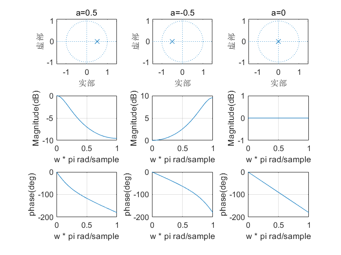
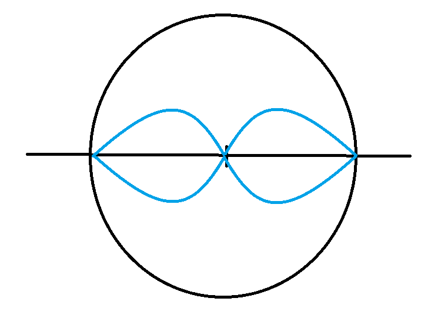
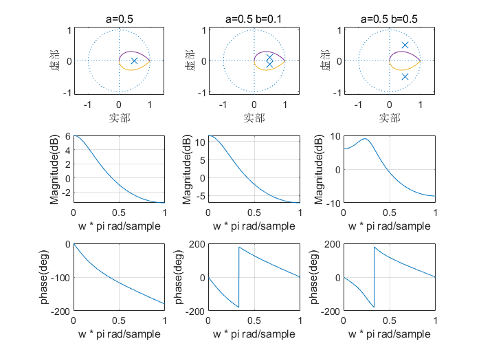

# z变换
## 定义
$$
X(z)=\sum x[n]z^{-n}
$$
反变换一般拆解成分式然后使用变换对

ROC：
* 因果信号：最外极点的圆外
* 非因果信号：最内极点的圆内

有DTFT的信号：ROC包含单位圆

## 应用

刻画离散系统与离散滤波器（尤其是IIR，FIR用有限冲激响应表示）

## 性质
| 性质     | x[n]                     | X(z)                     | $R_x$         |
| -------- | ------------------------ | ------------------------ | ------------- |
| 时移     | $x[n-n_0]$               | $z^{-n_0}X(z)$           | $R_x$         |
| 极点移动 | $a^{n}x[n]$              | $X(a^{-1}z)$             | $aR_x$        |
| 时间反转 | $x[-n]$                  | $X^{*}(1/z^{*})$         | $R_x$         |
| 共轭     | $x^{*}[n]$               | $X^{*}(z^{*})$           | $R_x$         |
| z域微分  | $nx[n]$                  | $-z\dfrac{dX(z)}{dz}$    | $R_x$         |
| 时域差分 | $x[n]-x[n-1]$            | $(1-z^{-1})X(z)$         |               |
| 时域累加 | $\sum_{-\infty}^{n}x[m]$ | $\dfrac{X(z)}{1-z^{-1}}$ |               |
| 时域卷积 | $x[n]*y[n]$              | $X(z)Y(z)$               | $R_x\cap R_y$ |

| 定理     |                                                              |
| -------- | ------------------------------------------------------------ |
| 初值定理 | $因果：x[0]=\underset{z\rightarrow \infty}{lim}X(z)\\非因果：x[0]=\underset{z\rightarrow 0}{lim}X(z)$ |
| 终值定理 | $因果：x[\infty]=\underset{z\rightarrow 1}{lim}(z-1)X(z)$    |

## 变换对

## z变换表示

### 分子分母系数表达

$$
F(s)=\dfrac{b_0+b_1z+...+b_mz^{m}}{a_0+a_1z+...+a_nz^n}
$$

### 零极点表达

$$
F(s)=k\dfrac{(z-z_1)...(z-z_m)}{(z-p_1)...(z-p_n)}
$$

### 分式和表示

$$
F(s)=\dfrac{k_{11}}{1-p_1z^{-1}}+\dfrac{k_{12}}{(1-p_1z^{-1})^2}+...+\dfrac{k_{1n_1}}{(1-p_1z^{-1})^{n_1}}\\+\dfrac{k_{21}}{1-p_2z^{-1}}+\dfrac{k_{22}}{(1-p_2z^{-1})^2}+...+\dfrac{k_{2n_2}}{(1-p_2z^{-1})^{n_2}}\\+....
$$

## 频率响应
### 零极点定义

化成z而不是$z^{-1}$的式子，找零极点

### 零极点频率响应
对于因果信号，极点都在单位圆内。z平面圆周上$X(e^{jw})$就是频率响应

下面对时域的讨论仅讨论极点（因为极点能被拆分成独立的分式产生独立的冲激响应）

#### 原点极点

* 延时器（在s变换里原点极点是积分器，这里是延时器，其实都是一种记忆单元）

* 对频率响应无影响，贡献线性相位（极点线性延迟，零点线性超前）
* 在时域上即FIR的冲激响应部分

#### 单位圆上z=1极点

* 累加器

* 时域上贡献直流分量

#### 单位圆上z=1零点

* 差分器

#### 单位圆上共轭极点

* 时域上稳态谐振
* 频域上选频谐振器

#### 单位圆上共轭零点

* 频域上陷波器

#### 实轴上一阶极点

对于$\dfrac{1}{z-a}$

* 时域上贡献衰减指数
  * a>0，单调衰减
  * a<0，振荡衰减
* 频域如图：

**不同极点摆放位置频率响应**：

以$\dfrac{1-a}{1-az^{--1}}$为例：

观察可得：
* 极点越靠近1，转折频率越前，下降越陡峭，并且最大衰减越多
* 极点越靠近1，相位峰值越大
* 在转折频率后近似线性相位，而前面群时延变化厉害（当零极点在右半平面）

#### 实轴上一阶零点

对于$z-a$，有七种情况：

#### 一对共轭极点

设两个极点$\alpha e^{\pm j\beta}$=$a\pm jb$

在s域中，45度线是划分时域振荡衰减和纯衰减；而z域内边界线比较复杂（蓝线内单调）：

频域如图：

**相同a不同b频率响应**

**相同$\alpha$不同$\beta$频率响应**

**相同$\beta$不同$\alpha$频率响应**

**总结**

* 横坐标a决定幅频特性大致走线，衰落的快慢，从相同a不同b的那幅图可以观察出三条线非常像，尤其在频率大的时候；以及a越接近1在相同b的时候峰值会越大
* 角度$\beta$决定峰值频率，以及群时延最大的地方感觉就是峰值频率
* 当零极点作关于纵轴的水平镜像的时候，幅频响应也作关于$0.5\pi$的水平镜像

### 全通系统

零极点在一条半径上，关于单位圆对称
$$
H(z)=\dfrac{z^{-1}-a^*}{1-az^{-1}}
$$

加若干个原点零点/极点也满足定义

### 最小相位系统

所有零极点都在单位圆内

非最小相位系统转化为最小相位系统：乘全通系统

### 狭义线性相位
相位不能跳变，w=0时相位=0，直线

注意幅度项是>=0的

### 广义线性相位
也就是恒定群时延（就算相位有跳变也算）

允许A有正负

### 离散系统实现线性相位
* 对于FIR，序列满足对于中心偶对称或奇对称，则满足线性相位

  偶对称：

  奇对称：

#### 四种FIR线性相位（根据项数奇偶和序列奇对称偶对称来分）
1. **偶对称 奇数项**：
2. **偶对称 偶数项**：
3. **奇对称 奇数项**：
4. **奇对称 偶数项**：

#### 线性相位FIR频率响应 
* **偶对称 奇数项**：开始非0，PI时不一定为0；适合设计带阻，可以设计低通，高通和带通
* **偶对称 偶数项**：开始非0，PI时为0；适合设计低通，可以设计带通，不能设计高通和带阻
* **奇对称 奇数项**：开始0，PI时0；适合设计带通，不能设计低通和高通和带阻
* **奇对称 偶数项**：开始0，PI时不一定0；适合设计高通，可以设计带通，不能设计低通和带阻

#### 线性相位FIR零点分布
* 因为序列对称性，如果$z_0$是零点，那么$z_0^{-1}$也是零点
* 那么就是，本身零点是共轭对称的，又来个关于单位圆对称
