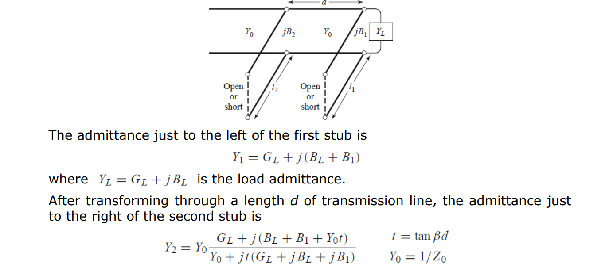
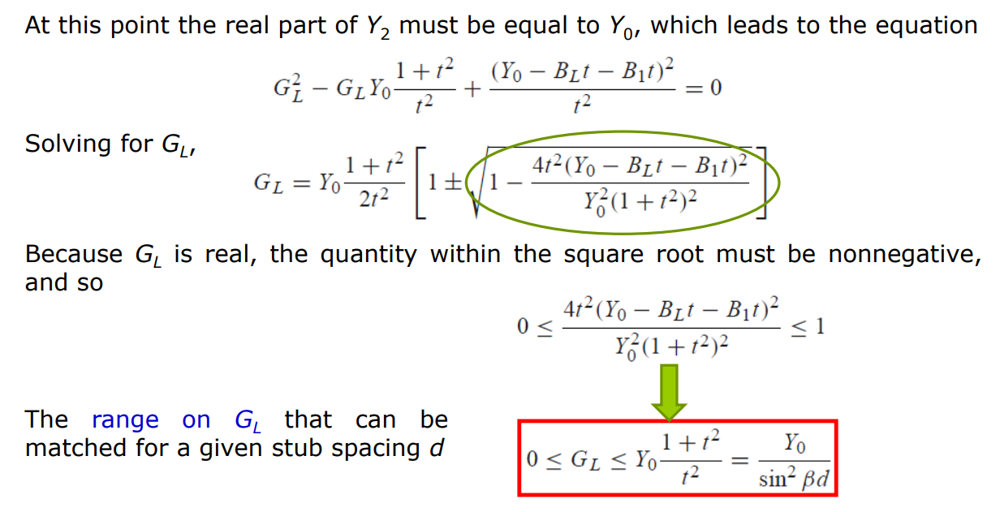
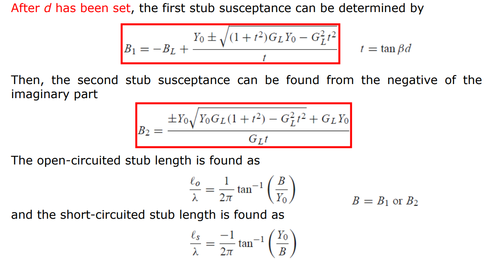

# 阻抗匹配
## L型匹配
### 匹配到Z0

B是指导纳

蓝色圆内两个解，圆外四个解

**解析解**：
(a)：先并后串
(b)：先串后并

### 与源的共轭匹配

方法：画出要匹配到的阻抗点（源阻抗的共轭），画出该点的电导圆和电阻圆，第一步匹配到这两个圆上，就可以完成匹配

绿色圆内两个解，其他四个解

**解析解**：

## 单支节匹配

长线带宽小，损耗大；虽然很多解，但是选最短最好

### 解析解

#### 并联支节

其中对于同样终端短路支节，两个解$l_{s1}+l_{s2}=0.5\lambda$
#### 串联支节

## 双支节匹配

好像带宽比单支节小

解：

## 1/4波长匹配

对于负载纯阻性
### 分数带宽

## 多截线匹配

相当于对$[\Gamma_0,\Gamma_1,...,\Gamma_N]$这个序列作傅里叶变换，相当于实现低通（相当于离散傅里叶变换，theta是频率轴也是电长度轴，关于pi/2对称）

* **Binomial Matching Transformer**:

## Tapered line
相当于对$\Gamma$进行连续傅里叶变换

## 匹配极限：Bode–Fano Criterion

匹配度越高，匹配带宽越窄：

